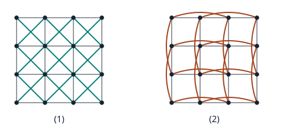
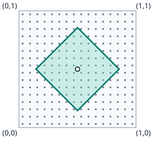

# 2024 计算机图形学 A 卷参考答案与解析

[试卷 Markdown](2024计算机图形学试卷A.md) · [原卷 PDF](2024计算机图形学试卷A.pdf) · [课程复习提纲](../../review/README.md) · [两卷考点分布与考纲总结](../README.md)

以下是按试卷题图和课程材料推导的参考答案。题号沿用原卷。选择题第 3 题依据课件同图的标注作答，第 5 题说明两处措辞的区别。

## 一、选择题（30 分）

| 题号 | 1 | 2 | 3 | 4 | 5 | 6 | 7 | 8 | 9 | 10 |
| --- | --- | --- | --- | --- | --- | --- | --- | --- | --- | --- |
| 参考选项 | D | C | A（课件用语） | B | B（见下） | C | B | D | A | C |

**1. D。覆盖测试可以对任意已定义内部的图形采样。** 设区域为 $S$，连续覆盖函数为 $\mathbf1_S(x,y)$。点采样只需在像素中心取 $\mathbf1_S(i+\tfrac12,j+\tfrac12)$。三角形的便利在于三个不共线的点确定平面，且三角形是凸集。顶点逆时针排列时，分别计算三条有向边与“边起点到采样点”向量的二维叉积，内点的三个符号相同。复杂多边形也能采样，只是可能需要三角剖分或奇偶规则等额外处理。见[第 2 讲·三角形光栅化](../../review/02-digital-drawing.md)。

**2. C。** 对最高频率为 $f_{\max}$ 的带限信号，理想条件下采样率应达到奈奎斯特条件 $f_s\ge 2f_{\max}$。预滤波先削弱目标采样率无法表达的频率。超采样则在一个像素或曝光时段内多取几个样本再平均，用有限次采样近似积分，足够高的频率仍可能漏掉。D 在曝光时段内用多个不同时刻的子帧作平均时成立；若输入帧已经发生时间混叠，再平均也无法还原真实运动。见[第 3 讲·预滤波与超采样](../../review/03-antialiasing.md)。

**3. 按课件原图选 A。** 第 4 讲第 108 页的同一幅图依次标为 **Modeling transformation → View transformation → Projection transformation → Viewport transformation**。A 正确描述了局部坐标到世界坐标的去向，卷中称作 World transformation，和原图的 **建模变换** 名称不同。在也把模型矩阵称为 world matrix 的语境下，这一选项有命名歧义。计算顺序为 $p_{\mathrm{clip}}=PVMp_{\mathrm{obj}}$，透视除法得 $p_{\mathrm{ndc}}=p_{\mathrm{clip,xyz}}/w_{\mathrm{clip}}$，随后视口映射 $x_s=(x_{\mathrm{ndc}}+1)W/2,\ y_s=(y_{\mathrm{ndc}}+1)H/2$。横纵坐标用于定位，深度仍可供可见性测试。见[原课件同图，第 108 页](../../ppt/lec-04-transforms.pdf#page=108)及[第 4 讲·变换顺序](../../review/04-transforms.md)。

**4. B。** 设针孔在原点，像平面在 $z=d$，则 $x'=dx/z,\ y'=dy/z$。换用齐次坐标可以用矩阵完成投影的第一步，但转回欧氏坐标要除以随点变化的 $w$。因此完整透视映射对三维欧氏坐标不满足线性性。向纵深延伸的平行线通常出现消失点。见[第 4 讲·针孔与透视除法](../../review/04-transforms.md)。

**5. 单选最明确选 B。** Flat 对每个三角形用同一面法向着色，曲面网格上容易看出面与面的明暗分块。Gouraud 插值顶点颜色，Phong 插值顶点法向并在片元处归一化、逐片元着色。B 中“平面着色的效果最为光滑”与课件球体对照图相反。Blinn–Phong 的镜面项用半程向量 $\mathbf h=(\mathbf l+\mathbf v)/\|\mathbf l+\mathbf v\|$，亮度与 $\max(0,\mathbf n\cdot\mathbf h)^p$ 成正比。D 的后半句也有限定条件：光线投射可以给出观测方向，但光栅化时已知相机位置 $e$ 和着色点 $p$，即可取 $\mathbf v=(e-p)/\|e-p\|$。若把 D 理解为“必须投射光线”，则 D 也不成立。见[第 5 讲·局部反射和着色频率](../../review/05-shading.md)。

**6. C。** 设 $h$ 是从中心顶点 $v$ 出发的半边。C 从 $h.\mathrm{next}$ 开始，它在中心相邻三角形的对边上。迭代一次后，新半边仍是下一个三角形的对边。每次通过 twin 取到的都是外圈面的中心，绕完一圈却回到 $h.\mathrm{next}$；题目的停止条件要求回到 $h$，因此循环不能正常终止。可令开始时的半边为 $h_{\mathrm{start}}$ 并与它比较。A、B、D 各自用同一种半边作为起点和终止标记。见[第 9 讲·半边结构的 next 与 twin](../../review/09-geometry-processing.md)。

**7. B。** 若有 $d$ 个积分维度，每维取 $m$ 个点，张量积梯形求积需要约 $m^d$ 个样本。多次反射时每一跳又引入新的方向变量。蒙特卡罗估计 $\widehat I_N=N^{-1}\sum_{j=1}^N f(X_j)/p(X_j)$，对独立同分布且方差有限的样本，标准误差为 $\sigma/\sqrt N$。误差的常数仍取决于被积函数及采样密度，但收敛率的指数不随维数增加。见[第 13 讲·蒙特卡罗积分](../../review/13-monte-carlo-ray-tracing.md)。

**8. D。** 先画亮白漫反射底层，它在许多出射方向上都有贡献；再在理想镜面方向附近叠加一个较弱、较宽的光泽峰。图中入射方向画在法向左边，镜面方向在法向右边。D 具有明显的宽底和右侧略抬高的峰。A 的镜面峰相对底层过强，B 的峰在入射侧，C 在两侧都有尖峰。可用 $f_r\approx \rho_d/\pi+f_{\mathrm{glossy}}$ 理解图形的两种贡献。见[第 11 讲·漫反射与光泽反射](../../review/11-rendering-equation.md)。

**9. A。** 光栅化对同一采样点保留最近深度；光追对主射线 $r(t)=o+t d$ 取有效交点中最小的正参数 $t$，同样能判断最近可见表面，也能输出对应深度图。因此把深度／可见性当成光追不具备的能力，是错误理由。B–D 分别涉及光栅化硬件、加速结构访存和几何变化后的更新成本。见[第 5 讲·深度缓存](../../review/05-shading.md)及[第 12 讲·最近交点与加速结构](../../review/12-ray-tracing.md)。

**10. C。** 通常的前向运动学将骨架表示为一棵有根树。每个非根节点有唯一父节点，任何关节都有一条从根到它的唯一路径。树上沿途合成局部变换，例如 $M_{\mathrm{hand}}^{\mathrm{world}}=M_{\mathrm{shoulder}}^{\mathrm{world}}M_{\mathrm{elbow}}^{\mathrm{local}}M_{\mathrm{hand}}^{\mathrm{local}}$。改变关节角度会带动后代，父子关系保持不变。含闭环约束的机构要另外处理。见[第 4 讲·层次骨架](../../review/04-transforms.md)。

## 二、简答题（30 分）

### 1. 绕 $(1,1)$ 旋转（5 分）

1. 将整幅图形向左、向下各平移 1 个单位，让黑色顶点落在原点。
2. 绕原点逆时针旋转 $\alpha$。
3. 将图形向右、向上各平移 1 个单位，把旋转中心移回 $(1,1)$。

复核方法：对 $c=(1,1)$，任意点变为 $p'=c+R_\alpha(p-c)$。代入 $p=c$ 得 $p'=c$，与题图的黑点固定一致。见[第 4 讲·绕任意中心旋转](../../review/04-transforms.md)。

### 2. 仿射变换下的直线和平行线（5 分）

**按通常可逆仿射变换作答，两问均为“是”。** 写 $F(x)=Ax+b$，直线 $\ell(t)=p+t\,d$（$d\ne0$）的像为

$$
F(\ell(t))=(Ap+b)+t(Ad).
$$

可逆性保证 $Ad\ne0$，因此像仍为直线。两条平行直线可选相同方向 $d$，变换后的方向都是 $Ad$；又因 $F$ 可逆，两条原本不同的直线也不会合并。

如果“仿射”允许奇异矩阵，则要说明退化。取 $F(x,y)=(x,0)$，竖线 $x=1$ 整条变成点 $(1,0)$；平行的水平线 $y=0$ 和 $y=1$ 都映到 $x$ 轴。故一般仿射映射仍保持未塌缩方向的平行关系，但不能保证得到两条不同的直线。见[第 4 讲·仿射矩阵及其保留的性质](../../review/04-transforms.md)。

### 3. 最终深度缓存（5 分）

按题图从上到下、从左到右填写，$R=+\infty$。深度较小者在前，每格更新为 $Z\leftarrow\min(Z,z_{\mathrm{new}})$。

| 行＼列 | 1 | 2 | 3 | 4 | 5 | 6 |
| --- | --- | --- | --- | --- | --- | --- |
| 1 | R | R | R | R | R | R |
| 2 | R | R | 5 | 4 | R | R |
| 3 | R | 5 | 6 | 5 | 5 | R |
| 4 | 5 | 6 | 7 | 5 | 5 | 6 |
| 5 | R | R | 6 | 6 | 5 | 4 |
| 6 | R | R | R | 8 | 8 | 8 |

第 4 行第 4 列依次读到 $8,5,6$，最终保留 5。注意原图 C 第 4 行第 6 列虽然是白底，格内印的是 6，按数值填 6。见[第 5 讲·逐采样点更新深度](../../review/05-shading.md)。

### 4. 两种细分与尖锐特征（5 分）

- **Loop。** 在三角形的三条边上各设一个新边点，顺次连接三个边点。原三角形变成四个小三角形，三个在角上，一个在中央。相邻面共享同一个边点。
- **Catmull–Clark。** 对三角形增设一个面点、三个边点，从面点连向三个边点。每个原顶点与它相邻的两个边点、面点构成一个四边形，所以原三角形变成三个四边形。两种细分的“怎样连边”和“把新旧点放在哪里”是不同步骤。
- **保持尖锐边界。** 显式标记折痕边和角点，细分时把尖锐边拆成两段并继承标记。在折痕上取边端点的中点，新点和旧折痕点沿折痕一维更新，避免把两侧面上的邻点一起平均；需要保留的尖角固定。这样折痕两侧仍各自光滑，但不跨越折痕抹平轮廓。

见[第 9 讲·Loop、Catmull–Clark 与边界规则](../../review/09-geometry-processing.md)。

### 5. 反射半球与均匀圆盘采样（6 分）

**半球。** 对单面不透明表面的反射，只有位于表面外侧的入射方向可能给该侧贡献反射亮度。以外法向 $n$ 为轴，上半球 $\Omega^+=\{\omega:n\cdot\omega>0\}$；投影因子是 $n\cdot\omega_i=\cos\theta_i$。相应的反射项为

$$
L_r(\omega_o)=\int_{\Omega^+}f_r(\omega_i,\omega_o)L_i(\omega_i)(n\cdot\omega_i)\,d\omega_i .
$$

若考虑材料透射，另一侧的入射方向需用透射项处理。见[第 11 讲·渲染方程与反射半球](../../review/11-rendering-equation.md)。

**圆盘。** “均匀”指单位圆盘上等面积的小块具有相同概率。极坐标面积元为 $r\,dr\,d\theta$，题给联合密度可分解为

$$
p(r,\theta)=\frac r\pi=(2r)\frac1{2\pi}.
$$

因此 $p_R(r)=2r,\ F_R(r)=r^2$；$p_\Theta(\theta)=1/(2\pi),\ F_\Theta(\theta)=\theta/(2\pi)$。取两个相互独立的均匀随机数 $\xi_1,\xi_2\sim U[0,1)$，分别求逆：

$$
r=\sqrt{\xi_1},\quad \theta=2\pi\xi_2,\qquad
(x,y)=(\sqrt{\xi_1}\cos 2\pi\xi_2,\ \sqrt{\xi_1}\sin 2\pi\xi_2).
$$

验算：半径不超过 $1/2$ 的概率为 $(1/2)^2=1/4$，正好等于面积占比。见[第 13 讲·逆变换采样](../../review/13-monte-carlo-ray-tracing.md)。

### 6. 抗剪切、抗弯曲的弹簧（4 分）

**（1）抗切向力。** 在每个小方格的两条对角线上各加一根弹簧，如图左。方格剪切为平行四边形时，四条边的长度可以几乎不变，两条对角线的长度却改变，弹簧提供回复力。用两种对角线可减小方向偏差。

**（2）抗弯曲。** 在每行每列连接“中间隔一个点”的点对，如图右的弧线。令格点为 $P_{ij}$，所有下标有效处都连 $P_{ij}$ 与 $P_{i+2,j}$，以及 $P_{ij}$ 与 $P_{i,j+2}$。弧线只是为了让长弹簧与原有短弹簧在纸面上区分开来。每根长弹簧的静止长度是两格。网格沿中间质点处折叠时，跨折线的弦长会缩短，产生抵抗弯折的回复力。弯曲弹簧通常比承担拉伸的结构弹簧弱。

本题是所给 13 讲复习提纲以外的历史卷考点。旧课件第 80–83 页依次画出了三种结构及其受力结果。见[旧第 14 讲·Structures from Springs](../../old/ppt/lec-14-intro-animation.pdf#page=80)。

## 三、综合题（40 分）

### 1. 从屏幕像素到纹理足迹（15 分）

**A（5 分）。** 这里发生纹理缩小采样。一个屏幕像素覆盖许多原纹素；对中心作一次双线性查找只混合最近四个纹素。如果覆盖区域内有细密的明暗条纹，这四点可能恰好都落在亮条或暗条上，无法代表整个像素平均颜色。屏幕上会出现摩尔纹、假低频条带；视角移动时还可能闪烁。

**B（5 分）。** 在纹理图中央圆圈外画一个**顶点分别向上、向下、向左、向右的菱形**，见下图。虚线框的右上角在屏幕上朝向原图的 $u$ 增大方向，因此映到纹理圆圈右边；左上角朝向 $v$ 增大方向，映到圆圈上方；另外两角关于中心对称。四条边均斜穿纹理网格。

记菱形足迹为 $F$。若把每个纹素格 $Q_j$ 内的颜色视为常数 $c_j$，遍历与菱形相交的所有纹素，用重叠面积加权：

$$
\bar c=\frac{\sum_j |F\cap Q_j|\,c_j}{|F|}.
$$

若采用连续重建的纹理 $T(u,v)$，则求 $\bar c=|F|^{-1}\int_F T(u,v)\,du\,dv$；可将屏幕像素分成许多等面积子样本，分别映到纹理并查色、平均，以近似本图的积分。两种做法都会随足迹或采样数增大而更费时。

**C（5 分）。** Mipmap 各层预存与纹理轴对齐的方形区域平均，能以很少的查询近似范围平均。题图中的真实足迹却是旋转的菱形。用轴对齐窗口近似时，会混入菱形外的纹素或漏掉菱形尖角内的纹素，可能过糊或留下走样。选取相邻层做三线性插值能缓和层级切换，却不能使预滤波窗口转向。对于其他斜视表面，如果足迹还被拉成长条，这种误差会更明显。

层级公式为 $D=\log_2\max(\|\Delta_x\mathbf t\|,\|\Delta_y\mathbf t\|)$，其中 $\mathbf t$ 以第 0 层纹素为单位，$\Delta_x,\Delta_y$ 表示屏幕相邻像素间的变化。本题无需精确计算 $D$。见[第 6 讲·纹理缩小与 Mipmap](../../review/06-texture-mapping.md)。

### 2. k-d 树、重心坐标和纹理查找（20 分）

**A（3 分）。** 叶节点保存与该空间区域有重叠的全部图元。按图读出：

| 叶节点 | a | b | c | d | e |
| --- | --- | --- | --- | --- | --- |
| 三角形编号 | 5、6 | 6 | 1、2、3、5 | 4、6、7 | 3 |

三角形 5 的顶端跨过分割线 B，3 的左尖端跨过 A，6 横跨 a、b、d，所以同一编号可出现在多个叶子里。

**B（4 分）。** 沿箭头方向从左下进入，按射线由近到远深度优先访问 **A → B → D → a → c**。a 中没有交点，射线在 D 左侧先越过 B，直接进入 c，在那里击中三角形 1。回溯到已有祖先时无须再次列作新访问，b 及 A 的右子树均跳过。

**C（3 分）。** 按访问叶节点得到的完整候选集合是 $a\cup c=\{1,2,3,5,6\}$。先检查 a 的 5、6，两者均未命中。再到 c，5 已经检查过，新的候选为 1、2、3。若按题设遇到 1 就立即停，**必检的是 5、6、1**；2、3 是否真的测试取决于它们在 c 的列表里是否排在 1 之前。若每叶完整扫描以取最近命中，则一共测试上面的五个不同三角形。4、7 均无须测试。见[第 12 讲·k-d 树划分与遍历](../../review/12-ray-tracing.md)。

**D（5 分）。** 按 $p_1,p_2,p_3$ 的顺序记重心权重为 $(\lambda_1,\lambda_2,\lambda_3)$，满足 $p=\sum_i\lambda_i p_i$ 且 $\sum_i\lambda_i=1$。比较两个坐标得

$$
5\lambda_2=2,\qquad 10\lambda_3=4,\qquad
(\lambda_1,\lambda_2,\lambda_3)=\boxed{(0.2,\,0.4,\,0.4)} .
$$

三个权重非负、和为 1，与点落在三角形内一致。见[第 5 讲·重心坐标](../../review/05-shading.md)。

**E（5 分）。** 本小问给了一组新的重心权重。用它线性插值交点的 UV：

$$
(u,v)=0.5(0,0.2)+0.3(0.6,0.8)+0.2(1,0.4)=(0.38,0.42).
$$

原图的 **$u$ 向上，$v$ 向右**。每格宽高均为 $1/5$，从左下角以零为起始索引，行号 $\lfloor5u\rfloor=1$，列号 $\lfloor5v\rfloor=2$，即自下数第 2 行、自左数第 3 列。最近邻查得颜色值为 $\boxed{0.4}$。见[第 5 讲·属性插值](../../review/05-shading.md)及[第 6 讲·纹理采样](../../review/06-texture-mapping.md)。

### 3. 什么是计算机图形学（5 分）

**定义。** 计算机图形学研究如何用计算机表示、构造、处理和呈现视觉信息。建模决定物体的形状和材质，动画描述它们随时间的变化，渲染根据相机、几何和光照生成图像。

**开放问答示例。** 学期初我以为图形学主要是让计算机画出物体。做过三角形光栅化后，我才注意到，即使只画两个相互遮挡的三角形，程序也得先判断像素中心落在哪些三角形内，再用深度决定哪一个可见。贴图继续追问的是一个像素应该代表多大范围的纹理。现在我会把画面理解为几何、可见性、采样和光照共同计算出来的结果。

第二段可换成自己的实验或课堂经历。见[第 1 讲·建模、动画与渲染](../../review/01-introduction.md)。
