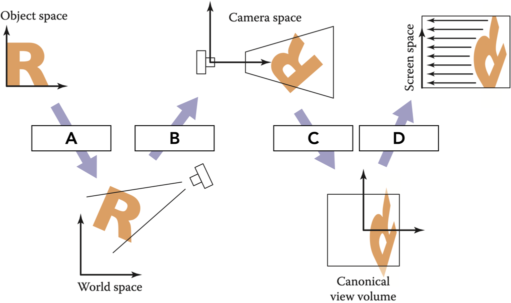
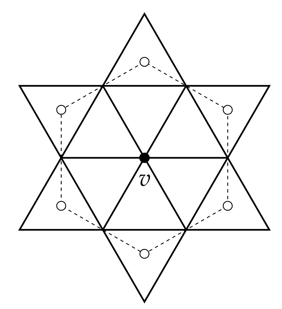
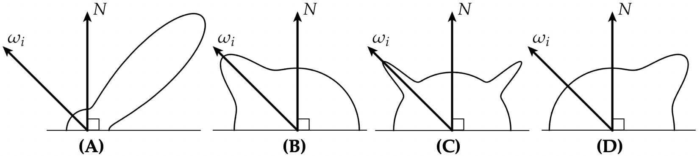
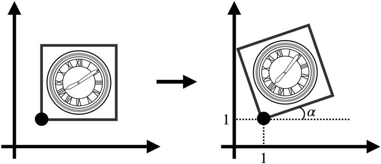
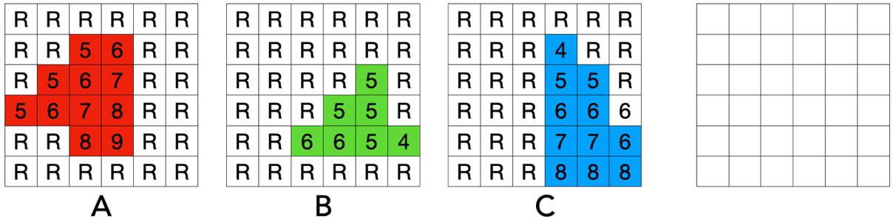
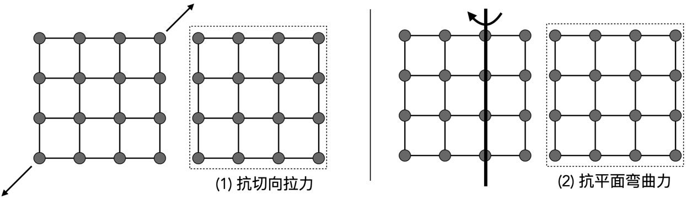
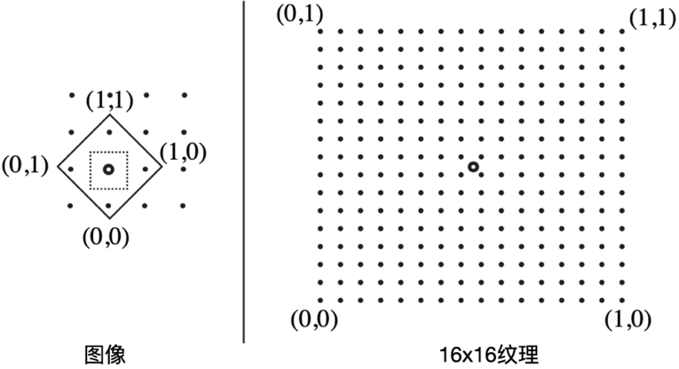
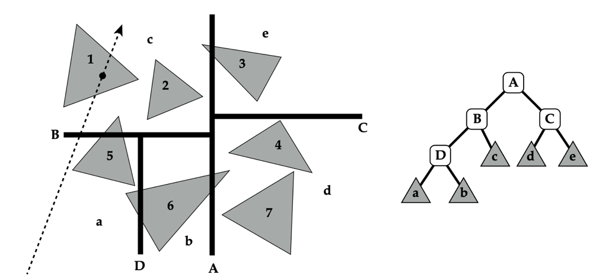
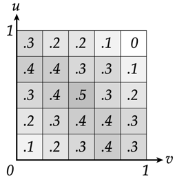

# 2024 计算机图形学试卷 A

福州大学 2023–2024 学年第 1 学期考试 A 卷

[原卷 PDF（10 页）](2024计算机图形学试卷A.pdf) · [参考答案与逐题解析](2024计算机图形学试卷A-解析.md) · [两卷考点分布与考纲总结](../README.md)

课程名称：计算机图形学　　考试日期：________  
考生姓名：________　　学号：________　　专业或类别：________

| 题号 | 一 | 二 | 三 | 四 | 五 | 六 | 七 | 八 | 总分 | 累分人签名 |
| --- | --- | --- | --- | --- | --- | --- | --- | --- | --- | --- |
| 题分 | 30 | 30 | 40 | | | | | | 100 | |
| 得分 | | | | | | | | | | |

**考生注意事项**

1. 本试卷共 10 页，请查看试卷中是否有缺页。
2. 考试结束后，考生不得将试卷、答题纸和草稿纸带出考场。

## 一、选择题（每小题 3 分，共 30 分）

**1.** 选择三角形而非更复杂的多边形来进行光栅化，以下哪个说法是错误的？（　）

- A. 三角形是最基础的多边形，其他多边形可以分解成多个三角形
- B. 三角形的平面性使三角形内外判断非常容易，而其他多边形则不保证是平面的
- C. 三角形清晰定义了内外区域，而多边形可能无法确定内外区域
- D. 三角形光栅化可以表示成为连续信号的离散采样问题，而多边形则不能

**2.** 以下关于走样（Aliasing）的说法哪一项是错误的？（　）

- A. 走样现象不仅仅是计算机图形学的问题，人类视觉中也会出现走样现象
- B. 走样产生的原因是采样速度跟不上信号变化的速度
- C. 超采样（Super sampling）比预滤波（Pre-filtering）能更有效地减少走样
- D. 对于快速运动，可以通过对几个连续帧进行平均来减少时间混叠（混叠指不同频率发生叠加而产生了信号失真）

**3.** 下图显示了将对象从原始坐标空间转换到屏幕空间的完整变换（Transformation）序列。图中所示变换 A、B、C、D 的名称或解释，以下哪个说法是错误的？（　）



- A. 变换 A 称为世界变换（World Transformation），它将对象变换到统一世界坐标系下
- B. 变换 B 称为相机变换（Camera Transformation）或者视图变换（Viewing Transformation），它将对象从世界坐标系转换到以相机为中心的相机坐标系
- C. 变换 C 称为投影变换（Projection Transformation），它将对象投影到标准视景体
- D. 变换 D 称为视口变换（Viewport Transformation）或屏幕变换（Screen Transformation），它将视景体变换到二维屏幕空间进行最终显示

**4.** 关于透视投影（Perspective projection）变换的说法中，以下哪一项是错误的？（　）

- A. 透视投影与人类观看物体时产生的视觉效果非常接近，物体看起来近大远小
- B. 透视投影变换属于线性变换的一种
- C. 与正交投影（Orthographic projection）相比，平行性等性质不适用于透视投影
- D. 透视投影变换等价于先将视体（View frustum）变换成长方体，再运用正交投影变换得到标准的视体

**5.** 利用 Blinn-Phong 反射模型进行着色，以下哪个说法是错误的？（　）

- A. 它考虑了环境（Ambient）、漫反射（Diffuse）和镜面（Specular）反射光
- B. 该模型的具体实现分为平面（Flat）着色、Gouraud 着色和 Phong 着色，其中平面着色的效果最为光滑（Smooth）
- C. 对于平面着色、Gouraud 着色和 Phong 着色，增加图形的顶点数量对 Phong 着色的效果影响最小
- D. Blinn-Phong 反射模型需要考虑光源方向、观测方向和表面点的法向等信息。类似于光线追踪（Ray tracing），观测方向是通过光线投射（Ray Casting）来生成

**6.** 右图实线图形为某三角网格（Mesh），它使用半边（Halfedge）数据结构。给定顶点 $v$，则可通过 $v$ 遍历图中所有顶点、边和面。考虑遍历图中多边形，其顶点为白色，位于对应三角形的中心，顶点间通过虚线边相连。以下哪个代码片段不能正确遍历该多边形？（　）



**A.**

```cpp
HalfedgeIter he = v->he;
do {
  push_back( he->next->twin->face->center );
  he = he->twin->next;
}
while( he != v->he );
```

**B.**

```cpp
HalfedgeIter he = v->he->next->next;
do {
  push_back( he->next->next->twin->face->center );
  he = he->twin->next->next;
}
while( he != v->he->next->next );
```

**C.**

```cpp
HalfedgeIter he = v->he->next;
do {
  push_back( he->twin->face->center );
  he = he->next->twin->next;
}
while( he != v->he );
```

**D.**

```cpp
HalfedgeIter he = v->he->next->twin;
do {
  push_back( he->face->center );
  he = he->twin->next->twin->next->twin;
}
while( he != v->he->next->twin );
```

**7.** 为什么我们使用蒙特卡罗（Monte Carlo）估计来积分渲染方程，而不是使用梯形规则（Trapezoid rule）这样更标准的数值求积？（　）

- A. 因为蒙特卡罗估计可以避免走样
- B. 因为梯形规则会带来维数灾难（Curse of dimensionality）
- C. 因为蒙特卡罗估计可以获得全局照明而不仅仅是局部照明
- D. 因为并非所有函数都是分段线性的（Piecewise linear）

**8.** 对于给定的入射方向 $\omega_i$，下图（A）–（D）显示了不同材质（Materials）在反射方向 $\omega_o$ 上的概率分布。现对某个陶器上釉，首先涂上亮白色的漫反射涂料，然后涂上暗淡的光泽（Glossy）釉，那么下面哪个图像看起来最符合该釉面陶器的材质？（　）



**9.** 选择采用光栅化而不是光线追踪的理由中，以下哪一项是错误的？（　）

- A. 光栅化支持深度缓冲来判断可见性而光线追踪则不能
- B. 现代图形硬件支持光栅化
- C. 在光线追踪器中，对空间数据结构进行遍历可能会访问到高度不连贯的内存
- D. 如果几何形状发生变化，光线追踪器可能需要重新构建空间数据结构

**10.** 在前向运动学（Forward kinematics）中，关于铰链骨架（Articulated skeleton）模型的描述中，以下哪个选项是错误的？（　）

- A. 在运动中，骨架的拓扑结构是不会改变的
- B. 铰链骨架模型是一种层次化表示
- C. 铰链骨架模型是一种树状结构，可能存在环
- D. 角色动画可以表示为关节夹角在不同时刻下的变化

## 二、简答题（共 30 分）

**1.（5 分）** 请用文字描述下图所示变换的完整操作序列。如图所示，黑色顶点坐标为 $(1,1)$，旋转角度为 $\alpha$。（不需要写变换矩阵）



**2.（5 分）** 仿射变换是否将直线映射到直线？平行线经过相同仿射变换后保持平行吗？对于每个问题，如果是，请解释原因，如果不是，请给出反例。

**3.（5 分）** 在光栅化过程需要采用深度缓存（Z-Buffer）解决多个三角形的可见性问题。如图所示，已知三角形 A、B、C 的深度图，若按照 A、B、C 顺序依次进行光栅化，则最终深度缓存是什么？请将结果填写在最右侧的空表格。（R 表示无穷大数）



<details>
<summary>展开可复制的 A、B、C 深度数据</summary>

每组内的六个数从左到右排列，行号从上到下。R 表示无穷大。

| 行 | A | B | C |
| --- | --- | --- | --- |
| 1 | R R R R R R | R R R R R R | R R R R R R |
| 2 | R R 5 6 R R | R R R R R R | R R R 4 R R |
| 3 | R 5 6 7 R R | R R R R 5 R | R R R 5 5 R |
| 4 | 5 6 7 8 R R | R R R 5 5 R | R R R 6 6 6 |
| 5 | R R 8 9 R R | R R 6 6 5 4 | R R R 7 7 6 |
| 6 | R R R R R R | R R R R R R | R R R 8 8 8 |

</details>

**4.（5 分）** 对于网格的上采样问题，我们课程介绍了两种方法，分别是 Loop 和 Catmull 网格细分。请写出 Loop 和 Catmull 的细分规则（以三角形为例，不需要写顶点更新规则）。当图形存在尖锐边界（Sharp boundary）时，多次细分后尖锐边界将变得光滑，失去原有几何细节。请问如何在细分中避免过光滑现象而保持表面的尖锐细节？

**5.（6 分）** 使用蒙特卡罗估计来积分渲染方程，需要对半球区域（Hemisphere）进行随机采样。为什么只对着色点沿法向量一侧的半球面进行采样？考虑对二维平面上的圆进行均匀采样，请通过对 CDF（累积密度函数）求逆（Inversion）来设计均匀采样方法。提示：圆的参数化方程为 $(r\cos\theta,r\sin\theta)$，$\theta$ 和 $r$ 的取值范围分别为 0 到 $2\pi$ 和 0 到 1 之间，变量 $\theta$ 和 $r$ 的联合概率密度为 $p(\theta,r)=r/\pi$。

**6.（4 分）** 使用弹簧质点模型（Mass Spring System）进行动画模拟时，需要针对不同物体设计不同的弹簧结构。以左侧的弹簧结构为例，其无法抵抗切向的拉力（如箭头所示方向），且无法抵抗平面弯曲的力（如第三图所示沿旋转箭头方向进行弯曲）。请在两个虚线图中对现有弹簧结构进行修改（只需添加弹簧），使其能够分别对抗（1）切向力和（2）弯曲力。



## 三、综合题（共 40 分）

**1.（15 分）** 图中左侧所示的四边形（菱形），其四个顶点的纹理坐标已知，分别对应于右侧 $16\times16$ 纹理图像的四个位置。左图每个黑点表示屏幕采样点，对应于一个屏幕像素，如图中突出显示的圆圈点和包围它的虚线矩形区域（像素）。为了计算每个采样点对应像素的颜色，需要在纹理图像进行纹理查找。圆圈点对应的纹理坐标已在纹理图上标注，同样以圆圈显示。



**A.（5 分）** 假设使用纹理贴图的双线性采样（也称“双线性滤波”，Bilinear filtering）来实现纹理查找，同时假设纹理图像包含了许多高频的细节，那么该方法可能存在什么问题？

**B.（5 分）** 请在右图纹理空间中大致画出与左图虚线矩形对应的纹理映射区域。为了避免走样，需要对纹理采样结果进行滤波，请简要描述一个准确但可能费时的算法来计算该点处的纹理值。

**C.（5 分）** 现考虑使用 Mip-map 来加速你在上一个子问题中提出的算法。使用这种更高效的方法可能会出现什么问题？

**2.（20 分）** 如下所示的 k-d 树用于划分七个三角形所占据的空间。分割平面由大写字母标识，小写字母用于表示 k-d 树的每个叶子占用的空间区域。



**A.（3 分）** 写下与每个叶节点关联的三角形列表。

**B.（4 分）** 从图中可以看出入射光线与三角形 1 相交。然而，k-d 树必须进行遍历才能判断相交情况。假设使用深度优先遍历，且在找到相交三角形后终止遍历，请列出树的节点被访问的顺序（使用右图所示的大小写符号）。

**C.（3 分）** 哪些三角形需要显式检查是否与射线相交？假设每个三角形最多检查一次。

**D.（5 分）** 假设三角形 1 具有顶点 $p_1=(0,0)$、$p_2=(5,0)$ 和 $p_3=(0,10)$，并且从平面外部射出的光线与三角形相交于 $p=(2,4)$，则 $p$ 的重心坐标是多少？

**E.（5 分）** 某射线击中三角形，其与三角形交点的重心坐标为 $(0.5,0.3,0.2)$。假设该三角形三个顶点的纹理坐标为 $t_1=(0,0.2)$、$t_2=(0.6,0.8)$ 和 $t_3=(1,0.4)$，那么如果对纹理进行采样，这条光线所击中的点将被分配什么颜色值？纹理图像的坐标系见右图。（假设使用最近邻插值计算纹理）



<details>
<summary>展开可复制的 5×5 纹理数值</summary>

按原图从上到下列出五行，$u$ 向上、$v$ 向右。列号从左起计。

| 自上数的行 | 第 1 列 | 第 2 列 | 第 3 列 | 第 4 列 | 第 5 列 |
| --- | --- | --- | --- | --- | --- |
| 1（上） | 0.3 | 0.2 | 0.2 | 0.1 | 0 |
| 2 | 0.4 | 0.4 | 0.3 | 0.3 | 0.1 |
| 3 | 0.3 | 0.4 | 0.5 | 0.3 | 0.2 |
| 4 | 0.2 | 0.3 | 0.4 | 0.4 | 0.3 |
| 5（下） | 0.1 | 0.2 | 0.3 | 0.4 | 0.3 |

</details>

**3.（5 分）** 什么是计算机图形学？和你本学期开始时想象的一样吗？
