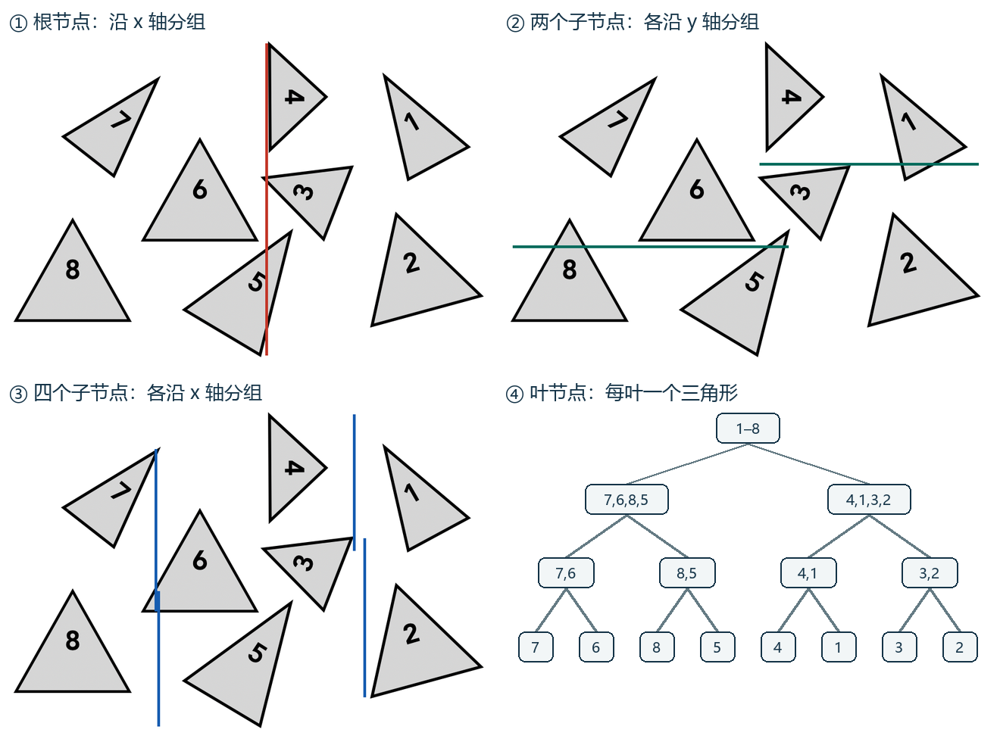

# 2025 计算机图形学 A 卷参考答案与解析

[原题 Markdown](2025计算机图形学试卷A.md) · [原卷 PDF](2025计算机图形学试卷A.pdf) · [两卷考点分布与考纲总结](../README.md) · [课程复习提纲](../../review/README.md)

以下为根据卷面和课件推导的复习参考答案。选择题第 3、8 题的术语和应用题第 2 题的坐标约定影响作答，详见对应解析。

## 一、选择题（每题 3 分，共 30 分）

| 题号 | 1 | 2 | 3 | 4 | 5 | 6 | 7 | 8 | 9 | 10 |
| --- | --- | --- | --- | --- | --- | --- | --- | --- | --- | --- |
| 参考选项 | C | D | A（依课件命名） | C | B | B | B | C（见说明） | B | A |

**1．C，三角形为什么适合光栅化。** 单个非退化三角形共面，三条有向边可判定内外；三顶点属性可用 $a=\lambda_1a_1+\lambda_2a_2+\lambda_3a_3$ 插值。用足够多的三角形可以逼近曲面，但相邻三角形常在共边处形成折角，两侧法向可能不同，网格本身不保证处处可微或光滑。[第 2 讲·三角形光栅化](../../review/02-digital-drawing.md)

**2．D，奈奎斯特采样条件。** 对最高频率为 $B$ 的带限信号，均匀采样频率须达到约 $2B$ 才能理想重建。取 $f_s>2B$ 可避开恰在端点取样时的退化。只要求 $f_s>B$ 仍可能使相邻频谱副本重叠。[第 3 讲·采样与频谱](../../review/03-antialiasing.md)

**3．A，按课件原图的命名。** 第 4 讲第 108 页把 Object space → World space 的箭头标作 **Modeling transformation（建模／模型变换）**；A 对变换效果的描述正确。其后三个阶段依次是相机／观察变换、投影变换（透视除法后到 NDC）、视口变换。在把物体到世界矩阵称为 *world matrix* 的命名体系里，A 也可理解，因此这道题靠课堂图的标签区分。[第 4 讲·变换与 MVP](../../review/04-transforms.md) · [课件第 108 页](../../ppt/lec-04-transforms.pdf#page=108)

**4．C，深度缓冲按采样位置更新。** 若深度越小越近，就在每个子样本 $s$ 取 $z_s=\min_j z_j(s)$，只用该处通过深度测试的片元更新颜色，再对各样本的颜色求平均。同一像素的不同子样本可能被不同三角形遮住。B 中的 $O(n)$ 采用每个三角形平均覆盖常数个采样点的课堂假设，实际比较次数取决于生成的候选片元／样本数。[第 5 讲·Z-buffer 与超采样](../../review/05-shading.md)

**5．B，区分算层级、层内过滤和层间过滤。** 以第 0 层纹素为单位计算屏幕像素足迹，长边为 $L$，连续层级为 $D=\log_2L$。双线性插值混合同一层的四个近邻。层间平滑过渡要在相邻两层各做双线性过滤，再按 $D$ 的小数部分混合两层结果，即三线性过滤。方形纹理每次宽高减半，总开销为 $N(1+1/4+1/16+\cdots)<4N/3$（有限层）。[第 6 讲·Mipmap](../../review/06-texture-mapping.md)

**6．B，半边的起点、对偶与面环。** 图中 $e_4$ 自 $V_0$ 指向 $V_2$，课程的 $\mathrm{vertex}()$ 取半边起点，故返回 $V_0$。沿 $f_3$ 走完 $e_{11}$，下一条是 $e_7$；跨过 $e_7$ 的对偶是 $e_1$。$f_0$ 的有向环是 $e_0\to e_1\to e_5\to e_0$，其中任一条都能作该面的代表半边。[第 9 讲·半边结构](../../review/09-geometry-processing.md)

**7．B，分段 Bézier 的一阶连续条件。** 一个三次段 $B(t)=\sum_{i=0}^3\binom3i (1-t)^{3-i}t^iP_i$ 在段内光滑。两段端点相接只保证 $C^0$；等参数区间的三次段还需 $P_3=Q_0$ 且 $P_3-P_2=Q_1-Q_0$，才能使接缝左右一阶导数相等。Bernstein 权重非负且和为 1，解释了凸包性和仿射不变性。[第 8 讲·曲线接缝](../../review/08-curves-surfaces.md)

**8．C，冬季太阳入射角与辐照度。** 在课件讨论的北半球中纬度，同一地点冬季正午太阳高度较低，与地面法向的夹角 $\theta$ **变大**，从而 $\cos\theta$ 变小。相同光束照到水平面上的辐照度按 $E=E_\perp\cos\theta$ 下降。C 同时把辐照度 $E$ 与沿射线的辐射亮度 $L$ 混用。B 也有简写：辐射能量的单位为 J，课件所谓“辐射率”指 $L=d^2\Phi/(dA_\perp\,d\omega)$，面积须取垂直光线的投影面积。按单选意图，C 的季节角度结论明确错误。[第 10 讲·辐射量与余弦定律](../../review/10-radiometry.md)

**9．B，逆向反射（retroreflection）。** 图中 $\omega_i$ 从表面指回光源，反光背心使反射能量集中在返回光源的方向，即 $\omega_o\approx\omega_i$。B 在左上来光方向出现突出反射瓣；A 的强瓣位于法向另一侧，是镜向反射；C 在来光与镜向各有一个尖瓣。[第 11 讲·反射方向分布](../../review/11-rendering-equation.md)

**10．A，低采样率的典型表现是噪点。** 半球均匀采样时，小光源占的立体角小，少量样本通常给出较高方差，导致颗粒噪声。设 $p(\omega)>0$ 覆盖全部有贡献的方向，以独立样本计算 $\widehat I=N^{-1}\sum_k g(\omega_k)/p(\omega_k)$，则 $\mathbb E[\widehat I]=\int g\,d\omega$。在单样本方差有限时，$\mathrm{Var}(\widehat I)=\mathrm{Var}(g/p)/N$；大数定律说明样本均值的收敛。对直接光照按光源取样可提高命中光源的概率。[第 13 讲·蒙特卡罗积分与重要性采样](../../review/13-monte-carlo-ray-tracing.md)

## 二、理解与应用题（共 70 分）

### 1. 频域分析（8 分）

**1.1　走样的原因（4 分）。** 取一维截面说明。令 $F(\nu)$ 为连续信号 $f(x)$ 的频谱，采样间隔为 $T$，采样频率为 $f_s=1/T$。均匀点采样相当于在空间域乘梳状冲激列；频域内则以 $f_s$ 为间隔复制原频谱：

$$
f_{\mathrm{sampled}}(x)=f(x)\sum_{m\in\mathbb Z}\delta(x-mT),
\qquad
F_{\mathrm{sampled}}(\nu)=\frac1T\sum_{k\in\mathbb Z}F(\nu-kf_s).
$$

若信号含有超过 $f_s/2$ 的频率，相邻频谱副本可能重叠。重叠区的高频与低频在样本中无法区分，例如细条纹被采成稀疏的摩尔纹。

**1.2　反走样原理（4 分）。** 先对原信号做低通预滤波 $g=f*h$，频域里 $G=FH$，把目标采样率无法表示的高频滤去或衰减，再按目标间隔采样。或者先提高采样率，把频谱副本拉远，再低通过滤并降到输出分辨率。边缘像素的面积平均可用多个子样本近似。等权重时 $C_{\mathrm{pixel}}\approx N^{-1}\sum_{j=1}^N C_j$。原始低分辨率图已经混叠后再模糊，无法从重叠频谱中恢复原信号。[第 2 讲·覆盖采样](../../review/02-digital-drawing.md) · [第 3 讲·频谱复制与预滤波](../../review/03-antialiasing.md)

### 2. 三角形的投影与采样（20 分）

原题第三个顶点重复写成 $p_1$，结合三角形名称和后续问题，取 $p_3=(1,0,3)$。三个顶点的 $z$ 都是 **正 3**，而采样点 $p'=(-1/3,-1/3)$ 位于第三象限。以下先按正深度且横、纵轴同向的标准成像方式作答，再给出相反画轴时的完整数值。两套结果所用坐标系已分别标明。

**2.1　视锥体到标准立方体（4 分）。** 用列向量，相机前方为 $+z$，令近距 $n=2$ 映到 $z_{\mathrm{ndc}}=-1$，远距 $f=4$ 映到 $+1$。正方形画面的缩放 $s=\cot(45^\circ/2)=1+\sqrt2$。取 $w_{\mathrm{clip}}=z$，令 $z_{\mathrm{ndc}}=A+B/z$，由 $A+B/2=-1,\ A+B/4=1$ 得 $A=3,\ B=-8$。当画面的 $x,y$ 分别与相机的 $x,y$ 同向，可取

$$
P_+=\begin{bmatrix}
s&0&0&0\\
0&s&0&0\\
0&0&3&-8\\
0&0&1&0
\end{bmatrix},\qquad
(x_{\mathrm{ndc}},y_{\mathrm{ndc}},z_{\mathrm{ndc}})=
\left(\frac{s x}{z},\,\frac{s y}{z},\,3-\frac8z\right).
$$

**2.2　投影、边函数与覆盖（8 分）。** 记 $a=s/3\approx0.80474$。所有顶点的 $w_{\mathrm{clip}}=3$，$z_{\mathrm{ndc}}=1/3$。舍去深度得 $p'_1=(0,0),p'_2=(0,a),p'_3=(a,0)$。可把三条边写成朝向三角形内部取非负的函数

$$
E_{12}=x,\qquad E_{23}=a-x-y,\qquad E_{31}=y.
$$

各式等于 0 就是相应的直线方程。$p'$ 的 $E_{12}=E_{31}=-1/3<0$，**采样点在三角形外**。

**2.3　颜色与透视校正（8 分）。** 采用上述投影，三角形不覆盖 $p'$，故**该三角形不给此样本写入颜色**。若题目只要求形式计算，令 $p'=\lambda_1p'_1+\lambda_2p'_2+\lambda_3p'_3$，则 $\lambda_2=y/a,\ \lambda_3=x/a,\ \lambda_1=1-\lambda_2-\lambda_3$。代入得 $(1+2/s,-1/s,-1/s)$。它是延长平面上的外插权重，负值提示了采样点在外。

比较前后空间时，一般属性 $C$ 的透视校正公式为

$$
C=\frac{\sum_i\lambda_i C_i/w_i}{\sum_i\lambda_i/w_i}.
$$

本题三点同深，$w_1=w_2=w_3=3$，所以对任何对应的三角形内点，三维与屏幕空间插值得到**相同**颜色。对上面的外点，形式外插也相同，但不会成为该三角形的可见样本。

**若按负坐标采样点应在内部来读卷面。** 一套自洽约定是相机仍朝 $+z$，将成像平面横、纵轴同时反向。此时使用 $P_-=\mathrm{diag}(-1,-1,1,1)P_+$，深度仍是 $1/3$，三个二维顶点变为 $(0,0),(0,-a),(-a,0)$。三条朝内边函数依次取 $-x,\ a+x+y,\ -y$。在给定点三者分别为 $1/3,\ (s-2)/3,\ 1/3$，全部为正。此时 **$p'$ 在内**，由 $-a\lambda_2=-1/3,\ -a\lambda_3=-1/3$ 得

$$
(\lambda_1,\lambda_2,\lambda_3)=
\left(1-\frac2s,\frac1s,\frac1s\right)
=(3-2\sqrt2,\sqrt2-1,\sqrt2-1).
$$

以单位 RGB 三原色为三个顶点的颜色，结果为 **$(0.17157,\ 0.41421,\ 0.41421)$**；三维与二维插值仍相同。这一路径增加了画轴方向的假设，原图没有标出两根轴的名称与符号。

**若照搬课件的 $-z$ 相机。** 第 4 讲第 107 页在正近远距离约定下取 $w_{\mathrm{clip}}=-z$，深度为 $3+8/z$。卷面的 $z=+3$ 给 $w_{\mathrm{clip}}=-3$、$z_{\mathrm{ndc}}=17/3$，顶点均位于相机后方并被裁剪；只用负的 $w$ 算出第三象限的 $x,y$ 会漏掉可见性判断。[第 4 讲·视锥体与坐标约定](../../review/04-transforms.md) · [第 2 讲·三条边的内外测试](../../review/02-digital-drawing.md) · [第 5 讲·重心坐标与透视校正](../../review/05-shading.md)

### 3. 网格细分（8 分）

**3.1　细分规则（4 分）。** 所有更新都从同一轮的旧网格计算。

- **Loop。** 每条旧边插入一个点，在旧三角形内连接三个边点，将一个三角形拆成四个三角形。内部边 $AB$ 两侧的对顶点为 $C,D$ 时，新边点为 $E=\tfrac38(A+B)+\tfrac18(C+D)$。度数为 $k$ 的旧内部点更新为 $P'=(1-k\beta)P+\beta\sum_{i=1}^kP_i$，其中 $P_i$ 是一环邻点。按课件权重，$k=3$ 时 $\beta=3/16$，其余取 $3/(8k)$。
- **Catmull–Clark。** 对旧三角形 $ABC$ 插入面点 $F=(A+B+C)/3$，内部边 $AB$ 的新边点为 $E=(A+B+F_1+F_2)/4$，$F_1,F_2$ 为其两侧面点。把面点与三个边点相连，旧三角形变为三个四边形。度数为 $k$ 的旧内部点更新为 $P'=(\bar F+2\bar M+(k-3)P)/k$，其中 $\bar F$ 是相邻面点的平均，$\bar M$ 是相邻各条**旧边中点**的平均。

**3.2　保持锐边（4 分）。** 标记边界、折痕和必须保持的尖角。在折痕边 $AB$ 上用中点 $E=(A+B)/2$；恰有两条折痕相接的旧点只沿折痕方向平滑，即 $P'=(P_{\mathrm{prev}}+6P+P_{\mathrm{next}})/8$。标记的尖角（如三条锐边相交）固定为 $P'=P$。把折痕标记传给新子边即可在后续细分中保留锐边，平坦区域可继续采用普通规则。[第 9 讲·Loop、Catmull–Clark 与锐边](../../review/09-geometry-processing.md)

### 4. 光线求交与 BVH（14 分）

**4.1　分界线与二叉树（6 分）。** 对本节点的全部三角形先取紧轴对齐包围盒，选最长轴，用几何质心 $(A+B+C)/3$ 在该轴上的坐标排序，再从中间平分图元数。下图分三层画出全部七条分界线；偶数个质心时把线画在中间两个质心坐标的平均值。

| 当前节点的图元 | 最长轴 | 子节点（左右或上下，按图示） |
| --- | --- | --- |
| 全部 8 个 | $x$ | 左 $\{7,6,8,5\}$，右 $\{4,1,3,2\}$ |
| $\{7,6,8,5\}$ | $y$ | 上 $\{7,6\}$，下 $\{8,5\}$ |
| $\{4,1,3,2\}$ | $y$ | 上 $\{4,1\}$，下 $\{3,2\}$ |
| $\{7,6\},\ \{8,5\},\ \{4,1\},\ \{3,2\}$ | 各为 $x$ | 分别按从左到右拆成 $7/6,\ 8/5,\ 4/1,\ 3/2$ |

左侧四个三角形的包围盒接近正方形；按原图黑色外轮廓量得宽约 505 像素、高约 510 像素，所以取 $y$。图元的编号位置可能偏离质心，要用三个顶点来判组。BVH 每步把三角形整体分到一侧，分界线可以穿过三角形，两个子包围盒允许重叠。

**4.2　射线与 AABB 的两个交点（8 分）。** 令 $r(t)=(-3+t,\ 4-t,\ 5-2t),\ t\ge0$。每个分量都要落入 $[-2,2]$。分别解不等式：

| 轴 | 约束 | 允许区间 |
| --- | --- | --- |
| $x$ | $-2\le-3+t\le2$ | $[1,5]$ |
| $y$ | $-2\le4-t\le2$ | $[2,6]$ |
| $z$ | $-2\le5-2t\le2$ | $[3/2,7/2]$ |

取交集得 $t_{\mathrm{enter}}=\max(1,2,3/2)=2$，$t_{\mathrm{exit}}=\min(5,6,7/2)=7/2$。射线从 $y=2$ 面进入，**入口 $r(2)=(-1,2,1)$**；从 $z=-2$ 面离开，**出口 $r(7/2)=(1/2,1/2,-2)$**。[第 12 讲·Slab 检测与 BVH](../../review/12-ray-tracing.md)

### 5. 渲染方程与半球采样（16 分）

**5.1　BRDF 与余弦项（8 分）。** $f(p,\omega_o,\omega_i)$ 是点 $p$ 的双向反射分布函数（BRDF）。它给出从 $\omega_i$ 方向到达的微分辐照度 $dE_i$ 向 $\omega_o$ 方向产生的微分出射辐射亮度 $dL_o$，即 $f=dL_o/dE_i$，单位 $\mathrm{sr}^{-1}$。法向 $\mathbf n$ 与指向光源的单位方向 $\omega_i$ 夹角为 $\theta_i$。接收面 $dA$ 在垂直入射方向的平面上只占 $dA_\perp=dA\cos\theta_i$，故 $dE_i=L_i(p,\omega_i)\cos\theta_i\,d\omega_i$。把每束入射光的反射贡献相加，就得到题面给出的反射项

$$
L_r(p,\omega_o)=\int_{H^2} f(p,\omega_o,\omega_i)\,
L_i(p,\omega_i)\,(\mathbf n\cdot\omega_i)\,d\omega_i.
$$

法向入射时余弦为 1，擦过表面时趋近 0。若表面自身发光，完整出射亮度还应加 $L_e(p,\omega_o)$。[第 10 讲·投影面积与辐照度](../../review/10-radiometry.md) · [第 11 讲·BRDF 与渲染方程](../../review/11-rendering-equation.md)

**5.2　推导单位半球均匀采样（8 分）。** 令法向为 $+z$，极角 $\theta\in[0,\pi/2]$，方位角 $\phi\in[0,2\pi)$。均匀指相对于半球面积（单位球上即立体角）均匀，密度 $p_\omega=1/(2\pi)$。球面微元 $d\omega=\sin\theta\,d\theta\,d\phi$，所以角度的联合密度为

$$
p_{\theta,\phi}(\theta,\phi)=\frac{\sin\theta}{2\pi},
\qquad p_\theta(\theta)=\sin\theta,\quad p_\phi(\phi)=\frac1{2\pi}.
$$

两角独立。取 $z=\cos\theta$，从极点向赤道走时 $z$ 从 1 降到 0，面积带为 $|dz|\,d\phi$，所以 $z$ 在 $[0,1]$ 均匀。等价地，极角累积分布 $F_\theta(t)=1-\cos t$，$1-U$ 与 $U$ 同为均匀随机数。取独立的 $\xi_1,\xi_2\sim U[0,1]$，令 $z=\xi_1,\ \phi=2\pi\xi_2$。水平截面半径是 $\sqrt{1-z^2}$，故采样方向为

$$
(x,y,z)=
\left(\sqrt{1-\xi_1^2}\cos(2\pi\xi_2),\
\sqrt{1-\xi_1^2}\sin(2\pi\xi_2),\ \xi_1\right).
$$

检查 $x^2+y^2+z^2=1$ 且 $z\ge0$。若直接均匀选极角，等宽角带在极点附近的面积较小，会造成极区采样过密。[第 10 讲·球面微元](../../review/10-radiometry.md) · [第 13 讲·逆变换与半球采样](../../review/13-monte-carlo-ray-tracing.md)

### 6. 课程反馈（4 分）

开放题，可用“具体难点＋解决过程＋喜欢的内容”作答。示例：

> 我觉得最容易算错的是透视投影。开始做题时我只除以 $w$ 看横纵坐标，经常漏掉深度。现在我会先写清相机朝向，再代入近、远平面的两个点检查矩阵。我最喜欢光线追踪里的求交：把包围盒按三个轴拆成区间，取一次交集就知道一条射线从哪一面进、哪一面出，几何图和计算结果可以直接对照。

这里的观点和选择可按个人学习经历替换。[第 4 讲·透视投影](../../review/04-transforms.md) · [第 12 讲·射线求交](../../review/12-ray-tracing.md)
