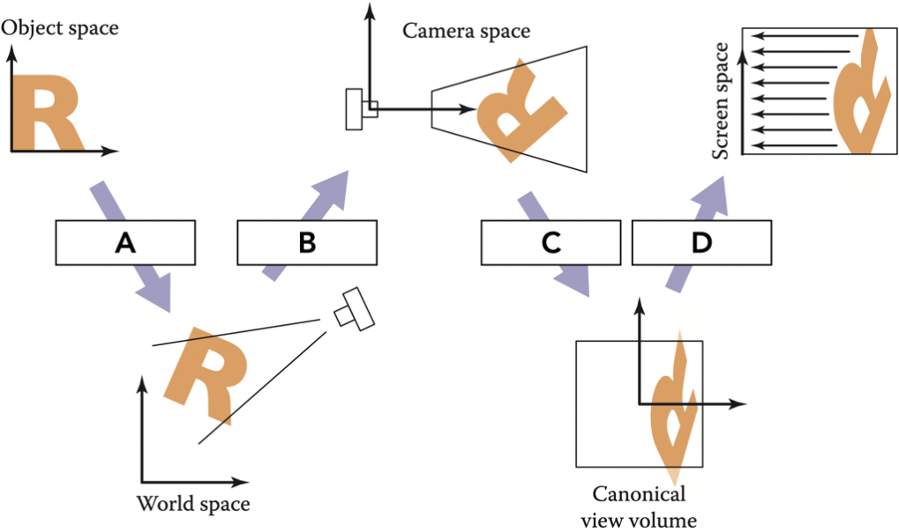
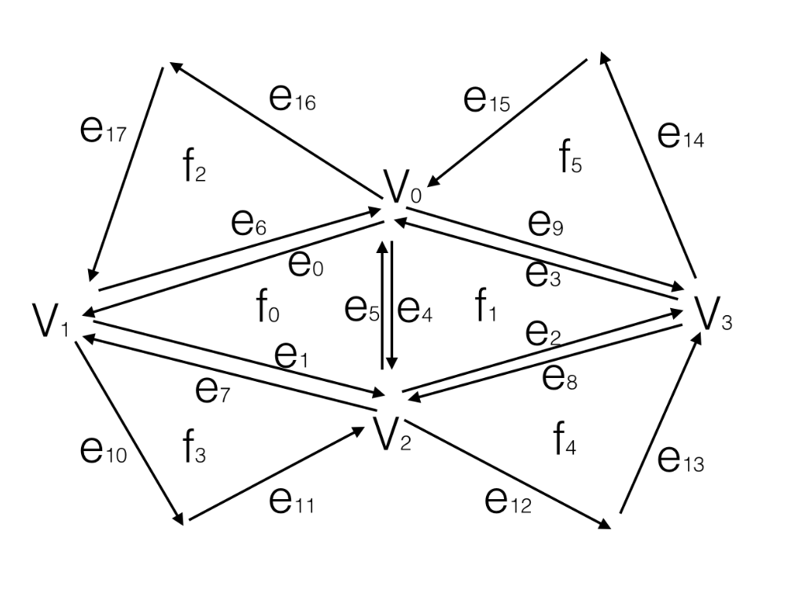
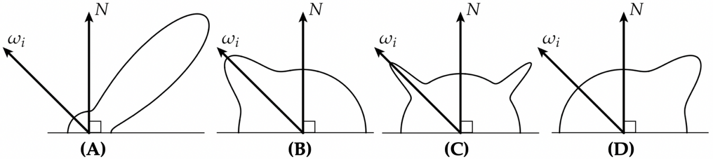
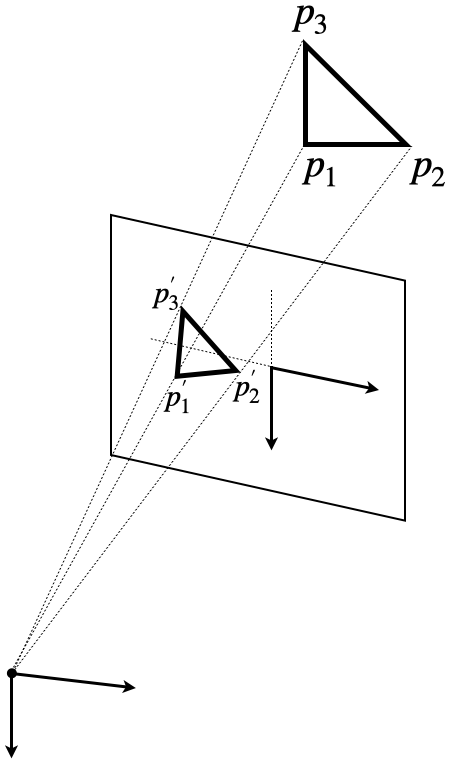
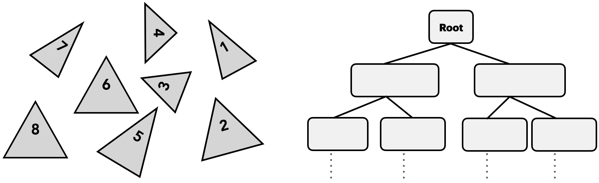
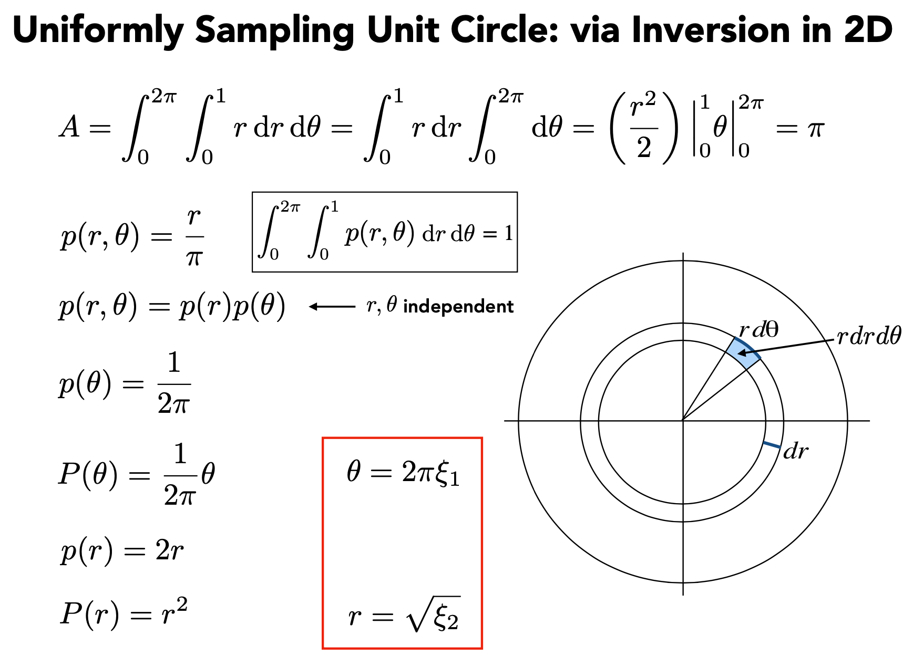

# 福州大学 2024–2025 学年第 1 学期考试 A 卷

**课程名称　计算机图形学**　　考试日期 __________

考生姓名 __________　　学号 __________　　专业或类别 __________

| 题号 | 一 | 二 | 三 | 四 | 五 | 六 | 七 | 八 | 总分 | 累分人签名 |
| --- | --- | --- | --- | --- | --- | --- | --- | --- | --- | --- |
| 题分 | 30 | 70 | | | | | | | 100 | |
| 得分 | | | | | | | | | | |

**考生注意事项**

1. 本试卷共 10 页，请查看试卷中是否有缺页。
2. 考试结束后，考生不得将试卷、答题纸和草稿纸带出考场。

[原卷 PDF](2025计算机图形学试卷A.pdf) · [参考答案与解析](2025计算机图形学试卷A-解析.md) · [两卷考点分布与考纲总结](../README.md)

## 一、选择题（每小题 3 分，共 30 分）

得分 __________　　评卷人 __________

**1.** 选择三角形进行光栅化，以下哪个说法是错误的？（　　）

- A. 三角形可以逼近任意形状
- B. 三角形的内外区域是确定的
- C. 三角网格是可微分且光滑的
- D. 三角形容易进行线性插值

**2.** 关于信号采样，以下哪个说法是错误的？（　　）

- A. 采样是指将连续信号进行离散化
- B. 光栅化是对图形的采样，纹理贴图是对图像的采样
- C. 信号失真是因为采样速度跟不上信号改变的速度
- D. 根据香农（奈奎斯特）采样定理，采样频率大于原始信号的最高频率时，离散信号可以完全复原原始信号

**3.** 下图显示了对象从原始坐标空间转换到屏幕空间的完整变换（Transformation）过程。关于图中所求变换 A、B、C、D 的名称和解释，以下哪个说法是错误的？（　　）

- A. 变换 A 称为世界变换（World Transformation），它将对象变换到统一世界坐标系下
- B. 变换 B 称为相机变换（Camera Transformation）或者视图变换（Viewing Transformation），它将对象从世界坐标系转换到以相机为中心的相机坐标系
- C. 变换 C 称为投影变换（Projection Transformation），它将对象投影到标准视景体
- D. 变换 D 称为视口变换（Viewport Transformation）或屏幕变换（Screen Transformation），它将视景体变换到二维屏幕空间进行最终显示

**4.** 关于深度缓冲（Z-Buffer），以下哪一项是错误的？（　　）

- A. 深度缓冲解决三角形的遮挡问题，缓冲池仅需要保存距离相机最近采样点的深度值
- B. 算法复杂度为 $O(n)$，$n$ 是三角形数量
- C. 和超采样算法同时实现时，只需要计算每个像素点的深度值，不需要对每个采样点进行深度测试
- D. 深度缓冲可以解决画家算法面临的循环遮挡问题

**5.** 使用 Mip-map 进行纹理贴图，以下哪个说法是错误的？（　　）

- A. 使用 Mip-map 技术，纹理图像的存储开销增加不超过 $1/3$ 倍
- B. 采用双线性插值可得到连续平滑过渡的 Mip-map Level 值
- C. 当像素大小和纹素大小是 1:1 时，贴图效果最理想，可避免走样和模糊现象
- D. Mip-map 是一种各向同性滤波方法，改进方法 Ripmap 和 EWA 滤波可以进行各向异性滤波

**6.** 右图所示为采用半边数据结构表示的三角网格，下述操作哪个是错误的？（　　）

- A. $e_{11}\to\mathrm{next}()=e_7$
- B. $e_4\to\mathrm{vertex}()=V_2$
- C. $e_7\to\mathrm{twin}()=e_1$
- D. $f_0\to\mathrm{halfedge}()=e_0/e_1/e_5$（/ 表示或）

**7.** 关于 Bézier 曲线，下述哪个说法是错的？（　　）

- A. 三次 Bézier 曲线可以由四个三次多项式基函数线性组合而成
- B. Bézier 样条是 $C^1$ 连续的
- C. 满足凸包（Convex hull）性质，既整条曲线落在控制顶点构成的凸包内
- D. 满足仿射变换不变性，既对控制顶点进行仿射变换后得到的曲线等价于对曲线进行仿射变换得到的结果

**8.** 对照明进行量化的相关知识，以下哪一项是错误的？（　　）

- A. 立体角 $\omega$ 等于弧面积除以半径平方，在渲染公式中使用立体角微元 $d\omega$ 表示射线方向
- B. 光线的能量称为辐射率，定义为光子能量除以单位时间单位面积和单位立体角
- C. 太阳光线与地球上某个地点的垂直方向的夹角会随着季节改变，冬季时该夹角会变小，根据辐射率公式计算，太阳光到达地球的辐射率变小，所以冬季更冷
- D. 渲染公式是递归定义的，旨在计算一条光线的辐射率，求解方法是光线追踪，通过递归算法追溯光的传播路径

**9.** 对于给定的入射方向 $\omega_i$，下图 (A)–(D) 显示了不同材质（Materials）在反射方向 $\omega_o$ 上的概率分布。哪个图像看起来最接近反光背心的材质？（　　）

**10.** 使用蒙托卡罗估计求解渲染方程，有效的采样方法至关重要。以下哪个选项是错误的？（　　）

- A. 使用半球均匀采样，当采样率较低时，渲染的图像较光滑，缺乏细节
- B. 使用光源重要性采样，有更高概率采样到有效光线
- C. 蒙托卡罗估计是一种无偏估计，估计的期望值就是渲染公式的积分结果
- D. 根据大数定律，蒙托卡罗估计的方差随样本数增加而减小

## 二、理解与应用题（共 70 分）

得分 __________　　评卷人 __________

### 1. 频域分析（8 分）

请使用频域分析（傅里叶变换）这一数学工具，解释信号采样时产生走样（Aliasing）的原因及反走样（Anti-aliasing）技术原理。

**1.1（4 分）** Aliasing 产生原因：

**1.2（4 分）** Anti-aliasing 原理：

### 2. 三角形的投影与采样（20 分）

如右下图所示，已知三角形 $p_1p_2p_3$，其位于相机坐标系下的三个顶点的坐标分别为 $p_1=(0,0,3),\ p_2=(0,1,3),\ p_1=(1,0,3)$。相机取景的视锥体（view frustum）参数分别为：近裁剪面（near）=2、远裁剪面（far）=4、垂直角度（fovy）=$45^\circ$ 及宽高比（aspect ratio）=1。请回答以下问题：（计算步骤准确但最后数值错误仍可获得大部分分数）

**2.1（4 分）** 请写出透视变换矩阵 $M_{\mathrm{persp}}$（Perspective Transform），既视锥体到单位立方体的变换矩阵：

$$
M_{\mathrm{persp}}=\quad\underline{\hspace{4em}}
$$

**2.2（8 分）** 顶点 $p_1,p_2,p_3$ 经过透视变换后从相机坐标系变换到标准设备坐标系，也就是落在单位立方体内，去掉 $z$ 轴的深度信息可得到投影后的二维顶点坐标，分别为 $p'_1,p'_2,p'_3$。请计算 $p'_1,p'_2,p'_3$，并写出三角形 $p'_1p'_2p'_3$ 的采样函数（也就是三条边的直线方程），以及判断采样点 $p'=(-\tfrac13,-\tfrac13)$ 是否在三角形 $p'_1p'_2p'_3$ 内。

**2.3（8 分）** 接上题，假设顶点 $p'_1,p'_2,p'_3$ 的颜色值分别为 R,G,B，请使用质心坐标进行线性插值，计算 $p'$ 的颜色。如果在三角形 $p_1p_2p_3$ 所在的原三维空间进行线性插值，非而在投影后的三角形 $p'_1p'_2p'_3$ 所在的空间进行线性插值，最后插值颜色会一样的吗？为什么？

### 3. 网格细分（8 分）

针对网格的上采样问题，我们课程介绍了两种方法，分别是 Loop 和 Catmull-Clark 细分法。请写出 Loop 和 Catmull 的细分规则（以三角形为例）。当网格存在锐利边界（Sharp boundary）时，多次细分后锐利边界将变得光滑，失去原有的棱角。请问如何在细分中避免这种过度光滑现象，保持表面的锐利细节？

**3.1（4 分）** 细分规则：

**3.2（4 分）** 如何避免过光滑：

### 4. 光线求交与 BVH（14 分）

在光线追踪算法中，需要计算光线和三角形的交点，并构建 bounding volume hierarchy（BVH）加快求交运算。请解答下述问题：

**4.1（6 分）** 考虑二维空间的三角形集合，如下图（左）所示，请根据以下规则构建 BVH，在下图（左）中画出分界线，并在下图（右）的树中填写三角形编号，图中所示二叉树并未完全画出，请根据需要自行展开。BVH 规则：

- 选择包围盒的最长轴进行空间剖分；
- 根据三角形质心来判断三角形的相对位置，根据质心的中值点进行空间剖分；
- 终止条件：每个叶子节点仅包含一个三角形。

**4.2（8 分）** 假设轴对齐包围盒（Axis-aligned Bounding Box）对角线上的两个顶点分别为 $(-2,-2,-2)$ 和 $(2,2,2)$，对于给定射线，原点为 $(-3,4,5)$，方向为 $(1,-1,-2)$，请计算射线与包围盒的两个交点。（计算步骤准确但最后数值错误仍可获得大部分分数）

### 5. 渲染方程与半球采样（16 分）

渲染的核心在于光线能量的量化，其理论模型为渲染方程，具体解法为蒙特卡罗估计。请根据你的理解，解释下面两个问题：

**5.1（8 分）** 请解释 $f(p,w_o,w_i)$ 在方程中的作用。公式中为什么有 $\cos\theta_i$ 项？

$$
L(p,\omega_o)=\int_{H^2} f(p,\omega_o,\omega_i)\,L_i(p,\omega_i)\cos\theta_i\,d\omega_i
$$

**5.2（8 分）** 使用蒙特卡罗估计求解上式积分时，需要在半球区域（Hemisphere）进行随机采样。在单位半球面上的均匀采样的计算公式为

$$
\bigl(\sqrt{1-\xi_1^2}\cos(2\pi\xi_2),\ 
\sqrt{1-\xi_1^2}\sin(2\pi\xi_2),\ \xi_1\bigr),
$$

其中 $\xi_1,\xi_2$ 为 $[0,1]$ 区间上服从均匀分布的随机变量。请给出上面公式的推导过程。提示：可参考课程中介绍的单位圆内进行均匀采样的推导过程，如右下图所示。

证明：

### 6. 课程反馈（4 分）

你认为图形学课程哪些地方比较困难？最喜欢哪些部分？

无标准答案，可参考如下回答。

> 转录说明：原卷第 9 页至此，第 10 页为答题留白。第 2 题第三个顶点在原卷中再次印作 $p_1$，下文题干使用 $p_3$。两处写法均按原卷保留。
