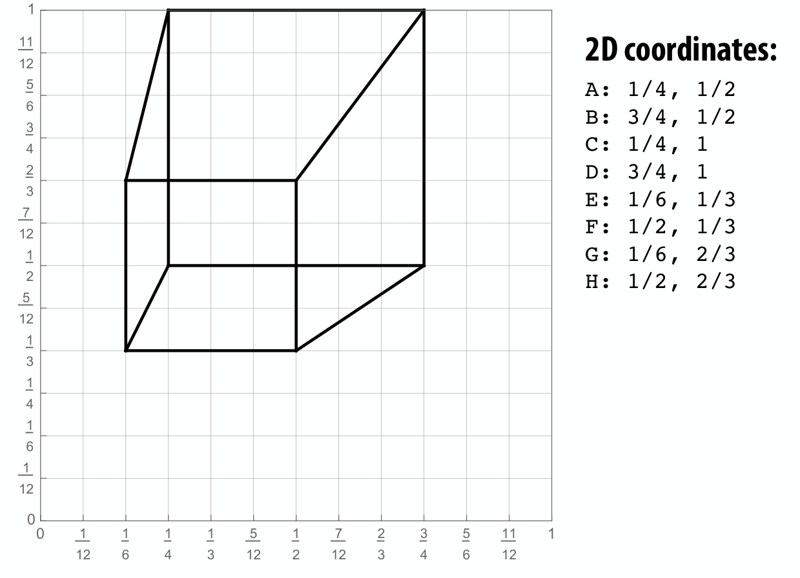

# 第 1 讲　计算机图形学导论

[复习提纲](README.md) · [原课件（80 页）](../ppt/lec-01-introduction.pdf)

## 图形学把什么变成什么？（第 1–17 页）

计算机图形学用计算机**合成和处理视觉信息**。可以把输入想成一张数字清单，里面是点的位置、连接关系、材料和光源；算法要回答的是这些数字从某处看起来是什么样子。开篇的游戏画面是一个成品，课件随即用显示设备的发展追问：连一个点应该画在哪里，计算机是怎么知道的？

- ENIAC（1945）和约 120 字节的穿孔卡说明早期计算结果的输入输出形式。随后出现可视显示终端，Ivan Sutherland 的 **Sketchpad（1963）** 让人在显示器上交互绘图。
- 个人电脑、现代显示器、VR 和 AR 发展了人观察和操纵数字模型的方式。第 15 页展示 3D 打印，说明同一份几何描述也能指导设备制造实体。

## 课堂案例里分别用了什么技术？（第 18–44 页）

| 场景 | 课件案例 | 图形学要解决的具体问题 |
|---|---|---|
| 电影特效 | 《侏罗纪公园》的恐龙，《黑客帝国》的“子弹时间” | 把数字角色放进实拍场景。第 21–22 页对照成片与环绕演员的相机阵列，说明如何在动作近乎冻结时改变视点。 |
| 动画与仿真 | 《阿凡达》的人脸运动捕捉，Andy Serkis 在《双塔奇兵》中饰演咕噜，《疯狂动物城》的毛发，《冰雪奇缘 2》的气流 | 把表演映射到虚拟角色，表示细小几何，或用物理规律生成随时间变化的运动。 |
| 游戏 | 《Halo 5》《Battlefield 5》《Red Dead Redemption 2》 | 课件分别用它们举例说明角色与场景建模、渲染效果及大尺度场景。 |
| 训练、VR 与 AR | America’s Army、CAE 飞行训练、丰田驾驶模拟器、达芬奇手术机器人、HTC Vive、Microsoft HoloLens | 在可控环境中练习操作。VR 用头显和控制器把人带入合成环境，AR 把虚拟内容与眼前场景配准。 |
| 设计与制造 | 宜家目录（课件例示 75% 为渲染图）、Avametric 实拍衣裙与模拟对照、Tesla Model X 概念图、扎哈团队的海达尔·阿利耶夫中心、SolidWorks 和 SketchUp | 在成品出现前检查形态、材质或空间，输出接近摄影的产品展示。 |
| 字体、可视化与界面 | Baskerville 字形轮廓、医学与统计图、事件视界望远镜的黑洞观测图像、《星际穿越》的黑洞形象、桌面图形界面 | 曲线能表示字形，数据和模型都能生成图像。第 41–42 页把来自观测的数据可视化与由电影场景生成的画面并列。界面中的图标、透明度、过渡也用到图形技术。 |

共同的理论问题有五类：如何表示形状和运动，如何采样及重建信号，如何描述光的传播，如何数值计算，以及人如何感知结果。系统上还要组织并行、异构计算，并用着色语言描述大量相似计算。

## 课堂手算：把一个立方体画到方格纸上（第 46–55 页）

**建模。** 立方体中心在原点，尺寸 $2\times2\times2$，棱平行于坐标轴。顶点的每个坐标只能取 $+1$ 或 $-1$。相邻顶点只有一个坐标不同，因此 12 条棱分为三组：$AB,CD,EF,GH$；$AC,BD,EG,FH$；$AE,CG,BF,DH$。只存点还画不出立方体，必须知道哪些点要连起来。

**投影。** 课件采用针孔模型，以孔为原点、单位成像距离，用相似三角形得到 $v/1=y/z$，横向同理。按课上活动约定，相机位于 $c=(2,3,5)$，保持坐标轴方向。对每个世界坐标顶点先平移到相机坐标，再做透视除法：

$$
(x,y,z)=(X-2,Y-3,Z-5),\qquad (u,v)=\left(\frac{x}{z},\frac{y}{z}\right).
$$

例如，$A=(1,1,1)$ 减去相机位置后为 $(-1,-2,-4)$，故 $A'=(1/4,1/2)$。同理得到 $B'=(3/4,1/2)$，于是 $AB$ 在纸上是一条水平线。近面的 $AB$ 投影长 $1/2$，远面的平行棱 $EF$ 投影长 $1/3$，直接看出透视的近大远小。

| 顶点 | 世界坐标 $(X,Y,Z)$ | 投影 $(u,v)$ | 顶点 | 世界坐标 $(X,Y,Z)$ | 投影 $(u,v)$ |
|---|---|---|---|---|---|
| A | $(1,1,1)$ | $(1/4,1/2)$ | E | $(1,1,-1)$ | $(1/6,1/3)$ |
| B | $(-1,1,1)$ | $(3/4,1/2)$ | F | $(-1,1,-1)$ | $(1/2,1/3)$ |
| C | $(1,-1,1)$ | $(1/4,1)$ | G | $(1,-1,-1)$ | $(1/6,2/3)$ |
| D | $(-1,-1,1)$ | $(3/4,1)$ | H | $(-1,-1,-1)$ | $(1/2,2/3)$ |

老师把 12 条棱分给 12 名同学，每人计算一条棱的两端并连线。复习时先遮住右边的坐标答案，按第 53 页的空方格画一次，再比对下图。[空白方格（第 53 页）](../ppt/lec-01-introduction.pdf#page=53)

## 从纸面上的线到显示器上的像素（第 56–62 页）

方格纸上可以画连续线段，光栅显示器接收的是二维像素数组，每个像素各存一个颜色。**光栅化**就是把连续图形转换为网格上的离散表示。第 59–60 页画一条斜线，让大家决定“把直线穿过的格子全部点亮”会得到什么效果。这一步提出覆盖与采样规则的问题，[第 2 讲](02-digital-drawing.md)会用三角形把它具体化。

即使线框投影完全正确，它也只表达了棱的位置。要再现手中实物的外观，还要描述遮挡、材料、光源、相机；要表现动作，还要描述物体随时间的变化。

## 课程路线与考核（第 63–80 页）

第 63 页列出数字绘图、滤波与采样、几何建模、材质建模、光照建模、相机成像、动画与物理模拟、虚拟现实。后面的例图依次展示三角形覆盖、阶梯边、建筑和织物几何、不同材质的鞋面、《WALL‑E》的照明、实拍与渲染对照、相机拆解，以及流体绕过兔子模型的动画。

课件把学习目标概括为三件事：选择合适的表示（几何、图像、变换），掌握算法（采样、细分、光线追踪），理解设备（GPU、显示器、相机）。先修知识包括向量、矩阵、线性代数、数据结构和 C/C++；统计、信号处理和傅里叶变换用于后续章节。

按第 76–79 页的课程说明，数字绘图、几何、光线追踪、动画四次作业各列两周、各占 10 分，期末 50 分，课堂参与 10 分。主材料为讲义，参考书有 *Fundamentals of Computer Graphics*、*Computer Graphics: Principles and Practice*（第 3 版）、*Physically Based Rendering*（第 3 版）；课件致谢 GAMES101、CMU 15-362/662 和 UCB CS184。
