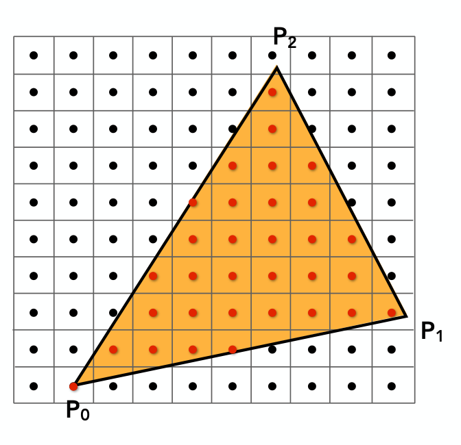
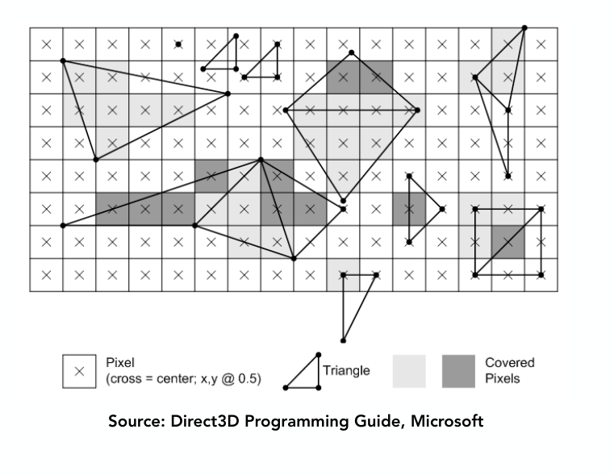
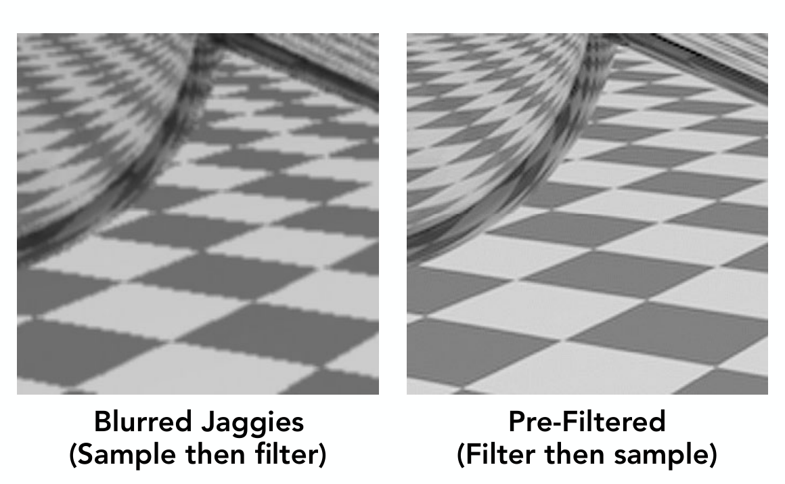

# 第 2 讲　数字绘制与三角形光栅化

[复习总纲](README.md) · [原课件（91 页）](../ppt/lec-02-digital-drawing.pdf)

给出三个已经投影到屏幕的顶点，显卡怎么决定哪些像素上色？本讲把绘制三角形归结为对一个二维函数采样，再从显示器如何重建这些样本解释锯齿。

## 1. 绘图机器、光栅显示与帧缓冲（第 3–14 页）

- CNC Sharpie 绘图机移动实物画笔，在纸上走出连续轨迹。示波器和阴极射线管（CRT）展示另一种控制轨迹的方法，电子束经聚焦、加速和偏转后打在荧光屏上。
- 电视式 CRT 让电子束按光栅逐行扫描，沿途调节亮度。此时可先把图像保存成二维像素颜色数组，称为**帧缓冲**（framebuffer），再按显示次序读取。第 8 页以游戏画面展示数字 RGB 经数模转换送往模拟显示器。
- LCD 利用液晶改变偏振，让背光透过或被阻挡，中间状态可形成不同亮度。LED 阵列直接控制发光元件，课件给出小型 RGB 点阵和 BAMPFA 建筑外墙大屏。电子墨水用电场移动不同颜色的带电粒子，改变表面的可见颜色。

## 2. 为什么把模型化成三角形（第 15–19 页）

《少年派的奇幻漂流》老虎模型的网格说明，许多小平面能近似一片弯曲的表面。三个不共线的点确定一个平面，三角形也有明确的内部。颜色、纹理坐标等顶点数据可以用重心坐标插值。课件用点和粗线也能用小三角形表示，说明统一图元后可以集中优化三角形绘制。

第 18 页的顺序是**摆放物体 → 投影到屏幕 → 求三角形覆盖 → 在覆盖的样本处插值顶点属性 → 采纹理并着色 → 根据深度、透明度等合成图像**。本讲集中解决第三步。输入是屏幕上的 $P_0,P_1,P_2$，输出是被覆盖的样本。

## 3. 采样与重建（第 20–35 页）

在 $x_0,\ldots,x_4$ 上测量曲线 $f(x)$，得到五个函数值。要在原来没有测量的 $x$ 处给出结果，就要约定重建方法。

| 方法 | 给定样本后怎么算 | 课件中看见什么 |
| --- | --- | --- |
| 最近邻／分段常数 | 取离 $x$ 最近的样本值 | 一维是阶梯，二维地球图片放大后出现方块 |
| 分段线性 | 在 $[x_i,x_{i+1}]$ 令 $t=(x-x_i)/(x_{i+1}-x_i)$，取 $(1-t)f(x_i)+t f(x_{i+1})$ | 一维用线段连相邻样本，二维沿两个坐标方向做线性插值，得到双线性重建 |

第 26–27 页把五个样本加密为九个，两种重建都更贴近原曲线。音频例子以 $44.1\,\mathrm{kHz}$ 记录随时间变化的振幅，即每秒 $44\,100$ 个样本。地球图片（第 29 页）则在二维位置上采样。

光栅化所采的函数是三角形 $T$ 的指示函数。像素 $(i,j)$ 代表一个小方格，中心样本的位置为 $(i+\tfrac12,j+\tfrac12)$。

$$
\chi_T(x,y)=
\begin{cases}
1,&(x,y)\in T,\\
0,&(x,y)\notin T,
\end{cases}
\qquad I[i,j]=\chi_T(i+\tfrac12,j+\tfrac12).
$$

于是“像素方格和三角形有交集”与“像素中心在三角形内”要区分。一次中心采样只回答后一个问题，一条擦过像素角的细边可能完全漏掉。

## 4. 怎样判定一个采样点在三角形内（第 36–53 页）

三角形内部是三个内侧半平面的交集。先考虑一条有向边 $P_i=(X_i,Y_i)\to P_{i+1}$，下标对 3 取模。设 $\Delta X_i=X_{i+1}-X_i,\ \Delta Y_i=Y_{i+1}-Y_i$。

1. 切向量为 $\mathbf t=(\Delta X_i,\Delta Y_i)$。将它旋转 $90^\circ$ 得到法向量 $\mathbf n=(-\Delta Y_i,\Delta X_i)$。
2. 从边的起点指向待测点 $S=(x,y)$ 的向量是 $\mathbf v=(x-X_i,y-Y_i)$。点积给出边函数

   $$
   L_i(x,y)=\mathbf v\cdot\mathbf n
   =-(x-X_i)\Delta Y_i+(y-Y_i)\Delta X_i
   =A_i x+B_i y+C_i,
   $$

   其中 $A_i=-\Delta Y_i,\ B_i=\Delta X_i,\ C_i=X_i\Delta Y_i-Y_i\Delta X_i$。
3. $L_i=0$ 表示在直线上，正负号区分两侧。按第 49–53 页的顶点顺序，内部对应三个 $L_i$ 全为正。交换顶点绕序会翻转符号；实际计算可先用对面顶点检验这条边内侧的符号。恰为零的点按下一节的共边规则处理。

第 53 页的结果图。靠近边的像素也只检查黑点所在的中心，不能只凭像素方格是否碰到橙色判断。

## 5. 共边规则与遍历效率（第 54–59 页）

**共边采样点归谁？** 第 55 页两只三角形拼成一个四边形，样本恰落在公共边上。如果两个三角形都排除它就会留缝，都纳入又会双算。课件引入 Direct3D 的 **top-left rule**。边界点落在顶边或左边时纳入。顶边是位于三角形其余部分上方的水平边，左边是三角形左侧的非水平边。相邻三角形以同一规则处理，即可给共边样本唯一归属。读图时先确认屏幕 $y$ 轴方向，再把“上”和“左”换成代码判断。

第 56 页原图。沿相邻三角形的公共边逐格检查，观察哪些中心被计入。

**少算哪些采样点？** 先用三个顶点的坐标极值构造轴对齐包围盒，只遍历盒内像素。第 58 页画出沿扫描行增量遍历的路径；由上式可直接推出向右一步 $L_i$ 增加 $A_i$，向下一行（$y$ 增 1 时）增加 $B_i$。第 59 页进一步将区域划成小块，同一块中的样本可并行测试。整块在外时提前排除，整块在内时直接接受，跨边界的块再细测。这也解释了硬件为何能高效地反复做半平面测试。

## 6. 显示器怎样重建三角形（第 60–70 页）

iPhone 6S 和 Galaxy S5 的显微照片显示，两者的 RGB 子像素排列不同。纸上印刷的热气球照片放大后也有半色调网点。为讨论采样，课件将一个显示像素近似成亮度、颜色均匀的小方块。发送“纯红／纯白”的中心采样结果，每个值就会铺满一个方块。与原来连续三角形的斜边相比，方块的边缘形成台阶，也就是锯齿（jaggies）。

## 7. 走样的三个课堂例子（第 71–91 页）

| 课件例子 | 采样的自变量 | 现象和原因 |
| --- | --- | --- |
| 三角形斜边、Don Mitchell 的 *Retort* 棋盘图（第 77–78 页） | 屏幕平面上的位置 | 黑白格和轮廓在小区域内变化很快，离散像素出现台阶或错误的细纹 |
| 衬衫与领带（第 79 页） | 相机传感器的行、列 | 先读每个传感器像素，再演示跳过奇数行和奇数列；布料的细条纹与稀疏网格形成额外的大尺度摩尔纹 |
| 车轮倒转错觉（第 74、80 页） | 视频帧的时刻 | 视频按时刻记录运动。相邻帧内类似的辐条位置可以被解释成较小的反向转动，使真实转速或方向难以分辨 |

共同原因是相对于细节变化的速度，采样不够密，多个原始信号可以给出同一组样本。反走样的顺序是**先对连续信号做低通预滤波，再按目标网格采样**。对红色三角形，边缘像素由红白两种区域的覆盖比例决定，可产生过渡色。先点采样再模糊，只会把已经产生的错误纹样一起变模糊。

第 88 页原图。左图的台阶被抹软，右图保留棋盘斜线的走向。预滤波为何有效，以及怎样在像素内近似求平均，见[第 3 讲](03-antialiasing.md)。
