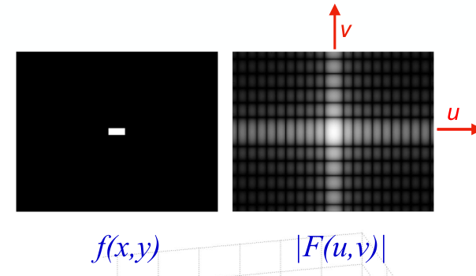
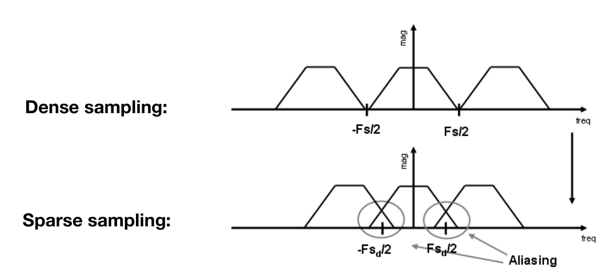
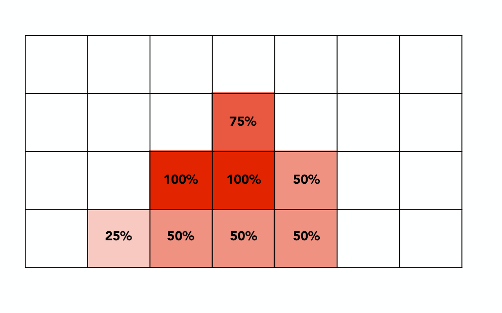

# 第 3 讲　采样、频谱与反走样

[复习总纲](README.md) · [原课件（63 页）](../ppt/lec-03-antialiasing.pdf)

第 2 讲里，红色三角形经中心采样后只剩红、白两个值。第 1–5 页回顾了先滤波再采样的处理顺序。本讲先用频谱说明这一步为什么有效，再给出用有限个样本估算边缘像素颜色的方法。

## 1. 把信号拆成不同频率（第 6–11 页）

**声音叠加的例子。** 第 7 页给出三个分量 $f_1(x)=\sin(\pi x)$、$f_2(x)=\sin(2\pi x)$、$f_4(x)=\sin(4\pi x)$。把它们按 $f(x)=f_1(x)+0.75f_2(x)+0.5f_4(x)$ 叠起来，得到看似复杂的波形。横轴上的一段波形可以改用“有哪些频率、各占多少”描述。

**周期信号与傅里叶级数。** 第 8 页逐项增加奇次谐波逼近方波，公式为

$$
f(t)=\frac A2+\frac{2A}{\pi}
\left(\cos(\omega t)-\frac{\cos(3\omega t)}3
+\frac{\cos(5\omega t)}5-\frac{\cos(7\omega t)}7+\cdots\right).
$$

频率越高，越能补出跃变处的锐利轮廓。图形中一条理想的硬边也含有任意高频成分。

**连续傅里叶变换。** 取频率 $u$ 的单位为每单位长度的周期数，使用第 9 页的 $2\pi$ 约定和 $e^{i\theta}=\cos\theta+i\sin\theta$，则

$$
F(u)=\int_{-\infty}^{\infty}f(x)e^{-2\pi iux}\,dx,\qquad
f(x)=\int_{-\infty}^{\infty}F(u)e^{2\pi iux}\,du.
$$

$F(u)$ 是信号在该频率基函数上的复系数。**第 10 页的矩形脉冲**在 $|x|<X/2$ 内取 1，其他位置取 0。积分上下限因此缩为 $[-X/2,X/2]$：

$$
F(u)=\int_{-X/2}^{X/2}e^{-2\pi iux}\,dx
=X\frac{\sin(\pi Xu)}{\pi Xu}.
$$

在 $u=0$ 用极限得到 $X$；离原点最近的两个零点是 $u=\pm1/X$，主瓣宽度为 $2/X$。空间中的矩形越宽，频域主瓣越窄。

**离散例题。** 对 $N$ 个样本，$X_k=\sum_{m=0}^{N-1}x_m e^{-2\pi i km/N}$，$k=0,\ldots,N-1$。第 11 页将

$$
x(t)=\cos(2\pi\,10t)+\cos(2\pi\,25t)+\cos(2\pi\,50t)+\cos(2\pi\,100t)
$$

进行 FFT（快速计算离散傅里叶变换的算法），时域看似杂乱，正频率幅度谱出现 $10,25,50,100\,\mathrm{Hz}$ 四个峰。

## 2. 二维频谱怎样对应图像（第 12–19 页）

$$
F(u,v)=\iint f(x,y)e^{-2\pi i(ux+vy)}\,dx\,dy,\qquad
f(x,y)=\iint F(u,v)e^{2\pi i(ux+vy)}\,du\,dv .
$$

两式的积分范围都是整个平面。$(u,v)$ 表示两个方向的空间频率。若 $F=F_R+iF_I$，幅度谱为 $|F|=\sqrt{F_R^2+F_I^2}$，相位为 $\arg F$，可用 $\operatorname{atan2}(F_I,F_R)$ 求出。课件照片旁的黑白频谱图展示幅度，零频移到了图中央。

第 13 页将矩形扩展到二维。原点居中、宽 $X$ 高 $Y$ 的矩形指示函数可写作横、纵两个一维矩形的乘积，频谱也能分离。取 $\operatorname{sinc}(s)=\sin(s)/s$，有

$$
F(u,v)=XY\,\operatorname{sinc}(\pi Xu)\,\operatorname{sinc}(\pi Yv).
$$

第 13 页原图。空间方向上越宽，对应方向上的频谱主瓣越窄。

第 14–19 页对同一幅伸手指向镜头的人像做实验。保留频谱中心附近的低频，照片还看得出大致明暗，五官与衣物边缘变糊；去掉中心低频，留下高频，人像主要剩下轮廓与纹理；只保留一圈环带，则只看得见对应尺度的细节。环带离中心越远，剩下的纹理越细。

## 3. 卷积、盒式滤波及原题计算（第 20–30 页）

把滤波核 $g$ 滑过信号 $f$，每到一个位置，把对应值的乘积累加：

$$
(f*g)(t)=\int_{-\infty}^{\infty} f(\tau)g(t-\tau)\,d\tau,\qquad
(f*g)[n]=\sum_{m=-\infty}^{\infty} f[n-m]g[m].
$$

**第 21–23 页的滑动计算。** 信号为 $(1,3,5,3,7,1,3,8,6,4)$，核为 $(1/4,1/2,1/4)$。对第一个完整窗口，$1/4+3/2+5/4=3$；右移一步，$3/4+5/2+3/4=4$。第 24 页改用对称均值核，$g[-1]=g[0]=g[1]=1/3$，所以输出是 $(f[n-1]+f[n]+f[n+1])/3$。边界上的值取决于延拓方式，课件计算的是完整窗口。

**卷积定理。** 空间域卷积对应频域逐点相乘，故既可以直接滑动核，也可以把信号和核分别变换，逐频率相乘，再做逆变换。按第 9 页使用的普通频率约定，

$$
\mathcal F(f*g)=FG,\qquad \mathcal F(fg)=F*G.
$$

第 25 页还列出角频率约定的写法。若正变换用 $e^{-i\omega t}$，逆变换前带 $1/(2\pi)$，后一式相应变成 $\mathcal F(fg)=(F*G)/(2\pi)$。做题时常数要与选用的定义配套。

第 27–30 页的二维例子用元素均为 $1/9$ 的 $3\times3$ 核平滑小女孩的照片，相当于把周围九个位置等权平均。盒式滤波（box filter）在空间域是方窗，其频谱有主瓣和旁瓣，能够衰减高频。加宽空间窗口后中心主瓣变窄，图像更模糊；旁瓣说明方窗并不能完全截去一个界限以上的所有频率。

## 4. 采样为什么产生走样（第 31–41 页）

1. **从样本看。** 第 32–33 页固定采样点间距并逐渐提高正弦信号频率。高频曲线可以在所有样本点上恰好与低频曲线重合，重建就可能把原来的快变化读成慢变化。这个采样率下无法区分的频率互为别名（aliases）。
2. **从频谱看。** 设采样间隔为 $T$，频率 $f_s=1/T$。在空间域用间隔 $T$ 的冲激串乘原信号，等于在频域每隔 $f_s$ 复制一次原频谱，即 $F_s(u)=\tfrac1T\sum_{k\in\mathbb Z}F(u-kf_s)$。密采样使副本分得更远；稀采样会让邻近副本重叠，混在一起的频率无法由该组样本唯一分开。
3. **奈奎斯特–香农采样定理。** 理想带限信号的最高频率为 $B$ 时，课件给的临界周期是 $T=1/(2B)$，采样率对应 $2B$。实际判题可取 $f_s>2B$ 以避开恰在边界时的相位问题。已知采样率时，可表达的频带上界（奈奎斯特频率）是 $f_s/2$。例如第 2 讲的 $44.1\,\mathrm{kHz}$ 音频采样对应 $22.05\,\mathrm{kHz}$ 的界限。
4. **图形里的难点。** 三角形指示函数在边上从 0 跳到 1，和方波一样并非带限。提高显示器、帧缓冲或传感器的分辨率能缓解走样，却要付出更多样本。另一条路径是先去除或衰减目标网格无法表达的高频，再进行采样。

第 35 页原图。两个圆圈标出了重叠区。若等到采样后才做低通，错误折回低频的那部分也已经落入保留区。

## 5. 一像素宽的盒式滤波与超采样（第 42–54 页）

把像素看作面积为 1 的方格 $P$。三角形内部的指示函数等于 1，外部为 0，故它在像素内的平均值就是**面积覆盖率**：

$$
\alpha_P=\frac{1}{|P|}\int_P\chi_T(x,y)\,dA
=\frac{|P\cap T|}{|P|},\qquad
C_P=\alpha_P C_T+(1-\alpha_P)C_{\mathrm{bg}} .
$$

最后一式对应课件的纯色三角形和纯色背景。直接做精确的面积裁剪较麻烦，可以在一个像素内布置 $N\times N$ 个子样本，逐个判定是否在三角形内，再以命中数除以 $N^2$。这就是用超采样近似一像素方窗的预滤波。

**第 46–51 页的红色三角形。** $2\times2$ 每个像素测四次。例如顶端像素命中三点是 $75\%$，中间一行依次为 $100\%,100\%,50\%$，最下一行依次为 $25\%,50\%,50\%,50\%$。边缘得到浅红。第 52–53 页换成 $4\times4$，每像素 16 点，覆盖率的步长细化到 $1/16$，也增加了采样工作量。

第 51 页原图。可以把每个百分数乘 4，倒推出该像素被三角形覆盖的子样本数。

## 6. 子样本位置、多三角形及常见 AA（第 55–63 页）

常规中心采样在 $(i+\tfrac12,j+\tfrac12)$ 测量。$2\times2$ 的四点，横、纵偏移各独立取 $\{\tfrac14,\tfrac34\}$。第 58 页问如何推广，规则 $N\times N$ 网格的子像素中心为

$$
\left(i+\frac{a+1/2}{N},\ j+\frac{b+1/2}{N}\right),
\qquad a,b\in\{0,\ldots,N-1\}.
$$

第 59 页问多个三角形能否各自平均完再叠加。应保留每个子样本的覆盖、颜色及必要的深度信息，在该位置确定可见表面后，再把同一显示像素的最终子样本平均一次。若过早把每个三角形压缩成覆盖率，两个覆盖率同为 $1/2$ 的三角形可能占同一半，也可能各占一半，单从这两个数字无法还原。可分块处理并在块内保留必要的子样本状态，完成后再输出像素，以降低峰值存储需求。

| 第 60–62 页提到的方法 | 怎样使用信息 |
| --- | --- |
| SSAA（超采样） | 以更密的子样本计算图像，再降采样。直接近似像素面积积分，计算与存储开销较高 |
| MSAA（多重采样） | 为同一像素保留多个覆盖／深度样本，常可在同一图元内共享着色结果。课件比较无 AA 与 4× MSAA 的轮廓 |
| FXAA（快速近似反走样） | 在已渲染图像上检测并平滑明显的边缘。第 62 页和 4× MSAA 对照 |
| TAA（时间反走样） | 加权融合当前帧和历史帧的采样信息 |
| DLSS | 课件列为基于深度学习的超采样方法 |

复习时要能区分 $2B$（给定带宽所需的临界采样率）、$f_s/2$（给定采样率的频带上界）与 $N^2$（每个像素的子样本数）。超采样后的一次平均，近似的是最终显示网格采样前应做的预滤波。
