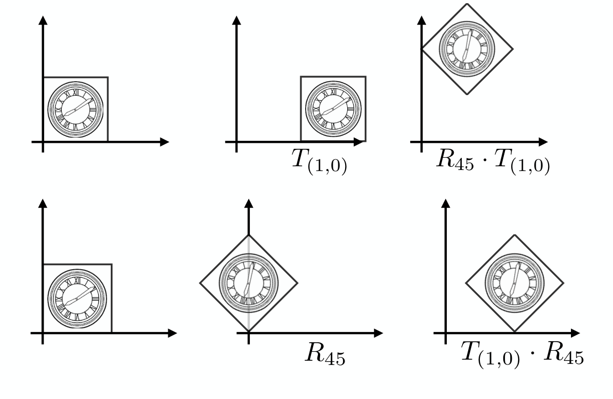
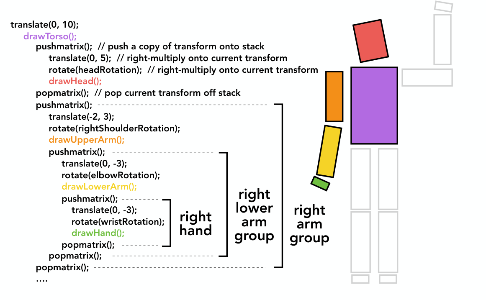
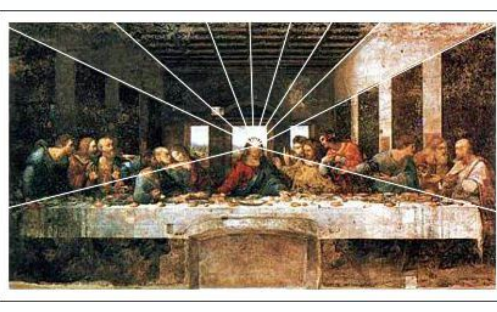
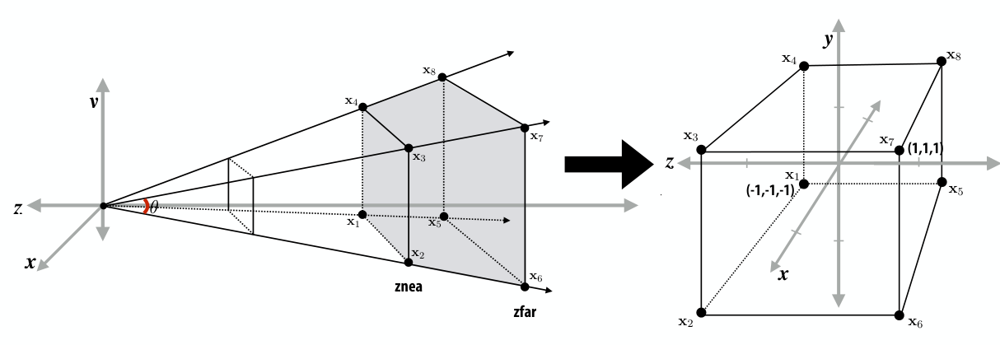

# 第 4 讲　几何变换与 MVP

[复习总纲](README.md) · [原课件（118 页）](../ppt/lec-04-transforms.pdf)

本讲统一使用**列向量，矩阵写在左边，连乘从右向左作用**。先说明物体怎样在场景中摆放，再把它从相机看到的位置变成屏幕像素坐标。数学推导最容易出错的地方是绕点旋转的顺序、观察矩阵的方向，以及透视除法前后的深度约定。

## 1. 为什么要做变换（第 2–11 页）

第 4 页的立方体顶点形如 $(\pm1,\pm1,\pm1)$。第 5 页的“方块人”可以反复使用同一个立方体，分别缩放、旋转、平移为头、躯干和四肢。**建模变换**让形状可以在方便的局部坐标中定义，再实例化并组成场景；**观察与投影**决定从哪里看、看到的物体落在屏幕什么位置。

线性变换满足 $f(\mathbf x+\mathbf y)=f(\mathbf x)+f(\mathbf y)$ 和 $f(a\mathbf x)=a f(\mathbf x)$，因此必有 $f(\mathbf 0)=\mathbf 0$。仅凭“直线变为直线”不能判定线性；平移就是课件的反例。线性变换可用矩阵表示，其复合仍是线性变换。

## 2. 从基向量推二维变换（第 12–29 页）

设 $\mathbf p=(x,y)^T$。矩阵的第一、第二列分别是基向量 $(1,0)^T,(0,1)^T$ 变换后的位置。

| 变换和课堂例子 | 矩阵或坐标关系 | 几何意义 |
| --- | --- | --- |
| 缩放（第 12–17 页） | $S=\operatorname{diag}(s_x,s_y)$ | $s_x=s_y=0.5$ 时两个方向长度都减半；$s_x=0.5,s_y=1$ 时只压窄横向。用 $S_2(\mathbf x)=2\mathbf x$ 可以逐项验证可加性和齐次性 |
| 镜像（第 18–19 页） | $x'=-x,\ y'=y$ | 关于 $y$ 轴反射，左右互换，距离保持 |
| 水平错切（第 20–21 页） | $x'=x+ay,\ y'=y$，矩阵为 $\left[\begin{smallmatrix}1&a\\0&1\end{smallmatrix}\right]$ | $y=0$ 的点不动，$y=1$ 的点横移 $a$，中间各层按高度成比例移动 |
| 绕原点逆时针旋转（第 22–24 页） | $R(\theta)=\left[\begin{smallmatrix}\cos\theta&-\sin\theta\\ \sin\theta&\cos\theta\end{smallmatrix}\right]$ | 第一个基向量转到 $(\cos\theta,\sin\theta)$，第二个转到 $(-\sin\theta,\cos\theta)$；课件用 $45^\circ$ 演示 |
| 平移（第 26–29 页） | $T_{\mathbf b}(\mathbf p)=\mathbf p+\mathbf b$ | 例 $T_{1,1}$。有 $T_{\mathbf b}(\mathbf x)+T_{\mathbf b}(\mathbf y)=\mathbf x+\mathbf y+2\mathbf b$，非零平移破坏可加性 |

## 3. 齐次坐标、仿射变换与组合次序（第 30–46 页）

二维点用 $(x,y,1)^T$，方向向量用 $(x,y,0)^T$。$w\ne0$ 时，$(X,Y,w)^T$ 对应欧氏点 $(X/w,Y/w)$。任意非零倍数表示同一点。第 32–33 页把这些齐次表示画成穿过原点的直线，与平面 $w=1$ 的交点给出普通坐标。

- 两向量相加仍是向量；点减点得向量；点加向量得点。两个点分量相加后末项为 2，除以 2 得到中点。要作保持点意义的加权组合，应使权重和为 1。
- 所有二维仿射变换都可写成 $\mathbf p'=A\mathbf p+\mathbf b$。在齐次空间中，用一个矩阵就能运算：

$$
\begin{bmatrix}x'\\y'\\1\end{bmatrix}=
\begin{bmatrix}a&b&t_x\\c&d&t_y\\0&0&1\end{bmatrix}
\begin{bmatrix}x\\y\\1\end{bmatrix}.
$$

对 $w=0$ 的方向向量，平移列不起作用。$A=I$ 就是纯平移；$\mathbf b=0$ 时，嵌入任意二维线性变换。第 33 页还有一个空间解释，$(X,Y,w)$ 被平移矩阵变成 $(X+wt_x,Y+wt_y,w)$，在齐次空间沿各个 $w$ 层观察，这相当于错切。

**哪些量保持？** 欧氏变换保持任意两点距离，反射也保持距离，但翻转取向。课件所说的刚体运动只含保取向的旋转与平移；再加均匀缩放得到相似变换，可保持角度；一般仿射变换还能作非均匀缩放、错切，保持平行关系；透视投影属于更一般的射影变换。存在逆矩阵时，$M^{-1}$ 会把结果送回原处。

**平移再旋转，还是旋转再平移？** 第 40–44 页先将图形向右移 1，再绕原点逆时针转 $45^\circ$，得到 $R_{45}T_{(1,0)}$；次序颠倒得到 $T_{(1,0)}R_{45}$。用原点检验，前者给 $(\sqrt2/2,\sqrt2/2)$，后者给 $(1,0)$。

第 43 页原图。上排连同已经平移的图形中心一起绕原点转；下排旋转完才水平平移。

若按时间先后执行 $A_1,A_2,\ldots,A_n$，总矩阵为 $A_n\cdots A_2A_1$，可先合为一个矩阵，再用于所有顶点。第 46 页要求绕任意中心 $\mathbf c$ 转动：先把中心移到原点，再旋转，然后把中心移回，故 $M=T(\mathbf c)R(\alpha)T(-\mathbf c)$。将 $\mathbf c$ 本身代入，结果仍是 $\mathbf c$，可快速检查顺序。

## 4. 三维旋转与层次建模（第 47–63 页）

三维点和方向分别补 $w=1$ 与 $w=0$。缩放写成 $\operatorname{diag}(s_x,s_y,s_z,1)$，平移矩阵为 $\left[\begin{smallmatrix}I_3&\mathbf t\\0&1\end{smallmatrix}\right]$。任意 $(X,Y,Z,w)^T$ 在 $w\ne0$ 时通过除以 $w$ 回到三维。

以下给出三个旋转矩阵的 $3\times3$ 线性部分，作齐次变换时补末行、末列 $(0,0,0,1)$。令 $c=\cos\alpha,\ s=\sin\alpha$，角度按右手规则：

$$
R_x=\begin{bmatrix}1&0&0\\0&c&-s\\0&s&c\end{bmatrix},\quad
R_y=\begin{bmatrix}c&0&s\\0&1&0\\-s&0&c\end{bmatrix},\quad
R_z=\begin{bmatrix}c&-s&0\\s&c&0\\0&0&1\end{bmatrix}.
$$

第 51 页特别问 $R_y$ 的正负号。用循环顺序 $x\to y\to z\to x$ 检查即可，例如绕 $+y$ 转 $90^\circ$ 会把 $+z$ 转到 $+x$。第 53 页用飞行模拟器的滚转、俯仰、偏航说明欧拉角。写成 $R_x(\alpha)R_y(\beta)R_z(\gamma)$ 时，在这里的固定轴列向量约定下，右边的 $R_z$ 先作用。

**绕任意轴旋转。** 第 54–55 页给出 Rodrigues 公式。若 $\mathbf n=(n_x,n_y,n_z)^T$ 为过原点的单位轴向量，且 $[\mathbf n]_\times\mathbf v=\mathbf n\times\mathbf v$，则

$$
[\mathbf n]_\times=
\begin{bmatrix}0&-n_z&n_y\\n_z&0&-n_x\\-n_y&n_x&0\end{bmatrix},\qquad
R(\mathbf n,\alpha)=\cos\alpha\,I+(1-\cos\alpha)\mathbf n\mathbf n^T
+\sin\alpha\,[\mathbf n]_\times .
$$

推导时把 $\mathbf v$ 拆成 $\mathbf v_\parallel=(\mathbf n^T\mathbf v)\mathbf n$ 和 $\mathbf v_\perp=\mathbf v-\mathbf v_\parallel$。平行分量不动；垂直平面内旋转后为 $\cos\alpha\,\mathbf v_\perp+\sin\alpha\,(\mathbf n\times\mathbf v_\perp)$。合起来即上式。

**课堂骨架例子。** 若头、上臂、前臂和手各记独立世界坐标，抬肩要同时重算多个部件。层次树改为让每个部件只保存相对父节点的变换，手的世界矩阵就等于沿“躯干 → 右上臂 → 右前臂 → 右手”的局部矩阵依次连乘。第 62–63 页先 $T(0,10)$ 画躯干，头部相对躯干 $T(0,5)$ 并旋转；右肩相对躯干 $T(-2,3)$，肘和腕各相对上一个关节 $T(0,-3)$，各关节再乘自己的旋转。右手所在支路的具体乘积是

$$
T(0,10)\,T(-2,3)R_{\mathrm{shoulder}}\,T(0,-3)R_{\mathrm{elbow}}\,T(0,-3)R_{\mathrm{wrist}}.
$$

进入子树时 `pushmatrix()` 保存父矩阵，局部变换右乘当前矩阵；画完后 `popmatrix()` 恢复父节点。单改肩的角度，肘和手会一起运动，头不受影响。

第 62 页原图。右侧括号指出手、前臂与整条右臂的作用范围。

## 5. 观察变换与相机坐标（第 64–72 页）

课件以合影解释 MVP。安排人站在哪里是 Model，选择机位与朝向是 View，通过镜头形成图像是 Projection。相机和所有物体一起刚性运动时，拍到的相对位置不变，所以可把整个世界变换到一个标准相机：眼睛位于原点、看向 $-z$、上方为 $+y$。

设眼睛在 $\mathbf e$，单位视线为 $\hat{\mathbf g}$，与视线正交的单位上方向为 $\hat{\mathbf t}$，右方向 $\hat{\mathbf r}=\hat{\mathbf g}\times\hat{\mathbf t}$。先平移眼睛到原点，再把这组正交基换为标准轴：

$$
M_{\mathrm{view}}=
\begin{bmatrix}
\hat{\mathbf r}^{\,T}&0\\
\hat{\mathbf t}^{\,T}&0\\
-\hat{\mathbf g}^{\,T}&0\\
0\ \ 0\ \ 0&1
\end{bmatrix}
T(-\mathbf e).
$$

第 71 页先写逆旋转，其**列**是相机的三个轴在世界中的表示。正交旋转矩阵的逆等于转置，故世界转相机时把三个轴放在**行**中。若题目给的 up 仅是大致向上，可先取 $\hat{\mathbf r}=\operatorname{normalize}(\hat{\mathbf g}\times\mathbf{up})$，再以 $\hat{\mathbf t}=\hat{\mathbf r}\times\hat{\mathbf g}$ 正交化；up 与视线不能平行。

## 6. 正交、透视与针孔相机（第 73–97 页）

**正交投影。** 投影线彼此平行，远近相同大小的物体正投影大小相同。若只需平面图，可以舍去 $z$；实际管线仍保留归一化深度，供后续 Z-buffer 比较。第 75–77 页的观察长方体是 $[l,r]\times[b,t]\times[f,n]$，其中 $f<n<0$ 是相机坐标中的有符号深度。先把盒中心移到原点，再把各边长度缩放为 2：

$$
M_{\mathrm{ortho}}=
\begin{bmatrix}
2/(r-l)&0&0&-(r+l)/(r-l)\\
0&2/(t-b)&0&-(t+b)/(t-b)\\
0&0&2/(n-f)&-(n+f)/(n-f)\\
0&0&0&1
\end{bmatrix}.
$$

按这一约定，左、下、远三个边界分别映到 $-1$，右、上、近三个边界分别映到 $+1$。

**透视现象。** 第 78–83 页用铁轨、8–9 世纪加洛林绘画、Lorenzetti 的《天使报喜》（1344）、Masaccio 的《纳税银》与 Brunelleschi 的建筑图比较空间的画法。同尺寸物体越远，视角越小；向纵深延伸的一组平行线在画面上趋向同一消失点。平行于成像平面的线仍可以保持平行。

第 82 页原图。沿天花板和墙面的纵深边延长，观察它们在中心附近相交。

**针孔模型。** 第 84–91 页用蜡烛说明穿过针孔的光线在实像平面上倒立。为绘图方便，把虚拟像平面放在场景与眼睛之间，得到正立图像。眼睛在原点，像平面为 $z=d$，相似三角形给出

$$
(x,y,z)\ \longmapsto\ (dx/z,\,dy/z,\,d).
$$

齐次矩阵可以先把 $(x,y,z,1)^T$ 变成 $(x,y,z,z/d)^T$，再除以第四分量。此处用一个像平面说明“近大远小”，深度都变成 $d$。下一步要做可见性比较，因此需要把整个视锥体映射成立方体。

**描述视锥体。** 第 93–97 页给出上、下、左、右、近、远六个面，以及垂直视场角 $\theta_{\mathrm{fovy}}$、宽高比 $a$、正的近远距离 $d_n,d_f$。对称相机在近平面上满足 $t=d_n\tan(\theta_{\mathrm{fovy}}/2),\ b=-t,\ r=a t,\ l=-r$。不要把竖直视场角直接当成半角。

第 97 页原图。归一化设备坐标（NDC）还保有第三维，之后才把横纵坐标映射到帧缓冲。

## 7. 推透视矩阵及检查深度符号（第 98–107 页）

**第 98–105 页的推导采用有符号坐标 $f<n<0$。** 把视锥“挤”成正交盒，再乘 $M_{\mathrm{ortho}}$。由相似三角形，$x'=nx/z,\ y'=ny/z$，因此可以令未除法的齐次结果为 $(nx,ny,Az+B,z)^T$。近平面的点保持不动；远平面的点在 $x,y$ 上收缩，但要求深度仍为 $f$。由 $z'=A+B/z$ 得

$$
An+B=n^2,\qquad Af+B=f^2
\quad\Longrightarrow\quad A=n+f,\quad B=-nf .
$$

于是

$$
M_{\mathrm{persp}\to\mathrm{ortho}}=
\begin{bmatrix}
n&0&0&0\\0&n&0&0\\0&0&n+f&-nf\\0&0&1&0
\end{bmatrix},\qquad
M_{\mathrm{persp}}=M_{\mathrm{ortho}}M_{\mathrm{persp}\to\mathrm{ortho}}.
$$

检验时，$z=n$ 得 $z_{\mathrm{NDC}}=+1$，$z=f$ 得 $z_{\mathrm{NDC}}=-1$，与上一节的正交矩阵一致。

**第 106 页下方、第 107 页矩阵和曲线改用正距离。** 为避免与上式撞名，把它们记为 $0<d_n<d_f$，相机空间坐标仍是 $z<0$。这套矩阵取 $w'=-z$，并把近平面映到 $-1$、远平面映到 $+1$：

$$
P=
\begin{bmatrix}
\frac{2d_n}{r-l}&0&\frac{r+l}{r-l}&0\\
0&\frac{2d_n}{t-b}&\frac{t+b}{t-b}&0\\
0&0&-\frac{d_f+d_n}{d_f-d_n}&-\frac{2d_fd_n}{d_f-d_n}\\
0&0&-1&0
\end{bmatrix},
\qquad
z_{\mathrm{NDC}}=\frac{d_f+d_n}{d_f-d_n}+
\frac{2d_fd_n}{(d_f-d_n)z}.
$$

代入 $z=-d_n$ 和 $z=-d_f$ 分别得到 $-1$ 与 $+1$。**第 107 页底部中文把这两个端点写反了**，该页曲线及矩阵均与此处代入结果一致。两套约定都能用于绘制，解题时须先写明近远值是距离还是坐标，近端目标是 $-1$ 还是 $+1$。两者的共同点是透视除法产生 $1/z$ 项，深度随 $z$ 非线性变化，靠近相机处变化更快。

## 8. 从标准立方体到屏幕（第 108–118 页）

设屏幕宽 $W$、高 $H$，第 110 页屏幕图采用左下角为 $(0,0)$、$y$ 向上的约定。索引从 $(0,0)$ 到 $(W-1,H-1)$；像素中心为 $(i+\tfrac12,j+\tfrac12)$。视口变换把 $[-1,1]^2$ 映到 $[0,W]\times[0,H]$：

$$
M_{\mathrm{viewport}}=
\begin{bmatrix}
W/2&0&0&W/2\\0&H/2&0&H/2\\0&0&1&0\\0&0&0&1
\end{bmatrix}.
$$

例如 NDC 的 $(-1,-1)$ 落在屏幕左下边界，$(0,0)$ 落在屏幕中心，$(1,1)$ 落在右上边界。边界 $(W,H)$ 与最后一个像素中心 $(W-\tfrac12,H-\tfrac12)$ 不同。

第 113–118 页用同一个物体串起全流程：**物体坐标 → 模型矩阵 $M$ → 世界坐标 → 观察矩阵 $V$ → 相机坐标 → 投影矩阵 $P$ → 齐次裁剪坐标 → 除以 $w$ → NDC → 视口 → 屏幕坐标 → 光栅化**。算一个顶点时，先求 $PVM\mathbf p_{\mathrm{obj}}$，保留四个分量，完成透视除法后再套视口公式。
