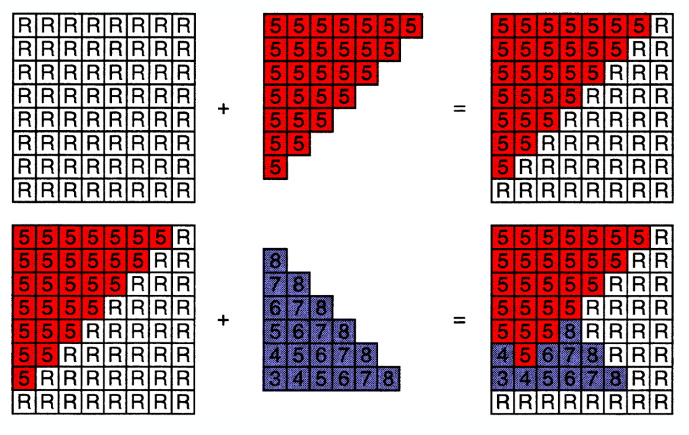
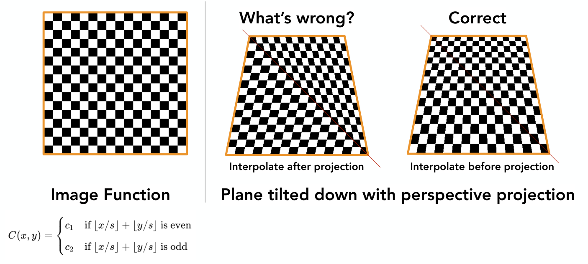
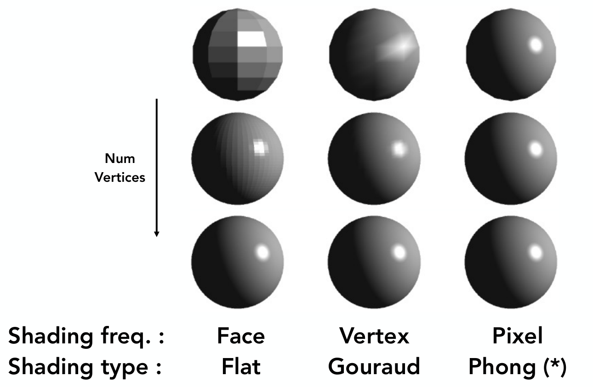

# 第 5 讲　可见性、重心坐标与着色

[复习提纲](README.md) · [原课件（88 页）](../ppt/lec-05-shading.pdf)

变换和覆盖测试给出“哪些三角形盖住这个采样点”。要得到一个颜色，还需回答三个问题：哪一个面在前面？顶点给的属性到了这个位置是多少？依照该点的材质、光照和观察方向，应该画什么颜色？

## 一处覆盖多个三角形时，谁可见？（第 2–27 页）

**画家算法。** 按深度由远到近画，后画的颜色覆盖先画的颜色。课件逐层画出远山、草地和树，再对比立方体各面按正确和错误顺序覆盖的结果。对 $n$ 个三角形排序通常要 $O(n\log n)$。更根本的问题是，三角形可以首尾循环遮挡，或彼此穿过，一整个三角形未必有一个对所有采样点都正确的绘制顺序（第 17、24 页）。

**Z-buffer。** 颜色缓冲保存 RGB，深度缓冲为每个采样位置存一个深度值，课件举 16–32 位为例。采用本讲“深度越小越近”的约定，将深度初始化为 $+\infty$。对每个三角形覆盖的每个采样点，若新深度严格小于已存值，同时更新深度和颜色，否则保留原样。对不透明表面、深度无并列时，先画哪个三角形都会留下最近的那个。课件简写复杂度为 $O(n)$，前提是每个三角形覆盖的采样数视作常数；更直接的计数是每个候选片元做一次常数时间比较。

**课件格子题（第 22 页）。** 红色三角形的深度全为 5，蓝色三角形上的数从 3 到 8。红色写入后逐格试蓝色：蓝色 4 遇红色 5 会覆盖，蓝色 6 遇红色 5 会被挡住，蓝色 5 遇红色 5 则保留先写的红色。蓝色落在空格时直接写入。图上的数是深度，方格的颜色才是最终输出。

第 24–27 页的绿、黄三角形互相贯穿，一部分区域绿在前，另一部分黄在前。超采样时**每个子采样点独立做深度测试**；同一像素内胜出的点可分属不同三角形，最后才平均颜色，交界像素才会呈现中间色。

## 三角形内一个点的重心坐标（第 28–44、50 页）

视锥体映射到 NDC 后仍保留深度信息。课件第 29 页沿用“相机看向 $-z$，$f>n>0$ 表示远、近距离”的矩阵，透视除法后有

$$
z_{\mathrm{ndc}}=\frac{f+n}{f-n}+\frac{2fn}{(f-n)z_{\mathrm{eye}}}.
$$

代 $z_{\mathrm{eye}}=-n$ 得 $-1$，代 $-f$ 得 $+1$。投影深度对相机空间的 $z$ 非线性；在屏幕三角形上，可以用屏幕重心坐标线性插值**顶点已经除以 $w$ 的 NDC 深度**。对原物体上的纹理坐标等属性，要用下一节的透视校正。

对非退化三角形 $ABC$，从基底 $\overrightarrow{AB},\overrightarrow{AC}$ 写 $P=A+\beta(B-A)+\gamma(C-A)$，于是

$$
P=\alpha A+\beta B+\gamma C,\qquad \alpha+\beta+\gamma=1.
$$

三权重都非负说明点在闭三角形内。$A$ 对应 $(1,0,0)$；在 $BC$ 上有 $\alpha=0$。第 36 页用跷跷板上的大象和蚂蚁解释质心：两侧力臂分别是 $0.5\,\mathrm m$ 与 $50\,\mathrm{km}$，平衡条件是两侧力矩相等。把距离都换成米，便有 $m_E\times0.5=m_A\times50{,}000$，因此图中平衡所需的质量比是 $100{,}000:1$。第 37 页三角形的 $A,B,C$ 顶点分别挂了 3、2、5 个 1 kg 的砝码，忽略板重，支点就是 $0.3A+0.2B+0.5C$。

第 39 页给出可直接解题的线性方程组。用 $\gamma=1-\alpha-\beta$ 消去第三个未知数，得到 $P-C=\alpha(A-C)+\beta(B-C)$，即

$$
\begin{bmatrix}x_A-x_C & x_B-x_C\\ y_A-y_C & y_B-y_C\end{bmatrix}
\begin{bmatrix}\alpha\\\beta\end{bmatrix}
=\begin{bmatrix}x_P-x_C\\y_P-y_C\end{bmatrix}.
$$

解出前两项即可由权重和得到第三项。矩阵的两列是两个从 $C$ 出发的边向量，行列式为零表示三点共线。

**两种等价算法。** 设边函数 $L_{BC}(x,y)=(x_C-x_B)(y-y_B)-(y_C-y_B)(x-x_B)$。对同一条边，它正比于有向垂直距离，故

$$
\alpha=\frac{L_{BC}(P)}{L_{BC}(A)},\qquad
\beta=\frac{L_{CA}(P)}{L_{CA}(B)},\qquad \gamma=1-\alpha-\beta .
$$

也可用面积。对内点，$\alpha=[PBC]/[ABC]$，$\beta=[PCA]/[ABC]$，$\gamma=[PAB]/[ABC]$，方括号表示面积。例如 $[PBC]=\tfrac12\lVert(B-P)\times(C-P)\rVert$。两算法等价，因为以 $BC$ 为底的两个三角形，其面积比等于对应高之比。要检验外点，保留叉积的符号。若 $A,B,C$ 共线，则分母为零。给定同一空间中线性变化的属性，$V(P)=\alpha V_A+\beta V_B+\gamma V_C$，可逐分量计算颜色、位置或向量。

## 为什么棋盘纹理需要透视校正？（第 45–50 页）

第 47 页把棋盘向远处倾斜。远处一段与近处等长的线在屏幕上更短；直接在投影后的端点间等距分配纹理坐标，会把棋盘画成图中间的样子。做到透视正确，应让屏幕上的采样点取回原三维表面对应位置的属性。

第 49 页令 $\alpha$ 为屏幕上 $A'$ 的权重，$\beta$ 为三维线上 $A$ 的权重，由 $y'=ny/z$ 和 $z_P=\beta z_A+(1-\beta)z_B$ 得

$$
\beta=\frac{\alpha/z_A}{\alpha/z_A+(1-\alpha)/z_B}
     =\frac{\alpha z_B}{\alpha z_B+(1-\alpha)z_A}.
$$

**原页末式的权重标记有误。** 第 49 页右下角的分子是 $(1-\alpha)z_A$，按该页上方对 $A$ 的定义，这一分式是 $1-\beta$。可令 $\alpha=1$ 做端点检查，此时应取回 $A$，所以 $\beta=1$。

推广到三角形，设 $\lambda_i$ 是屏幕重心权重、$w_i$ 是各顶点的裁剪空间齐次分量、$a_i$ 是顶点属性：

$$
a(P)=\frac{\sum_i\lambda_i\,a_i/w_i}{\sum_i\lambda_i/w_i}.
$$

做题时可以分开两行算：先对 $a_i/w_i$ 和 $1/w_i$ 各做一次屏幕线性插值，再相除。若三个 $w_i$ 相同，公式自然退化为普通重心插值。

## Blinn–Phong 局部反射模型（第 51–77 页）

课件先给旋转立方体加上明暗，再用《Sweet Feast》的餐具及彩色叠杯照片分辨三种成分：杯身的大面积固有色、局部的亮斑、背光处仍可见的底色。设着色点处 $\mathbf n$ 是单位法向，$\mathbf l$ 指向点光源，$\mathbf v$ 指向观察者，三者都归一化。$r$ 是到光源的距离，$I$ 是光源强度，$k_a,k_d,k_s$ 是对应的材质系数，RGB 系数按通道相乘。

| 分量 | 公式 | 如何读式子 |
|---|---|---|
| 环境光 | $L_a=k_a I_a$ | 常数项给没有直接光的区域留一点亮度，用它近似被忽略的间接光。 |
| Lambert 漫反射 | $L_d=k_d(I/r^2)\max(0,\mathbf n\cdot\mathbf l)$ | 正对光时单位面积接收最多，转过 $60^\circ$ 只接收到一半；背光截为零。漫反射外观与观察方向无关。 |
| Blinn–Phong 镜面项 | $\mathbf h=(\mathbf v+\mathbf l)/\lVert\mathbf v+\mathbf l\rVert$，$L_s=k_s(I/r^2)\max(0,\mathbf n\cdot\mathbf h)^p$ | 观察方向接近理想镜面反射方向时，半程向量 $\mathbf h$ 接近法向。$k_s$ 调高光强弱，$p$ 调宽窄。 |

第 69–70 页把镜面反射方向与观察方向画在同一入射平面内。此图中，观察方向与镜面方向的夹角是 $\theta$，半程向量与法向的夹角是 $\alpha=\theta/2$，于是可以用 $\mathbf n\cdot\mathbf h=\cos\alpha$ 衡量观察者离高光中心有多远。

单光源时 $L=L_a+L_d+L_s$。多个点光源分别计算直接漫反射与镜面项再相加。平方反比来自同一通量分摊到面积随 $r^2$ 增长的球面。课件提到局部着色有时用 $1/r$ 作视觉折中；物理光照保留平方反比。第 72–74 页画出 $\cos^p\theta$ 和球面高光，$p$ 从 1 增到 256，高光区域逐渐收紧。着色点的局部输入能算出亮度和高光，要判断另一物体是否投下阴影，还需检查通往光源的路径。

## 同一个光照公式在哪里算？（第 78–88 页）

| 着色频率 | 计算、插值各做什么 | 课件球体的结果 |
|---|---|---|
| Flat（逐面） | 每个三角形用同一面法向求一次颜色。 | 低面数的球能明显看到多面体的分块。 |
| Gouraud（逐顶点） | 在顶点用顶点法向算出颜色，面内插值颜色。 | 明暗连续，但窄高光若落在面内部，三个顶点可能都没采到。 |
| Phong（逐片元） | 插值顶点法向，在片元处重新归一化，再代入光照公式。 | 即使网格较粗，片元也有机会算出高光；轮廓精细程度仍受几何限制。 |

球的几何法向可取“球心指向表面点”的单位向量。只有网格时，课件给出邻接面法向平均的办法：$\mathbf n_v=\sum_{f\ni v}\mathbf n_f/\lVert\sum_{f\ni v}\mathbf n_f\rVert$。片元处线性插值多个单位法向后，长度一般不再为 1，计算点积前要再归一化。注意题目中的两个 *Phong*：**Phong shading** 指光照计算的频率，**Blinn–Phong** 指所代入的反射公式。
