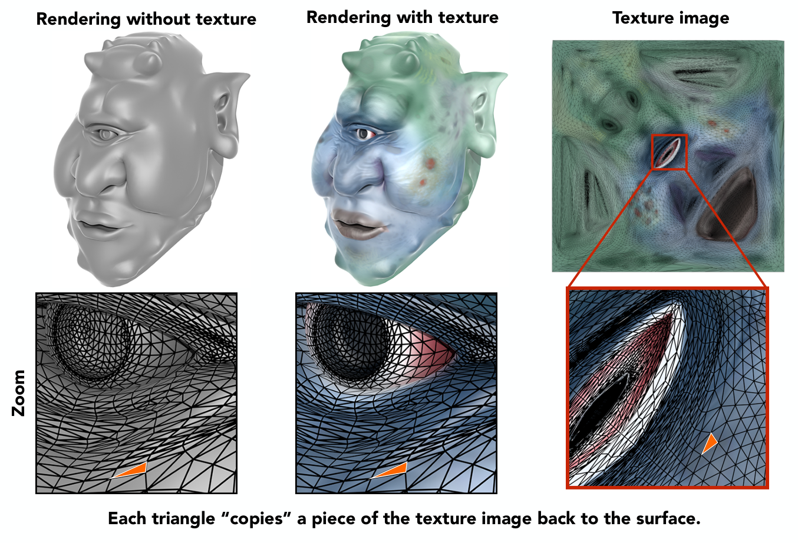
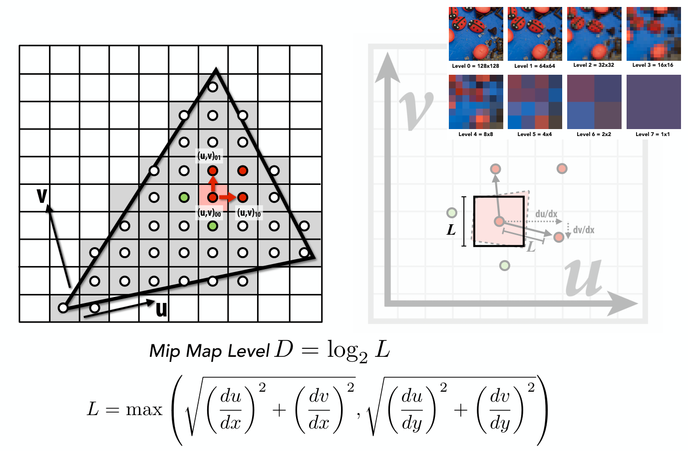
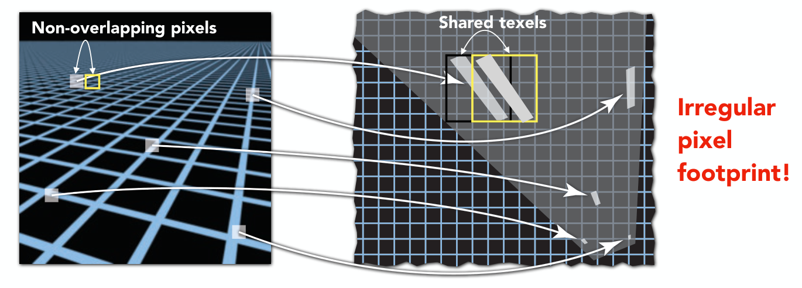
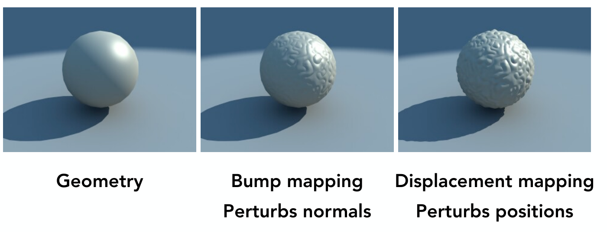

# 第 6 讲　纹理映射与光栅化管线

[复习提纲](README.md) · [原课件（93 页）](../ppt/lec-06-texture-mapping.pdf)

## 从巧克力包装纸理解 UV（第 2–18 页）

台灯图里，球上的花纹、地板上的木纹都随表面位置改变。第 5 讲用一个 $k_d$ 描述整块材质，这里可以改用一张图 $k_d(u,v)$，让同一三角形内部也有细节。老师展示圣诞巧克力和摊开的包装纸：三维世界中的**表面局部是二维的**，可以给每个表面点指定二维纹理坐标 $(u,v)$。

区分三个位置：表面点在三维世界中的 $(x,y,z)$、它投影在屏幕上的 $(x_s,y_s)$、它应读取纹理的 $(u,v)$。**屏幕像素 pixel** 记录成像，**纹素 texel** 是纹理中的离散样本。三角形顶点给了 UV，光栅化器对覆盖的采样点插值 UV，再用它查纹理。透视投影时采用[第 5 讲的透视校正](05-shading.md)。返回的 RGB 可以直接显示，也可以当作 $k_d$ 继续算光照。

第 9–12 页把 $(u,v)$ 的两个分量编码成颜色，对照人头像和 Sponza 宫殿的最终贴图。第 13–15 页说明 **UV 展开**：为曲面选切缝，把若干片摊到平面、排入一张纹理图集（atlas），然后为顶点赋 UV。图上蘑菇、骆驼和头部的展开片说明，切在哪里、各块如何排、哪里会拉伸，都影响结果。

## 一个像素会看到多少纹素？（第 19–28 页）

把一个屏幕像素所占的小方块映到纹理空间，得到它的**足迹（footprint）**。面对相机时可能接近方形；平面倾斜时，足迹可以变得很长、很斜。课件用同一张蜻蜓图比较 600 像素宽图像的显示大小，又用有透视的蓝色网格比较 $1280\times1280$ 参考图与 $256\times256$ 点采样图。

| 对应关系 | 采样问题 | 典型处理 |
|---|---|---|
| 一像素约对应一纹素 | 屏幕与纹理的局部采样密度匹配。 | 点采样即可看清原有结构。 |
| 放大（magnification），一个纹素跨多个像素 | 如何估计纹素中心之间的值？最近邻会出现方块。 | 邻近纹素插值。 |
| 缩小（minification），一个像素盖住多个纹素 | 取单点遗漏足迹内的大量细节，远处网格产生摩尔纹与锯齿。 | 先对足迹内信号低通滤波，再按屏幕采样。 |

第 26–27 页用每像素 512 次超采样给出高质量对照。严重缩小时一个足迹含很多纹素，逐个采样代价大，于是问题变成：能否预先算好区域平均，用很少几次查询近似它？

## 放大：四个纹素如何给出一个颜色？（第 28–36 页）

第 29–35 页的黑点是纹素中心，红点是查询位置。取包住红点的四邻 $u_{00},u_{10},u_{01},u_{11}$，在这四点构成的单位格中，红点的水平、垂直偏移是 $s,t\in[0,1]$。先做两次水平插值，再做一次垂直插值：

$$
\begin{aligned}
\operatorname{lerp}(x,a,b)&=(1-x)a+xb,\\
u_0&=(1-s)u_{00}+su_{10},\qquad
u_1=(1-s)u_{01}+su_{11},\\
f(u,v)&=(1-t)u_0+tu_1 .
\end{aligned}
$$

因此四个权重依次是 $(1-s)(1-t),s(1-t),(1-s)t,st$，总和为 1。第 35 页把红点移动到相邻位置，四邻要围绕**新位置**重选。照片中眼角和发丝的对照给出最近邻、双线性、双三次三种重建效果。双线性在一个纹素间隔内平滑过渡；纹理大幅缩小时，四个近邻仍代表不了整个足迹。

## 缩小：Mipmap、层级与三线性过滤（第 37–50 页）

1. **预计算。** 从第 0 层起，每次低通滤波后把宽和高各减半。瓢虫图依次是 $128^2,64^2,32^2,16^2,8^2,4^2,2^2,1^2$（第 41 页）。第 2 层一个纹素约代表原图 $4\times4$ 的区域，第 4 层代表 $16\times16$。第 38–40 页的走廊近处需要细层，远处需要粗层；整张图固定选粗层会让近处模糊。
2. **算开销。** 若原图有 $N$ 个纹素，各层总数 $N(1+1/4+1/16+\cdots)\approx4N/3$，额外约为原图的 $1/3$。课件的 $128^2$ 示例实际为 21,845 个纹素，其中原图占 16,384 个。
3. **估计层级。** 对屏幕点 $(x,y)$ 及其右、上邻居求纹理坐标。以下 $u,v$ 以**第 0 层纹素**为单位；若题给 $[0,1]$ 坐标，差分的两个分量先分别乘纹理宽和高。设 $\mathbf t_{00},\mathbf t_{10},\mathbf t_{01}$ 为三个位置的纹理坐标：

$$
\begin{aligned}
\mathbf d_x&=\mathbf t_{10}-\mathbf t_{00}=(\partial u/\partial x,\partial v/\partial x),\\
\mathbf d_y&=\mathbf t_{01}-\mathbf t_{00}=(\partial u/\partial y,\partial v/\partial y),\\
L&=\max(\lVert\mathbf d_x\rVert,\lVert\mathbf d_y\rVert),\qquad D=\log_2 L .
\end{aligned}
$$

这里两个偏导用相隔一个像素的差分估计。$L$ 取足迹**较长边的长度**，因为选的是正方形滤波区域。例如长边占 4 个原图纹素，应用 $D=2$；小于 1 时按放大处理，取最精细的第 0 层。实际查询把层级限制在金字塔的有效范围内。

**三线性过滤。** 设 $k=\lfloor D\rfloor$，$\delta=D-k$。在第 $k$ 和 $k+1$ 层分别做双线性插值得 $C_k,C_{k+1}$，最后输出 $(1-\delta)C_k+\delta C_{k+1}$。通常是两层各查四个纹素。第 47、49 页的宫殿图用颜色标出层级：就近取整数出现一条条分界，层间插值则平滑过渡。第 50 页将“层内最近邻或双线性”与“固定 0 层、最近层或层间线性”组合成六种选择。

## 为何远处网格还会过糊？（第 51–59 页）

看下图最窄、最斜的纹理足迹。相邻屏幕像素彼此分开，若用最长边 $L$ 给每个像素套一个方形窗口，窗口会重叠，把本应只给邻居看的纹素也平均进来。第 51–53 页同一蓝格图的点采样产生摩尔纹，512 倍超采样保留细线，三线性 mipmap 在斜视处出现过度模糊。

**各向异性过滤**分别考虑不同方向的尺度。Ripmap 沿 $u,v$ 分别降分辨率，可查轴对齐的矩形；求和面积表也能快速求轴对齐矩形的和，斜长足迹仍较难拟合。EWA（Elliptical Weighted Average）用带方向的椭圆近似足迹，对多个纹素加权平均，并可用 mipmap 减少查询工作。第 58 页给出它作用于斜视网格的结果。

## 从顶点到显示器：管线与 Shader（第 60–71 页）

**应用提交三维顶点 → 顶点处理（模型、观察、投影变换）→ 三角形处理 → 光栅化并生成覆盖片元 → 片元处理（纹理查询、着色）→ 帧缓冲操作 → 显示图像。** 深度测试处理多个候选片元争用同一采样位置的问题。一个片元是产生于覆盖处的候选贡献，仍可能因遮挡被丢弃。

顶点着色器按顶点执行，输出位置以及将要插值的属性。片元着色器读取插值后的 UV、法向等，计算材质、明暗和透明度。第 68–69 页的 GLSL 示例中，纹理与光方向是整次绘制共享的 uniform，UV 和法向随片元变化。按示例的方向约定，$\text{lightDir}$ 沿入射光传播，故实际运算为

$$
k_d=\operatorname{sample}(\text{myTexture},uv)_{\mathrm{RGB}},\qquad
C_{\mathrm{RGB}}=k_d\,\operatorname{clamp}((-\text{lightDir})\cdot\mathbf n,0,1),
\qquad C_\alpha=1 .
$$

第 70 页 Inigo Quilez 的蜗牛用约 800 行 shader 进行程序化建模。第 71 页用 Unreal Engine 的 Kite Demo 说明实时目标：几十万至数百万个三角形、数百万像素和超采样下仍要达到每秒 30–60 帧，VR 对帧率要求更高。

## 纹理还可以存什么？（第 72–93 页）

课件第 73 页将纹理概括为“存储加过滤”。它能给片元程序提供颜色、方向等各种数据。早期通用 GPU 计算就曾把矩阵元素等数据打包进纹理，在片元着色器里并行完成矩阵乘法、卷积或蒙特卡洛估计。

| 方法 | 存储与查询 | 课堂例子或可观察的差异 |
|---|---|---|
| 环境贴图 | 用方向查颜色。根据观察方向和法向算反射方向，再查远处环境；环境近似固定在无穷远处。 | 茶壶映出窗格，带环境贴图的反光球出现周围景物。Escher 的反光球和 Debevec 的 light probes 展示如何记录各方向的环境。 |
| 球面与立方体环境图 | 经纬展开在上下两极拉伸。Cube map 用六张方形图，以方向中绝对值最大的分量及其符号选面，再求面内 UV。 | 第 78 页的右面满足 $x>\lvert y\rvert$ 且 $x>\lvert z\rvert$；第 79 页以教堂的十字展开图展示六个面。 |
| 凹凸贴图、法线贴图 | 高度图通过局部差分求法线，法线贴图则直接存法线方向。两者都可改变局部受光。 | 看球面高光和明暗能读出细纹，查看外轮廓仍是原来的球。 |
| 位移贴图 | 高度改变真实几何位置，需要几何足够细以表达起伏。 | 第 86–88 页用玩具火车和球对照，除了受光，位移还会改变剪影和几何遮挡。 |
| 预计算明暗 | 把静态环境遮蔽等结果烘焙到纹理，着色时查询。 | 第 89 页的人头展示简单着色、AO 图、叠加 AO 后眼窝等处的加深。 |
| 三维与程序纹理 | 用 $(u,v,w)$ 访问体内任一点，或者直接用函数生成数值。 | 凿开的实体块仍有内部花纹，Perlin 噪声生成类似石纹的球和花瓶；体数据可绘制头骨等医学结构。 |

**高度怎样变成法向？** 第 83–85 页先在二维平面取 $d_p=c[h(p+1)-h(p)]$，切向变成 $(1,d_p)$，垂直方向为 $(-d_p,1)$，再归一化。三维局部切平面里，令

$$
d_u=c_1[h(u+1,v)-h(u,v)],\qquad
d_v=c_2[h(u,v+1)-h(u,v)],\qquad
\mathbf n'=\frac{(-d_u,-d_v,1)}{\lVert(-d_u,-d_v,1)\rVert}.
$$

“$+1$”指向相邻纹素走一步。这个法向是在**局部切线坐标系**中求得，用它和光方向点乘时要先统一坐标系。

第 93 页的光栅化器作业把第 2–6 讲串起来：依次绘制三角形、做超采样抗锯齿、实现几何变换、计算重心坐标、用像素采样贴纹理、实现 Mipmap。可以用这六步检查自己是否能把前五讲的公式放回它们实际工作的地方。
