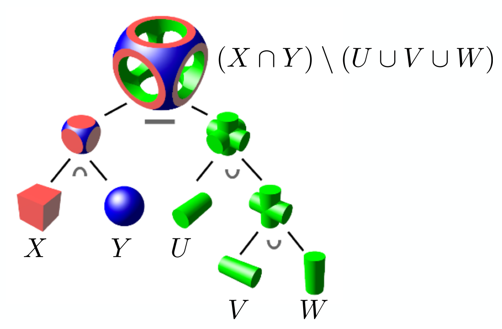
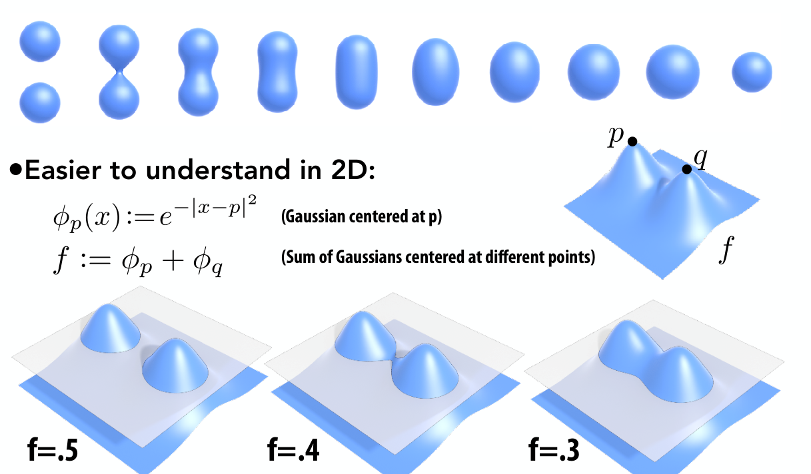
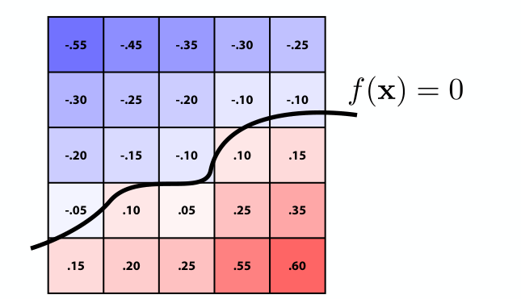

# 第 7 讲　几何入门：隐式表示与显式表示

[复习总纲](README.md) · [原课件（45 页）](../ppt/lec-07-intro-geometry.pdf)

同一个圆环，可以用一个方程判断空间中的点是否在里面，也可以用两个角度直接生成表面上的点。本讲围绕这两种操作来选择几何表示。

## 1. 同一个单位圆怎样描述（第 1–15 页）

几何研究形状、大小、模式和位置，也研究能度量长度、角度等量的空间。第 4 页以地球、十二块皮缝成的球和十二面体引入。第 5 页换成单位圆，展示几种等价或互补的描述。

| 描述方式 | 单位圆的例子 |
| --- | --- |
| 语言描述 | 说出“单位圆”（unit circle），即给定平面内距圆心为 1 的点的集合。 |
| 隐式关系 | $x^2+y^2=1$ |
| 显式参数 | $(x,y)=(\cos\theta,\sin\theta)$ |
| 运动、曲率 | 匀速绕圆运动满足 $\mathbf x''=-\mathbf x$（适当的单位与初值），单位圆的曲率 $\kappa=1$ |
| 对称、离散与测量 | 绕中心旋转图形保持不变，内接正 $n$ 边形随 $n\to\infty$ 逼近圆，也可用不同方向的断层测量描述对象 |

第 7–13 页依次展示成组的玻璃杯、车身、剖开的发动机、飘动的衣料、飞溅的水、城市与公园、长毛犬。几何可能是光滑外壳、具有内部结构的机械、不断变形的界面或大量细丝。描述的对象与后续要做的查询共同决定表示方式。

## 2. 隐式与显式：成员判定和采样（第 16–28 页）

**隐式曲面**给出标量函数 $F:\mathbb R^3\to\mathbb R$，表面是零水平集 $\{\mathbf x:F(\mathbf x)=0\}$。如果已约定内部为负，代入一点即可区分内、外和边界。反过来，要画出所有满足方程的点，需要解方程或搜索。

**课堂算例：点在单位球里面吗？** 第 20 页取 $F(x,y,z)=x^2+y^2+z^2-1$ 和 $q=(3/4,1/2,1/4)$。代入得到

$$
F(q)=\frac9{16}+\frac4{16}+\frac1{16}-1=-\frac18<0.
$$

因此 $q$ 在球内。这里使用的是代数隐函数，$-1/8$ 给出符号，并不等于点到球面的有符号欧氏距离。

**显式曲面**直接列出点，或给出从参数域到空间的映射 $\mathbf X(u,v)=(x(u,v),y(u,v),z(u,v))$。第 23 页的单位球面使用极角 $\theta$ 和方位角 $\phi$，

$$
\mathbf X(\theta,\phi)=(\cos\phi\sin\theta,\ \sin\phi\sin\theta,\ \cos\theta).
$$

**同一圆环的两种写法**（第 18–19、25–26 页）。主半径为 2，管半径为 1，令 $\rho=\sqrt{x^2+y^2}$：

$$
F(x,y,z)=(2-\rho)^2+z^2-1,\qquad
\mathbf X(u,v)=((2+\cos u)\cos v,\ (2+\cos u)\sin v,\ \sin u).
$$

$u$ 绕管截面，$v$ 绕圆环中心轴。取 $(u,v)=(0,0)$ 就生成表面点 $(3,0,0)$。用参数式判断一个任意空间点是否在实体内，无法像取样一样直接代参数。第 26 页上方是圆环参数式，下方沿用了上一例的球形示意；若按**圆环**的隐式方程验算同一 $q$，得到 $F(q)=31/8-\sqrt{13}>0$，在圆环实体外。

## 3. 代数曲面和构造实体几何（第 29–32 页）

**代数曲面**是三元多项式的零点集。课件展示球、圆环、心形。一般圆环可写为 $(R-\sqrt{x^2+y^2})^2+z^2=r^2$；心形的例子是

$$
\left(x^2+\frac94 y^2+z^2-1\right)^3
=x^2z^3+\frac9{80}y^2z^3.
$$

圆环式中的根号如何和“多项式”对应？移项再平方，可将同一个标准环面（$R>r>0$）写成四次多项式的零点集：

$$
(x^2+y^2+z^2+R^2-r^2)^2-4R^2(x^2+y^2)=0 .
$$

因此一条多项式就能精确描述这个光滑曲面。第 30 页的奶牛和汽车则说明，为复杂造型直接写出一个方程往往很困难。

**构造实体几何（CSG）**把球、圆柱、立方体等实体作为叶节点，通过并、交、差逐层构造实体。若 $d_A,d_B$ 在实体内为负，用于识别边界和内外的场可写为

$$
F_{A\cup B}=\min(d_A,d_B),\quad
F_{A\cap B}=\max(d_A,d_B),\quad
F_{A\setminus B}=\max(d_A,-d_B).
$$

课件直接给出并集的 $\min$：只要一个值为负，点就在并集内；另两式由同一符号约定推出。组合场仍可作符号判定，其绝对值未必是到新边界的精确距离。

第 32 页的树从下往上读。$X$ 为立方体、$Y$ 为球，先得到 $X\cap Y$；把三个方向的圆柱 $U,V,W$ 取并，最后计算 $(X\cap Y)\setminus(U\cup V\cup W)$，三个方向的孔都被挖出。

## 4. 平滑融合、水平集与分形（第 33–41 页）

**软物体表面（blobby surfaces）**在空间中叠加光滑标量场，再取等值面。第 33 页用以 $p,q$ 为中心的两个高斯峰 $\phi_p(x)=e^{-\lVert x-p\rVert^2}$、$f=\phi_p+\phi_q$。观察 $f=0.5,0.4,0.3$：降低截取高度，两座峰的截线由分开逐渐连到一起。这样的连接比布尔并产生的棱线平滑。

第 34 页把同样想法用于两个距离函数 $d_1,d_2$。图中圆形与方形靠近时逐渐融合；第 35 页的蘑菇和瓢虫场景用距离函数建模。第 34 页示意公式印作 $f(x)=e^{d_1(x)^2}+e^{d_2(x)^2}-1/2$。按字面两项均至少为 1，$f=0$ 无解；应掌握的是用随距离衰减的权重叠加，再选取能截到该场的阈值，第 33 页的高斯例给出了这种构造。

**水平集（level set）**把隐函数的采样值存入规则网格。定义域仍然是整个空间，表面由插值后的 $F=0$ 决定。下图同一列相邻值为 $-0.10$、$+0.05$ 时，若沿两采样点连线作线性插值，则从负值端走 $0.10/(0.10+0.05)=2/3$ 到达零点。连接此类位置即可理解图中的黑线。

第 36–39 页的两个用途是从医学体数据提取等组织密度面、在物理模拟中用距离场追踪空气与液体的交界面。三维环境中每一维采 $n$ 次，存储一张二维曲面所用的稠密体网格仍有 $O(n^3)$ 个值。只在零面附近保留一条窄带，可以减少存储。

**分形**通过自相似在不同尺度保留细节，适合表现课件中的螺旋和植被等自然形态，但精确控制局部形状较难。综合来看，隐式表示能紧凑地精确描述简单几何，便利于成员判定；用它列举表面点或直接塑造复杂外形的代价较大。

## 5. 从点云到面片（第 42–45 页）

| 显式表示 | 存什么 | 适合做什么、会遇到什么困难 |
| --- | --- | --- |
| 点云 | 一串 $(x,y,z)$，常附每点的法向 | 可以直接记录扫描数据。每像素有许多样本的大场景可直接显示；稀疏区缺少连接关系，同一批点可能对应不同补面，插值、模拟和编辑都较难。 |
| 多边形网格 | 顶点和面上的顶点连接关系，常用三角形、四边形 | 可按部位疏密自适应采样，便于求邻域、加工和模拟。要额外维护连接数据，第 9 章具体展开。 |
| 参数曲面片 | 由控制点确定的一块块 Bézier 曲面 | 第 44 页用拼接后的整形体及其面片网格对照。复杂外形可拆成简单面片，接缝的连续性由控制点安排决定，第 8 章给出公式。 |

课件还列出细分曲面和 NURBS。复习时可以用两个问题选表示：需要从参数生成表面点，还是需要判定一个三维点的内外？对大量扫描样本，还需判断后续操作是否依赖邻接关系。
