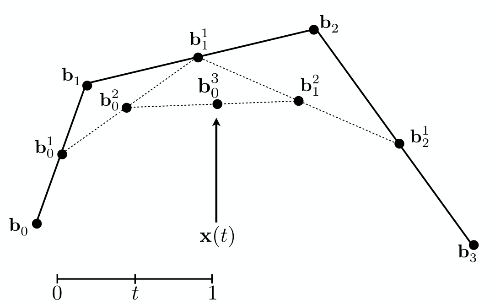
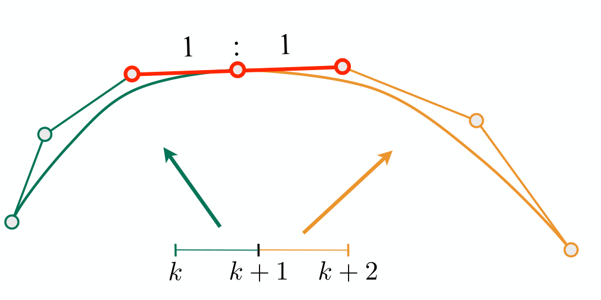
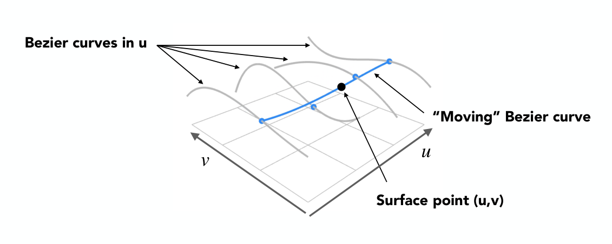
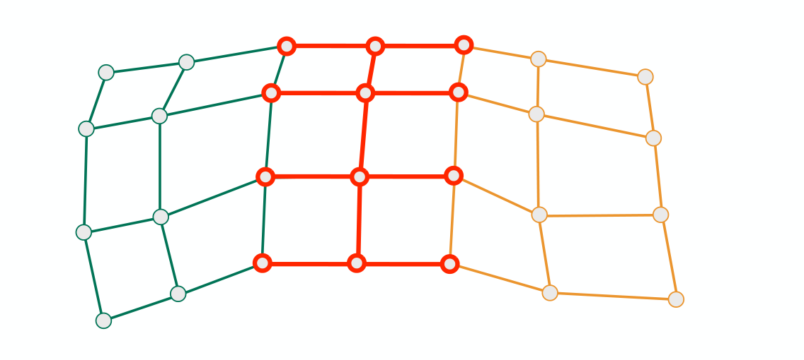

# 第 8 讲　样条、Bézier 曲线与曲面

[复习总纲](README.md) · [原课件（127 页）](../ppt/lec-08-curves-surfaces.pdf)

读本章时先区分给定的数据：Hermite 给端点和导数，Catmull–Rom 从相邻插值点估算导数，Bézier 用控制多边形首尾的两条边指定导数。三者都可以用同一行幂基 $[1,u,u^2,u^3]$ 表示。

## 1. 为什么用分段三次曲线（第 1–17、32–34 页）

第 3–9 页展示了 Baskerville 字体的三次 Bézier 字形轮廓、Maya 动画曲线、Rhino 汽车造型。传统制图的样条是一根用重物固定、自然弯曲的细条，船体与船舶型线图都能看到这种用若干约束控制整体轮廓的做法。

给定一串数值，最近邻插值会跳变，线性插值经过样本但在折点处斜率通常突变。可以让每小段曲线同时满足左右端点的值与导数。这是四个标量约束，由四个系数的三次多项式就能满足。若用一条高次多项式穿过全部样本，第 33 页的 Lagrange 插值图显示，即使采样点吻合，两端的振荡也可能很大。分段后，一次编辑只需影响附近的曲段。

**切线与法线。** 曲线 $\mathbf x(u)$ 的切向量为 $\mathbf t=\mathrm d\mathbf x/\mathrm du$。曲面 $\mathbf x(u,v)$ 的参数切向量为 $\mathbf t_u=\partial\mathbf x/\partial u$、$\mathbf t_v=\partial\mathbf x/\partial v$，单位法线为

$$
\widehat{\mathbf n}=\frac{\mathbf t_u\times\mathbf t_v}{\lVert\mathbf t_u\times\mathbf t_v\rVert}.
$$

曲线导数为零时不能由该导数定切向；曲面两切向量平行或有一个为零时，叉积为零，不能用上式归一化。

## 2. 三次 Hermite 插值：从四条约束推到四个权重（第 17–32 页）

第 18 页把 $d$ 次以下多项式写成 $x(u)=\sum_{i=0}^d c_i u^i$。幂基 $1,u,\ldots,u^d$ 在区间上线性无关，这使给定多项式的幂基系数唯一。课件接下来固定 $u\in[0,1]$。设端点值为 $x_0,x_1$，端点导数为 $d_0,d_1$。写 $x(u)=c_0+c_1u+c_2u^2+c_3u^3$，则 $x'(u)=c_1+2c_2u+3c_3u^2$。把 0 和 1 分别代入位置和一阶导数，

$$
c_0=x_0,\qquad c_0+c_1+c_2+c_3=x_1,\qquad
c_1=d_0,\qquad c_1+2c_2+3c_3=d_1.
$$

记 $h=(x_0,x_1,d_0,d_1)^T$、$c=(c_0,c_1,c_2,c_3)^T$、$U(u)=[1,u,u^2,u^3]$。四个条件组成 $Bc=h$，于是

$$
B=\begin{bmatrix}1&0&0&0\\1&1&1&1\\0&1&0&0\\0&1&2&3\end{bmatrix},
\qquad
\beta_H=B^{-1}=\begin{bmatrix}
1&0&0&0\\0&0&1&0\\-3&3&-2&-1\\2&-2&1&1
\end{bmatrix},\qquad x(u)=U(u)\beta_H h.
$$

把 $U(u)\beta_H$ 的四个分量展开，就得到可以直接代数值的 Hermite 公式：

$$
\begin{aligned}
x(u)&=x_0H_0(u)+x_1H_1(u)+d_0H_2(u)+d_1H_3(u),\\
H_0&=2u^3-3u^2+1,& H_1&=-2u^3+3u^2,\\
H_2&=u^3-2u^2+u,& H_3&=u^3-u^2 .
\end{aligned}
$$

检查权重时可代 $u=0$：位置权重是 $(1,0,0,0)$，权重的导数是 $(0,0,1,0)$，正好取回 $x_0,d_0$。同理可检查右端。四条约束里的后两项表示方向与速度；拼接相邻段时，让两段共享端点与该处的一阶导数即可。

## 3. Catmull–Rom：只给要经过的点（第 35–52 页）

第 36–39 页给出等间隔处的四个值 $y_0,y_1,y_2,y_3$。要构造中间 $y_1\to y_2$ 这一段，在 $y_1$ 处取跨过它的割线斜率 $(y_2-y_0)/2$，在 $y_2$ 处取 $(y_3-y_1)/2$。分母 2 来自左右两个单位参数间隔。把这两个切线和两个端点送入 Hermite，沿点列滑动即可生成分段三次、插值各点且 $C^1$ 连续的样条。点列首尾若缺邻点，须另给端点规则。

对空间点逐坐标做同一运算即可。第 41–44 页以三维点（如 $(0,1,3)$）和一串 $p_i$ 演示；$p_0,p_3$ 影响中间段的起止切线，该段自身的定义区间是 $p_1$ 到 $p_2$。一般形式为 $\mathbf p(u)=\sum_i F_i(u)\mathbf p_i$，各坐标复用同一组标量基函数。

令 $P=(p_0,p_1,p_2,p_3)^T$，则 Hermite 控制数据为 $h=(p_1,p_2,(p_2-p_0)/2,(p_3-p_1)/2)^T$。这给出等间隔 Catmull–Rom 的基矩阵：

$$
\mathbf p(u)=U(u)\beta_{CR}P,\qquad
\beta_{CR}=\frac12
\begin{bmatrix}
0&2&0&0\\-1&0&1&0\\2&-5&4&-1\\-1&3&-3&1
\end{bmatrix}.
$$

每一列都是对应控制点的多项式系数。例如 $p_0$ 的权重为 $-u/2+u^2-u^3/2$，在区间内部可以为负。Catmull–Rom 可以越出控制点的凸包。

## 4. 三次 Bézier 的控制点、基矩阵与性质（第 53–69 页）

四个控制点 $p_0,p_1,p_2,p_3$ 确定一段三次 Bézier。它从 $p_0$ 出发，到 $p_3$ 结束，中间两点通过首末边控制端点切线。与 Hermite 对照有

$$
\mathbf b(0)=p_0,\quad \mathbf b(1)=p_3,\quad
\mathbf b'(0)=3(p_1-p_0),\quad \mathbf b'(1)=3(p_3-p_2).
$$

把上面四项按这个顺序组成 $h=M_{Z\to H}P$，再代入 $U\beta_H h$，即得 Bézier 的幂基写法：

$$
M_{Z\to H}=\begin{bmatrix}1&0&0&0\\0&0&0&1\\-3&3&0&0\\0&0&-3&3\end{bmatrix},
\qquad
\beta_Z=\beta_H M_{Z\to H}=
\begin{bmatrix}1&0&0&0\\-3&3&0&0\\3&-6&3&0\\-1&3&-3&1\end{bmatrix}.
$$

因此 $\mathbf b(u)=U(u)\beta_ZP$。把行向量与矩阵的乘积因式分解，依次得到 $(1-u)^3,\,3u(1-u)^2,\,3u^2(1-u),\,u^3$。

- **凸包性。** 在 $[0,1]$ 上四个权重均非负，而且由二项式定理，其和为 $((1-u)+u)^3=1$。每个曲线点都是控制点的凸组合，必在包含控制点的最小凸集内。
- **仿射不变性。** 对仿射变换 $T(x)=Ax+t$，加权和的权重和为 1，所以 $T(\sum_iw_ip_i)=\sum_iw_iT(p_i)$。变换控制点即可变换整条曲线。课件指出普通多项式 Bézier 的这一结论不能直接推广到透视变换，有理表示如 NURBS 可处理相应的投影变换。
- **局部控制。** 单段内部移动任一控制点通常影响整段。把多段首尾连接后，移动某段内部控制点只改动相关曲段；端点手柄还可用于维持拼接处的切线约束。

## 5. de Casteljau、Bernstein 形式与三维例题（第 70–90 页）

**几何作图法。** 固定参数 $t\in[0,1]$，将原始控制点记为 $b_i^0=b_i$，对每层的相邻点执行同一个线性插值：

$$
b_i^r(t)=(1-t)b_i^{r-1}(t)+t b_{i+1}^{r-1}(t),\qquad r=1,\ldots,n.
$$

第 71–76、86 页的二次例先求 $b_0^1=(1-t)b_0+tb_1$ 与 $b_1^1=(1-t)b_1+tb_2$，再求 $b_0^2=(1-t)b_0^1+t b_1^1=(1-t)^2b_0+2t(1-t)b_1+t^2b_2$。三次时按 **4 个控制点 → 3 个一级点 → 2 个二级点 → 1 个曲线点** 作图。

第 82 页的黑点 $b_0^3$ 才是这一次所求的曲线点。改变 $t$，最后那个点的轨迹就是整段曲线。第 85 页的系数三角形给出代数解释：沿路径每次乘 $t$ 或 $1-t$，相同乘积的路径条数给出二项式系数。

$$
\mathbf b(t)=\sum_{i=0}^n b_i B_i^n(t),\qquad
B_i^n(t)=\binom ni t^i(1-t)^{n-i}.
$$

**第 89 页三维算例。** 控制点为 $b_0=(0,2,3)$、$b_1=(2,3,5)$、$b_2=(6,7,9)$、$b_3=(3,4,5)$。课件用它们代入三次 Bernstein 公式。用同组数据复算 $t=1/2$，权重是 $(1,3,3,1)/8$，因此

$$
\mathbf b(1/2)=\frac{b_0+3b_1+3b_2+b_3}{8}
=\left(\frac{27}{8},\frac92,\frac{25}{4}\right).
$$

若改用 de Casteljau，每一层只需取中点，三层结束应得到同一结果。

## 6. 分段 Bézier 与曲线接缝（第 91–97 页）

第 92 页用 $n=10$ 的曲线说明，高次控制多边形很难直观编辑。字体、矢量路径以及 Illustrator、Keynote 的绘图工具常把多段低次曲线（通常三次）首尾相连。课件取两段等长单位参数区间 $[k,k+1]$、$[k+1,k+2]$，前段控制点为 $a_0,\ldots,a_3$，后段为 $b_0,\ldots,b_3$。

| 接缝条件 | 对三次控制点的检验 |
| --- | --- |
| $C^0$，位置连续 | $a_3=b_0$，两段共用端点，接头仍可出现折角。 |
| $C^1$，一阶导数连续 | 还要有 $3(a_3-a_2)=3(b_1-b_0)$。因此 $a_2,a_3=b_0,b_1$ 共线，公共点为另外两点的中点。 |

第 97 页红线标出接点两侧手柄的长度比 $1:1$。仅同向共线能保证切线方向接上（通常称 $G^1$），若导数大小不同，仍不满足这里的 $C^1$。比较非等长区间时，应把局部导数分别除以各段参数跨度，再检查等式。

## 7. Bézier 曲面片与四种计算方式（第 98–122 页）

双三次面片使用 $4\times4$ 个三维控制点 $p_{ij}$，参数 $(u,v)\in[0,1]^2$。第 99 页的 Gumbo 大象和 Utah 茶壶都是由曲面片描述的模型。固定一个参数可得到一条等参数曲线；让该参数连续变化，这条曲线扫过面片。

**① 分两次做一维 de Casteljau。** 固定 $u$，沿 $u$ 方向的四条三次曲线各求一个点，作为新曲线的四个控制点；随后在新曲线上以 $v$ 求值。因为两个方向可分离，按另一方向先做也能得到同一点。

第 105 页图中四条曲线先用同一个 $u$ 取值，右侧的移动曲线用 $v$ 选定最终黑点。

**② 张量积 Bernstein 形式。** 一行控制点本身沿另一条曲线运动，将它的表达式代回即可。若两个方向次数分别为 $m,n$，

$$
\mathbf S(u,v)=\sum_{i=0}^{m}\sum_{j=0}^{n}p_{ij}B_i^m(u)B_j^n(v).
$$

**③ 矩阵形式。** 双三次时将控制点排列为矩阵 $P=(p_{ij})$，

$$
\mathbf S(u,v)=U(u)\beta_ZP\beta_Z^T U(v)^T .
$$

矩阵中的一个元素是一个空间点，实际可对 $x,y,z$ 分量分别做同一运算。

**④ 在中点细分。** 将参数区间一分为二，两小段各自仍用 $u\in[0,1]$ 表示，但分别代入原曲线参数 $u/2$、$(u+1)/2$。以左段为例，$U(u/2)=U(u)S_L$，其中 $S_L=\operatorname{diag}(1,1/2,1/4,1/8)$，故新控制点 $P_L=H_LP$，$H_L=\beta_Z^{-1}S_L\beta_Z$。两侧的控制点更新矩阵为

$$
H_L=\frac18\begin{bmatrix}8&0&0&0\\4&4&0&0\\2&4&2&0\\1&3&3&1\end{bmatrix},
\qquad
H_R=\frac18\begin{bmatrix}1&3&3&1\\0&2&4&2\\0&0&4&4\\0&0&0&8\end{bmatrix}.
$$

左段最后一行等于右段第一行，所以两小段共用原曲线中点。各行均非负且和为 1，新控制点留在原凸包内。重复操作时，曲线保持原形，控制折线越来越贴近曲线。第 119–120 页在左段继续二分，分别得到 $H_LH_LP$ 与 $H_RH_LP$；第 121–122 页在面片的两个方向分别乘矩阵，例如 $H_RPH_L^T$ 选出 $u$ 方向右半、$v$ 方向左半的子面片。

## 8. 曲面怎样拼接（第 123–127 页）

两块双三次面片沿公共边作同向参数化。**$C^0$** 要求公共边的边界曲线一致；在同一 Bézier 次数、同一参数化下，可让该边四个控制点逐个重合。**$C^1$** 还需跨边导数逐点匹配：公共边第 $j$ 个点记为 $E_j$，两侧紧邻控制点记为 $L_j,R_j$，两侧参数等跨度且方向一致时，需要 $E_j-L_j=R_j-E_j$。这些控制点对应的三次基函数相同，因而四组差向量相等能保证整条边的跨边导数一致。

第 124–126 页先标出公共边，再标出其两侧的控制点列。图中每组横向的三个红点用来检查同一直线上的两段手柄；自己画控制网时，先对上边界点，再逐组比较相邻手柄的方向与长度。
