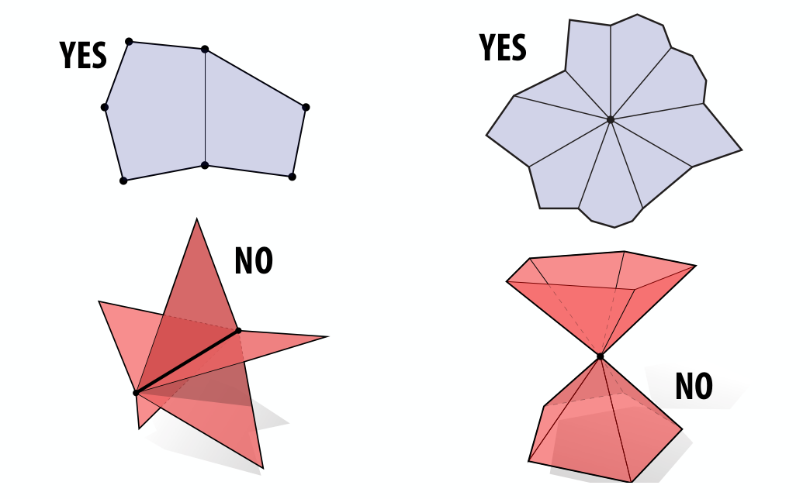
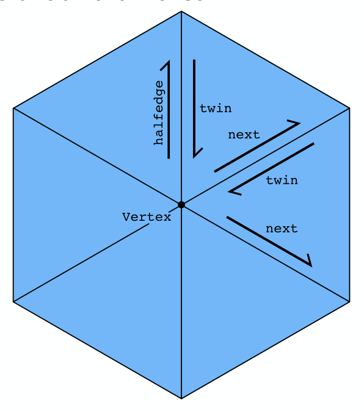
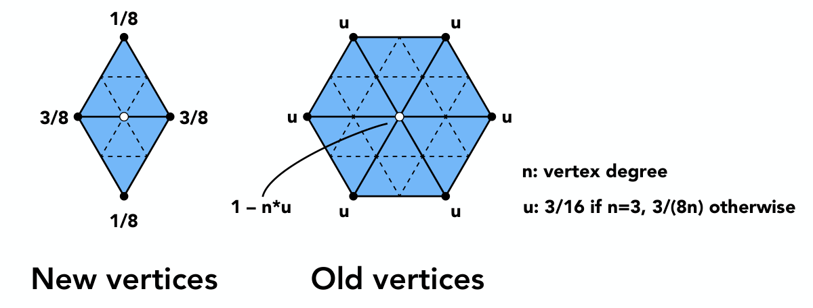
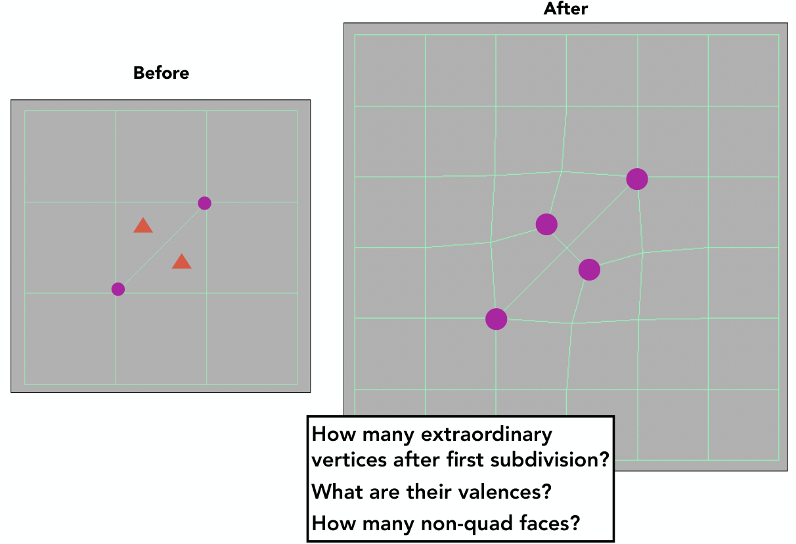
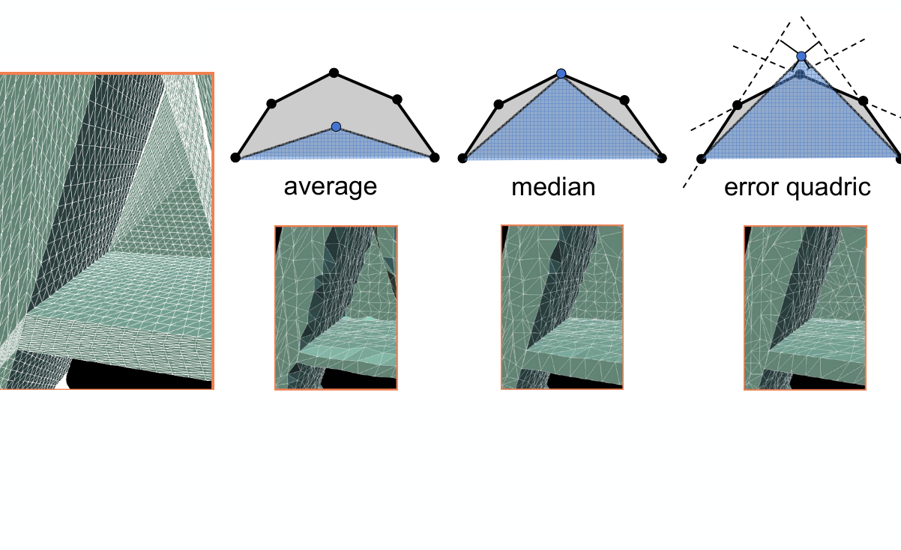

# 第 9 讲　网格表示与几何处理

[复习总纲](README.md) · [原课件（96 页）](../ppt/lec-09-geometry-processing.pdf)

本章先回答怎样找一个顶点周围的面，再用这些邻域实现三类操作：细分增加分辨率，简化减少面数，重网格化改善三角形的大小、形状与排列。

## 1. 怎样存放一个网格（第 1–14 页）

网格同时具有**几何**（顶点的位置）和**连接关系**（哪些点、边、面相邻）。鹿形线框直观显示了连接关系。第 4 页的立方体有 8 个顶点，6 个方形面各分为两个三角形，共 12 个三角形。

- **独立三角形列表。** 每个三角形直接存三组 $(x,y,z)$。同一物理顶点被相邻面重复存储，挪动它时要同步修改所有副本。
- **索引三角形。** 顶点数组只存每个位置一次，面数组存三个顶点编号。第 6 页的两个三角形为 $(0,2,1)$ 和 $(0,3,2)$，共用顶点 0、2。移动顶点数组中的一个位置，会同时更新所有相关面。
- **设计目标。** 求法线、做细分时，需要迅速找邻居；局部编辑时，要能添加、删除和重新连接元素。只给顶点数组和三元组不能直接回答全部邻接查询。

第 9–14 页以位图作类比。画作放大后看到的颜料并非规则小方块，但方格的四邻域 $(i\pm1,j),(i,j\pm1)$ 容易寻址、滤波和存储。它也有方向性偏差，不总能对齐图像边界。把像素推广为体素能存实体内部，但致密体素必须覆盖整个三维体积；若只关心壳面，直接存曲面通常经济得多。

## 2. 流形条件与 Euler 公式（第 15–22 页）

正常二维曲面的每个内部点都有一个像圆盘的小邻域；若点在边界，小邻域像半圆盘。可以想象从远处看地球是弯的，站到地面附近却像平面。第 16 页的两个锥面只在尖端相接：在公共点附近始终有两片，不能摊成一个圆盘。第 18 页还让读者判断兔子、圆环和带有分叉或接触处的形体；判断依据是逐点的邻域。

对于无边界多边形流形，检查两件事：

1. 每条边恰好属于两个面。若有第三个面像鱼鳍一样插在同一条边上，该边非流形。边界边只属于一个真实面。
2. 每个内部顶点周围的面围成一个连续的扇环；边界顶点围成一把开扇。即使每条边的邻面数合规，若两个不相连的面扇只共用一个顶点，这个顶点仍非流形。

第 19 页左列查“一条边有几个面”，右列查“一个点附近有几把扇”。闭合、连通、与球面同拓扑的网格满足

$$
V-E+F=2.
$$

用立方体验算：取原始方形面时，$8-12+6=2$；若改用第 4 页的三角面网格，六条新增对角线同时多出六个面，仍有 $8-18+12=2$。圆环同样是流形，却不满足球面专用的右端值 2。

## 3. 四面体例题、关联矩阵和半边（第 23–30 页）

第 23 页四面体的顶点依次为 $v_0=(-1,-1,-1)$、$v_1=(1,-1,1)$、$v_2=(1,1,-1)$、$v_3=(-1,1,1)$。课件面表依次为 $(0,2,1),(0,3,2),(3,0,1),(3,1,2)$。**找出所有接触 $v_2$ 的面**：扫描后得到第 1、2、4 行。若只有面表且共有 $F$ 个三角形，搜索成本为 $O(F)$。课件接着展示约十亿个多边形的大卫雕像，这时每查一个顶点都从头扫面相当昂贵。

**关联矩阵。** 顶点–边、边–面各建一张矩阵，用 1 表示接触、0 表示不接触。给定两项，查稠密矩阵里的单个关联标志可达 $O(1)$；要枚举所有邻居，至少要输出这些邻居。矩阵里零很多，可压缩为稀疏结构，但需额外维护索引，频繁改变连接关系比较麻烦。

**半边结构。** 一条无向边 $AB$ 拆为 $A\to B$ 和 $B\to A$ 两条方向相反的半边。每条半边 $h$ 记录起点 vertex、所属无向边 edge、所属面 face、同一面上下一条半边 next，以及方向相反的 twin。顶点、边、面各指向一条属于自己的半边。一次指针跳转就是一次局部邻接查询。

| 课堂遍历 | 起点与每一步操作 | 为什么回到起点 |
| --- | --- | --- |
| 访问一个面的全部顶点（第 28 页） | 令 $h=f.\mathrm{halfedge}$，访问 $h.\mathrm{vertex}$ 后令 $h=h.\mathrm{next}$。 | next 始终沿同一个面绕行，一圈后完成。 |
| 访问一个内部顶点邻接的全部边（第 29 页） | 令 $h=v.\mathrm{halfedge}$，访问 $h.\mathrm{edge}$ 后令 $h=h.\mathrm{twin}.\mathrm{next}$。 | twin 跨入邻面，next 在该面里重新回到从 $v$ 出发的半边，恰好多走一个扇区。 |

这两个循环都应先处理元素，再判断是否已回到起点。环绕度数为 $k$ 的点会访问 $k$ 条相邻边，整体为 $O(k)$。在有边界的实现中，应按是否显式设置外侧半边处理停止条件。

## 4. 三种局部编辑与几何处理任务（第 31–47、82 页）

| 操作 | 课件做法 | 对局部网格的影响 |
| --- | --- | --- |
| 翻转 flip | 第 32 页两面 $(a,b,c),(b,d,c)$ 共用 $bc$，用新对角线 $ad$ 代替，得到 $(a,d,c),(a,b,d)$。 | 更新半边的连接，点、边、面总数保持原值。 |
| 分裂 split | 第 33 页在 $bc$ 中间插入 $m$，再连接 $m$ 与 $a,d$。 | 两个三角形变四个；增加 1 点、3 边、2 面。 |
| 折叠 collapse | 第 34 页把边 $bc$ 的两个端点合成 $m$，重新连接邻域并删除退化的面和边。 | 在普通内部三角网格的合法折叠中，减少 1 点、3 边、2 面。 |

分配、删除以及改写半边指针时，要维持面环、对偶和流形条件。三种操作分别对应局部重采样、上采样、下采样。真正的算法还需说明**选哪条边**以及**把点放在哪里**。

数字几何处理把信号处理中采样、滤波、压缩的思想用于几何。第 37–38 页用“扫描 → 处理 → 打印”串起输入与输出。第 39–47 页区分如下任务。

- **重建。** 从点、带法线点、多视图图像或 CT/MRI 体数据恢复面。轮廓可构造 visual hull，点可用 Voronoi/power crust 或 Poisson 重建，体数据可用 marching cubes 提取等值面。
- **上采样、下采样、重采样。** 增点时要插值，可做细分或双边上采样；减少点云可抽样，简化网格可逐步删减或做变分逼近。重新分配样本时，三角形的形状会影响显示和方程求解，两个任务对质量的要求可能不同。
- **滤波。** 曲率流、双边滤波和谱滤波可减噪或突出特征。图像里对应模糊、保边平滑、边缘检测。
- **压缩与分析。** 压缩需兼顾坐标与连接，可无损或有损。第 45 页用大象图的 840 kb 与 8 kb 图像作类比。形状分析则寻找有意义的部分、模型间对应关系或对称性；第 39 页还列出曲面参数化。

## 5. Loop 三角网格细分（第 48–57 页）

从粗控制网格出发，每一轮先决定新的连接，再用邻域加权得到新位置。用同一轮旧顶点的数据计算所有更新，可避免顺序影响结果。细分要区分“是否经过旧点”和“极限面在顶点处有多光滑”：Loop 与普通 Catmull–Clark 会移动旧点。

**连接。** 每条旧边插入一个点，每个旧三角形的三个边点互连，1 个三角形变成 4 个。随后用下面两种规则确定位置。

$$
p_{\mathrm{edge}}=\tfrac38(a+b)+\tfrac18(c+d),\qquad
p'=(1-nu)p+u\sum_{i=1}^n p_i,\qquad
u=\begin{cases}3/16,&n=3,\\3/(8n),&n\ne3.\end{cases}
$$

第一式针对旧内部边 $ab$，$c,d$ 是该边两侧三角形的对顶点。第二式针对旧内部点 $p$，$n$ 是其度数，$p_i$ 是一环邻点。这里沿用第 55 页给定的权重版本。第 56 页的度 6 例为 $u=1/16$，中心权重 $1-6/16=10/16$，六邻点各占 $1/16$。两种规则的权重都能加到 1。

第 55 页左图横向的两点才是旧边端点，纵向两点是对顶点。右图中心点的权重随邻点数变化。

## 6. Catmull–Clark、奇异点与锐边（第 58–79 页）

**改变连接。** 每个旧面生成一个面点，每条旧边生成一个边点，将面点与周围边点相连。一个 $k$ 边形被划为 $k$ 个四边形，故第一轮后所有面都是四边形。规则四边网格的内部顶点度数为 4；其余内部顶点称为非常规顶点（extraordinary vertex）。

**第 63–67 页读图题。** 一块规则方格网的中间方格被一条对角线分为两三角形。原对角线两端各为度 5；第一轮后这两点仍为度 5，两个三角形的面点各为度 3。故图示区域有 **4 个非常规内部点（5、5、3、3），0 个非四边形面**。继续细分，异常点仍局限在原来的这几处。

**更新位置。** 用 $p$ 表示旧顶点，$n$ 表示其度数，$\bar f$ 表示相邻面点均值，$\bar m$ 表示相邻旧边的几何中点均值。第 68–69 页给出内部规则：

$$
f=\frac{1}{k}\sum_{i=1}^k v_i,\qquad
e=\frac{v_1+v_2+f_1+f_2}{4},\qquad
p'=\frac{\bar f+2\bar m+(n-3)p}{n}.
$$

第一式是 $k$ 边形的面点。第二式中的 $v_1,v_2$ 是旧边两端，$f_1,f_2$ 是相邻面的新面点。第三式里的 $m_i=(p+v_i)/2$ 是**旧边中点**，与第二式算出的边点 $e$ 有别。代 $n=4$ 可得课件的规则网格特例，

$$
p'=\frac{(f_1+f_2+f_3+f_4)+2(m_1+m_2+m_3+m_4)+4p}{16}.
$$

**为什么控制网格的连接重要？** 第 70–71 页对比相同人头：四边网格只有少数非常规点，反射线和焦散较平滑；把 Catmull–Clark 应用于密集三角网格，产生大量非常规点，法线近似较差，反射线和焦散可见锯齿。

**锐边与边界。** 第 73 页将旧顶点 $p_i$ 向邻点的加权中心移动。若邻点权重已归一化，可写作 $p_i'=\alpha p_i+(1-\alpha)\sum_j w_{ij}p_{ij}$，其中 $\sum_j w_{ij}=1$。这个条件使整体平移后的更新结果仍平移相同的距离。普通局部平均会将角、棱一起磨圆。可标记锐边，先进行 $N$ 层锐边细分再转用平滑规则，得到可控的部分锐度。第 76 页在一条标记折痕上给出新点和旧点规则，边界也可同样处理：

$$
e'=\tfrac12(p_0+p_1),\qquad
p'=\tfrac18p_{\mathrm{prev}}+\tfrac34p+\tfrac18p_{\mathrm{next}}.
$$

第二式只使用沿折痕方向的两个邻点。第 72–77 页用多面环、带棱的模型及不同圆角立方体演示标记的效果。第 78–79 页展示 Pixar 1997 年短片《Geri’s Game》，人物的头、手、衣服、领带、鞋都使用了细分建模。

## 7. 网格简化与二次误差度量 QEM（第 80–87 页）

第 81 页连续展示头骨的 30,000、3,000、300、30 个三角形版本。要尽量保住轮廓和尖锐特征，每次折叠要同时决定折哪条边、合并后的顶点放哪里。直接放在中点未必能保住尖角。

设与待合并顶点原先有关的三角形平面为 $\Pi_i$，$\hat n_i$ 是单位法向，$p_i$ 是该平面上一点。候选新点 $x$ 到平面的有符号距离为 $\hat n_i\cdot (x-p_i)$。二次误差选择

$$
x^*=\arg\min_x E(x),\qquad
E(x)=\sum_i\big[\hat n_i\cdot(x-p_i)\big]^2.
$$

第 84 页图下的小式只印出点积求和；本页正文明确要求 **sum of square distance**，故实际求和要平方，使平面两侧的误差都计入且互不抵消。若将平面写成 $a_ix+b_iy+c_iz+d_i=0$，记其系数列为 $\pi_i$、点的齐次坐标为 $\tilde x$，同一式可写为 $E=\tilde x^T(\sum_i\pi_i\pi_i^T)\tilde x$。

**贪心删边。** 对各候选边求最低可达误差并评分，选误差最小的一条合法边折叠，在受影响邻域更新候选代价，迭代至目标面数。第 86 页将平均值、中位数与二次误差的结果并列，后者能把候选点放在原支撑平面的交汇附近；第 87 页牛模型的三角形数依次为 5,804、994、532、248、64。

## 8. 正则化与各向同性重网格化（第 88–96 页）

狭长的三角形和悬殊的边长会使某些计算变差。第 89–90 页的 Delaunay 条件是每个三角形的**外接圆内部不含其他顶点**（课件为平面示意）。这在模拟中常有益，却不能保证三角形等边，也不自动带来最好的形状逼近。

第 91–94 页以三角网格内部顶点的理想度数 6 为参照。翻转共享对角线时，原边两端度数各减 1，新边两端各加 1。如果四点偏离 6 的总程度减小，就值得翻转。多次局部翻边有助于分散过高或过低的度数。移动顶点到邻点中心又可改善形状，但直接向三维均值移动可能偏离原表面，应取切向分量。

**第 96 页四步循环。** 取目标尺度 $\ell$ 为课件所说的平均边长，按顺序反复执行：

1. 边长大于 $\tfrac43\ell$ 时，分裂长边。
2. 边长小于 $\tfrac45\ell$ 时，折叠短边。
3. 对能使顶点度数更接近 6 的局部结构，翻转边。
4. 把顶点沿曲面切向向邻域中心移动，使三角形大小、形状更均匀。

复习时可从题目所给目标倒推算法：增加光滑表面的采样密度用细分，给定面数预算时用误差引导折叠，面数相近但三角形细长或度数失衡时用重网格化。
