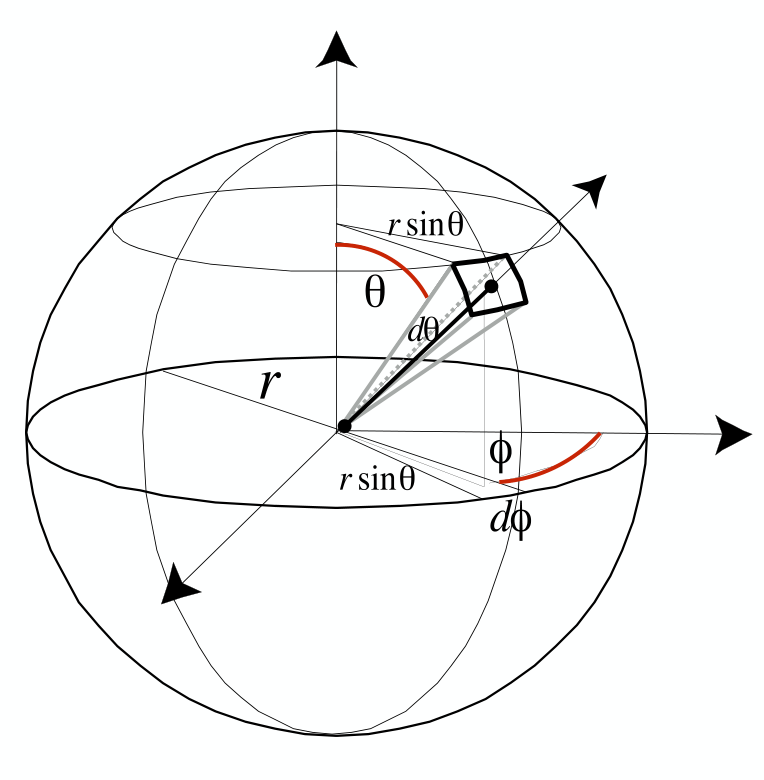
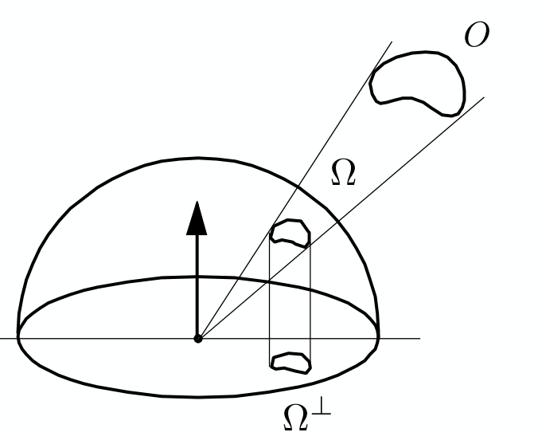

# 第 10 讲　辐射度量学与光度学

[复习提纲](README.md) · [原课件（62 页）](../ppt/lec-10-radiometry.pdf)

## 从“光子击中多少次”到有单位的物理量（第 2–24 页）

第 3–7 页把同一场景的几何模型、颜色和明暗分开看。即使知道物体形状和颜色，也还要知道有多少光到达每个像素。逐图元做局部着色很难直接得知另一个物体是否挡光；从一点发出射线，可以检查它与场景中什么物体相交。要进一步解释阴影、镜面反射和间接光，先要给“沿射线传播的光”定义一个可相加、可积分的量。

本讲采用**几何光学、稳态**近似。光的波长远小于物体尺度，在均匀介质中光沿直线传播，遇界面可反射或折射，暂略衍射、干涉等波动效应。白炽灯将热能转为光，太阳的光来自核聚变；传感器、眼睛或胶片记录到达它们的能量。第 11 页的高速成像示意靠重复实验、每次略微改变取样时刻，观察光脉冲的传播。

**课堂计数题。** 把光子想成街道上弹跳的小球，统计撞击接收面的次数。设每次撞击携带相等能量：

| 观察了什么 | 课件中的数 | 物理意义 |
|---|---|---|
| 整场实验的所有撞击 | 40 次 | 对应一段时间内的辐射能量 $Q$。 |
| 同一场实验持续 2 秒 | $40/2=20$ 次/秒 | 对应通量或功率 $\Phi$。 |
| 边长 $\epsilon$ 的小正方形里有 2 次撞击 | $2/\epsilon^2$ | 这是观察时段内的**单位面积能量**。要成为辐照度还要除以时长，并乘每次撞击的能量。 |

第 15 页标题讲 irradiance，而图下写的是 *radiant energy density*，可用上表分清。若沿用 2 秒的观察时段，每次撞击携能 $q$ 焦耳，这一小块的平均辐照度就是 $(2q)/(2\,\mathrm{s}\,\epsilon^2)$，与单位面积累计能量 $2q/\epsilon^2$ 相差一个时间因子。成像时把接收面分成像素，各格累计的通量反映局部明暗。真实光子携能依波长而异，第 18 页给出

$$
Q_{\mathrm{photon}}=\frac{hc}{\lambda},\qquad
h\approx6.626\times10^{-34}\ \mathrm{J\,s},\qquad c\approx3.00\times10^8\ \mathrm{m/s}.
$$

量纲为焦耳，可见波长按课件给的数字范围应读作约 $390$–$700\,\mathrm{nm}$（原页的米制指数误印为 $10^{-3}$，纳米换算为 $10^{-9}\,\mathrm m$）。波长越短，单光子能量越高。

| 量 | 定义 | 单位 | 读法 |
|---|---|---|---|
| 辐射能量 $Q$ | $Q=\int_{t_0}^{t_1}\Phi(t)\,dt$ | $\mathrm J$ | 在这段时间送了多少能量 |
| 辐射通量 / 功率 $\Phi$ | $\Phi=dQ/dt$ | $\mathrm W=\mathrm{J/s}$ | 单位时间经过、发出或接收多少能量 |
| 辐照度 $E$（irradiance） | $E(p)=d\Phi_{\mathrm{in}}/dA$ | $\mathrm{W/m^2}$ | 接收表面上单位面积收到多少功率 |
| 辐射强度 $I$（intensity） | $I(\omega)=d\Phi/d\omega$ | $\mathrm{W/sr}$ | 点光源给单位立体角发出多少功率 |
| 辐射亮度 $L$（radiance，课件也称“辐射率”） | $L=d^2\Phi/(dA_\perp\,d\omega)$ | $\mathrm{W/(m^2\,sr)}$ | 在给定点、给定方向上，每单位投影面积、单位立体角有多少功率 |

“绿色有多少”要再按波长分辨。第 23 页展示日光、白炽、荧光、卤素、冷白与暖白 LED 的光谱。同样是照明，不同波段的贡献可以大不相同。谱辐照度用每单位波长的辐照度来表达，例如 $\mathrm{W/(m^2\,nm)}$。

## 照斜了为何变暗？移远了为何变暗？（第 24–36、42 页）

**角度。** 正对平行光束的投影面积记为 $A$，倾斜接收面的实际面积记为 $A'$，它的外法向与指向光源的方向夹角为 $\theta$，则 $A=A'\cos\theta$。对同一束功率 $\Phi$，

$$
E_{\mathrm{tilted}}=\frac{\Phi}{A'}=\frac{\Phi}{A}\cos\theta .
$$

立方体顶面转过 $60^\circ$，在固定入射光场中单位面积接到的功率减半。第 26 页以地轴倾角约 $23.5^\circ$ 和北半球冬夏太阳光的入射角为例。着色时把法向 $\mathbf n$ 与指向光源的单位向量 $\mathbf l$ 点乘，取 $\max(0,\mathbf n\cdot\mathbf l)$。第 31 页牛模型的方向光相当于无穷远光源，各处使用同一入射方向。

**距离。** 各向同性点光源均匀照向整个球面，故 $\Phi=\int_{S^2}I\,d\omega=4\pi I$。半径 $r$ 的球面面积是 $4\pi r^2$，球面上垂直受照的小片有

$$
I=\frac{\Phi}{4\pi},\qquad E(r)=\frac{\Phi}{4\pi r^2}=\frac{I}{r^2},\qquad
\frac{E(r_2)}{E(r_1)}=\left(\frac{r_1}{r_2}\right)^2 .
$$

第 36 页每次移动点光源 1 米，图像迅速变暗。若距离从 $r$ 变成 $2r$，辐照度剩 $1/4$。一般点光源可以有方向性，对朝向任意的接收面还要乘上面的余弦，所以 $E=I(\omega)\max(0,\cos\theta)/r^2$。$I$ 描述光源朝哪个方向发，$E$ 描述表面接到多少。

## 怎样对“方向”积分？（第 37–42 页）

平面角是圆弧长与半径之比 $\theta=l/r$。立体角是物体沿径向投到球面上的面积与半径平方之比 $\Omega=A_{\mathrm{sphere}}/r^2$，单位球面度 sr。完整圆周为 $2\pi$ 弧度，整个球面为 $4\pi$ sr，上半球为 $2\pi$ sr。单位向量 $\omega$ 描述一个方向，$d\omega$ 描述它附近的一小束方向。

若 $\theta$ 从北极量起，$\phi$ 是方位角，纬圈处的半径是 $r\sin\theta$，所以

$$
dA_{\mathrm{sphere}}=(r\,d\theta)(r\sin\theta\,d\phi),\qquad
d\omega=\sin\theta\,d\theta\,d\phi,\qquad
\int_0^{2\pi}\!\int_0^\pi\sin\theta\,d\theta\,d\phi=4\pi .
$$

**太阳和月亮的例子（第 38 页）。** 从地面观察，两者各占约 $60\,\mu\mathrm{sr}$。把同样的角份额换算到总面积约 $510\times10^6\,\mathrm{km^2}$ 的地球表面，课件估算为 $510\times10^6\times60\times10^{-6}/(4\pi)\approx2.4\times10^3\,\mathrm{km^2}$。它比较的是视角大小。

## 一条射线上传递的量是什么？（第 43–51 页）

小面片的实际面积为 $dA$，垂直于射线方向的投影面积为 $dA_\perp=dA\cos\theta$（取表面正半球）。把点、方向、能量的关系写开：

$$
d^2\Phi=L(p,\omega)\cos\theta\,dA\,d\omega,\qquad
L_i(p,\omega)=\frac{dE_i}{\cos\theta\,d\omega},\qquad
L_o(p,\omega)=\frac{dI_o}{\cos\theta\,dA}.
$$

$L_i$ 表示从指定方向到达该表面的辐射亮度，$L_o$ 表示从该表面朝指定方向离开的辐射亮度。同一点、同一方向上的入射与出射值一般不同，关系由材质决定。把 $L$ 再按波长展开为 $L_\lambda$，便保留颜色信息。若波长以纳米计，$L_\lambda$ 的单位为 $\mathrm{W/(m^2\,sr\,nm)}$，对波长积分才得到普通辐射亮度。

物理渲染沿射线追踪 $L$；在真空中沿无遮挡的同一条射线，**辐射亮度保持不变**。这与点光源的 $E\propto 1/r^2$ 可以同时成立：前者跟随一条射线，后者计算接收面积上汇聚的通量。理想针孔相机按方向采到场景辐射亮度，有限像素会汇集相应范围内的能量。

## 半球光、遮蔽和面光源（第 52–58、62 页）

要求一点的辐照度，就把表面外侧半球 $H^2$ 所有入射方向的贡献相加。每一束方向都要乘投影余弦：

$$
dE=L_i(p,\omega)\cos\theta\,d\omega,\qquad
E(p)=\int_{H^2}L_i(p,\omega)\cos\theta\,d\omega .
$$

**均匀半球光。** 若所有方向可见，且 $L_i=L$ 为常数，第 53 页的积分可完整写为

$$
E=L\int_0^{2\pi}\!\int_0^{\pi/2}\cos\theta\sin\theta\,d\theta\,d\phi
 =L\,(2\pi)\left[\tfrac12\sin^2\theta\right]_0^{\pi/2}=\pi L.
$$

原页第一行简写时漏了 $\cos\theta$，展开式和 $\pi L$ 的结果都包含它。半球的普通立体角是 $2\pi$，加余弦权的积分才是 $\pi$。

**为什么第 54 页的白牛没有处处一样白？** 腿底、腹下和接触地面的部位看不全发光的环境。第 55 页用环境光遮蔽（AO）把均匀远场环境的积分限制到可见方向：若可见性 $V(p,\omega)$ 取 0 或 1，则 $E_{\mathrm{AO}}=L_0\int_{H^2} V(p,\omega)\cos\theta\,d\omega$。静态几何上的结果可以烘焙到纹理。对照河马张开的嘴，AO 使凹处层次更清楚。

**均匀面光源。** 若只有光源覆盖的方向区域 $\Omega$ 提供常量 $L$，辐照度为 $E=L\int_\Omega\cos\theta\,d\omega=L\Omega^\perp$。几何读法是把光源投到单位半球得到 $\Omega$，再投到切平面得到余弦加权面积 $\Omega^\perp$。各方向可能只被遮掉一部分，因此面光源可产生软阴影。第 57 页并排比较不同形状面光源的照明。第 58 页用测角光度图（goniometric diagram）描述真实灯具的强度如何随方向变化。

## 辐射度量与人眼感受（第 59–62 页）

光度学给各波长的辐射按人眼视觉灵敏度加权。第 59 页并列暗适应与明适应曲线。以亮度为例，课件用 $Y(p,\omega)=\int L_\lambda(p,\omega)V(\lambda)\,d\lambda$ 表示这种加权关系，其中 $V$ 表示视觉响应；若采用已归一化的无量纲视见函数并求绝对光度单位，还须乘相应的光效换算常数。

| 辐射度量 | 对应光度量 | 常用光度单位 |
|---|---|---|
| 辐射能量 $Q$ | 光能 | $\mathrm{lm\,s}$，课件记 Talbot |
| 辐射通量 $\Phi$ | 光通量 | 流明 $\mathrm{lm}$ |
| 辐照度 $E$ / 单位面积出射通量 | 照度 / 光出射度 | $\mathrm{lm/m^2}$，照度单位为勒克斯 $\mathrm{lx}$ |
| 辐射亮度 $L$ | 亮度（luminance） | $\mathrm{cd/m^2}$，亦称 nit |
| 辐射强度 $I$ | 发光强度 | 坎德拉 $\mathrm{cd}$ |

联系[第 11 讲](11-rendering-equation.md)：这里的半球积分给出表面接收的总辐照度。材质对各个入射方向的响应不同，下一步需把每项乘上 BRDF，才能求朝观察者方向出射的辐射亮度。
