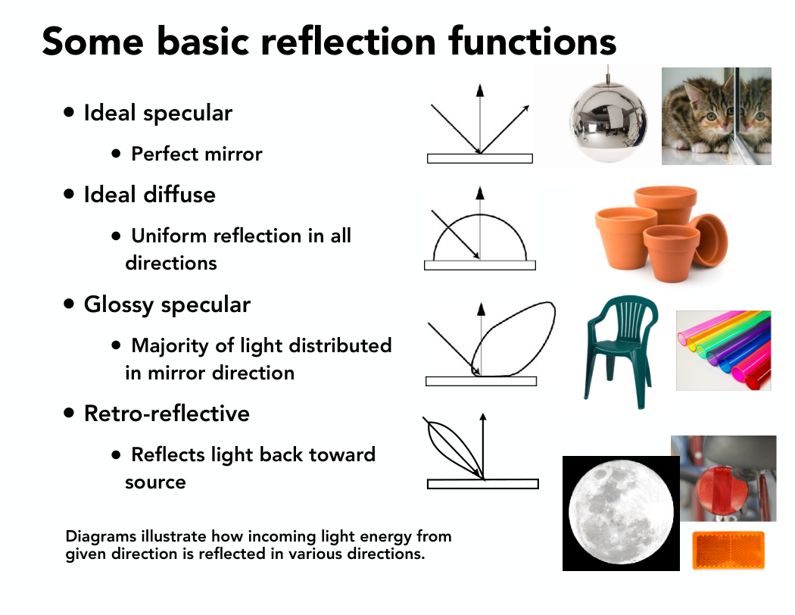
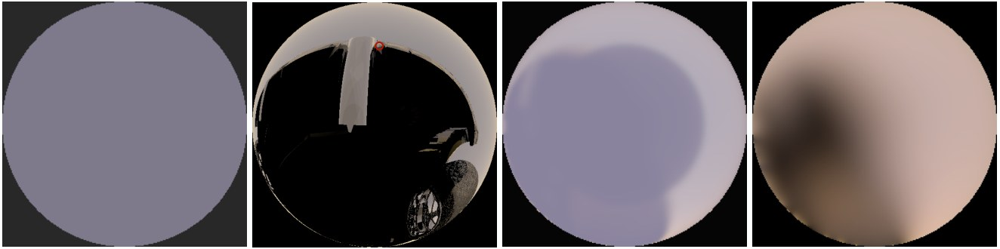
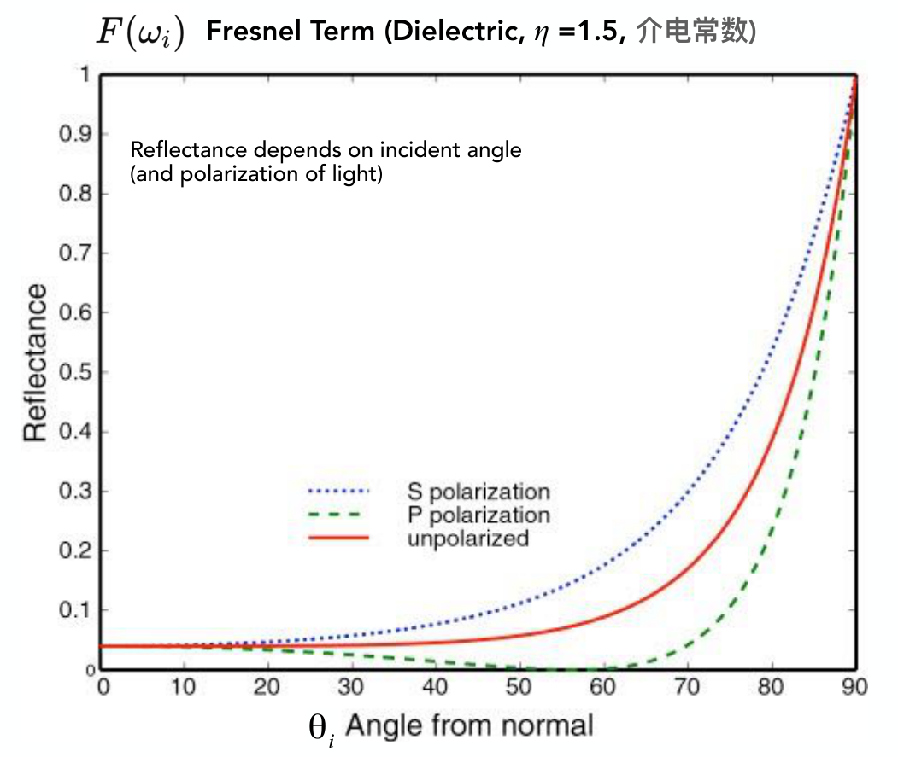
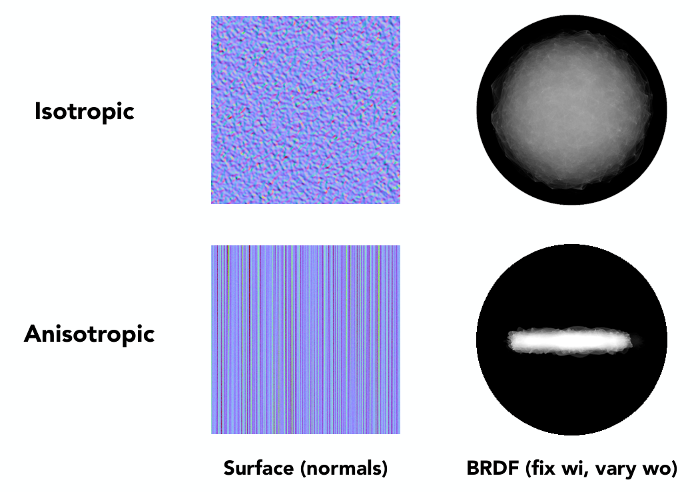
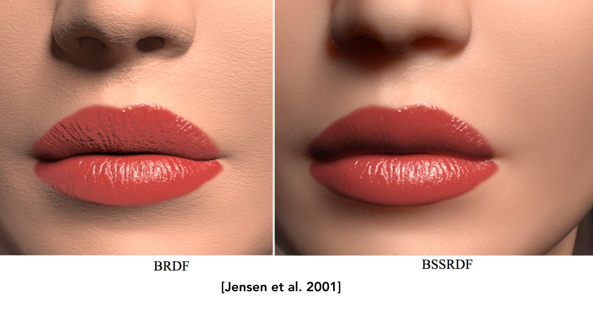

# 第 11 讲　渲染方程与材质散射

[原课件（74 页）](../ppt/lec-11-rendering-equation.pdf) · [返回总提纲](README.md)

本讲要回答一个具体问题：摄像机看见表面点 $p$ 时，究竟有多少光从 $p$ 沿观察方向出射？第 10 讲的辐射度量学给出光的量纲和积分方式，本讲再引入材质，说明同样的入射光照在陶器、镜子、金属和皮肤上为何呈现不同外观。

## 1. 从一束入射光写出渲染方程（第 2–10 页）

记 $\mathbf n$ 为表面的单位法向，$\omega_o$ 为从 $p$ 指向观察者的单位方向。课件把 $\omega_i$ 也定义为从 $p$ 指向来光一侧的单位方向，因此 $\cos\theta_i=\mathbf n\cdot\omega_i$。光子实际沿 $-\omega_i$ 到达表面。

1. 一个窄小立体角 $\mathrm d\omega_i$ 内的入射辐亮度 $L_i$ 对辐照度的贡献是 $\mathrm dE_i=L_i(p,\omega_i)\cos\theta_i\,\mathrm d\omega_i$。在上半球 $H^2$ 积分得到 $E(p)$。
2. 材质用 $f_r(p,\omega_i\to\omega_o)$ 描述这束光对观察方向的贡献，即 $\mathrm dL_r=f_r\,\mathrm dE_i$。将所有来光方向的贡献相加得到反射辐亮度 $L_r$。
3. 再加上表面自身沿该方向发出的辐亮度 $L_e$，得到 Kajiya（1986）的渲染方程：

$$
L_o(p,\omega_o)
=L_e(p,\omega_o)+
\int_{H^2}f_r(p,\omega_i\to\omega_o)\,
L_i(p,\omega_i)\cos\theta_i\,\mathrm d\omega_i .
$$

若沿 $\omega_i$ 的射线最先碰到场景中另一点 $q$，在无遮挡、非参与介质中，$L_i(p,\omega_i)=L_o(q,-\omega_i)$。计算 $p$ 处的一项又要计算 $q$ 处的同一个方程，这就是递归的来源。针孔相机发出眼射线是为了寻找交点，最终测量的是沿射线**反方向**回到眼睛的辐亮度。

## 2. 从方向分布读懂材质（第 11–25 页）

反射指光与表面相互作用后频率不变、从入射一侧离开。四种方向分布可对照第 12 页读图：理想镜面只把给定来光反射到镜像方向；理想漫反射的出射辐亮度与观察方向无关；光泽反射在镜像方向附近形成有宽度的反射瓣；逆向反射将光送回光源附近，例如反光标识。镜像方向和“回到光源”通常是两个方向。

同一茶壶依次换成漫反射、镜面、塑料、红色半光漆、Ford Mystic 车漆和黄金，形状相同，高光边界、倒影清晰度、颜色却会变（第 13–18 页）。第 19 页用红鞋的局部放大图展示表面细小亮斑。光还可能穿过界面、进入内部多次散射，或者被吸收并重新发射。能量守恒约束所有去向，单独计入的反射能量可以少于入射能量。

**车身旁一点的半球光照实验。** 第 21 页先把该点各来光方向的 $L_i(\omega)$ 看成一张半球图，然后在保持这张图不变的情况下更换材质。下面从左到右依次为漫反射、镜面、塑料、铜的**出射**辐亮度场（第 22–25 页）。漫反射汇总所有方向后处处同色；镜面将入射图像关于法线翻转；塑料使翻转的图像模糊；铜还对不同波长吸收不同，出射图带色。

## 3. BRDF、朗伯反射与理想镜面（第 26–35 页）

双向反射分布函数（BRDF）是给定入射辐照度微分时，出射辐亮度在指定方向的变化量：

$$
f_r(\omega_i\to\omega_o)
=\frac{\mathrm dL_r(\omega_o)}{\mathrm dE_i(\omega_i)}
=\frac{\mathrm dL_r(\omega_o)}
{L_i(\omega_i)\cos\theta_i\,\mathrm d\omega_i},
\qquad [f_r]=\mathrm{sr}^{-1}.
$$

**课堂问题：为何不能直接取 $L_o/L_i$？** 一个出射方向的总辐亮度含有来自整个半球的贡献，直接相除无法分离某一束入射光的影响。用微分比值才能指定入射方向及其立体角。

物理上可实现的反射分布满足非负性 $f_r\ge0$、亥姆霍兹互易性 $f_r(\omega_i,\omega_o)=f_r(\omega_o,\omega_i)$。对固定入射方向，能量守恒约束的是所有出射方向上的投影加权积分：

$$
\int_{H^2} f_r(\omega_i,\omega_o)\cos\theta_o\,\mathrm d\omega_o\le 1 .
$$

课件第 26 页也用互易的角标顺序来写此式。**积分**受 1 限制，某个方向的 BRDF 数值可以大于 1，窄而高的反射瓣仍可能守恒。

**朗伯材质的 $\pi$ 从哪里来（第 29–31 页）？** 朗伯 BRDF 为常数 $c$，故无自发光时 $L_o=cE$。用球坐标 $\mathrm d\omega=\sin\theta\,\mathrm d\theta\,\mathrm d\phi$，

$$
\int_{H^2}\cos\theta\,\mathrm d\omega
=\int_0^{2\pi}\!\int_0^{\pi/2}
\cos\theta\sin\theta\,\mathrm d\theta\,\mathrm d\phi=\pi .
$$

若半球各方向入射辐亮度为同一 $L_i$，则 $L_o=\pi cL_i$。令反照率（albedo）$\rho$ 表示反射掉的入射能量比例，便有 $c=\rho/\pi$，其中 $0\le\rho\le1$。任意照明下仍有 $L_r=(\rho/\pi)E$。

**镜面的方向与能量（第 32–35 页）。** 量角器实验中，镜面两侧关于法线对称，$\theta_i=\theta_o$，方位角差 $\pi$。按本讲方向约定，

$$
\omega_o=2(\mathbf n\cdot\omega_i)\mathbf n-\omega_i .
$$

读第 33 页的俯视图时要区分角度约定。若入、出射方位角都从同一固定切向起算，二者在切平面上的投影相反，即 $\phi_o=\phi_i+\pi\pmod{2\pi}$。第 33 页图下写作 $\phi_o=-\phi_i$，不能直接当作这一坐标系的方位角关系；第 34 页的 $\delta$ 项采用相差 $\pi$ 的写法。

完美无损镜面沿此方向传递原来的辐亮度。课件在球坐标中用狄拉克 $\delta$ 分布写成

$$
f_r=\frac{\delta(\cos\theta_i-\cos\theta_o)}{\cos\theta_i}
\,\delta_{2\pi}(\phi_i-\phi_o-\pi),
$$

其中方位角按 $2\pi$ 周期理解。乘 $\cos\theta_o$ 对出射半球积分得到 1。镜向是连续方向空间中的一个点，均匀随机发射射线几乎不可能恰好命中它，实际追踪时直接算出反射方向。

## 4. 折射、全内反射与菲涅尔反射（第 36–48 页）

BTDF 是双向透射分布函数，$f_t=\mathrm dL_t/\mathrm dE_i$。光从入射介质 $i$ 进入介质 $t$ 时，斯涅尔定律给出折射方向相对于法线的角度：

$$
\eta_i\sin\theta_i=\eta_t\sin\theta_t,\qquad
\cos\theta_t=\sqrt{1-(\eta_i/\eta_t)^2(1-\cos^2\theta_i)} .
$$

课件的折射率例值为真空 $1.0$、海平面空气 $1.00029$、$20^\circ\mathrm C$ 的水 $1.333$、玻璃 $1.5$–$1.6$、金刚石 $2.42$，具体值随波长变化。当 $\eta_i>\eta_t$ 且 $\sin\theta_i>\eta_t/\eta_i$，根号内为负，出现全内反射。用课件水和空气的数值代入，临界角约 $48.6^\circ$。水下仰望的 **optical manhole（斯涅尔窗）** 就是例子：水面只有一个圆锥形视野能看见水上，圆锥以外出现水下景物的反射（第 40 页）。

同一界面可以同时反射与透射。第 42 页的湖面既映出远处景物，又能看见水下石块。BSDF 统称反射和透射，反射项和透射项分别落在界面两侧的半球。第 41、43 页用简化的理想界面模型说明能量分配，固定入射方向时以 $F(\omega_i)$ 给镜面反射，以 $1-F(\omega_i)$ 给折射：

$$
f_r=\frac{F(\omega_i)}{|\cos\theta_i|}
\delta(\omega_o-\operatorname{reflect}(\omega_i)),\qquad
f_t=\frac{1-F(\omega_i)}{|\cos\theta_i|}
\delta(\omega_o-\operatorname{refract}(\omega_i)).
$$

这是课件表达反射／透射权重的写法。第 41 页把 BTDF 写成对称形式；在介质折射率不同、严格按辐亮度变换方向和立体角时，还要考虑折射率平方因子，不能把同侧 BRDF 的互易式直接用于任意 BTDF。

**菲涅尔项（第 44–47 页）。** 固定同一入射角后可以分配两个权重，改变入射角会改变权重本身。桌面上的杯子以掠射角观察时倒影更明显。对无吸收介质，设入射、出射介质折射率为 $n_1,n_2$，折射角为 $\theta_t$；电场垂直／平行于入射面的两种偏振分别有

$$
R_s=\left|\frac{n_1\cos\theta_i-n_2\cos\theta_t}
{n_1\cos\theta_i+n_2\cos\theta_t}\right|^2,\qquad
R_p=\left|\frac{n_1\cos\theta_t-n_2\cos\theta_i}
{n_1\cos\theta_t+n_2\cos\theta_i}\right|^2 .
$$

非偏振光 $F=(R_s+R_p)/2$，$T_s=1-R_s$、$T_p=1-R_p$。空气到 $n_2=1.5$ 的玻璃，正入射时两个反射率均约为 $0.04$；到掠射时两者都趋近 1。第 47 页导体曲线在正入射附近已很高，角度响应与玻璃不同。

## 5. 微表面与各向异性（第 48–63 页）

海面上一条破碎的阳光倒影引出微表面理论。从远处看，粗糙表面有统一的宏观法线；放大后，每个微小面都像一块有自己法线的镜子。微面法线越集中，高光越尖；分布越散，高光越宽。能把 $\omega_i$ 镜面反射至 $\omega_o$ 的微面法线必须平行于半程向量 $\mathbf h=(\omega_i+\omega_o)/\|\omega_i+\omega_o\|$。课件模型为

$$
f_r(\omega_i,\omega_o)=
\frac{F(\omega_i,\mathbf h)\,G(\omega_i,\omega_o,\mathbf h)\,D(\mathbf h)}
{4(\mathbf n\cdot\omega_i)(\mathbf n\cdot\omega_o)} .
$$

$D$ 描述所需朝向的微面法线分布，$G$ 考虑来光被相邻微面挡住、反射光被相邻微面遮住的比例，$F$ 是单个微面的菲涅尔反射项。第 53 页用摩托车坐垫、金属仪表和木椅对照材质外观。

**判断各向同性的操作是绕宏观法线一起转动入、出射方向。** 若响应保持不变，就只需方位角之差 $\phi_o-\phi_i$：

$$
f_r(\theta_i,\phi_i;\theta_o,\phi_o)
=f_r(\theta_i,\theta_o,\phi_o-\phi_i).
$$

拉丝锅底的纹理、尼龙纤维、天鹅绒的绒毛有特定取向，微面法线分布会偏向某些切向，绝对方位影响高光的位置和拉长方向。第 57 页问锅底如何拉丝，可以先从高光的轴向变化反推纹理方向。第 58 页在同一入射方向下比较两种法线分布对应的出射高光。

## 6. 玉、皮肤、叶片为何需要 BSSRDF（第 64–74 页）

观察背光的树叶、耳朵和玉雕：光可以从一点进入物体，在内部多次散射，最终从另一个位置离开。皮肤内部的角质层、表皮、真皮以及色素和血管均会影响光传输。BRDF 只在同一个表面点联结入射与出射方向，这里还要记录两个位置。

双向表面散射反射分布函数（BSSRDF）为 $S(x_i,\omega_i,x_o,\omega_o)$。要得到 $x_o$ 的出射散射辐亮度，既要枚举入射方向，也要枚举可能的入射点：

$$
L_s(x_o,\omega_o)=\int_A\int_{H^2(x_i)}
S(x_i,\omega_i,x_o,\omega_o)L_i(x_i,\omega_i)
\cos\theta_i\,\mathrm d\omega_i\,\mathrm dA_i .
$$

第 69–70 页中，同一雕像改用 BSSRDF 后暗部可收到邻近区域进入的光，明暗交界发生变化。第 71–72 页把同样的现象用于面部皮肤与人物渲染。第 73–74 页回到渲染方程：材质决定每个方向散射多少，后两讲分别解决沿射线找到哪个表面、如何估计半球积分。

