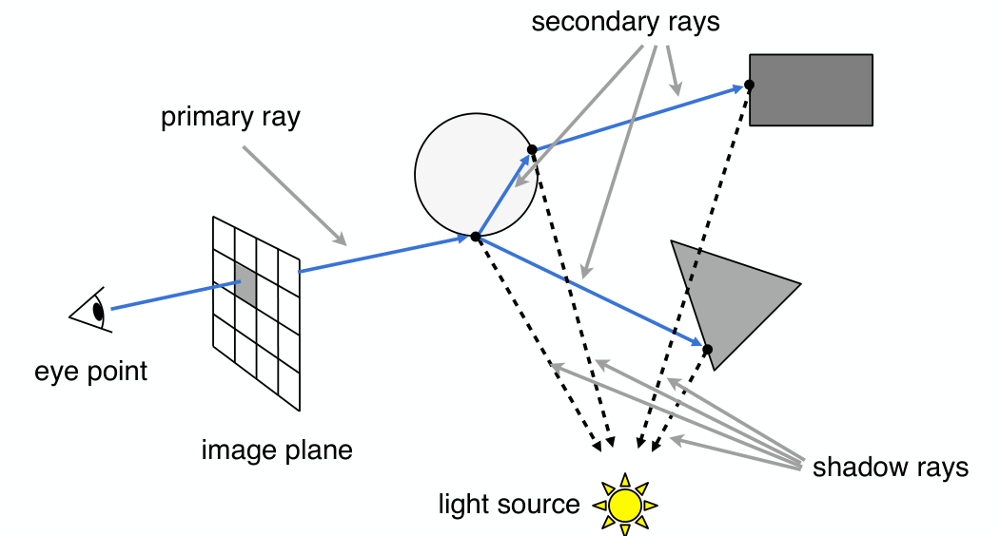
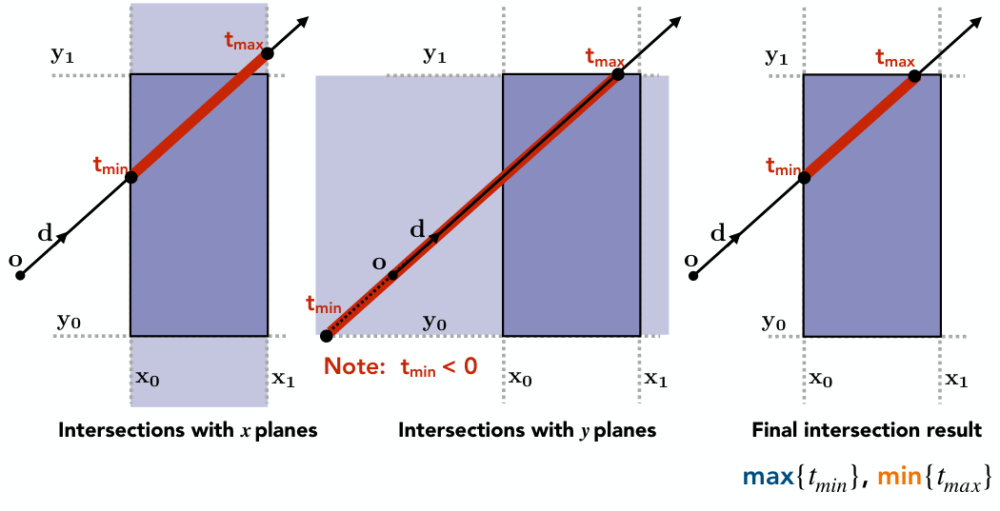
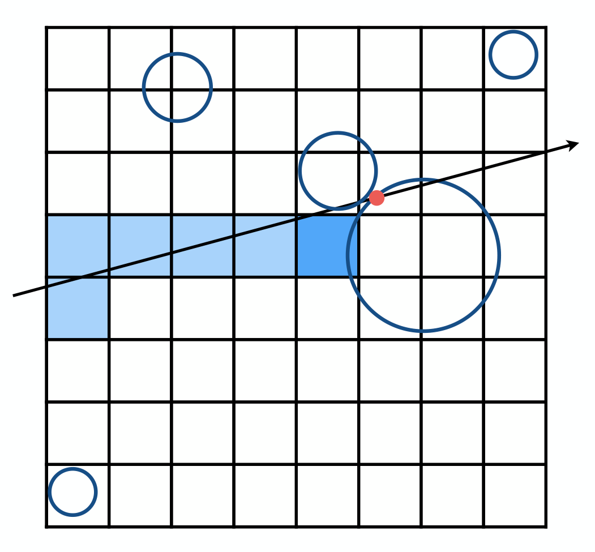
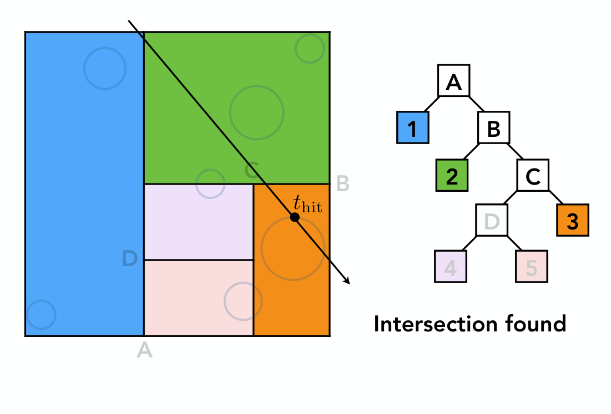
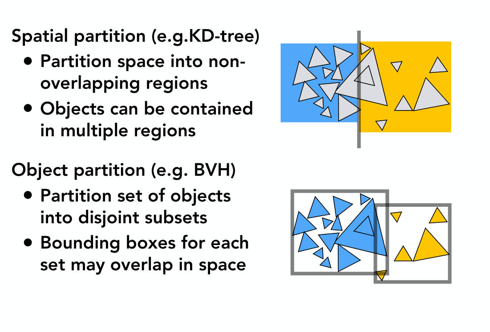

# 第 12 讲　光线追踪、求交与加速结构

[原课件（75 页）](../ppt/lec-12-ray-tracing.pdf) · [返回总提纲](README.md)

相机、几何、材质、光源是光线追踪器的输入。本讲拆解其中的几何问题：从眼睛出发的射线先碰到谁？从表面去光源的线段会不会被挡住？当场景有上千万个三角形时，怎样少做求交测试？

## 1. 眼射线、阴影射线和递归光追（第 2–13 页）

**光线投射（Ray Casting）。** Appel（1968）的方案是每像素发一条眼射线，再向光源发射阴影射线。针孔相机下，眼点和像素位置确定射线方向。可能有多个交点，像素只看见最近的有效交点。到光源的线段若被遮挡，该光源的直接贡献为零；可见时可在交点用 Blinn–Phong 等局部模型计算像素颜色。

**Whitted 式递归追踪。** 碰到理想镜面或透明界面时，沿镜面反射方向或折射方向继续找交点。在各个交点另发阴影射线，返回的辐亮度按局部反射、透射权重相加。次级射线可继续生成次级射线，遇到非镜面表面时做局部着色，也可以设置最大递归深度。课件第 7 页用 Whitted 的《Spheres and Checkerboard》作历史对照：同一经典球体棋盘场景标出的渲染时间是 VAX 11/780（1979 年）74 分钟、PC（2006 年）6 秒、GPU（2012 年）$1/30$ 秒。

第 8–12 页逐步补全图中的光路。实线从眼睛经像平面到球，再沿反射或折射方向传播；虚线只测试各点到光源的可见性。第 13 页的红绿墙箱体对照展示了局部照明与全局照明的差异：允许光经其他表面反弹后，阴影区也会受光，墙的颜色会映到邻近表面。仅跟踪理想镜面和折射的 Whitted 算法能表现镜中反射和隔着玻璃看物体，漫反射表面之间的间接照明还需第 13 讲的采样方法。

## 2. 射线与平面、三角形、球面及隐式曲面（第 14–22 页）

射线用起点 $\mathbf o$ 和方向 $\mathbf d$ 表示：

$$
\mathbf r(t)=\mathbf o+t\mathbf d,\qquad 0\le t<\infty .
$$

若 $\mathbf d$ 是单位向量，$t$ 就是沿射线走过的距离。一条射线与网格可能有零个、一个或多个交点。这项运算既用于渲染中的可见性、阴影、光照，也可用于封闭网格的内外测试。

**平面。** 已知平面上一点 $\mathbf p_0$、法线 $\mathbf N$，平面方程为 $(\mathbf p-\mathbf p_0)\cdot\mathbf N=0$，等价于 $ax+by+cz+d=0$。代入射线后得到

$$
t=\frac{(\mathbf p_0-\mathbf o)\cdot\mathbf N}{\mathbf d\cdot\mathbf N}.
$$

分母为零时射线平行于平面，要检查是否共面；$t<0$ 的交点在起点后方。普通可见性取最近的有效 $t$。

**三角形。** 先求射线与三角形所在平面交点，再检查交点是否在三条边围成的区域内。第 20 页给出 Möller–Trumbore 算法，把两步变为联立求解。令三顶点为 $\mathbf P_0,\mathbf P_1,\mathbf P_2$，则

$$
\mathbf o+t\mathbf d=(1-b_1-b_2)\mathbf P_0+b_1\mathbf P_1+b_2\mathbf P_2 .
$$

记 $\mathbf E_1=\mathbf P_1-\mathbf P_0$，$\mathbf E_2=\mathbf P_2-\mathbf P_0$，$\mathbf S=\mathbf o-\mathbf P_0$，$\mathbf S_1=\mathbf d\times\mathbf E_2$，$\mathbf S_2=\mathbf S\times\mathbf E_1$。课件的求解式为

$$
\begin{bmatrix}t\\b_1\\b_2\end{bmatrix}
=\frac{1}{\mathbf S_1\cdot\mathbf E_1}
\begin{bmatrix}\mathbf S_2\cdot\mathbf E_2\\
\mathbf S_1\cdot\mathbf S\\ \mathbf S_2\cdot\mathbf d\end{bmatrix}.
$$

分母非零、$t\ge0$、$b_1\ge0$、$b_2\ge0$ 且 $b_1+b_2\le1$ 才落在有效射线和三角形内。课件图给出的运算计数为 1 次除法、27 次乘法、17 次加法。

**球面。** 设球心 $\mathbf c$、半径 $R$，$\|\mathbf p-\mathbf c\|^2-R^2=0$。令 $\mathbf u=\mathbf o-\mathbf c$，代入得

$$
A t^2+B t+C=0,\quad A=\mathbf d\cdot\mathbf d,\quad
B=2\mathbf u\cdot\mathbf d,\quad C=\mathbf u\cdot\mathbf u-R^2,\quad
t_{\pm}=\frac{-B\pm\sqrt{B^2-4AC}}{2A}.
$$

判别式小于零时直线也不命中；等于零时相切；大于零时检查两个根的符号并选最近有效根。眼点在球内时近根为负，远根才是射线的出射交点。对一般隐式曲面 $f(\mathbf p)=0$，沿用同一思路解 $f(\mathbf o+t\mathbf d)=0$，筛选可用的实根。

## 3. 包围体与轴对齐包围盒 AABB（第 23–34 页）

朴素方法的工作量随“像素数 × 图元数”增长，添加阴影或反弹射线还会进一步放大成本。课件给出的 San Miguel 场景有 **1,070 万个三角形**，植物生态场景有 **2,000 万个三角形**。可以先用简单形状包住复杂物体。射线错过包围体，就可排除其中全部几何；碰到包围体仍要测试内部物体。第 29 页用茶壶演示旋转矩形、轴对齐矩形、圆等不同包围方式。

AABB 由逐坐标最小角 $\mathbf b_{\min}$ 和最大角 $\mathbf b_{\max}$ 定义。把盒子看成三个正交 **slab**（每对平行平面之间的空间）的交集。对每一轴 $k\in\{x,y,z\}$，求射线在该 slab 内的时间区间：

$$
t_0^k=\frac{b_{\min,k}-o_k}{d_k},\quad
t_1^k=\frac{b_{\max,k}-o_k}{d_k},\quad
t_{\mathrm{near}}^k=\min(t_0^k,t_1^k),\quad
t_{\mathrm{far}}^k=\max(t_0^k,t_1^k).
$$

交换先后次序由 $d_k$ 的正负决定。若 $d_k=0$，起点在该轴的范围内时这一轴不再限制 $t$，起点在范围外则整条射线不可能命中。合并三个区间得到

$$
t_{\mathrm{enter}}=\max_k t_{\mathrm{near}}^k,\qquad
t_{\mathrm{exit}}=\min_k t_{\mathrm{far}}^k .
$$

第 31 页中，与 $y$ 平面的一个交点落在射线反向，故该轴的 $t_{\min}<0$；它仍可与 $x$ 区间有交集。判断时分三种情况：

- $t_{\mathrm{enter}}>t_{\mathrm{exit}}$ 表示三个区间没有公共部分。
- $t_{\mathrm{exit}}<0$ 表示盒子全在射线后方。$t_{\mathrm{enter}}<0\le t_{\mathrm{exit}}$ 则是射线从盒内（或边界）出发。
- 闭盒把相切也算命中，条件为 $t_{\mathrm{enter}}\le t_{\mathrm{exit}}$ 且 $t_{\mathrm{exit}}\ge0$。第 32 页采用 $\le$，第 33 页总结使用严格 $<$，相等时对应是否保留单点接触的边界约定。

求轴对齐平面交点的优势也来自这里。若平面为 $x=p'_x$，一般平面公式简化为 $(p'_x-o_x)/d_x$。课件以 1 次减法、1 次除法对照一般情况的 3 次减法、6 次乘法、1 次除法（第 34 页）。

## 4. 均匀网格与“体育场里的茶壶”（第 35–45 页）

**预处理。** 先求整个场景的 AABB，划分为同样大小的格子。对每个图元，将其引用存入所有与它相交的格子。**查询。** 射线与总盒求交后，按走访顺序逐格推进（3D DDA）；只对当前格子中登记的图元求交。

第 43 页有一个容易写错的提前退出条件。射线由左向右，进入深蓝格时，格子里已登记了右侧的大圆。测试大圆能算出红色交点，但它仍在当前格之外；射线稍后可能先碰到小圆。应检查命中 $t$ 是否位于当前格的有效区间，或保留最近候选直到后续格不可能更近。同一图元可能被测试多次，可以为当前射线缓存该图元的求交结果（mailboxing）。

只划一格几乎没有加速；划得过细，遍历格子的成本又会主导。课件给出三维经验值 $\#\text{cells}=C\,\#\text{objects}$，$C\approx27$，这里是格子**总数**。植物丛中物体尺度和空间分布较均匀，网格有利；“体育场里的茶壶”代表空间大而细节局部集中的极端，即使茶壶很小，仍要分配大量空格，射线可能穿过成千上万个空格。

## 5. 非均匀空间划分与 KD 树（第 46–63 页）

需求是让图元密集的区域细分、空旷区域保持粗粒度。第 47–50 页用分割面 A、B、C、D 递归生成五个叶区域，并把分割过程画成树。八叉树每次将三维区域沿三个轴分成八块（二维示意对应四叉）；KD 树每次沿某个坐标轴用一个平面二分，BSP 树可用任意方向的平面。

**构建 KD 树。** 从总包围盒出发，内部节点保存分割轴、该轴上的分割位置及两个子节点引用。叶节点保存与该空间重叠的图元列表，可附 mailbox 信息。简单策略在区间中点或对象分布中位数处分割；更好的目标是尽量减小预期射线求交开销。课件列出最大深度经验式 $8+1.3\log N$（$N$ 为对象数），也可以在对象已经很少或继续切分无法降低预计成本时停止。同一对象跨越切分面，可在多个叶中出现。

**按射线时间遍历。** 先求根盒上的 $[t_{\min},t_{\max}]$。内部节点算射线与分割面的 $t_{\mathrm{split}}$。若分割点在当前区间中间，先查近子树对应的小区间，再按需查远子树；若分割点落在区间外，只需查当前区间所在的一侧。叶节点测试其中图元，且只接受该时间区间内的交点。

**按课堂图走一遍。** 第 56–63 页的射线从图的上方斜向右下。根 A 的近侧为蓝色叶 1；行进后进入 B 的绿色叶 2；接着来到 C，分割面交点比当前区间起点更早，因此跳过 D 的子树，进入橙色叶 3，在圆上取到 $t_{\mathrm{hit}}$。红、紫色的叶 5 和叶 4 均无需测试。

## 6. 按对象划分的 BVH（第 64–75 页）

KD 树划分**空间**：子区域内部互不重叠，图元引用可以重复。包围体层次结构（BVH）划分**对象集合**：两组对象互不重复，各组的包围盒却可以在空间中重叠。第 65 页的三角形对照图揭示了两种结构为什么需要不同的遍历条件。

**建树（第 66–72 页）。** 求当前组的包围盒，选一维，按空间中点或按对象位置中位数把对象分成两组，对每组重复。内部节点保存能包住子树所有对象的盒及两个子节点；叶节点保存自己的盒和图元列表。例图逐步得到 A、B、C、D 四组。叶中只剩少量图元（课件举例 5 个），或继续划分不能降低求交成本时停止。

**查询（第 73 页）。** 射线错过节点包围盒便返回未命中；叶节点返回该叶中最近的有效交点；内部节点对两个孩子递归，保留两个结果中较近者。子盒可能重叠，先命中一个子盒不足以直接返回。实现时可以维护已有最近距离，剪去入口就比它远的子树。

| 结构 | 划分对象与选用条件 | 主要代价 |
| --- | --- | --- |
| 均匀网格 | 等尺寸格子，适合规模和密度比较均匀的图元 | 空格遍历、重复登记，分辨率敏感 |
| KD 树 | 自适应划分空间，可按沿射线的顺序访问 | 构建较贵，跨面图元可能重复 |
| BVH | 自适应划分互不相交的对象集合，节点数受图元数约束，对象移动后较易更新包围盒 | 构建也有成本，空间重叠的兄弟盒可能都要访问 |

建树成本要由足够多的射线查询摊销。三种结构改变的是找到有效最近交点的速度，同一场景、同一射线应返回相同的可见表面。
