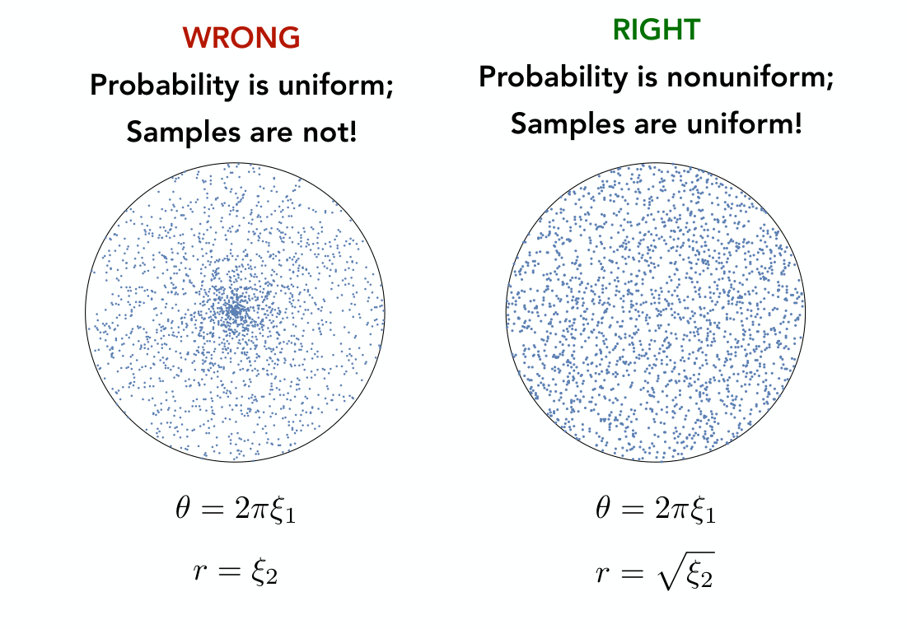
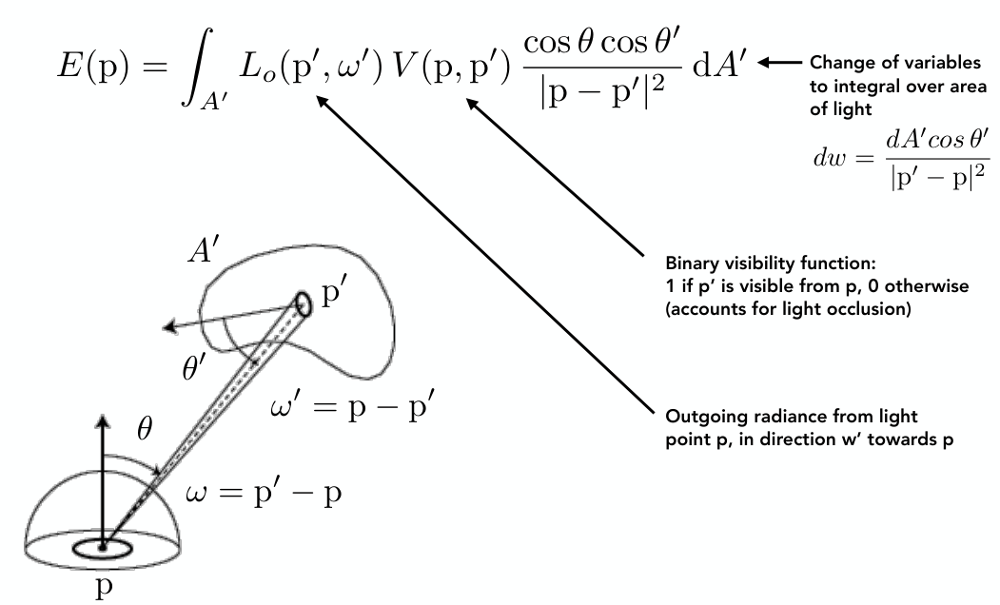
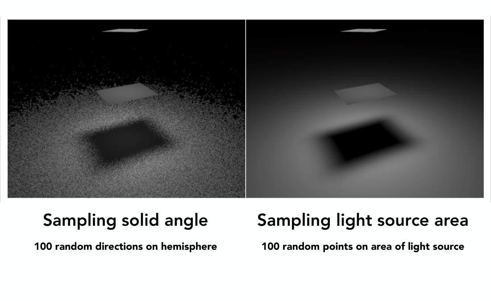
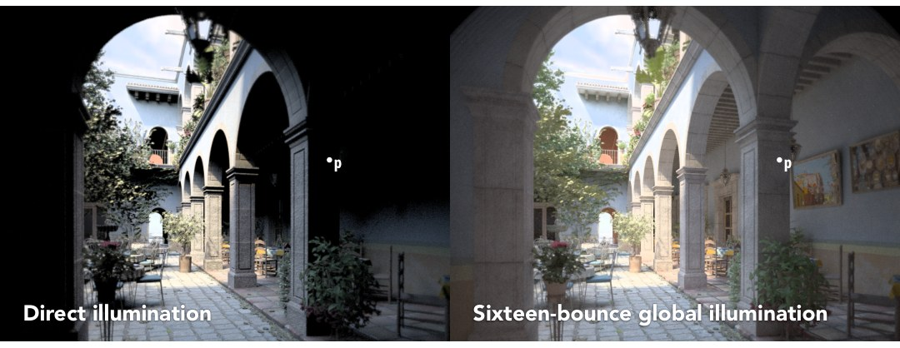

# 第 13 讲　蒙特卡洛积分与路径追踪

[原课件（110 页）](../ppt/lec-13-monte-carlo-ray-tracing.pdf) · [返回总提纲](README.md)

第 11 讲写出渲染方程，第 12 讲能沿给定方向求交。本讲解决接下来的问题：半球上有无穷多个入射方向，每个交点还要再求一次积分，有限条射线怎样估计一个像素的辐亮度？

## 1. 从梯形求积到维数灾难（第 2–21 页）

定积分 $\int_a^b f(x)\,\mathrm dx$ 可以看成曲线下的带符号面积，也等于区间长度乘以函数平均值。若知道原函数 $F$，积分为 $F(b)-F(a)$。常数 $C$ 的积分是 $(b-a)C$；仿射函数 $f(x)=cx+d$ 的平均值恰好为两个端点值的算术平均，也等于中点处的一次取值，因此

$$
\int_a^b f(x)\,\mathrm dx=(b-a)\frac{f(a)+f(b)}2 .
$$

课件先画出折线 $x_0=a,\ldots,x_4=b$。每一小段是直线，直接把梯形面积相加即可。对一般平滑函数，则用穿过采样点的折线近似。为统一下标，下式记 $n$ 为**等长小区间的个数**，有 $n+1$ 个取样点和步长 $h=(b-a)/n$：

$$
I\approx T_n=\sum_{i=0}^{n-1}\frac h2\,[f(x_i)+f(x_{i+1})]
=h\left[\frac{f(x_0)+f(x_n)}2+\sum_{i=1}^{n-1}f(x_i)\right].
$$

内部点出现两次，两端点只出现一次；若有 $N$ 个点，步长就写作 $(b-a)/(N-1)$。第 11 页画的折线节点并非等距，此时每段要乘自己的宽度，面积为 $\sum_i(x_{i+1}-x_i)[f(x_i)+f(x_{i+1})]/2$。数值求积要选**节点与权重**，一般形式为 $\sum_i A_i f(x_i)$。第 14 页用一次至五次多项式演示高斯求积：特别选择节点及权重可以精确积分。用 $m$ 个 Gauss–Legendre 节点可对最高 $2m-1$ 次多项式精确积分；一节点中点公式对一次函数精确，两节点已经能对三次函数精确。

对二阶连续可导的函数，复合梯形法一维工作量 $O(n)$、误差 $O(h^2)=O(n^{-2})$。二维分别沿 $x,y$ 求积，需要约 $n^2$ 次函数取值，估计为 $\sum_{i,j} A_iA_j f(x_i,y_j)$，误差阶仍是 $O(h^2)$。$k$ 维网格总取样数约为 $N=n^k$，达到的误差阶为 $O(N^{-2/k})$。高维时每一维只稍加密，工作量就成倍累积；多次反弹的光路正会引入许多积分维度。

## 2. 蒙特卡洛估计、分布与逆变换（第 22–32、40–42 页）

对目标积分 $I=\int_D f(x)\,\mathrm dx$，按密度 $p(x)$ 独立抽取 $N$ 个样本 $X_i$，一般估计式为

$$
F_N=\frac1N\sum_{i=1}^N\frac{f(X_i)}{p(X_i)},\qquad
p(x)>0\ \text{在所有有非零贡献的位置上（几乎处处）}.
$$

同一部分空间抽样越频繁，每次抽到它的权重越小。区间 $[a,b]$ 上均匀抽样时，归一化给出 $p=1/(b-a)$，恢复“宽度 × 样本平均值”，即 $F_N=(b-a)\sum_i f(X_i)/N$。

**离散例子。** 公平六面骰的每个面概率 $p_i=1/6$，一般离散分布满足 $p_i\ge0$、$\sum_i p_i=1$。将 $[0,1]$ 按各结果的概率依次划段，累积概率 $P_j=\sum_{i=1}^j p_i$。抽一个均匀数 $\xi$，找它落入哪个累积区间便返回该 $x_j$。第 29 页的水平虚线落在第 2 个区间，所以返回 $x_2$。端点可以统一采用左闭右开。

**连续分布。** 概率密度 $p(x)$ 对某区间积分才得到概率。以 $[0,1]$ 为例，$P(x)=\int_0^x p(t)\,\mathrm dt$，$\Pr(a\le X\le b)=P(b)-P(a)$。逆变换法取 $\xi\sim U[0,1)$，令 $X=P^{-1}(\xi)$。

**课堂算例（第 32 页）。** 给定二次密度 $p(x)=3(1-x)^2$，$0\le x\le1$。积分得 $P(x)=x^3-3x^2+3x=1-(1-x)^3$。令 $P(x)=\xi$，解得 $X=1-(1-\xi)^{1/3}$。产生的样本在靠近 0 的地方密集，符合原密度的形状。

## 3. 课堂推导：怎样均匀采样单位圆盘（第 33–39 页）

第 33 页的 *unit circle* 问的是实心圆盘的**面积**均匀。一个办法是在 $[-1,1]^2$ 内均匀抽点，若 $x^2+y^2>1$ 则丢弃。接受率为圆与正方形的面积比 $\pi/4$。第 35 页换成很窄的螺旋形状，矩形里大部分点都会被丢掉，此时直接变换随机变量更合算。

另一个直观尝试是 $\theta=2\pi\xi_1,\ r=\xi_2$，然后输出 $(r\cos\theta,r\sin\theta)$。结果向圆心聚集。因为同样的径向宽度 $\mathrm dr$ 在外圈扫过的面积更大，而这种取法给每个等宽圆环相同的概率。正确的面积元为 $\mathrm dA=r\,\mathrm dr\,\mathrm d\theta$，单位圆面积是 $\pi$，故

$$
p_A=\frac1\pi,\quad
p_{r,\theta}(r,\theta)=\frac r\pi,\quad
p_\theta(\theta)=\frac1{2\pi},\quad
p_r(r)=2r,\quad P_r(r)=r^2 .
$$

取独立的 $\xi_1,\xi_2\sim U[0,1)$，令 $\theta=2\pi\xi_1$、$r=\sqrt{\xi_2}$。检验方法是看半径 $1/2$ 的内盘：它占总面积的 $1/4$，正确算法落入它的概率也是 $1/4$，错误算法却给了 $1/2$。

## 4. 无偏性、方差与大数定律（第 43–49 页）

无偏要求 $\mathbb E[F_N]=I$。期望是按概率加权的平均，课件以公平硬币举例：正面记 1、反面记 0，期望为 $1/2$。用期望的线性性和采样密度可证明

$$
\mathbb E[F_N]
=\frac1N\sum_i\int_D\frac{f(x)}{p(x)}p(x)\,\mathrm dx
=\int_D f(x)\,\mathrm dx .
$$

单次计算可以偏离真值。方差度量这种波动，$\operatorname{Var}(Y)=\mathbb E[(Y-\mathbb E Y)^2]=\mathbb E[Y^2]-(\mathbb E Y)^2$。若 $Y_i=f(X_i)/p(X_i)$ 独立同分布且二阶矩有限，

$$
\operatorname{Var}(F_N)=\frac{\operatorname{Var}(Y)}{N}
=\frac1N\left[\int_D\frac{f(x)^2}{p(x)}\,\mathrm dx-I^2\right].
$$

凡是 $f$ 很大而 $p$ 很小的地方，偶然抽到一次就会产生巨大的权重。增加样本数使方差按 $1/N$ 下降，标准差按 $1/\sqrt N$ 下降。标准差减半约需 4 倍样本。大数定律解释了样本平均为何趋向期望，单次实验的误差仍可能先降后升。

**估计 $\pi$（第 47 页）。** 在外接正方形内均匀投点，以 $4\times$ 落入内切圆的比例估计 $\pi$。课件的一次试验中，取 $1,10,100,1\,000,10\,000,100\,000,1\,000\,000$ 个样本，得到 $4.000000,\ 3.200000,\ 3.240000,\ 3.112000,\ 3.163600,\ 3.139520,\ 3.141764$。第 49 页的软阴影对照同理，从 1 条阴影射线增加至 16 条后，半影区域噪点减少。

## 5. 直接照明：在半球上抽方向，还是在光源上抽位置（第 50–61 页）

估计表面点的辐照度 $E(p)=\int_{H^2}L_i(p,\omega)\cos\theta\,\mathrm d\omega$。每个样本都要为对应的方向发射射线，求出从该方向到达的 $L_i$。

**半球立体角均匀。** 上半球立体角为 $2\pi$，$p_\omega=1/(2\pi)$，所以

$$
\widehat E_\Omega(p)=\frac{2\pi}{N}\sum_{j=1}^{N} L_i(p,\omega_j)\cos\theta_j .
$$

第 53 页要求推导均匀方向。球坐标下 $\mathrm d\omega=\sin\theta\,\mathrm d\theta\,\mathrm d\phi$；在上半球取 $z=\cos\theta$ 后，$z$ 在 $[0,1]$ 均匀，$\phi$ 在 $[0,2\pi)$ 均匀。取 $z=\xi_1$、$\phi=2\pi\xi_2$，输出

$$
\omega=\big(\sqrt{1-\xi_1^2}\cos(2\pi\xi_2),\
\sqrt{1-\xi_1^2}\sin(2\pi\xi_2),\ \xi_1\big).
$$

**面光源面积均匀。** 课件场景中光源小，大部分半球方向没有直接来光。改为在光源面积 $A$ 上抽点 $p'$，再连线测试可见性。设 $r=\|p'-p\|$，$\omega=(p'-p)/r$，$\omega'=-\omega$。$\theta$ 是接收面法线与 $\omega$ 的夹角，$\theta'$ 是发光面法线与 $\omega'$ 的夹角，$V(p,p')$ 为取值 0 或 1 的可见性函数。单面向前发光的有效区域上，

$$
\mathrm d\omega=\frac{\cos\theta'}{r^2}\,\mathrm dA',\qquad
E(p)=\int_A L_o(p',\omega')V(p,p')
\frac{\cos\theta\cos\theta'}{r^2}\,\mathrm dA'.
$$

均匀面积密度为 $p_A=1/A$，估计量是

$$
\widehat E_A(p)=\frac A N\sum_{j=1}^N
L_o(p'_j,\omega'_j)V(p,p'_j)
\frac{\cos\theta_j\cos\theta'_j}{\|p-p'_j\|^2}.
$$

背向接收表面或背向单面光源的样本贡献为零。若用面积密度，须包含几何换元因子；若光源采样接口已返回相对立体角的密度，就按方向积分计算，几何因子已经体现在密度转换中。

**同样 100 条射线的对照（第 54–61 页）。** 左图从整个半球随机取 100 个方向，少数方向命中小面光源，每个像素命中数的差异带来噪点。右图直接抽光源上的 100 个点，向每个点发阴影射线，只剩可见性及几何权重的变化，半影平滑得多。

## 6. 重要性采样与余弦加权（第 62–67 页）

按预计贡献的大小分配样本，并用 $1/p$ 修正权重称为重要性采样。若 $p$ 跟非负的 $f$ 形状接近，$f/p$ 变化较小，方差下降。要覆盖能产生非零贡献的区域；抽得少的区域仍要以较高权重计入。

**第 46、63 页的直方图问题。** 给定中间高、两头低和接近均匀的两种采样分布，哪一种会使积分估计的方差更大？只看 $p$ 的直方图无法决定；要把它与被积函数 $f$ 对照。若 $f$ 在中部有峰，左图把更多样本分给高贡献区，通常更合适。若 $f$ 为正常数，均匀采样则使每个样本的 $f/p$ 都相同，方差为零。

辐照度被积函数中已经有 $\cos\theta$，可令 $p_\omega(\omega)=\cos\theta/\pi$。它由 $\int_{H^2}\cos\theta\,\mathrm d\omega=\pi$ 归一化，所得估计为

$$
\widehat E_{\cos}(p)=
\frac1N\sum_j\frac{L_i(p,\omega_j)\cos\theta_j}{\cos\theta_j/\pi}
=\frac{\pi}{N}\sum_j L_i(p,\omega_j).
$$

这里的 $\omega_j$ 必须按余弦密度抽取。若入射辐亮度为常数，该估计的每个样本给出相同贡献。更一般地，对反射辐亮度有

$$
\widehat L_r(p,\omega_o)=\frac1N\sum_{j=1}^N
\frac{f_r(p,\omega_j\to\omega_o)L_i(p,\omega_j)\cos\theta_j}{p_\omega(\omega_j)} .
$$

课件列出均匀半球、按 BRDF 采样、按光源采样三种方向选择思路。做题时先写被积函数与积分变量，再写抽样分布，最后决定分母以及是否需要面积与立体角的换算。

## 7. 全局照明与路径数爆炸（第 68–89 页）

一条有效光路把相机和光源连接起来。中间有一个散射点，就是从光源到该点再进相机的直接光；加入更多散射点，就会出现间接光。同一反弹次数也有许多方向和路径。全局照明要求把不同长度、不同形状的光路贡献相加。

第 76–81 页展示拱廊从仅有直接光，到加入 1、2、4、8、16 次间接反弹时的变化。观察标出的 $p$ 点附近：它收不到明亮天空的直接光，却能接收由庭院地面和墙面反射来的光，反弹增多后拱廊内部逐渐可见。

**两个不同的样本数。** 每个散射点都派生 $N$ 条后继射线，深度为 $b$ 的一层就可能有 $N^b$ 条。课件以每次 100 条为例，三层分别到 100、10 000、1 000 000 条。路径追踪在一个散射点只随机选 **1 条间接后继射线**，让单条路径向下延伸；同一像素可以独立追踪许多条这样的路径，再平均其辐亮度。第 85、87、88 页对比了同一场景每像素 **1、32、1 024 条路径**的噪声。直接照明另用的阴影射线不构成递归分支。

固定只允许前 $b$ 次反弹会遗漏所有更长光路的能量。即使多数场景高阶项逐渐变小，增加每像素样本数也无法消除这一截断偏差。

## 8. 俄罗斯轮盘及课件实测（第 90–97 页）

考虑一项样本贡献 $X=f_rL_iV\cos\theta/p_\omega$。课件指出，若尚未求可见性时的暂定贡献很小，花费一次求交可能不划算。直接删掉所有低贡献会系统性低估结果。俄罗斯轮盘（Russian Roulette）以概率 $q$ 继续评估，以 $1-q$ 终止，并对幸存样本补偿：

$$
X'=\begin{cases}X/q,&\text{以概率 }q,\\0,&\text{以概率 }1-q.\end{cases}
\qquad
\mathbb E[X'\mid X,q]=q\,(X/q)+(1-q)0=X .
$$

对可能有贡献的路径，要保留正的继续概率。降低 $q$ 可以减少工作，但幸存样本权重更大，通常会增加噪声。相同思路用于递归路径时，用继续概率决定是否再追一次间接反弹。

| 课件的汽车渲染（第 93–97 页） | 在阈值以下的终止比例 | 时间 |
| --- | ---: | ---: |
| 未启用轮盘 | 0% | 6.4 秒 |
| 亮度小于 0.25 | 50% | 5.1 秒 |
| 亮度小于 0.5 | 50% | 4.9 秒 |
| 亮度小于 0.125 | 90% | 4.8 秒 |
| 亮度小于 1 | 90% | 3.6 秒 |

最后一种图像的颗粒最明显。这组数值来自课件中的同一对照实验。

## 9. 一条路径怎样返回一个像素的估计（第 98–110 页）

从 $x$ 沿 $\omega$ 找到首个交点 $p$，则从该方向进入 $x$ 的辐亮度，就是 $p$ 沿 $-\omega$ 的出射辐亮度。课件将其按路径长度拆成三部分：

- **0 次反弹**：$p$ 自身向观察方向发光，贡献为 $L_e(p,\omega_o)$。
- **1 次反弹**：光源 $\to p\to x$。在光源上抽一个点，发阴影射线；若被挡，直接项为零。若采样器返回方向密度，则直接项为 $L_i f_r\cos\theta/p_{\text{light},\omega}$。
- **超过 1 次反弹**：光源 $\to\cdots\to p'\to p\to x$。在 $p$ 按 BRDF 等密度抽一个方向，递归计算 $p'$ 回到 $p$ 的至少一次反弹贡献，乘上本次 $f_r\cos\theta/p_\omega$，幸存时再除以轮盘继续概率。

第 98 页演示“直接项均匀抽光源面积、间接项均匀抽半球”的简版；第 106–108 页换成按 BRDF 的方向采样，并把下一交点的自发光和反弹光分开。可按如下顺序复述后一版（对应课件中显式采样光源的普通非镜面情形）：

1. 眼射线先求交，若命中光源，自发光由最外层的零反弹项计入。
2. 在当前交点算一次直接光估计。阴影测试的范围到所采光源点为止。
3. 抽取间接方向 $\omega_i$ 并得到相应 $p_\omega$，求下一交点。以 $q$ 决定是否继续。终止时仍返回已经算出的直接光。
4. 若继续，取下一交点的**至少一次反弹**辐亮度，沿 $-\omega_i$ 返回，以 $f_r\cos\theta/(p_\omega q)$ 加权。下一交点单纯发光的那一项属于上一步显式采样过的直接路径，不能在此再次相加。
5. 同一像素重复生成独立路径并平均。第 99 页给出每像素数百至数千路径的示意，第 109 页用红绿墙盒的照片与路径追踪结果并列，展示逼近真实光照的效果。

最后回查三个量：**反弹次数**决定纳入哪些路径长度，**每像素路径数**决定估计的随机波动，**采样密度与轮盘权重**决定每条幸存路径应代表多大贡献。
