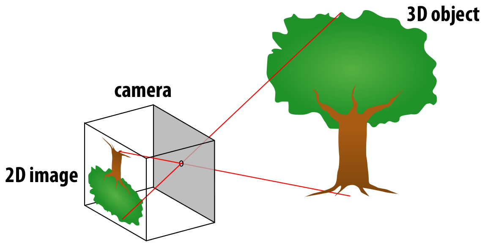
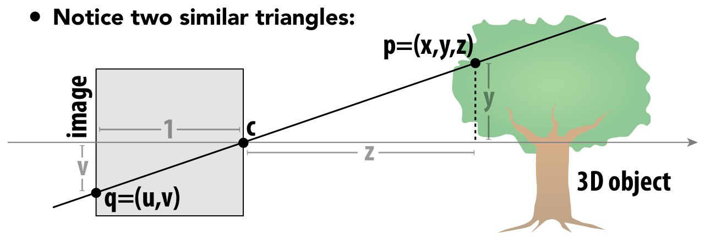
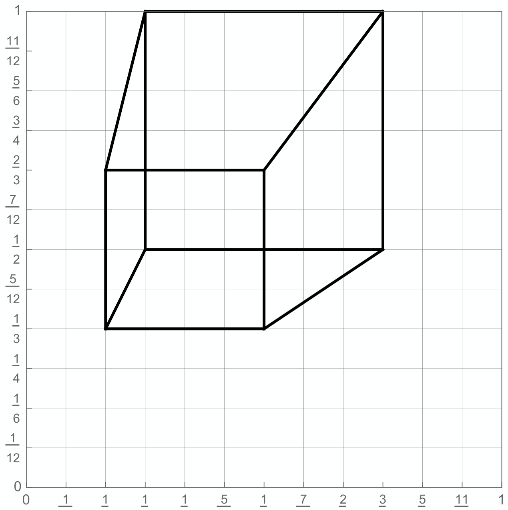
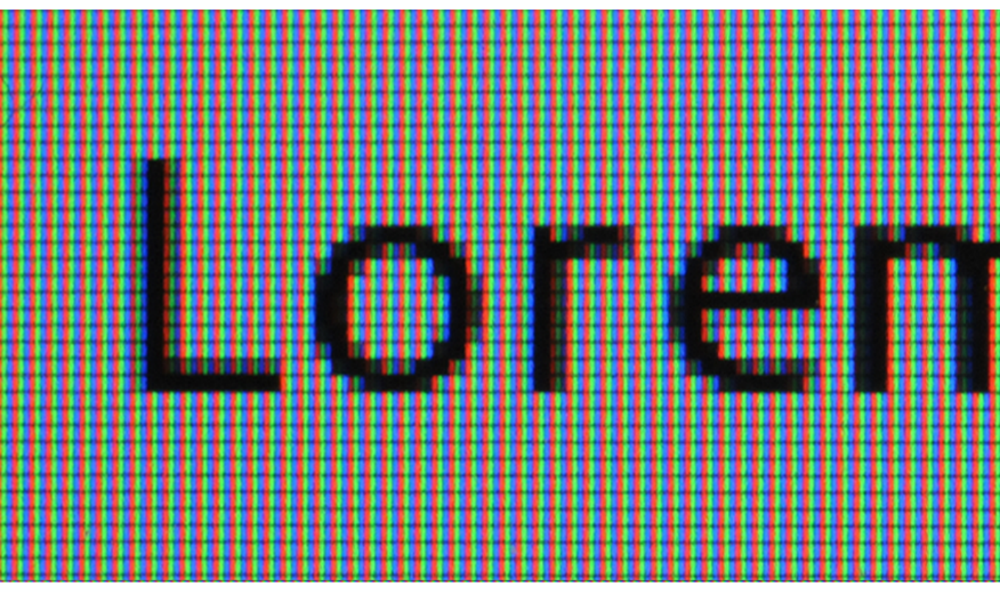
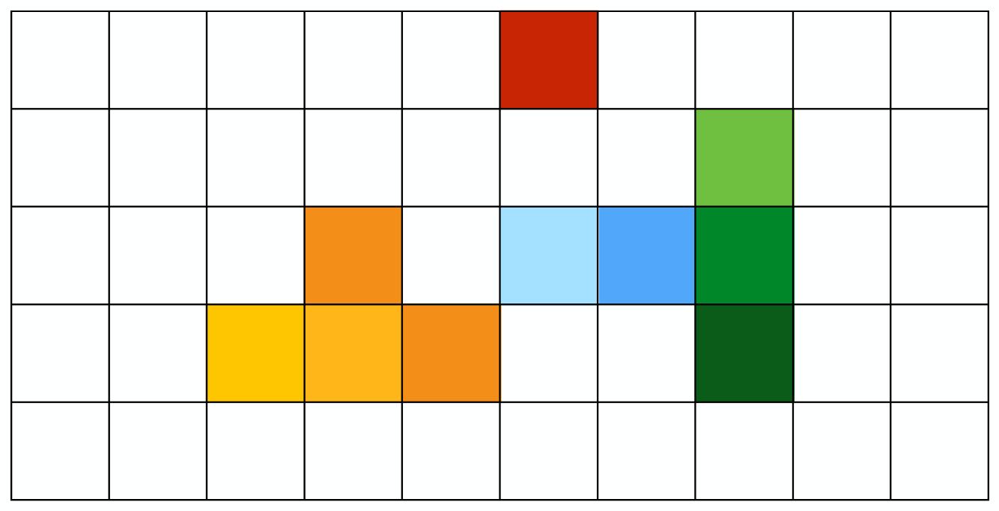
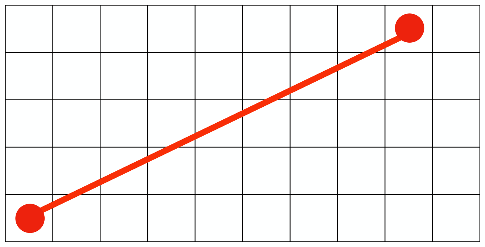
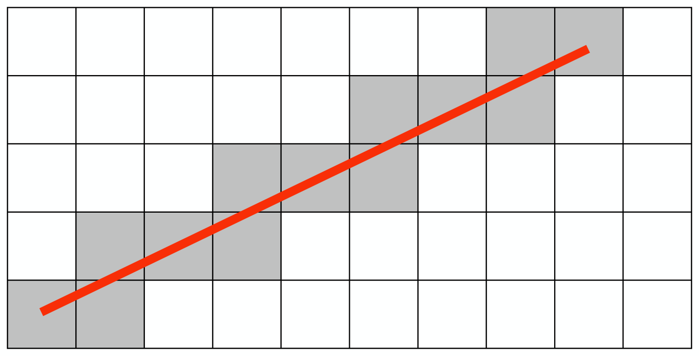
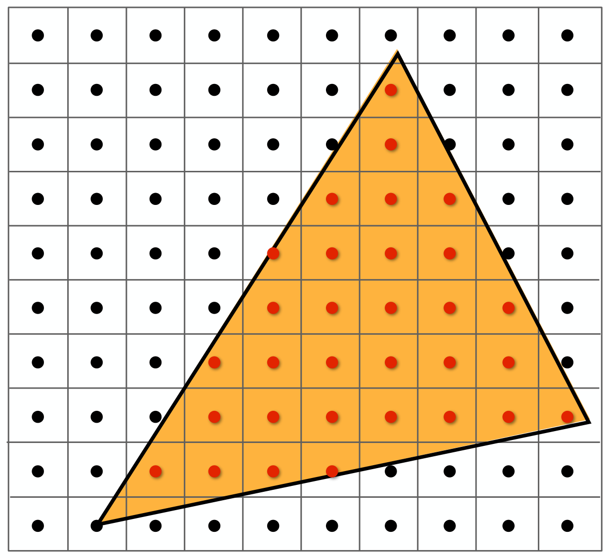
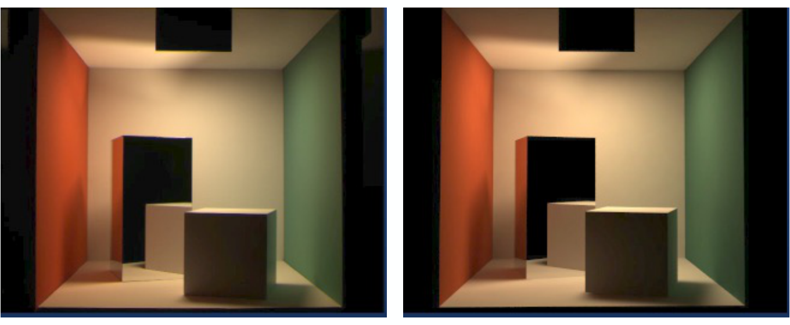

# Lecture 1 · Introduction

原课件共 80 页。[打开 PDF](../../ppt/lec-01-introduction.pdf)

按 PDF 页序提取，保留课件原有中英文。关键公式以 Markdown 数学式或原页局部图呈现。

## 第 1 页 · Introduction

Computer Graphics 2026 Fuzhou University - Computer Science

## 第 2 页 · Welcome！

Yixin Zhuang（庄一新）

- Ph.D. on Computer Science  (National University of Defense Technology)
- Research interests: computer graphics, 3D vision, intelligent robotics
- Website: yixin26.github.io
- Email: yixin.zhuang@gmail.com

## 第 3 页 · Today’s Topics

What is Computer Graphics?

Why Study Computer Graphics?

Course Overview

Logistics

## 第 4 页 · What is Computer Graphics?

## 第 5 页 · Probably CG games comes to your minds…

## 第 6 页 · More fundamentally: What is Computer Graphics?

## 第 7 页 · Display the computational results

Early computer (ENIAC), 1945

punch card (~120 bytes)

## 第 8 页 · Visual Display

## 第 9 页 · Sketchpad (Ivan Sutherland, 1963)

## 第 10 页

[查看原页](../../ppt/lec-01-introduction.pdf#page=10)

## 第 11 页 · Virtual and Augmented Reality

## 第 12 页 · What is Computer Graphics?

com•put•er   graph•ics   /kəmˈpyo͞ odər ˈɡrafiks/ n.

The use of computers to synthesize visual information.

visual information

computation

digital information

CMU

## 第 13 页 · What is Computer Graphics?

Why only visual?

com•put•er   graph•ics   /kəmˈpyo͞ odər ˈɡrafiks/ n.

The use of computers to synthesize visual information.

visual information

computation

digital information

CMU

## 第 14 页 · Graphics has evolved a lot since its early days… no longer just about turning on pixels!

## 第 15 页 · Turning digital information into physical matter

## 第 16 页 · Computer Graphics is everywhere!

## 第 17 页 · What is Computer Graphics?

com•put•er   graph•ics   /kəmˈpyo͞odər ˈɡrafiks/ n.

The use of computers to synthesize and manipulate visual information.

## 第 18 页 · Why Study Computer Graphics？

## 第 19 页 · Movies

Jurassic Park (1993)

## 第 20 页 · Moments That Changed The Movies: Jurassic Park

Moments That Changed The Movies: Jurassic Park https://www.youtube.com/watch?v=KWsbcBvYqN8

## 第 21 页 · Movies

（特效：子弹头时间）

The Matrix (1999)

## 第 22 页 · Movies

（子弹头时间拍摄方法）

The Matrix (1999)

## 第 23 页 · Avatar (2009)

（动画：人脸运动捕捉）

Avatar (2009)

## 第 24 页 · Movies

（动画：肢体和人脸运动捕捉）

Andy Serkis in The Two Towers

## 第 25 页 · Movies

（动画：毛发细节建模）

Zootopia (2016)

## 第 26 页 · Movies

（仿真：气流物理模拟）

Frozen 2 (2019)

## 第 27 页 · Games

（游戏：建模）

Halo 5 (2015)

## 第 28 页

（游戏：渲染）

Battlefield 5 (2018)

## 第 29 页

（游戏：大尺度场景）

Red Dead Redemption 2, Rockstar, 2019

## 第 30 页 · Training Simulations

From America’s Army

From CAE Inc.

## 第 31 页 · Visual Simulation

Driving simulator

Toyota Higashifuji Technical Center

da Vinci surgical robot

Intuitive Surgical

Flight simulator, driving simulator, surgical simulator, …

## 第 32 页 · Virtual Reality

The Verge

HTC Vive headset and controllers

## 第 33 页 · Augmented Reality

Microsoft Hololens augmented reality headset concept

## 第 34 页 · Product Design and Visualization

Ikea - 75% of catalog is rendered imagery

## 第 35 页 · Product Design and Visualization

Photograph

Simulation

Avametric 2016

## 第 36 页 · Product Design and Visualization

Tesla Model X concept (2012)

## 第 37 页 · Architectural Design

Heydar Aliyev Center, Zaha Hadid Architects

## 第 38 页 · Computer-Aided Design

Sketchup

SolidWorks

SketchUp

For mechanical, architectural, electronic, optical, …

## 第 39 页 · Typography

The Quick Brown

Fox Jumps Over

The Lazy Dog

ABCDEFGHIJKLMNOPQRSTUVWXYZ abcdefghijklmnopqrstuvwxyz 0123456789

credit: Randall Branding

Baskerville

## 第 40 页 · Visualization

Tableau

Science, engineering, medicine, journalism, …

## 第 41 页 · （可视化：真实黑洞形状）

（可视化：真实黑洞形状）

Event Horizon Telescope collaboration et al.

## 第 42 页 · Interstellar (2014)

（可视化：黑洞形状）

Interstellar (2014)

## 第 43 页 · Graphical User Interfaces

2D drawing and animation are ubiquitous in computing.

Typography, icons, images, transitions, transparency, …

## 第 44 页 · Foundations of Graphics

These applications require sophisticated theory and systems

- Theory
    - basic representations (how do you digitally encode shape, motion?)
    - sampling & aliasing (how do you acquire & reproduce a signal?)
    - radiometry & light transport (how does light behave?)
    - numerical methods (how do you manipulate signals numerically?)
    - perception (how does this all relate to humans?)
- System
    - parallel, heterogeneous processing
    - graphics-specific programming languages

## 第 45 页 · Today’s Topics

What is Computer Graphics?

Why Study Computer Graphics?

Course Overview

Logistics

## 第 46 页 · Activity: modeling and drawing a cube

- Goal: generate a realistic drawing of a cube
- Key questions:
    - Modeling: how do we describe the cube?
    - Rendering: how do we then visualize this model?

## 第 47 页 · Activity: modeling the cube

- Suppose our cube is...
    - centered at the origin (0,0,0)
    - has dimensions 2x2x2
    - edges are aligned with x/y/z axes
- QUESTION: What are the coordinates of the cube vertices?

```text
A:(1,1,1)      E:(1,1,-1)
B:(-1,1,1)     F:(-1,1,-1)
C:(1,-1,1)     G:(1,-1,-1)
D:(-1,-1, 1 )  H: (-1,-1,-1 )
```

- QUESTION: What about the edges?

```text
AB, CD, EF, GH,
AC, BD, EG, FH,
AE, CG, BF, DH
```

## 第 48 页 · Activity: modeling the cube

- Now have a digital description of the cube:

VERTICES                                                        EDGES

```text
A:(1,1,1)     E:(1,1,-1)
B:(-1,1,1)    F:(-1,1,-1)       AB,CD,EF,GH,
C:(1,-1,1)    G:(1,-1,-1)       AC,BD,EG,FH,
D:(-1,-1, 1 ) H: (-1,-1,-1 )    AE,CG,BF,DH
```

- How do we draw this 3D cube as a 2D (flat) image?
- Basic strategy:
    1. map 3D vertices to 2D points in the image
    2. connect 2D points with straight lines

## 第 49 页 · Perspective Projection

- Objects look smaller as they get further away (“perspective”)
- Why does this happen?
- Consider simple (“pinhole”) model of a camera:

3D object

camera

2D image



## 第 50 页 · Perspective Projection: side view

- Where exactly does a point p = (x,y,z) end up on the image?
- Let’s call the image point q=(u,v)

p=(x,y,z)

v

y

image

3D object

q=(u,v)

z

## 第 51 页 · Perspective Projection: side view

- Where exactly does a point p = (x,y,z) end up on the image?
- Let’s call the image point q=(u,v)
- Notice two similar triangles:

p=(x,y,z)

image

y

c

1

z

v

3D object

q=(u,v)

- Assume camera has unit size, origin is at pinhole c
- Then v/1 = y/z, i.e., vertical coordinate is just the slope y/z
- Likewise, horizontal coordinate is u=x/z

$$
u=\frac{x}{z},\qquad v=\frac{y}{z}.
$$



## 第 52 页 · Activity: now draw it!

- Need 12 volunteers
    - each person will draw one cube edge
    - assume camera is at c=(2,3,5)
    - convert (X,Y,Z) of both endpoints to (u,v):
        1. subtract camera c from vertex (X,Y,Z) to get (x,y,z)
        2. divide (x,y) by z to get (u,v)—write as a fraction
    - draw line between (u1,v1) and (u2,v2)

VERTICES                                                        EDGES

```text
A:(1,1,1)     E:(1,1,-1)
B:(-1,1,1)    F:(-1,1,-1)       AB,CD,EF,GH,
C:(1,-1,1)    G:(1,-1,-1)       AC,BD,EG,FH,
D:(-1,-1, 1 ) H: (-1,-1,-1 )    AE,CG,BF,DH
```

## 第 53 页 · Activity: output on a graph paper

## 第 54 页 · Activity: how did we do?

2D coordinates:

```text
A: 1/4, 1/2
B: 3/4, 1/2
C: 1/4, 1
D: 3/4, 1
E: 1/6, 1/3
F: 1/2, 1/3
G: 1/6, 2/3
H: 1/2, 2/3
```



## 第 55 页 · Success! We turned purely digital information into purely visual information, using a

completely algorithmic procedure.

visual information

computation

digital information

CMU

62/662

## 第 56 页

Not finished yet! how do we draw lines on a computer?

## 第 57 页 · Close up photo of pixels on a modern display



## 第 58 页 · Output for a raster display

- Common abstraction of a raster display:
    - Image represented as a 2D grid of “pixels” (picture elements) Each pixel can take on a unique color value



## 第 59 页 · What pixels should we color in to depict a line?

“Rasterization”: process of converting a continuous object to a discrete representation on a raster grid (pixel grid)



## 第 60 页 · What pixels should we color in to depict a line?

Light up all pixels intersected by the line?



## 第 61 页 · Activity: modeling and drawing a cube

2D coordinates:

```text
A: 1/4, 1/2
B: 3/4, 1/2
C: 1/4, 1
D: 3/4, 1
E: 1/6, 1/3
F: 1/2, 1/3
G: 1/6, 2/3
H: 1/2, 2/3
```

visual information

computation

digital information

CMU

62/662

## 第 62 页 · We just rendered a simple line drawing of a cube.

But for more realistic pictures, we need a much

richer model of the world:

Geometry

Materials

Lights

Cameras

Motions

…

Will see all of this as our course progresses.

## 第 63 页 · Course Topics

1. Drawing Digital Images (Rasterization) （图形显示成图像）
2. Filtering and Sampling （图形到图像转变的滤波和采样）
3. Modeling Geometry （三维对象的图形建模）
4. Modeling Material Properties （三维对象的材质属性）
5. Modeling Lighting （光照建模）
6. How Do Cameras Work? （相机模型和成像原理）
7. Animation and Physical Simulation （动画和物理模拟）
8. Virtual Reality （虚拟现实）

## 第 64 页 · Drawing Digital Images (Rasterization)



## 第 65 页 · Filtering and Sampling

No Jaggies

## 第 66 页 · Modeling Geometry

(Stanislav Orekhov)

ocfish/blogspot

[Kaldor 2008]

Platonic noid

## 第 67 页 · Modeling Material Properties

## 第 68 页 · Modeling Lighting

WALL-E, (Pixar 2008)

## 第 69 页 · Light Transport and Image Synthesis

Photograph (CCD) vs. computer rendering



## 第 70 页 · How Do Cameras Work?

Glenn Derene, Popular Mechanics

## 第 71 页 · Animation and Physical Simulation

Position  Based Fluids, Macklin and Müller

## 第 72 页 · Virtual Reality

## 第 73 页 · Course Goals

Overview of core ideas in graphics

- Modeling the world, image synthesis
- 3D graphics: geometry, rendering, animation
- Image capture, manipulation and display

Acquire core concepts and skills

- Representations (geometry, images, transforms, …)
- Algorithms (sampling, subdivision, ray-tracing, …)
- Technology (GPUs, displays, cameras, …)

## 第 74 页 · Today’s Topics

What is Computer Graphics?

Why Study Computer Graphics?

Course Overview

Logistics

## 第 75 页 · Prerequisites

Math

- Vectors, matrices, basic linear algebra
- Helpful: exposure to statistics, signal processing, Fourier transform

Programming

- Data structures
- Fluent with C and C++
- Fluent with development environment, debugging, etc.

## 第 76 页 · Course Assignments

1. Digital Drawing (2 weeks)
            2. Geometry (2 weeks)
3. Ray-Tracing (2 weeks)
            4. Animation (2 weeks)

## 第 77 页 · Course Deliverables and Assessment

Your course grade is out of 100 total points

- Four homework assignments, 10 points each
- Final exams, 50 points each
- Participation, 10 points

## 第 78 页 · Resources

Lectures will be primary source

Textbook reference material (optional):

- Fundamentals of Computer Graphics by P. Shirley, S. Marschner, et al.
- Computer Graphics: Principles and Practice (3rd Edition) by Hughes, van Dam, et al.
- Physically Based Rendering, Third Edition:

From Theory to Implementation by Pharr, Jakob and Humphreys

## 第 79 页 · Acknowledgement

Games101

CMU 15-362/662

UCB CS184

## 第 80 页

[查看原页](../../ppt/lec-01-introduction.pdf#page=80)
