# Lecture 2 · Digital Drawing

原课件共 91 页。[打开 PDF](../../ppt/lec-02-digital-drawing.pdf)

按 PDF 页序提取，保留课件原有中英文。关键公式以 Markdown 数学式或原页局部图呈现。

## 第 1 页 · Digital Drawing

Computer Graphics 2026 Fuzhou University - Computer Science

## 第 2 页 · Today’s Topics

Drawing Machines

Drawing Triangles to Raster Displays

Signal Reconstruction on Real Displays

Sampling and Aliasing

## 第 3 页 · Drawing Machines

## 第 4 页 · CNC Sharpie Drawing Machine

Aaron Panone with Matt W. Moore

http://44rn.com/projects/numerically-controlled-poster-series-with-matt-w-moore/

## 第 5 页 · Oscilloscope

示波器

## 第 6 页 · Cathode Ray Tube

CRT: 阴极射线管

## 第 7 页 · Television - Raster Display CRT

Raster Scan

Cathode Ray Tube

(modulate intensity)

光栅扫描

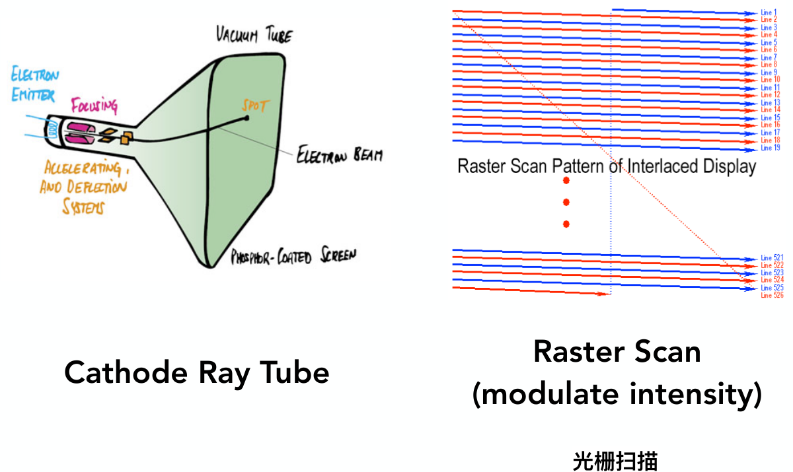

## 第 8 页 · Frame Buffer: Memory for a Raster Display

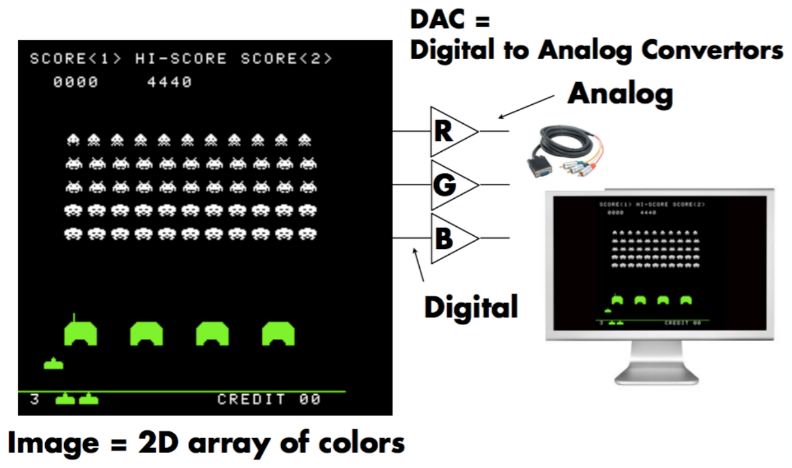

## 第 9 页 · A Sampling of Different

Raster Displays

## 第 10 页 · Flat Panel Displays

Low-Res LCD Display

B.Woods, Android Pit

## 第 11 页 · LCD (Liquid Crystal Display) Pixel

Principle: block or transmit light by twisting polarization

[H&B fig. 2-16]

Illumination from backlight (e.g. fluorescent or LED)

Intermediate intensity levels by partial twist

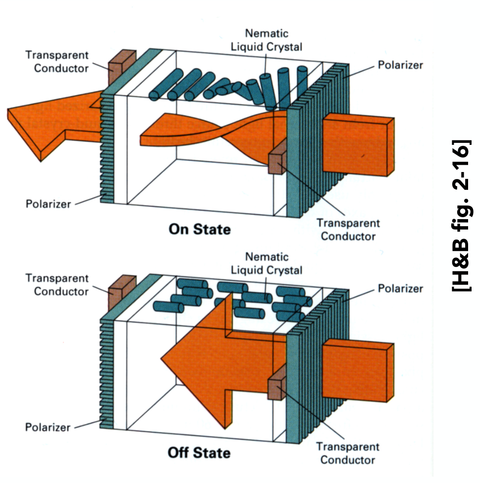

## 第 12 页 · LED Array Display

## 第 13 页 · BAMPFA: LED Array Display

## 第 14 页 · Electrophoretic (Electronic Ink) Display

[Wikimedia Commons

—Senarclens]

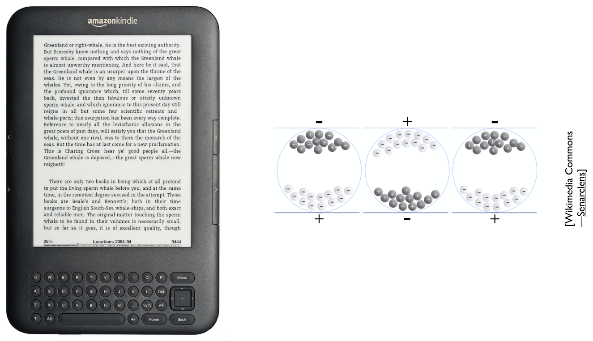

## 第 15 页 · Drawing A Triangle to Raster Display

## 第 16 页 · Polygon Meshes

Life of Pi (2012)

## 第 17 页 · Why triangles?

- Rasterization pipeline converts all primitives to triangles
    - even points and lines!
- Why?
    - can approximate any shape
    - always planar, well-defined interior
    - easy to interpolate data at corners
        - “barycentric coordinates”
- Key reason: once everything is reduced to triangles, can focus on making an extremely well-optimized pipeline for drawing them

“point”

“line”

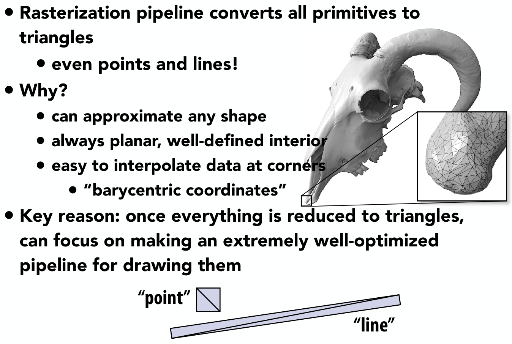

## 第 18 页 · The Rasterization Pipeline

- Rough sketch of rasterization pipeline:

1. Transform/position objects in the world
2. Project objects onto the screen
3. Sample triangle coverage
4. Interpolate triangle attributes at covered samples
5. Sample texture maps / evaluate shaders
6. Combine samples into final image (depth, alpha, …)

- Reflects standard “real world” pipeline (OpenGL/Direct3D)

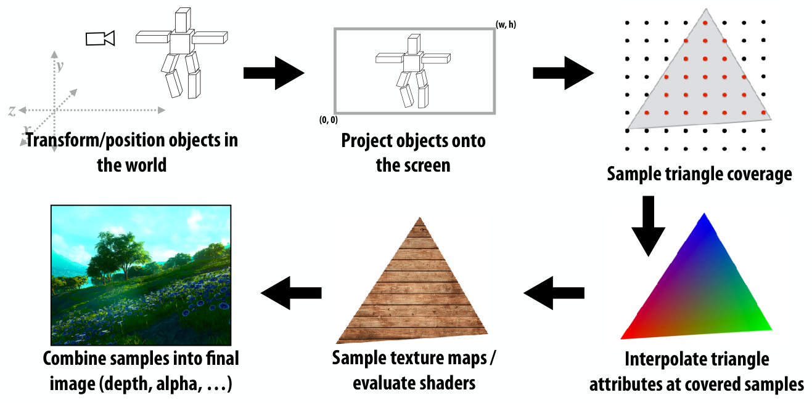

## 第 19 页 · Computing Triangle Coverage

What pixels does the triangle overlaps?

Input:

projected position of triangle vertices: P0, P1, P2

Output:

set of pixels “covered” by the triangle

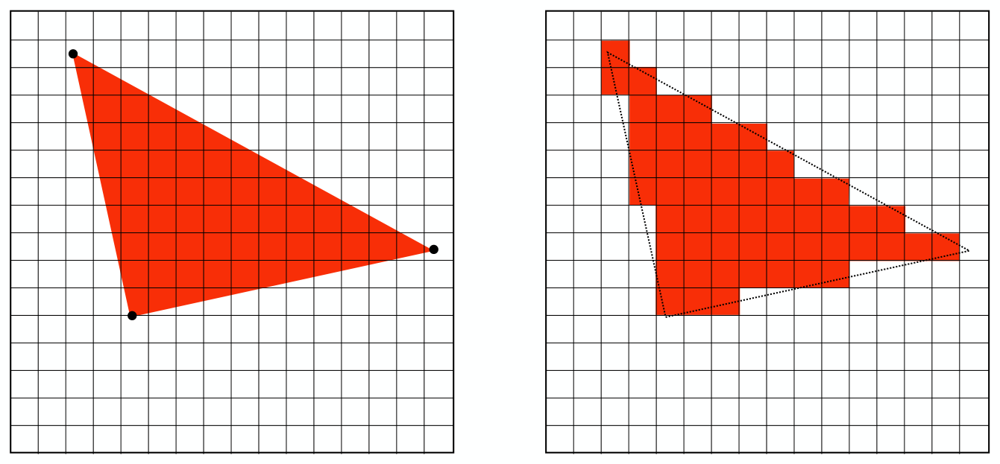

## 第 20 页 · A Simple Approach: Sampling

## 第 21 页 · Sampling a 1D Signal

f (x)

x

## 第 22 页 · Sampling=taking measurements of a signal

Below: 5 measurements (“samples”) of f (x)

f (x)

f(x4)

f(x1)

f(x3)

f(x2)

f(x0)

x0

x1

x2

x3

x4

## 第 23 页 · Reconstruction: given a set of samples, how might we attempt to reconstruct the original signal       ?

f (x)

f(x4)

f(x3)

f(x1)

f(x2)

f(x0)

x0

x1

x2

x3

x4

## 第 24 页 · Piecewise constant approximation

frecon(x) = value of sample closest to x frecon(x) approximates f (x)

f (x)

frecon (x)

x0

x2

x3

x4

x1

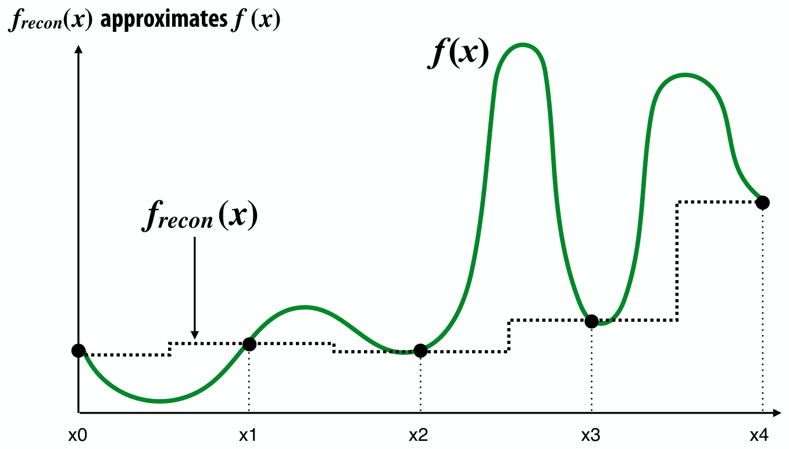

## 第 25 页 · Piecewise linear approximation

frecon(x) = linear interpolation between values of two

closest samples to x

f (x)

frecon (x)

x0

x1

x2

x3

x4

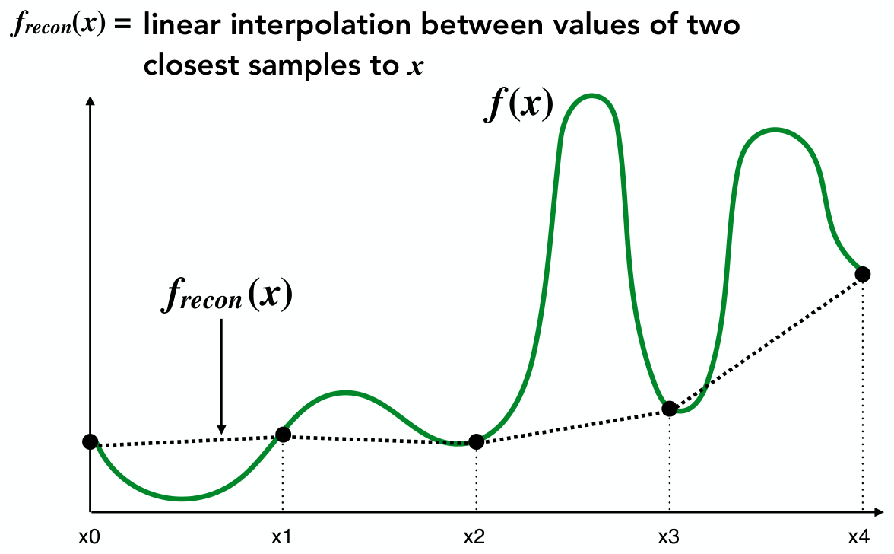

## 第 26 页 · How can we represent the signal more accurately?

Sample signal more densely (increase sampling rate)

x0

x1

x2

x3

x4

x5

x6

x7

x8

## 第 27 页 · Reconstruction from denser sampling

x0

x1

x2

x3

x4

x5

x6

x7

x8

= reconstruction via nearest = reconstruction via linear interpolation

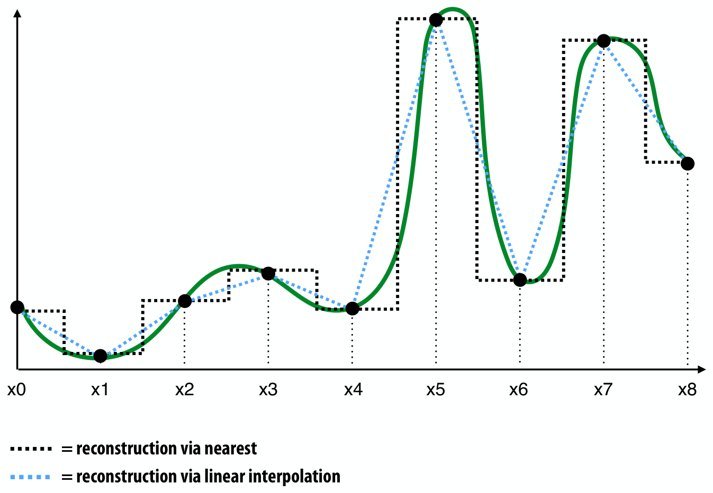

## 第 28 页 · Audio file: stores samples of a 1D signal

Sampled at 44.1 KHz (44100/second) that can restore the sound accurately.

Amplitude

time

## 第 29 页 · 2D Sampling & Reconstruction

- Basic story doesn’t change much for images:
    - sample values measure image (i.e., signal) at sample points
    - apply interpolation/reconstruction filter to approximate image

original

piecewise constant (“nearest neighbor”)

piecewise bi-linear

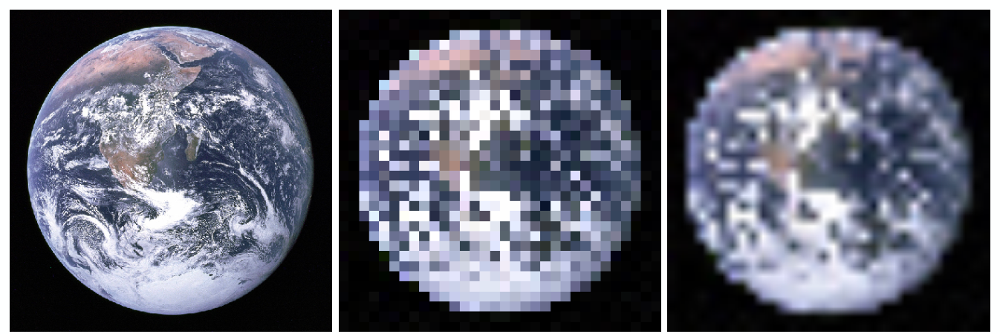

## 第 30 页 · Sampling Summary

- Sampling = measurement of a signal
    - Encode signal as discrete set of samples
    - In principle, represent values at specific points (though hard to measure in reality!)
- Reconstruction = generating signal from a discrete set of samples
    - Construct a function that interpolates or approximates function values
    - E.g., piecewise constant/“nearest neighbor”, or piecewise linear
    - Many more possibilities! For all kinds of signals (audio, images, geometry...)

## 第 31 页 · Let’s Try Rasterization As 2D Sampling

## 第 32 页 · What function are we sampling?

Define Binary Function: `inside(tri,x,y)`

$$
\operatorname{inside}(t,x,y)=\begin{cases}1,&(x,y)\text{ in triangle }t,\\0,&\text{otherwise.}\end{cases}
$$

## 第 33 页 · Sample If Each Pixel Center Is Inside Triangle

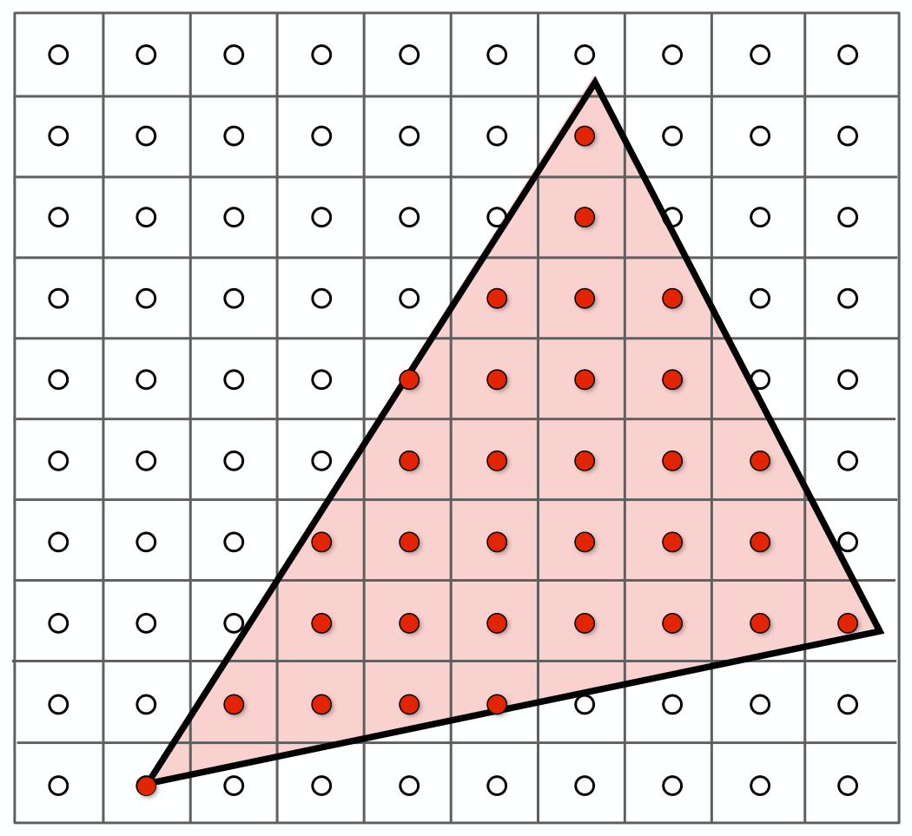

## 第 34 页 · Rasterization = Sampling A 2D Indicator Function

```text
for( int x = 0; x < xmax; x++ )
  for( int y = 0; y < ymax; y++ )
    Image[x][y] = f(x + 0.5, y + 0.5);
```

Rasterize triangle tri by sampling the function

```text
f(x,y) = inside(tri,x,y)
```

## 第 35 页 · Implementation Detail: Sample Locations

(0,0)

(w,0)

(x+1/2,y+1/2)

(0,h)

(w,h)

Sample location for pixel (x,y)

$$
(x+\tfrac12,\ y+\tfrac12)
$$

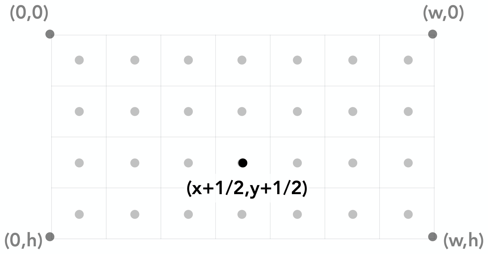

## 第 36 页 · Evaluating inside(tri,x,y)

## 第 37 页 · Triangle = Intersection of Three Half Planes

P2

P1

P0

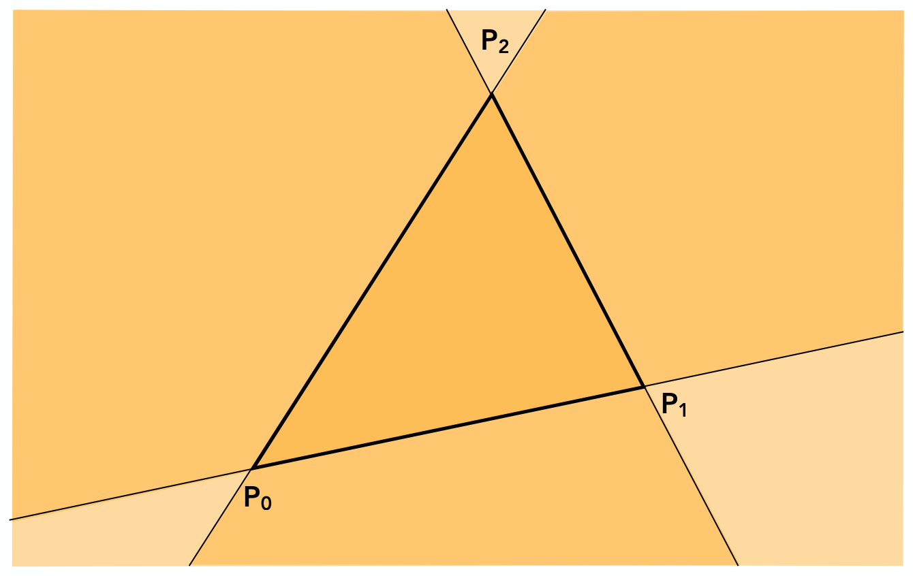

## 第 38 页 · Each Line Defines Two Half-Planes

Implicit line equation

- L(x,y) = Ax + By + C
- On line:       L(x,y) = 0

&gt; 0

- Above line: L(x,y) &gt; 0
- Below line:  L(x,y) &lt; 0

= 0

&lt; 0

## 第 39 页 · Line Equation Derivation

Line Tangent Vector

P1

T

P0

$$
\mathbf T=P_1-P_0=(x_1-x_0,\ y_1-y_0).
$$

## 第 40 页 · Line Equation Derivation

(-y,x)

General Perpendicular

Vector in 2D

(x,y)

$$
\operatorname{Perp}(x,y)=(-y,x).
$$

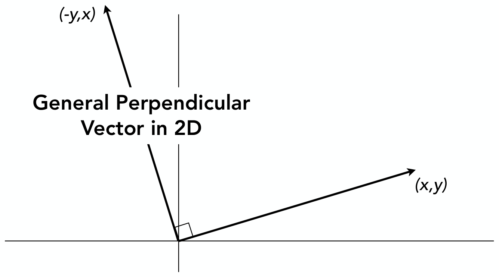

## 第 41 页 · Line Equation Derivation

N

Line Normal Vector

P1

T

P0

$$
\mathbf N=\operatorname{Perp}(\mathbf T)=(-(y_1-y_0),\ x_1-x_0).
$$

## 第 42 页 · Line Equation Derivation

N

P = (x, y)

V

P1

P0

$$
\mathbf V=P-P_0=(x-x_0,\ y-y_0).
$$

## 第 43 页 · Line Equation

N

P = (x, y)

V

P1

P0

When you take the dot product of the normal vector and a point

vector on the line, you get a scalar value that is constant for all

points on the line, forming the implicit equation of the line.

$$
L(x,y)=\mathbf V\cdot\mathbf N=-(x-x_0)(y_1-y_0)+(y-y_0)(x_1-x_0).
$$

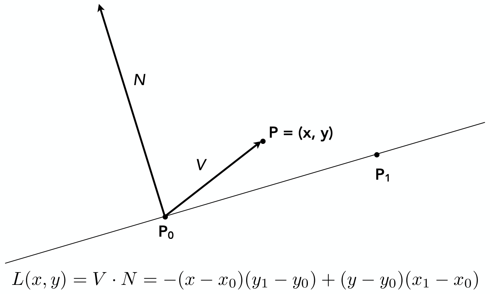

## 第 44 页 · Line Equation Tests

N

P

V

P1

P0

L(x, y) = V · N = 0

## 第 45 页 · Line Equation Tests

N

P

V

P1

P0

L(x, y) = V · N &gt; 0

## 第 46 页 · Line Equation Tests

N

P

V

P1

L(x, y) = c

P0

L(x, y) = V · N &gt; 0

When you take the dot product of the normal vector and a point

vector on the line, you get a scalar value that is constant for all

points on the line, forming the implicit equation of the line.

## 第 47 页 · Line Equation Tests

N

P

V

P1

L(x, y) = c

P0

$$
\mathbf V\cdot\mathbf N=\lVert\mathbf V\rVert\,\lVert\mathbf N\rVert\cos\theta.
$$

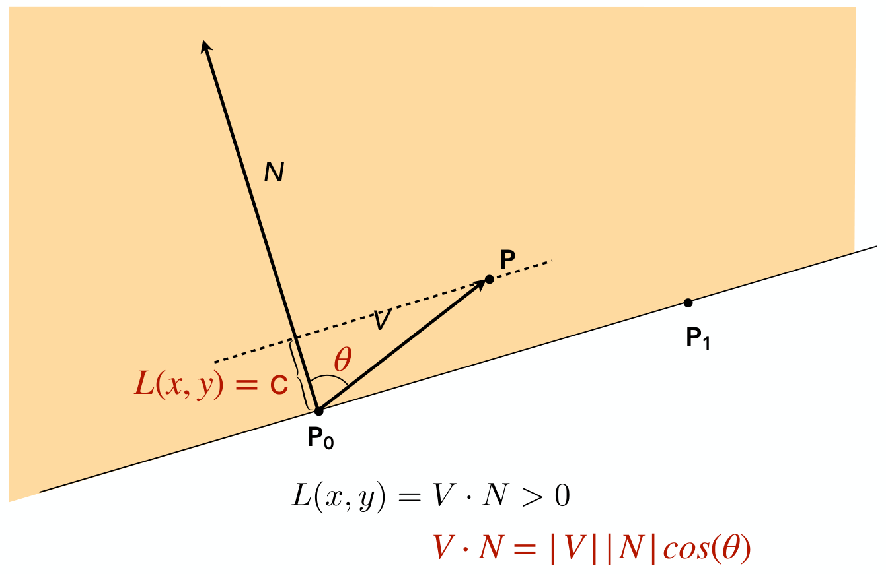

## 第 48 页 · Line Equation Tests

N

P1

V

P

P0

L(x, y) = V · N &lt; 0

## 第 49 页 · Point-in-Triangle Test: Three Line Tests

P2

Pi = (Xi, Yi)

dXi = Xi+1 - Xi

dYi = Yi+1 - Yi

Li (x, y)  = –(x - Xi) dYi  + (y - Yi) dXi = Ai x + Bi y + Ci

Li (x, y) =  0  : point on edge &lt; 0  : outside edge &gt; 0  : inside edge

P1

P0

Compute line equations from pairs of vertices

## 第 50 页 · Point-in-Triangle Test: Three Line Tests

P2

Pi = (Xi, Yi)

dXi = Xi+1 - Xi

dYi = Yi+1 - Yi

Li (x, y)  = –(x - Xi) dYi  + (y - Yi) dXi = Ai x + Bi y + Ci

Li (x, y) =  0  : point on edge &lt; 0  : outside edge &gt; 0  : inside edge

P1

P0

L0(x, y) &gt; 0

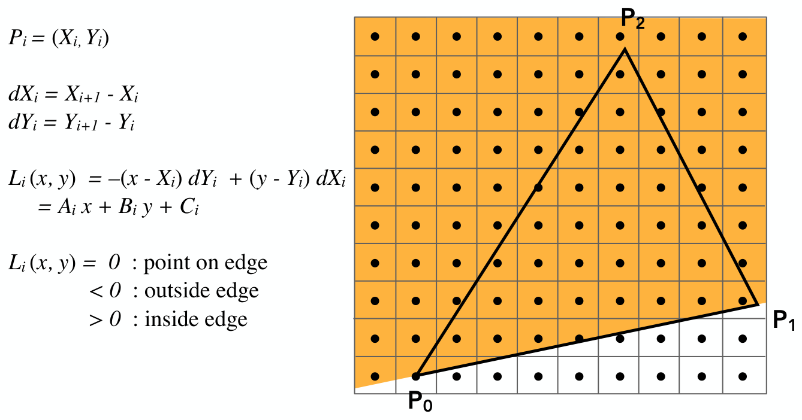

## 第 51 页 · Point-in-Triangle Test: Three Line Tests

P2

Pi = (Xi, Yi)

dXi = Xi+1 - Xi

dYi = Yi+1 - Yi

Li (x, y)  = –(x - Xi) dYi  + (y - Yi) dXi = Ai x + Bi y + Ci

Li (x, y) =  0  : point on edge &lt; 0  : outside edge &gt; 0  : inside edge

P1

P0

L1(x, y) &gt; 0

## 第 52 页 · Point-in-Triangle Test: Three Line Tests

P2

Pi = (Xi, Yi)

dXi = Xi+1 - Xi

dYi = Yi+1 - Yi

Li (x, y)  = –(x - Xi) dYi  + (y - Yi) dXi = Ai x + Bi y + Ci

Li (x, y) =  0  : point on edge &lt; 0  : outside edge &gt; 0  : inside edge

P1

P0

L2(x, y) &gt; 0

## 第 53 页 · Point-in-Triangle Test: Three Line Tests

Sample point $s=(s_x,s_y)$ is inside the triangle if it is inside all three lines.

```text
inside(sx, sy) =
    L0(sx, sy) > 0 &&
    L1(sx, sy) > 0 &&
    L2(sx, sy) > 0;
```

Note: actual implementation of `inside(sx,sy)` involves ≤ checks based on edge rules.

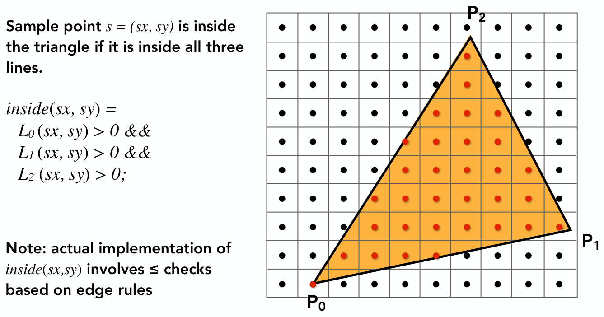

## 第 54 页 · Some Details

## 第 55 页 · Edge Cases (Literally)

Is this sample point covered by triangle 1, triangle 2, or both?

2

1

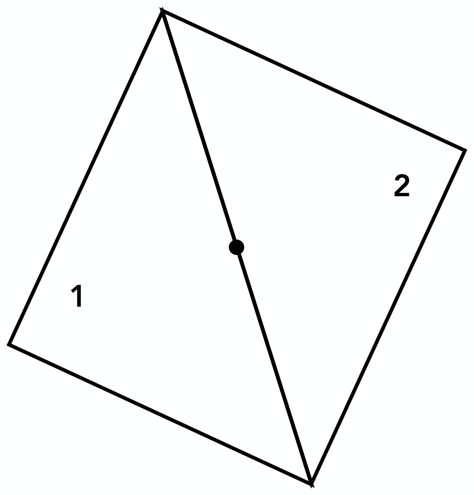

## 第 56 页 · Rasterization Rules

When sample point falls on an edge, the sample is classified as within triangle if the edge is a “top edge” or “left edge”

Top edge: horizontal edge that is above all other edges

Left edge:  an edge that is not exactly horizontal and is on the left side of the triangle. (triangle can have one or two left edges)

Source: Direct3D Programming Guide, Microsoft

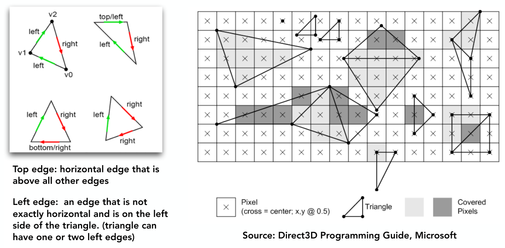

## 第 57 页 · Checking All Pixels on the Screen?

P2

P1

P0

Use a Bounding Box!

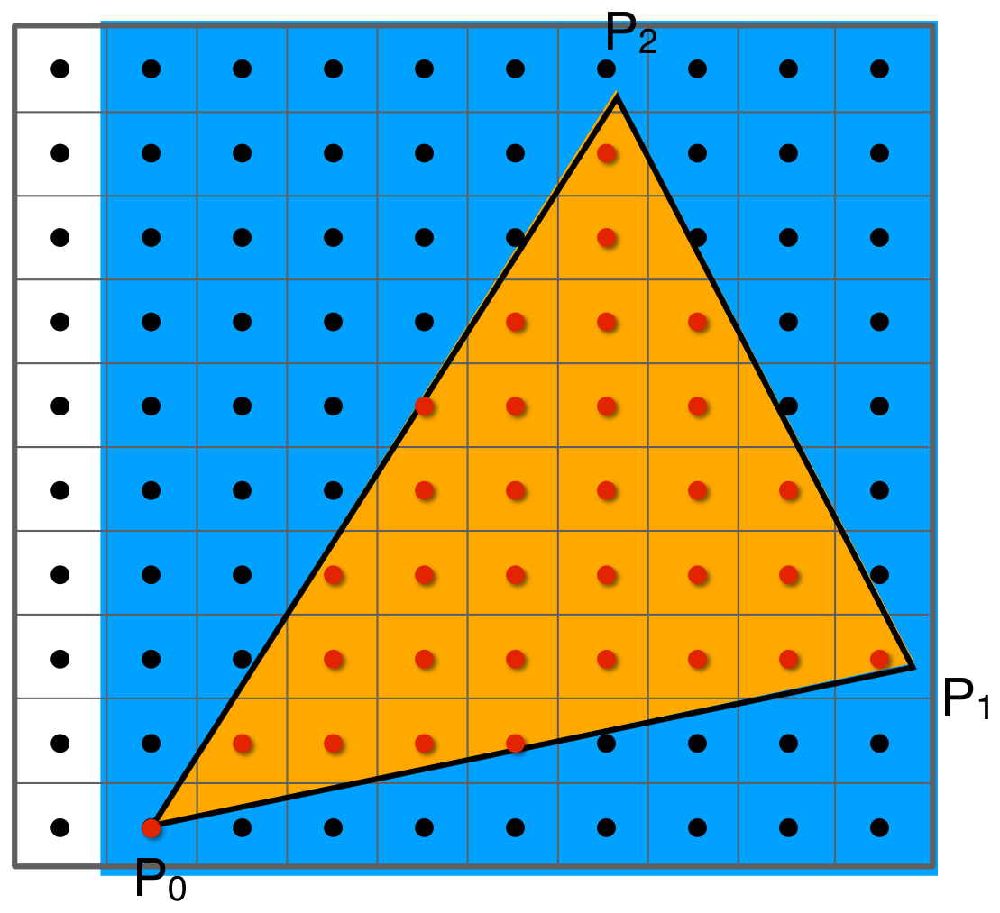

## 第 58 页 · Incremental Triangle Traversal (Faster?)

P2

P1

P0

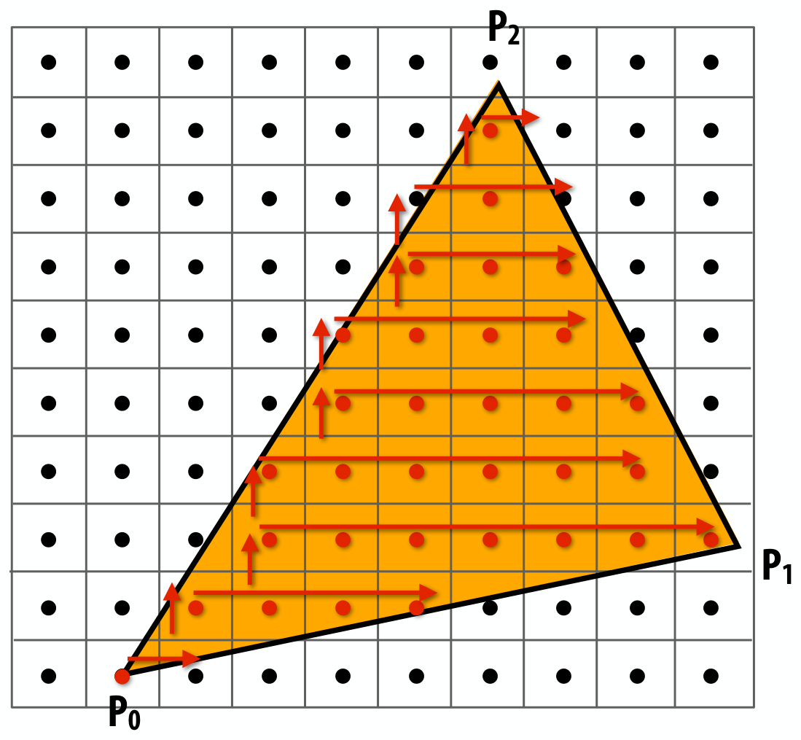

## 第 59 页 · Modern Approach: Tiled Triangle Traversal

P2

Traverse triangle in blocks

Test all samples in block in parallel

Advantages:

- Simplicity of wide parallel

execution overcomes cost of extra point-in-triangle tests (most triangles cover many samples, especially when super-sampling)

- Can skip sample testing work:

P1

entire block not in triangle (“early out”), entire block entirely within triangle (“early in”)

P0

All modern GPUs have special-purpose hardware for efficient point-in-triangle tests

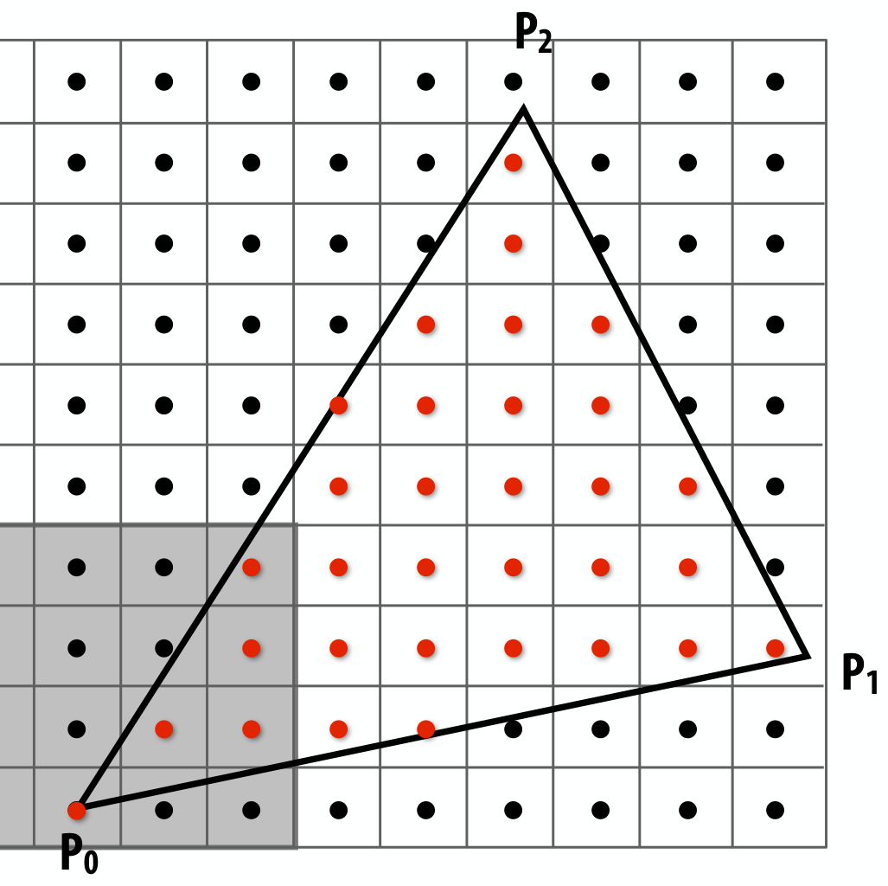

## 第 60 页 · Today’s Topics

Drawing Machines

Drawing Triangles to Raster Displays

Signal Reconstruction on Real Displays

Sampling and Aliasing

## 第 61 页 · Real LCD Screen Pixels (Closeup)

iphonearena.com

iPhone 6S

Galaxy S5

Notice R,G,B pixel geometry!  But in this class, we will assume a colored square full-color pixel.

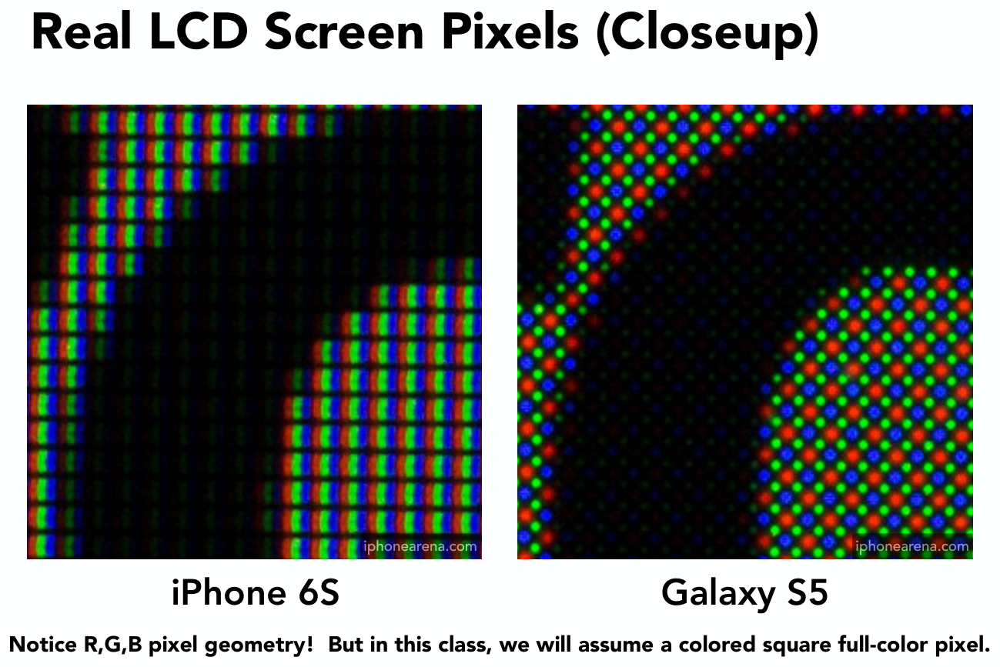

## 第 62 页 · Aside: What About Other Display Methods?

Color print: observe half-tone pattern

## 第 63 页 · Assume Display Pixels Emit Square of Light

Each image sample sent to the display is converted into a little square of light of the appropriate color:

(a pixel = picture element)

LCD pixel

on laptop

\* LCD pixels do not actually emit light in a square of uniform color, but this approximation suffices for our current discussion

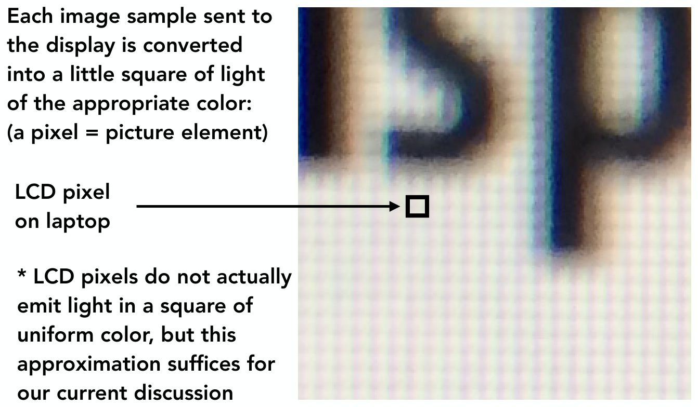

## 第 64 页 · So if we send the display this:

## 第 65 页 · We see this:

(assuming a screen pixel emits a square of perfectly uniform intensity of light)

## 第 66 页 · Compare: The Continuous Triangle Function

## 第 67 页 · What’s Wrong With This Picture?

Jaggies!

锯齿

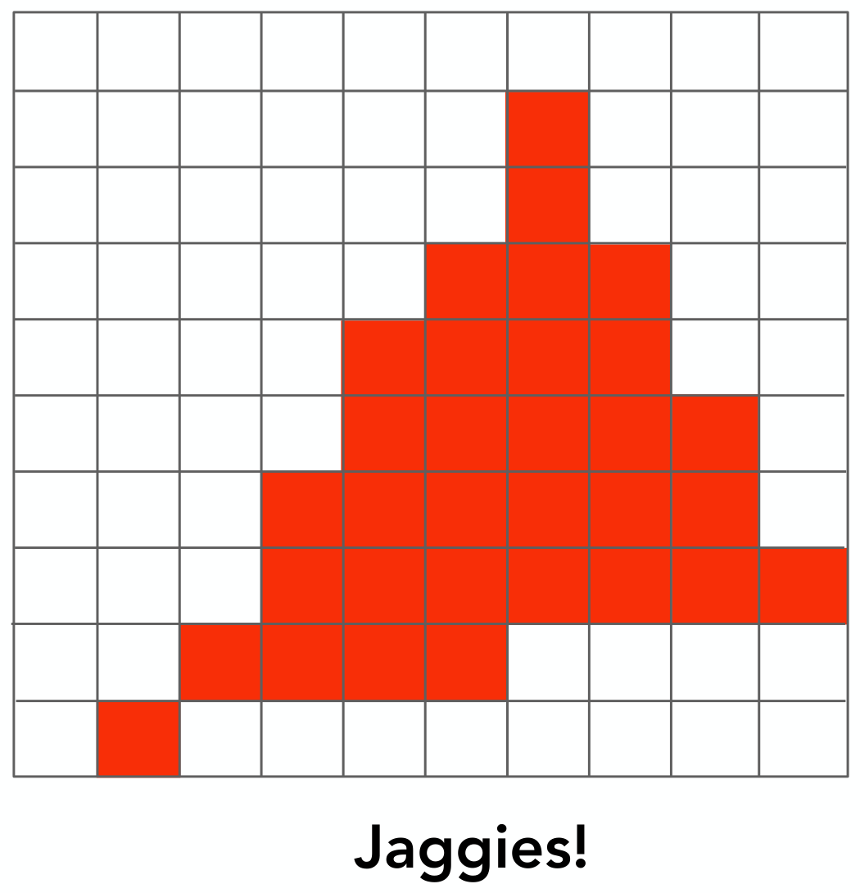

## 第 68 页 · Jaggies (Staircase Pattern)

Is this the best we can do?

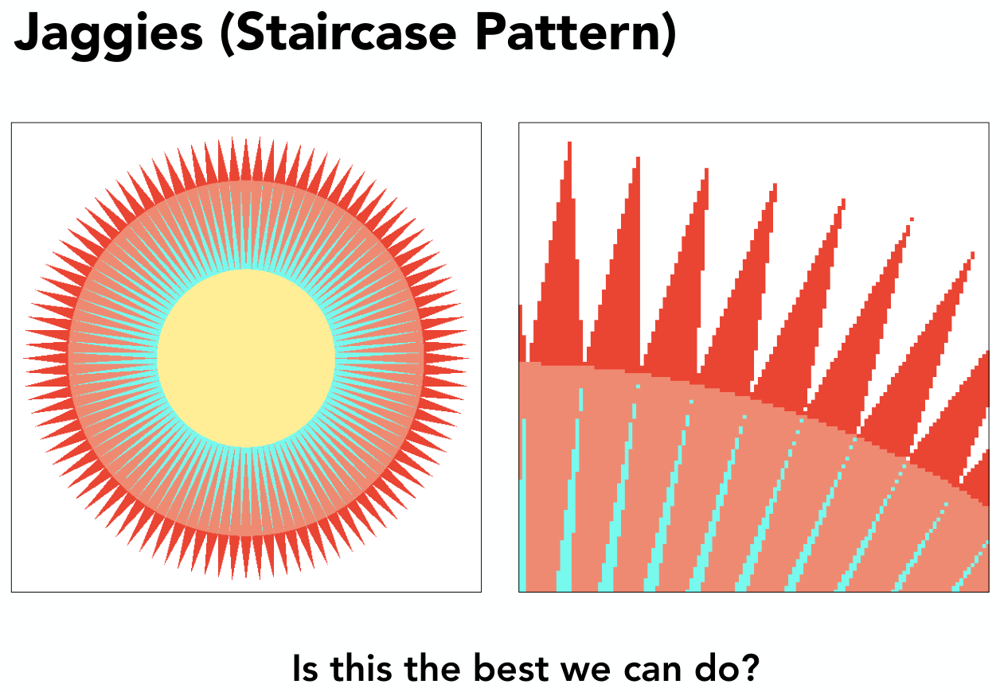

## 第 69 页 · How can we avoid Jaggies?

## 第 70 页 · Today’s Topics

Drawing Machines

Drawing Triangles to Raster Displays

Signal Reconstruction on Real Displays

Sampling and Aliasing

## 第 71 页 · Sampling is Ubiquitous in

Computer Graphics

## 第 72 页 · Audio = sample1D position

Sampled at 44.1 KHz (44100/second)

Amplitude

time

## 第 73 页 · Rasterization = Sample 2D Positions

## 第 74 页 · Video = Sample Time

Harold Edgerton Archive, MIT

## 第 75 页 · Photograph = Sample Image Sensor Plane

## 第 76 页 · Sampling Artifacts in Graphics and Imaging

## 第 77 页 · Jaggies (Staircase Pattern)

## 第 78 页 · Jaggies (Staircase Pattern)

Retort by Don Mitchell

## 第 79 页 · Moiré Patterns in Imaging

lystit.com

Read every sensor pixel

Skip odd rows and columns


## 第 80 页 · Wagon Wheel Illusion (False Motion)

瓦格纳轮效应

Created by Jesse Mason, https://www.youtube.com/watch?v=QOwzkND_ooU

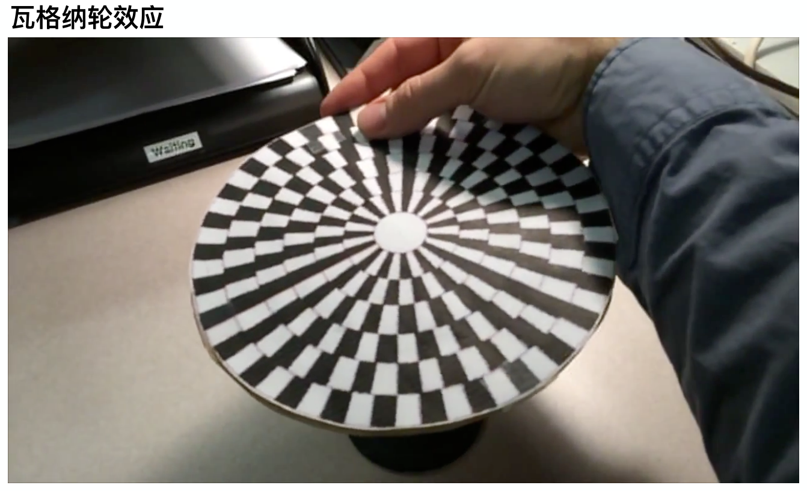

## 第 81 页 · Sampling Artifacts in Computer Graphics

Artifacts due to sampling - “Aliasing”

- Jaggies – sampling in space
- Wagon wheel effect – sampling in time
- Moire – undersampling images (and texture maps)
- [Many more] …

（Aliasing 翻译为混叠或走样，指信号变了样，深层意思是不同频率发生混叠）

We notice this in fast-changing signals (high frequency), when we sample too slowly

（通俗地讲，走样/混叠的原因是信号的变化速率大于采样频率）

## 第 82 页 · Antialiasing Idea: Filter Out High

Frequencies Before Sampling

## 第 83 页 · Rasterization: Point Sampling in Space

Sample

Note jaggies in rasterized triangle

where pixel values are pure red or white

## 第 84 页 · Rasterization: Antialiased Sampling

Pre-Filter

Sample

(remove high frequencies)

Note antialiased edges in rasterized triangle

where pixel values take intermediate values

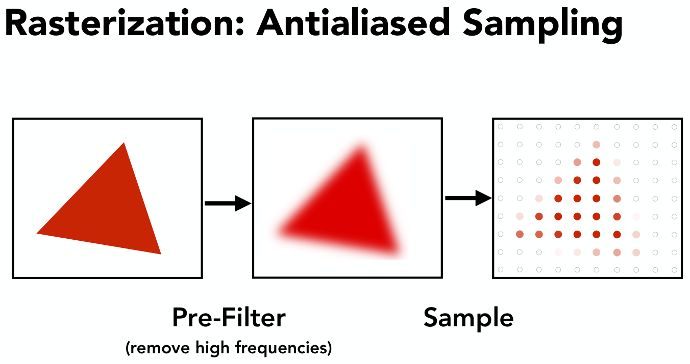

## 第 85 页 · Point Sampling

One sample per pixel

## 第 86 页 · Antialiasing

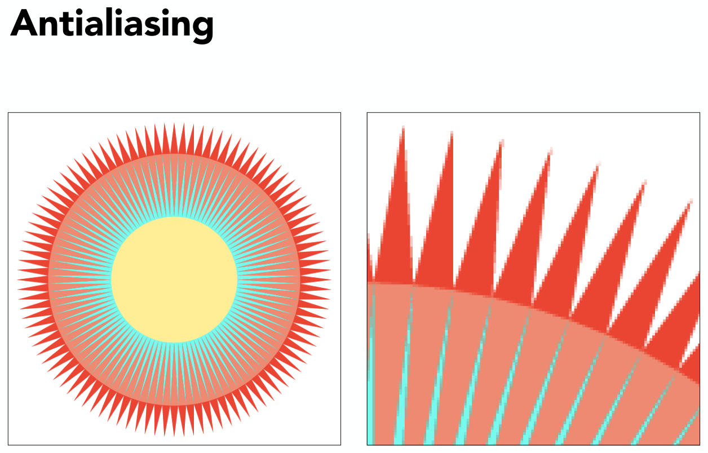

## 第 87 页 · Point Sampling vs Antialiasing

Jaggies

Pre-Filtered

## 第 88 页 · Antialiasing vs Blurred Aliasing

Blurred Jaggies

Pre-Filtered

(Sample then filter)

(Filter then sample)

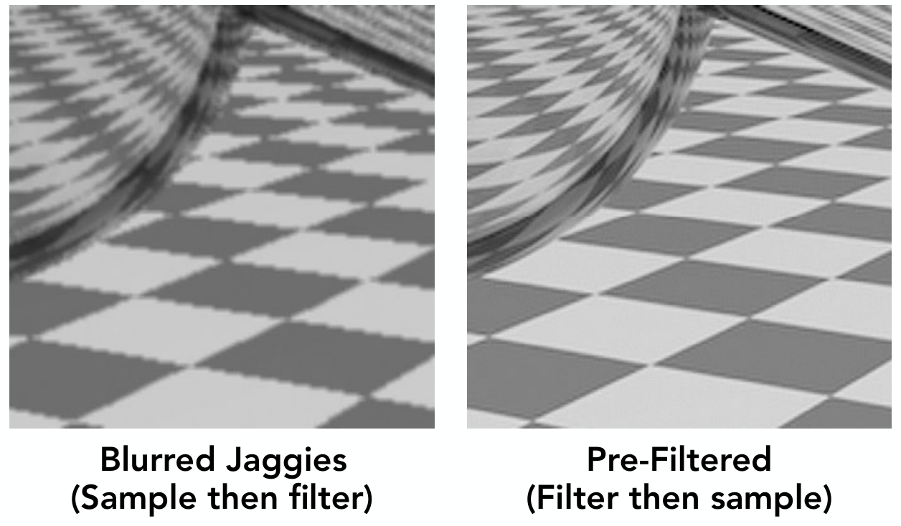

## 第 89 页

Next, we will dig into the reason why aliasing happened, and how to implement antialiasing rasterization algorithm.

## 第 90 页 · Things to Remember

Drawing machines

- Many possibilities
- Why framebuffers and raster displays?
- Why triangles?

We posed rasterization as a 2D sampling process

- Test a binary function inside(triangle,x,y)
- Evaluate triangle coverage by 3 point-in-edge tests
- Finite sampling rate causes “jaggies” artifact (next time we will analyze in more detail)

## 第 91 页 · Things to Remember

Aliasing

Sampling causes aliasing (artifacts) due to the lower sampling rate compared to the original signal frequency

Anti-aliasing

Pre-filtering removes high frequency from original signal before sampling
