# Lecture 3 · Understanding Aliasing and Antialiasing

原课件共 63 页。[打开 PDF](../../ppt/lec-03-antialiasing.pdf)

按 PDF 页序提取，保留课件原有中英文。关键公式以 Markdown 数学式或原页局部图呈现。

## 第 1 页 · Understanding Aliasing and Antialiasing

Computer Graphics 2026 Fuzhou University - Computer Science

## 第 2 页 · Recall Point Sampling

Sample

Note jaggies in rasterized triangle

where pixel values are pure red or white

## 第 3 页 · Recall Aliasing

（通俗地讲，走样/混叠的原因是信号的变化速率大于采样频率）

## 第 4 页 · Recall Antialiasing Sampling

Pre-Filter

Sample

(remove high frequencies)

（反走样/混叠就是让信号的变化速率与采样频率尽量接近）

## 第 5 页 · This Lecture

Let’s dig into the fundamental reasons why this works

And look at how to implement antialiased rasterization

## 第 6 页 · Signal Processing: Frequency Space

## 第 7 页 · Example: sound can be expressed as a superposition of frequencies

f1(x) = sin(𝜋x)

f2(x) = sin(2𝜋x)

f4(x) = sin(4𝜋x)

f(x) = f1(x) + 0.75 f2(x) + 0.5 f4(x)

频率叠加

## 第 8 页 · Fourier Transform

Represent a function as a weighted sum of sines and cosines

Joseph Fourier 1768 - 1830

−2A cos(3tω) + 2A cos(5tω) −2A cos(7tω) + · · ·

3π

5π

7π

傅立叶级数：周期信号可以通过傅立叶展开，表示成为一系列简单周期函数的线性组合。

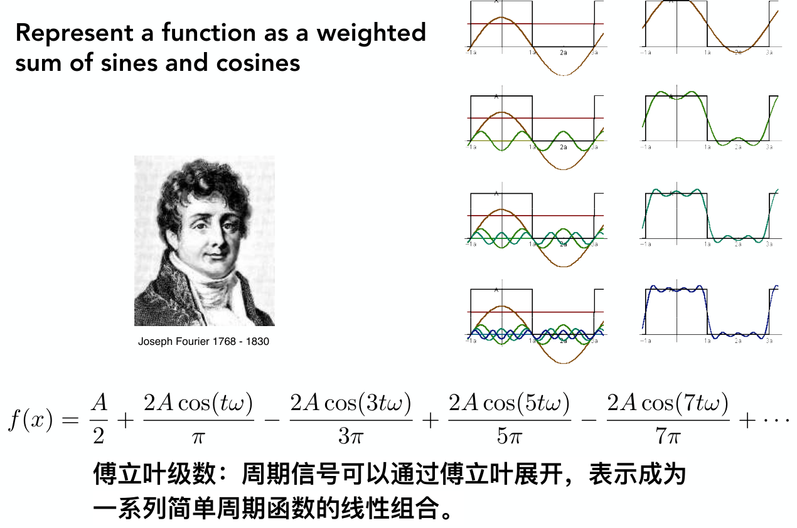

## 第 9 页 · Fourier Transform Decomposes A Signal Into Frequencies

Fourier transform

spatial

domain

frequency

Inverse transform

Recall

傅立叶变换：任意信号可以通过傅立叶变换分解成一系列不同频率的正余弦函数。

是

和某个基函数（与频率相关）的内积，可看成是在该基函数上的投影大小。

$$
F(\omega)=\int_{-\infty}^{\infty} f(x)e^{-2\pi i\omega x}\,dx,\qquad
f(x)=\int_{-\infty}^{\infty} F(\omega)e^{2\pi i\omega x}\,d\omega.
$$

$$
e^{ix}=\cos x+i\sin x.
$$

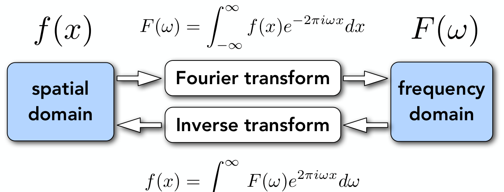

## 第 10 页 · Example: 1D Fourier Transform

u

x

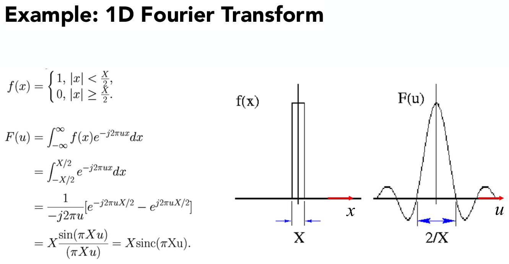

## 第 11 页 · Discrete Fourier Transform

离散信号的傅立叶变换

时域信号

信号频谱

$$
X_k=\sum_{m=0}^{n-1}x_m e^{-i2\pi km/n},\qquad k=0,\ldots,n-1.
$$

$$
x(t)=\cos(2\pi\cdot10t)+\cos(2\pi\cdot25t)+\cos(2\pi\cdot50t)+\cos(2\pi\cdot100t).
$$

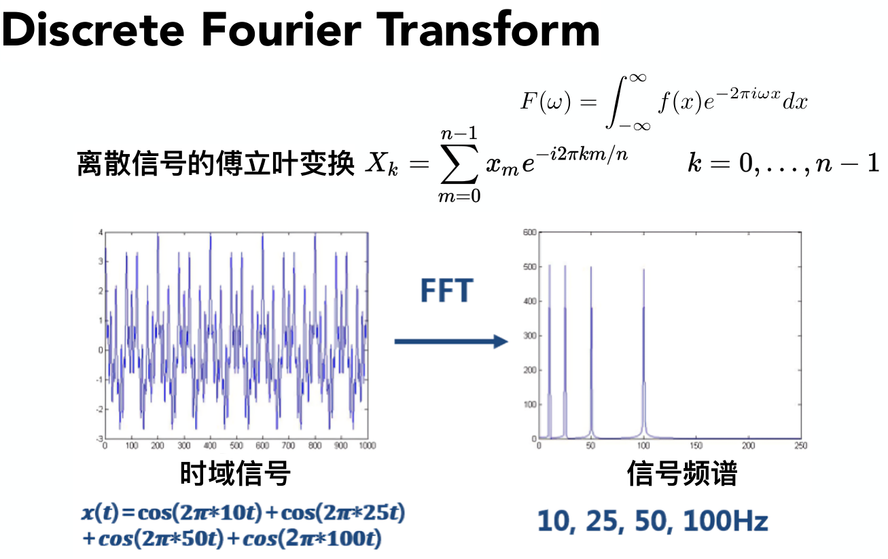

## 第 12 页 · 2D Fourier Transform

Definition

In 1D the Fourier transform is based on a decomposition into functions $e^{j2\pi ux}=\cos 2\pi ux+j\sin 2\pi ux$ which form an orthogonal basis. Similarly in 2D.

$F(u,v)$ is complex in general. $F(u,v)=F_R(u,v)+jF_I(u,v)$. $|F(u,v)|$ is the magnitude spectrum. $\arctan(F_I(u,v)/F_R(u,v))$ is the phase angle spectrum.

$$
F(u,v)=\int_{-\infty}^{\infty}\!\int_{-\infty}^{\infty}f(x,y)e^{-2\pi i(ux+vy)}\,dx\,dy.
$$

$$
f(x,y)=\int_{-\infty}^{\infty}\!\int_{-\infty}^{\infty}F(u,v)e^{2\pi i(ux+vy)}\,du\,dv.
$$

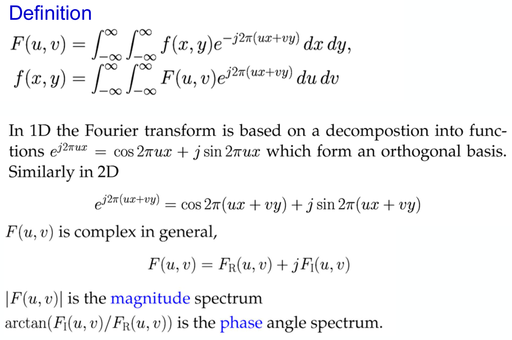

## 第 13 页 · Example: 2D Fourier Transform

V

rectangle centred at origin with sides of length X and Y

u

f(x,y)

|F(u,v)|

separability

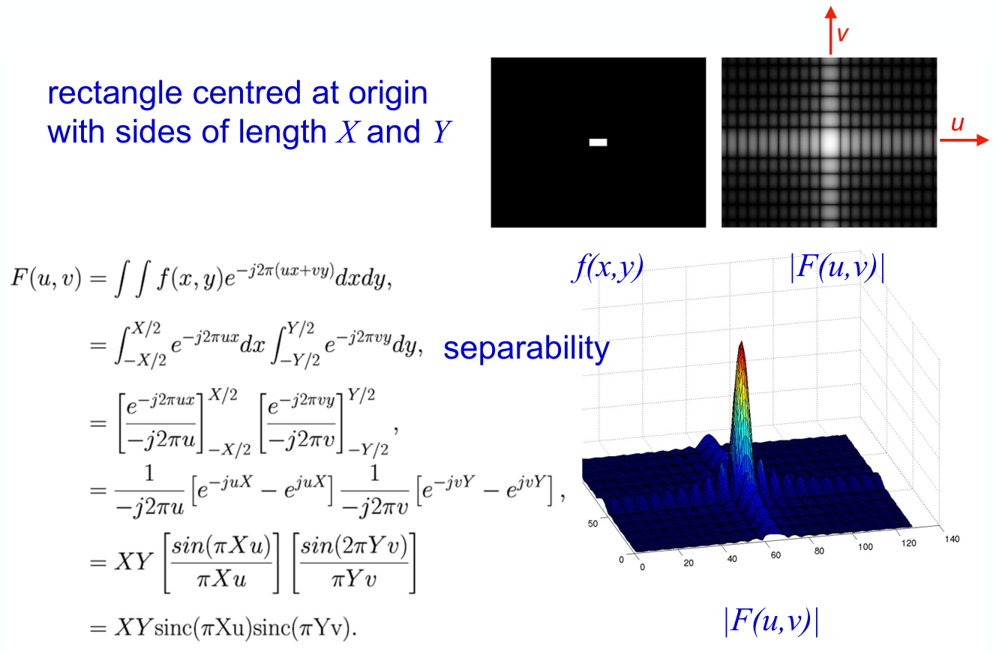

## 第 14 页 · Example: Image Frequency Content

V

U

Spatial Domain

Frequency Domain

f(x, y)

|F(u, v)|

2D DFT

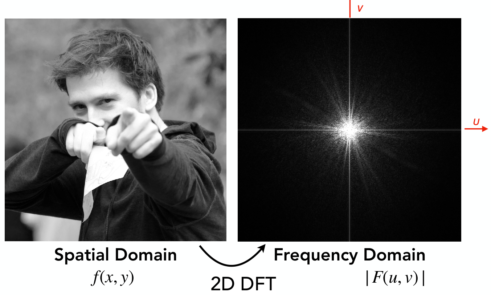

## 第 15 页 · Filtering = Getting rid of certain frequency contents

## 第 16 页 · Filter Out High Frequencies (Blur)

Spatial Domain

Frequency Domain

(Low frequency = Smooth gradients)

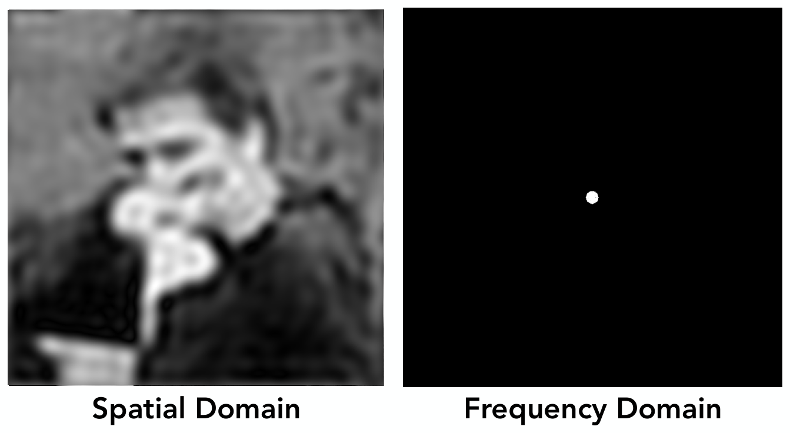

## 第 17 页 · Filter Out Low Frequencies Only (Edges)

Spatial Domain

Frequency Domain

(High frequency = Sharp edges)

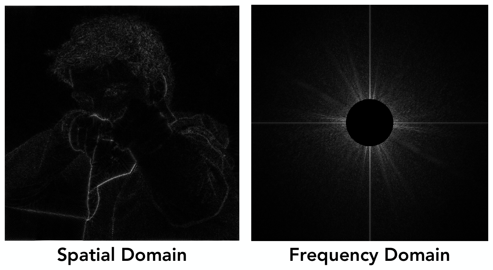

## 第 18 页 · Filter Out Low and High Frequencies

Spatial Domain

Frequency Domain

## 第 19 页 · Filter Out Low and High Frequencies

Spatial Domain

Frequency Domain

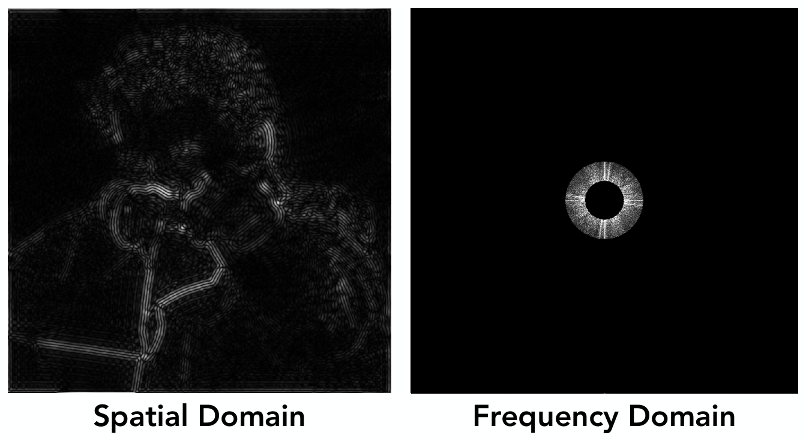

## 第 20 页 · Filtering = Convolution

## 第 21 页 · Convolution

Signal

1

3

5

7

8

6

4

Filter

1/4

1/2

## 第 22 页 · Convolution

1

3

5

7

8

6

4

Signal

Filter

1/4

1/2

1 x (1/4) + 3 x (1/2) + 5 x (1/4) = 3

Result

## 第 23 页 · Convolution

| | Values |
| --- | --- |
| Signal | 1, 3, 5, 3, 7, 1, 3, 8, 6, 4 |
| Filter | 1/4, 1/2, 1/4 |
| Result | 3, 4, … |

3 × (1/4) + 5 × (1/2) + 3 × (1/4) = 4

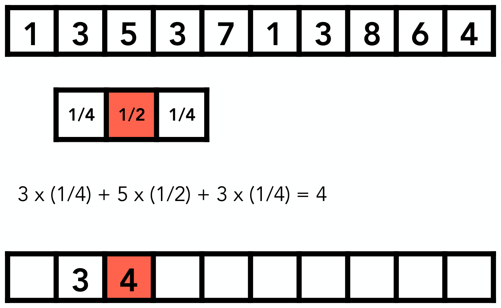

## 第 24 页 · Convolution Function

卷积函数定义

对两个函数重叠长度的乘积的积分

为滤波器（卷积核）

离散形式

例子：

卷积后

变为

如果将参加卷积的一个函数看作区间的指示函数（只在一个区间有定义，其余地方为0），卷积还可以被看作是“滑动平均”（定义域上滑动，重叠区域平均）

$$
(f*g)(t)=\int_{-\infty}^{\infty} f(\tau)g(t-\tau)\,d\tau,\qquad
(f*g)(n)=\sum_{m=-\infty}^{\infty} f(n-m)g(m).
$$

## 第 25 页 · Convolution Theorem

时域卷积定理：

两信号在时域的卷积积分对应于在频域中该两信号的傅立叶变换的乘积。

频域卷积定理：

两信号在时域的乘积对应于这两个信号傅立叶变换的卷积除以

。

$$
\mathcal F[f*g](\omega)=F_f(\omega)F_g(\omega),\qquad
\mathcal F[f\cdot g](\omega)=\frac{1}{2\pi}(F_f*F_g)(\omega).
$$

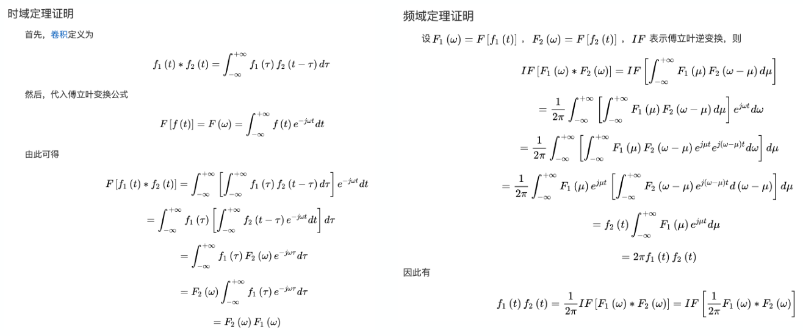

## 第 26 页 · Convolution Theorem

Convolution in the spatial domain is equal to multiplication in the frequency domain, and vice versa

Option 1:

- Filter by convolution in the spatial domain

Option 2:

- Transform to frequency domain (Fourier transform)
- Multiply by Fourier transform of convolution kernel
- Transform back to spatial domain (inverse Fourier)

## 第 27 页 · Convolution Theorem

Spatial

Domain

=

\*

Fourier

Transform

Inv. Fourier

Frequency

x

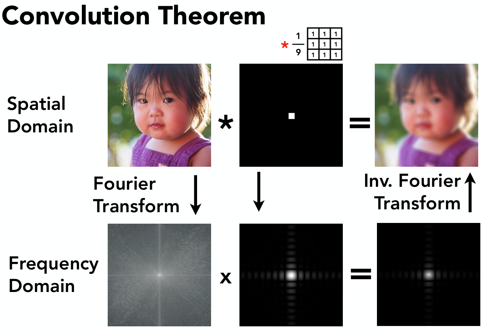

## 第 28 页 · Box Filter

1

9

Example: 3x3 box filter

$$
\frac19\begin{bmatrix}1&1&1\\1&1&1\\1&1&1\end{bmatrix}
$$

## 第 29 页 · Box Function = “Low Pass” Filter

Spatial Domain

Frequency Domain

## 第 30 页 · Wider Filter Kernel = Lower Frequencies

Spatial Domain

Frequency Domain

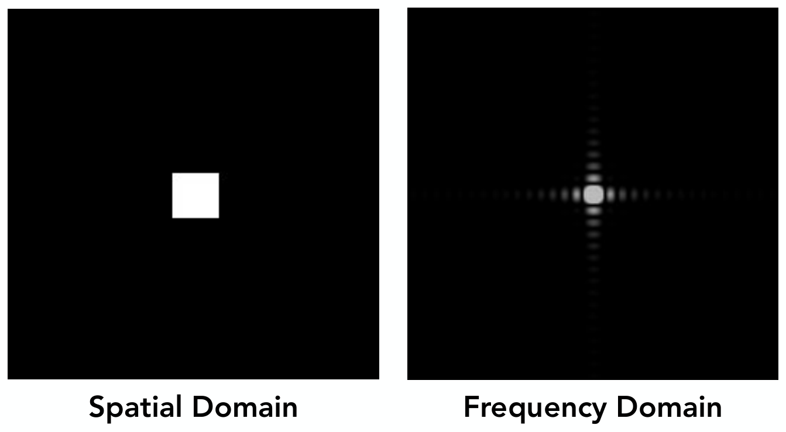

## 第 31 页 · Having introduced frequency space and filtering, we now explain aliasing

and anti-aliasing in signal sampling.

## 第 32 页 · Higher Frequencies Need Faster Sampling

Periodic sampling locations

f1(x)

Low-frequency signal:

sampled adequately for reasonable reconstruction

f2(x)

f3(x)

f4(x)

High-frequency signal is insufficiently sampled:

reconstruction

incorrectly appears to be from a low frequency signal

f5(x)

x

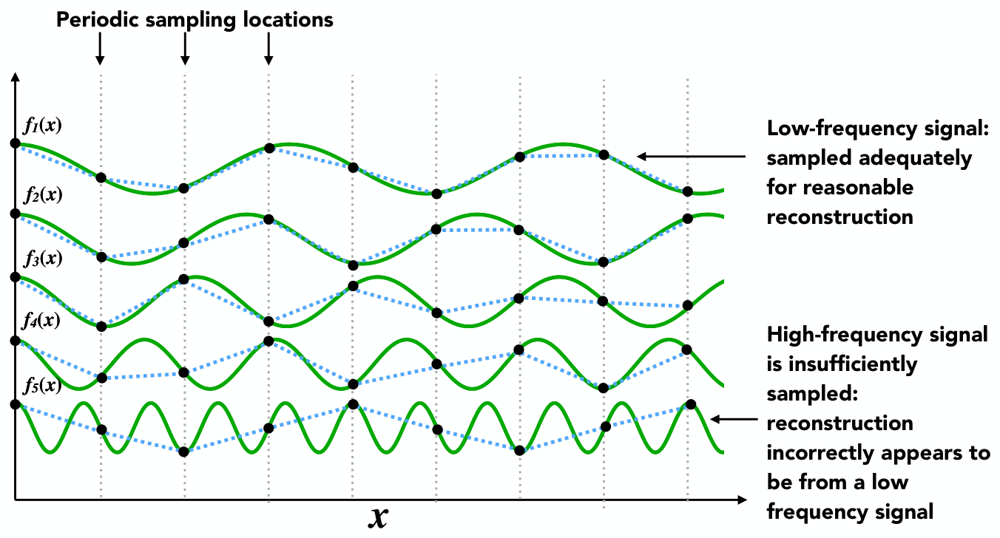

## 第 33 页 · Undersampling Creates Frequency Aliases

High-frequency signal is insufficiently sampled: samples erroneously appear to be from a low-frequency signal

Two frequencies that are indistinguishable at a given sampling rate are called “aliases”

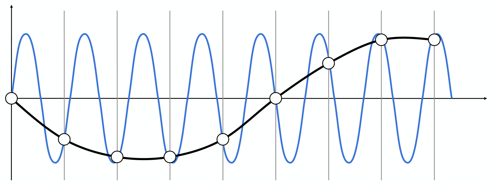

## 第 34 页 · Sampling = Repeating Frequency Contents

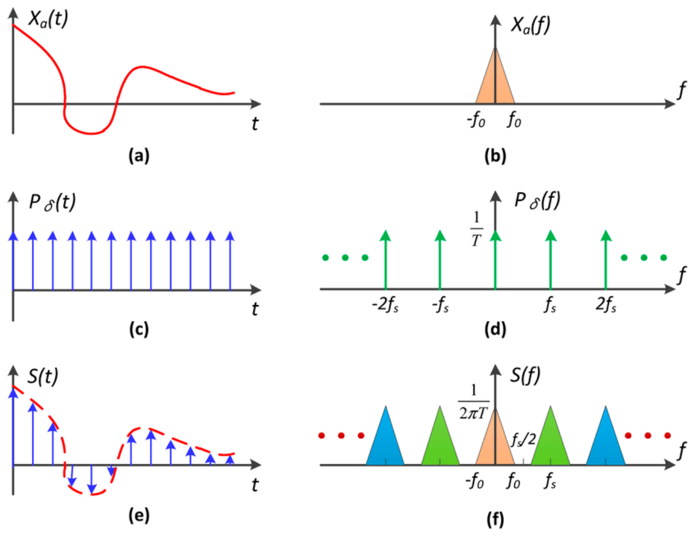

## 第 35 页 · Aliasing = Mixed Frequency Contents

Dense sampling:

Sparse sampling:

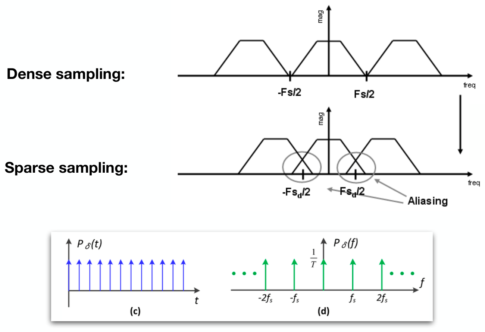

## 第 36 页 · Nyquist-Shannon Theorem

（香农采样定理）

- Consider a band-limited signal: has no frequencies above ω₀

1D: consider low-pass filtered audio signal

2D: recall the blurred image example from a few slides ago

-ω0

ω0

- The signal can be perfectly reconstructed if sampled with period T = 1 / 2ω0

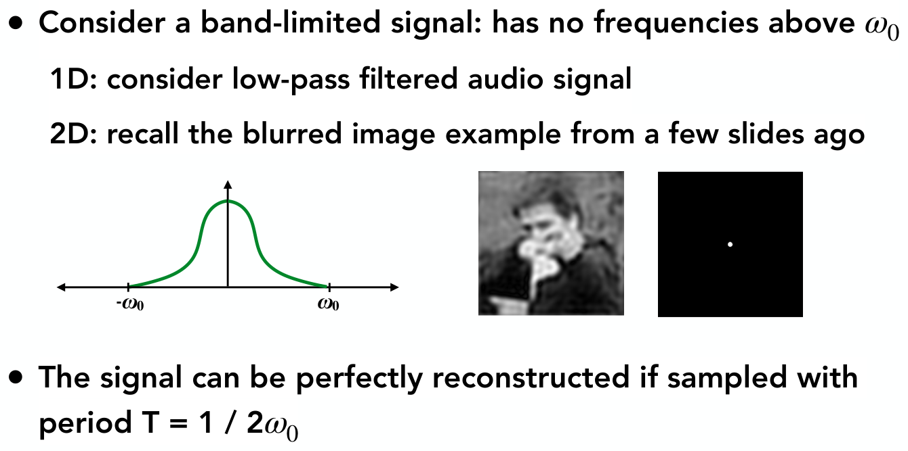

## 第 37 页 · Challenges of Sampling-based Approaches

- Our signals are not always band-limited in computer graphics.

Why?

Hint:

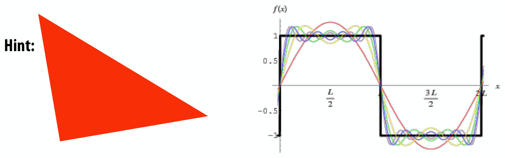

## 第 38 页 · Antialiasing

## 第 39 页 · How Can We Reduce Aliasing Error?

Increase sampling rate (increase Nyquist frequency)

- Higher resolution displays, sensors, framebuffers…
- But: costly & may need very high resolution

Antialiasing

- Simple idea: remove (or reduce) signal frequencies above the Nyquist frequency before sampling
- How? Filter out high frequencies before sampling.

## 第 40 页 · Antialiasing = Limiting, then repeating

Filtering

Then sparse sampling

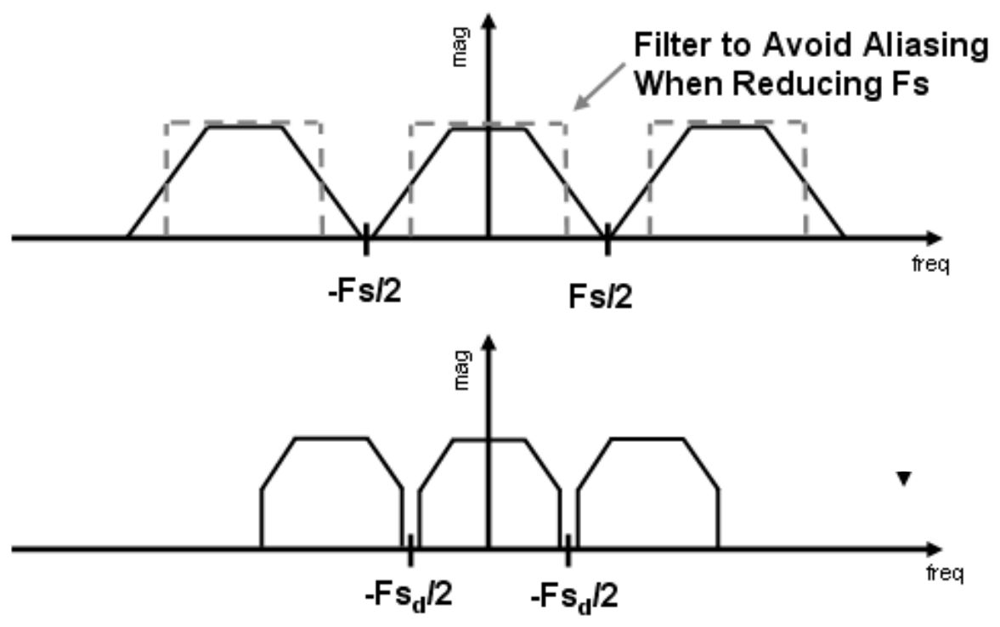

## 第 41 页 · Antialiased Sampling

Pre-Filter

Sample

(remove frequencies above Nyquist)

Note antialiased edges in rasterized triangle

where pixel values take intermediate values

## 第 42 页 · A Practical Pre-Filter

A 1 pixel-width box filter will attenuate frequencies whose period is less than or equal to 1 pixel-width

Spatial Domain

Frequency Domain

This is practical to implement — why?

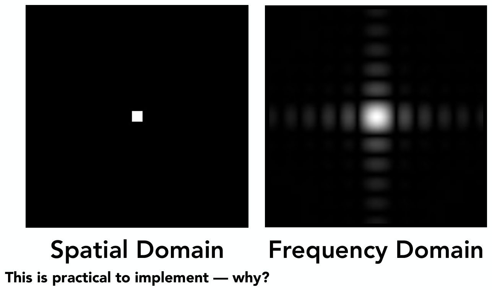

## 第 43 页 · Antialiasing by Computing Average Pixel Value

等价于均值滤波

In rasterizing one triangle, the average value inside a pixel area of f(x,y) = inside(triangle,x,y) is equal to the area of the pixel covered by the triangle.

Original

Filtered

1 pixel width

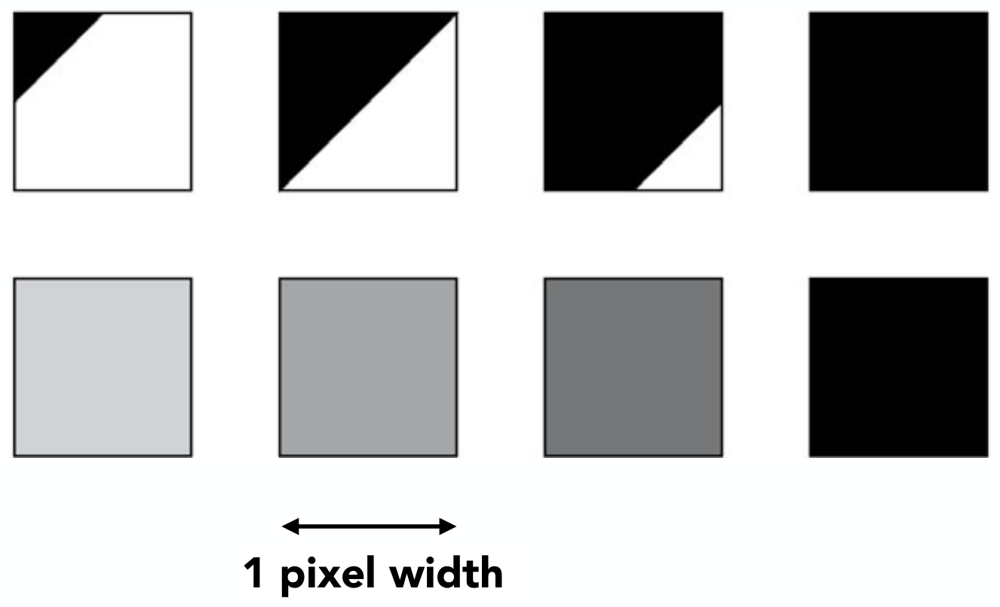

## 第 44 页 · Antialiasing By Supersampling

## 第 45 页 · Supersampling

We can approximate the effect of the 1-pixel box filter by sampling multiple locations within a pixel and averaging their values:

4x4 supersampling

## 第 46 页 · Point Sampling: One Sample Per Pixel

## 第 47 页 · Supersampling: Step 1

Take NxN samples in each pixel.

2x2 supersampling

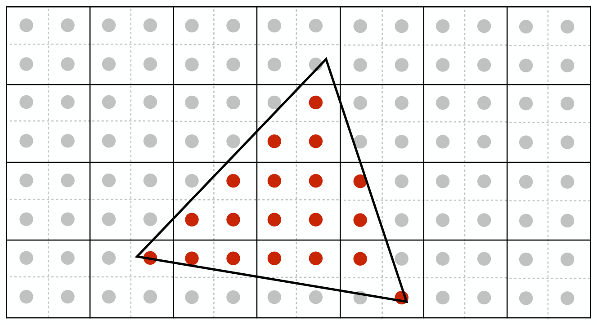

## 第 48 页 · Supersampling: Step 2

Average the NxN samples “inside” each pixel.

Averaging down

## 第 49 页 · Supersampling: Step 2

文字同第 48 页。

## 第 50 页 · Supersampling: Step 2

Average the NxN samples “inside” each pixel.

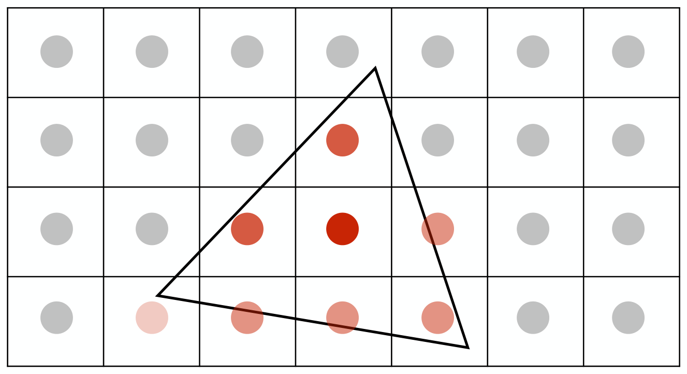

## 第 51 页 · Supersampling: Result

This is the corresponding signal emitted by the display

75%

100%

50%

25%

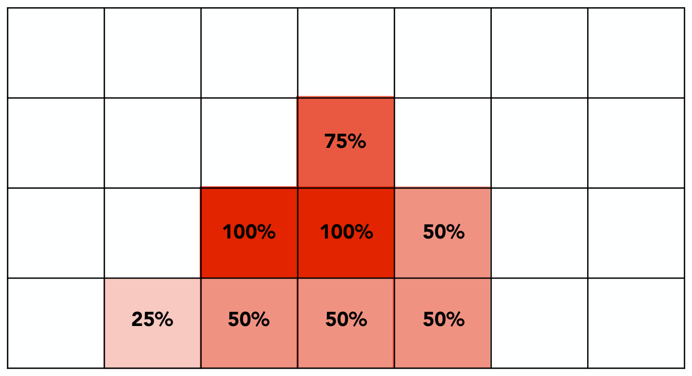

## 第 52 页 · Point Sampling

One sample per pixel

## 第 53 页 · 4x4 Supersampling + Box filter

Pixel value is average of 4x4 samples per pixel

## 第 54 页 · Antialiasing By Supersampling - Summary

- Antialiasing = remove frequencies above Nyquist before sampling
- We can attenuate these frequencies quite well with a 1-pixel box filter (convolution)
- We approximated the 1-pixel box sampling by supersampling and averaging
- Simple, good idea - high image quality, but costly
- May feel “right”, but can get even higher quality!

## 第 55 页 · Supersampling Implementation Tips

## 第 56 页 · Tip 1: Sample Locations

(0,0)

(w,0)

(i+1/2,j+1/2)

(0,h)

(w,h)

Regular sampling: sample location for pixel (i,j)

## 第 57 页 · Tip 1: Sample Locations

(0,0)

(w,0)

(i+1/4,j+1/4)

(i+3/4,j+1/4)

(i+3/4,j+3/4)

(0,h)

(w,h)

2x2 supersampling: locations for pixel (i,j)

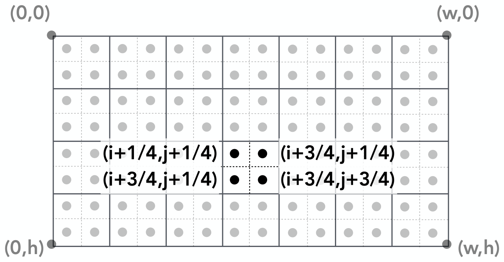

## 第 58 页 · Tip 1: Sample Locations

(0,0)

(w,0)

(0,h)

(w,h)

Sample locations for NxN supersampling?

## 第 59 页 · Tip 2: Supersampling Multiple Triangles

So far, we rasterized only a single triangle:

- Supersample
- Then average down

How should this change when we rasterize N triangles in the same image?

Supersample

- Supersample and average down each triangle, one by one?
- Or supersample all N triangles onto a high-res grid, then average down?

What are the algorithmic implications?

- E.g. what is the minimum memory needed?

Average Down

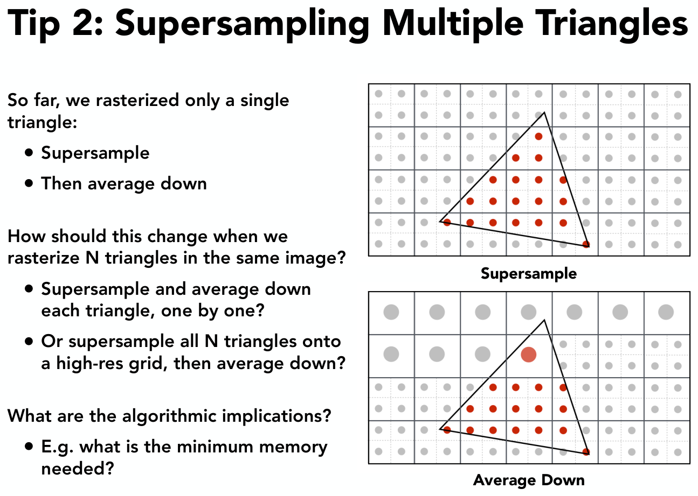

## 第 60 页 · Antialiasing (AA) Today

- SSAA (Supersampling AA)
    - Exact implementation: MSAA

(Multi-Sampling AA)

- Approximate implementation: FXAA

(Fast Approximate AA)

- TAA (Temporal AA)

(当前帧和历史帧进行加权融合)

- DLSS (Deep Learning Super Sampling)
- Essentially still “not enough samples” problem

## 第 61 页 · Antialiasing (AA) Today

No AA

4X MSAA

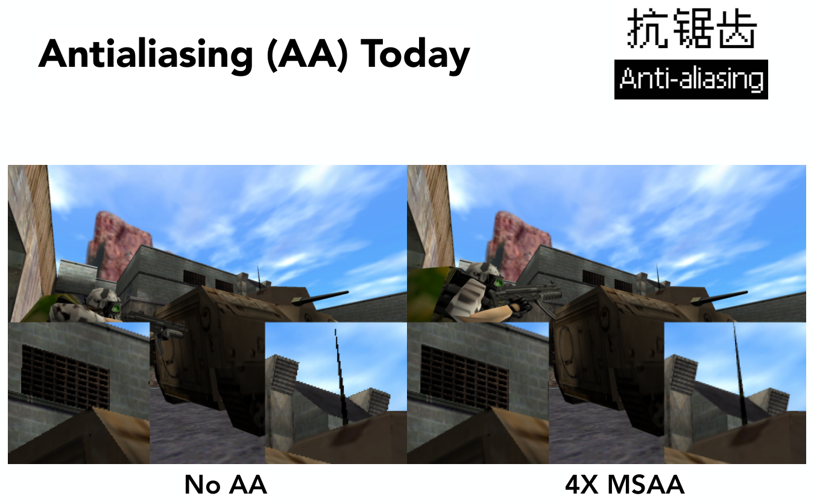

## 第 62 页 · Antialiasing (AA) Today

FXAA

4X MSAA

## 第 63 页 · Things to Remember

Signal processing key concepts:

- Frequency domain vs spatial domain
- Filters in the frequency domain scale frequencies
- Filters in the sampling domain = convolution

Sampling and aliasing

- Image generation involves sampling
- Nyquist frequency is half the sampling rate
- Frequencies above Nyquist appear as aliasing artifacts
- Antialiasing = filter out high frequencies before sampling
- Interpret supersampling as (approx) box pre-filter antialiasing
