# Lecture 4 · Transforms

原课件共 118 页。[打开 PDF](../../ppt/lec-04-transforms.pdf)

按 PDF 页序提取，保留课件原有中英文。关键公式以 Markdown 数学式或原页局部图呈现。

## 第 1 页 · Transforms

Computer Graphics 2026 Fuzhou University - Computer Science

## 第 2 页 · Why Study Transforms?

## 第 3 页 · The Rasterization Pipeline

1. Transform/position objects in the world
2. Project objects onto the screen
3. Sample triangle coverage
4. Interpolate triangle attributes at covered samples
5. Sample texture maps / evaluate shaders
6. Combine samples into final image (depth, alpha, …)

- Reflects standard “real world” pipeline (OpenGL/Direct3D)

## 第 4 页 · Cube

(1, 1, 1)

(-1, 1, 1)

(-1, 1, -1)

(1, 1, -1)

(-1, -1, 1)

(1, -1, 1)

(1, -1, -1)

(-1, -1, -1)

## 第 5 页 · Cube Man

## 第 6 页 · Modeling Objects

Transforms can describe positions and movements of body parts.

## 第 7 页 · Viewing Objects

?

Scene modeling

3D world coordinates

Rasterization

2D screen coordinates

## 第 8 页 · Why Study Transforms?

Modeling

- Define shapes in convenient coordinates
- Enable multiple copies of the same object
- Efficiently represent hierarchical scenes

Viewing

- World coordinates to camera coordinates
- Parallel / perspective projections from 3D to 2D

## 第 9 页 · Today’s Topics

Why Study Transformation?

Basic Transformations

3D transformations

MVP Transformation

## 第 10 页 · Basic idea:    transforms    to

f

x

f(x)

## 第 11 页 · What can we do with linear transformations?

- What did linear mean?

指直线到直线？

可加性？

齐次性？

- Cheap to compute
- Composition of linear transformation is linear
    - Leads to uniform representation of transformations
    - E.g., in graphics card (GPU) or graphics API

$$
f(x+y)=f(x)+f(y),\qquad f(ax)=a f(x).
$$

## 第 12 页 · Scale Transform

S0.5

## 第 13 页 · Scale Transform

S0.5

x′ = 0.5x

y′ = 0.5y

## 第 14 页 · Scale Matrix

S0.5

$$
\begin{bmatrix}x'\\y'\end{bmatrix}=\begin{bmatrix}s&0\\0&s\end{bmatrix}\begin{bmatrix}x\\y\end{bmatrix}.
$$

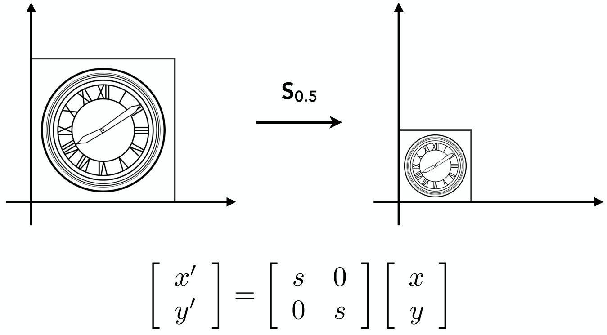

## 第 15 页 · Scale Transform (non-uniform a.k.a anisotropic)

S0.5,1.0

x′ = 0.5x

y′ = y

## 第 16 页 · Scale Transform (non-uniform a.k.a anisotropic)

S0.5,1.0

$$
\begin{bmatrix}x'\\y'\end{bmatrix}=\begin{bmatrix}s_x&0\\0&s_y\end{bmatrix}\begin{bmatrix}x\\y\end{bmatrix}.
$$

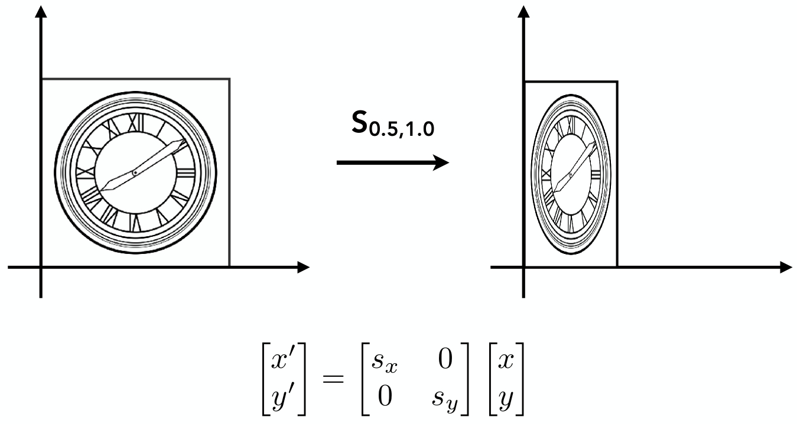

## 第 17 页 · Is scale a linear transform?

S₂(x) = 2x

S₂(x + y) = 2(x + y)

aS₂(x) = 2ax

S₂(x) + S₂(y) = 2x + 2y

S₂(x + y) = S₂(x) + S₂(y)

S₂(ax) = 2ax

S₂(ax) = aS₂(x)

S₂(x + y)

S₂(y)

S₂(ax)

S₂(x)

x + y

x ax

x

y

Yes!

## 第 18 页 · Reflection Transform

x′ = −1.0x

y′ = y

## 第 19 页 · Reflection Matrix

Horizontal reflection:

$$
\begin{bmatrix}x'\\y'\end{bmatrix}=\begin{bmatrix}-1&0\\0&1\end{bmatrix}\begin{bmatrix}x\\y\end{bmatrix}.
$$

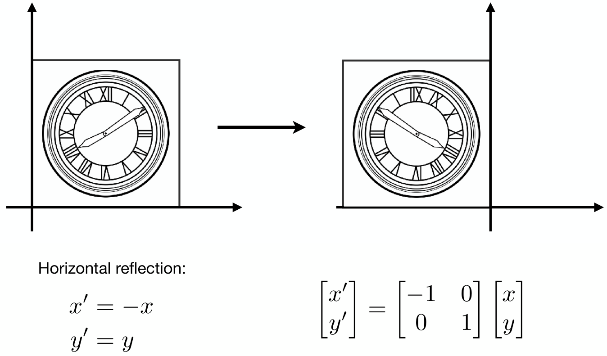

## 第 20 页 · Shear Matrix

1

a

## 第 21 页 · Shear Matrix

1

?

y

a

Hints:

Horizontal shift is 0 at y=0

Horizontal shift is a at y=1

Vertical shift is always 0

$$
\begin{bmatrix}x'\\y'\end{bmatrix}=\begin{bmatrix}1&a\\0&1\end{bmatrix}\begin{bmatrix}x\\y\end{bmatrix}.
$$

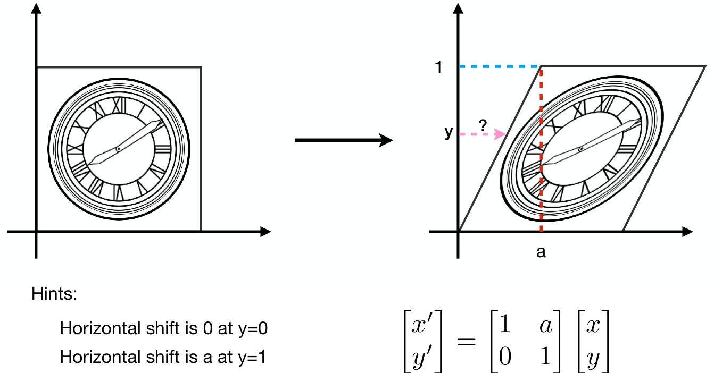

## 第 22 页 · Rotate

(about the origin (0, 0), CCW by default)

R45

## 第 23 页 · Rotation Matrix

x′= −sinθ × 1

y′= cosθ × 1

−sin θ

(x, y) = (0,1)

x′= cosθ × 1

y′= sinθ × 1

cos θ

sin θ

θ

(x, y) = (1,0)

x′ = a x + b y

y′ = c x + d y

## 第 24 页 · Rotation Matrix

$$
R_\theta=\begin{bmatrix}\cos\theta&-\sin\theta\\\sin\theta&\cos\theta\end{bmatrix}.
$$

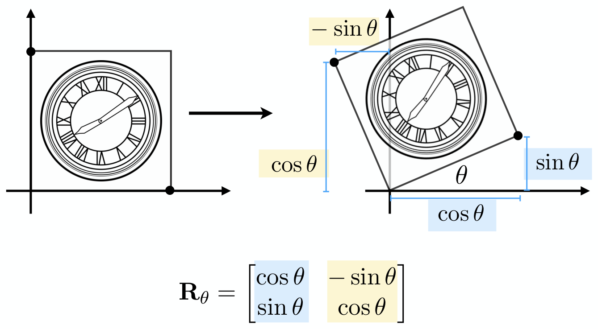

## 第 25 页 · Linear Transformation = Matrix

2D线性变换可以用2x2矩阵表示

$$
\mathbf x'=M\mathbf x,\qquad
\begin{bmatrix}x'\\y'\end{bmatrix}=\begin{bmatrix}a&b\\c&d\end{bmatrix}\begin{bmatrix}x\\y\end{bmatrix}.
$$

## 第 26 页 · Translate

T1,1

Ttx,ty

## 第 27 页 · Translation??

T1,1

Ttx,ty

$$
x'=x+t_x,\qquad y'=y+t_y.
$$

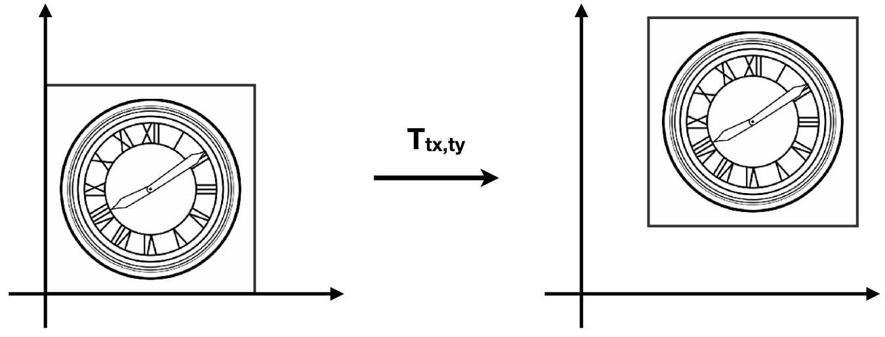

## 第 28 页 · Is translation a linear transform?

T\_b(x) + T\_b(y)

T\_b(x)

b

x + y

x

T\_b(x + y)

T\_b(y)

y

No! Translation is affine.

## 第 29 页 · Can we represent translation in matrix form？

- Translation cannot be represented in matrix form

(So, translation is NOT linear transform!)

- But we don’t want translation to be a special case
- Is there a unified way to represent all transformations?

$$
\begin{bmatrix}x'\\y'\end{bmatrix}=\begin{bmatrix}a&b\\c&d\end{bmatrix}\begin{bmatrix}x\\y\end{bmatrix}+\begin{bmatrix}t_x\\t_y\end{bmatrix}.
$$

## 第 30 页 · Solution: Homogenous Coordinates

Add a third coordinate (w-coordinate) $(x,y,w)$.

- 2D point = $(x,y,1)^\mathsf{T}$
- 2D vector = $(x,y,0)^\mathsf{T}$

Now you can express translation as a matrix!!

优点：统一表示、简化几何变换的计算

$$
\begin{bmatrix}x'\\y'\\w'\end{bmatrix}=
\begin{bmatrix}1&0&t_x\\0&1&t_y\\0&0&1\end{bmatrix}
\begin{bmatrix}x\\y\\1\end{bmatrix}=
\begin{bmatrix}x+t_x\\y+t_y\\1\end{bmatrix}.
$$

## 第 31 页 · Homogenous Coordinates

2D point   = (x, y, 1)T

2D vector = (x, y, 0)T

Valid operation if w-coordinate of result is 1 or 0

- vector + vector

= vector

- point

– point

+ vector

= point

+ point

= ??

In homogeneous coordinates,

规范化齐次坐标

$$
(x,y,w)^{\mathsf T}\sim(x/w,y/w,1)^{\mathsf T},\qquad w\ne0.
$$

## 第 32 页 · Homogeneous coordinates: some intuition

w

wx\_y

w = 1

x\_y

y

Many points in 2D-H correspond to same point in 2D

(  and ωx

x

correspond to the same 2D point)

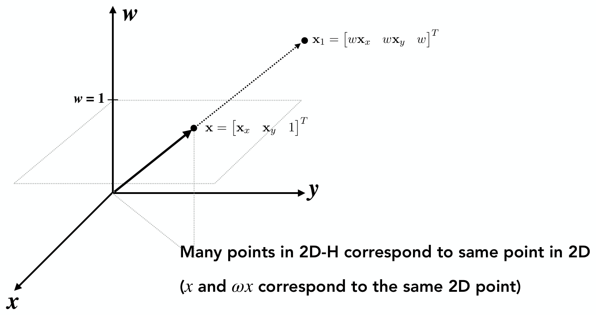

## 第 33 页 · Homogeneous coordinates: some intuition

w

wx\_y

w = 1

bₓ, b\_y

x\_y

y

2D Shear

0

1

x

Translation is a shear in  and  in 2D-H space

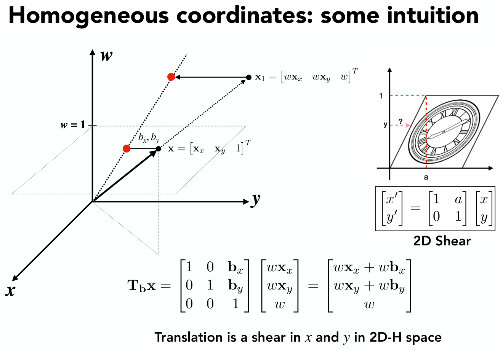

## 第 34 页 · Affine Transformations

Affine map = linear map + translation

Using homogenous coordinates:

Homogeneous coordinates let us encode translations as linear transformations!

$$
\begin{bmatrix}x'\\y'\\1\end{bmatrix}=
\begin{bmatrix}a&b&t_x\\c&d&t_y\\0&0&1\end{bmatrix}\begin{bmatrix}x\\y\\1\end{bmatrix}.
$$

## 第 35 页 · 2D Transformations

Scale

Rotation

Translation

$$
S=\begin{bmatrix}s_x&0&0\\0&s_y&0\\0&0&1\end{bmatrix},\quad
R=\begin{bmatrix}\cos\alpha&-\sin\alpha&0\\\sin\alpha&\cos\alpha&0\\0&0&1\end{bmatrix},\quad
T=\begin{bmatrix}1&0&t_x\\0&1&t_y\\0&0&1\end{bmatrix}.
$$

## 第 36 页 · 2D Transformations

“Projective Transform”

(any matrix)

(homogenous coordinates)

Scale

“Affine Transform”

“Similarity

Transform

Rotation

if Sx=Sy”

Translation

“Rigid Transform”

$$
S=\begin{bmatrix}s_x&0&0\\0&s_y&0\\0&0&1\end{bmatrix},\quad
R=\begin{bmatrix}\cos\alpha&-\sin\alpha&0\\\sin\alpha&\cos\alpha&0\\0&0&1\end{bmatrix},\quad
T=\begin{bmatrix}1&0&t_x\\0&1&t_y\\0&0&1\end{bmatrix}.
$$

## 第 37 页 · Summary of basic transformations

Linear:

Affine:

f(x + y) = f(x) + f(y)

Composition of linear transform + translation

f(ax) = af(x)

f(x) = g(x) + b

Scale

Rotation

Reflection

Shear

Not affine: perspective projection

Euclidean:

Preserve distance between points

Not linear:

|f(x) −f(y)| = |x −y|

Translation

“Rigid body” transformations are distance-preserving motions that also preserve orientation (i.e., does not include reflection)

## 第 38 页 · Inverse Transform

M^−¹

M

is the inverse of transform      in both a matrix and geometric sense

## 第 39 页 · Composing Transforms

## 第 40 页 · Composite Transform

?

## 第 41 页 · Translate Then Rotate?

T₍₁\_,₀₎

R₄₅ · T₍₁\_,₀₎

## 第 42 页 · Rotate Then Translate

R₄₅

T₍₁\_,₀₎ · R₄₅

## 第 43 页 · Transform Ordering Matters!

T₍₁\_,₀₎

R₄₅ · T₍₁\_,₀₎

R₄₅

T₍₁\_,₀₎ · R₄₅

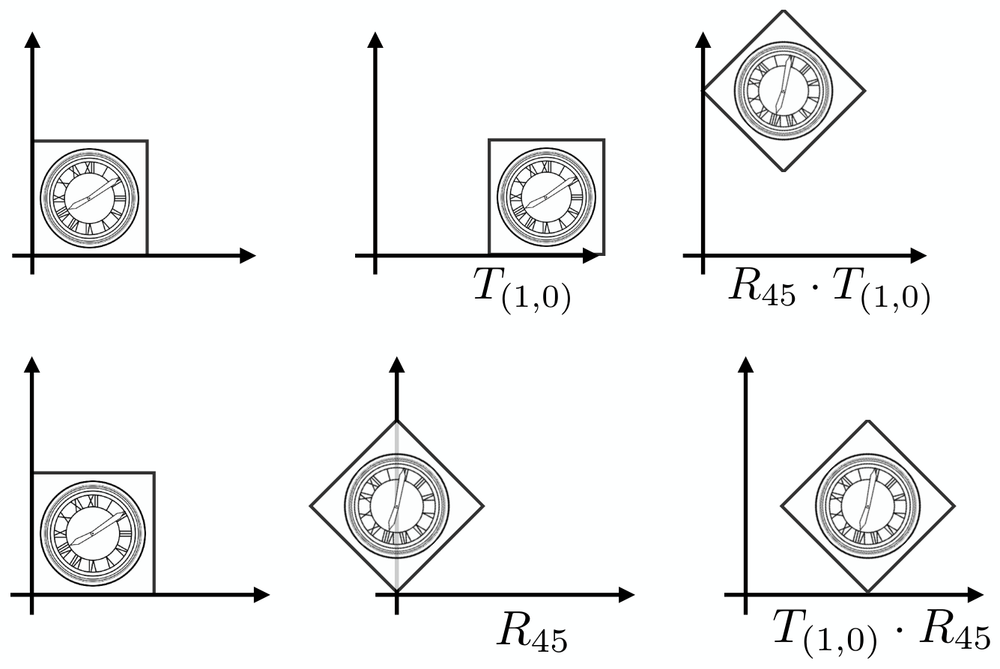

## 第 44 页 · Transform Ordering Matters!

Matrix multiplication is not commutative

≠

Note that matrices are applied right to left:

$$
R_{45^\circ}\,T_{(1,0)} \ne T_{(1,0)}\,R_{45^\circ}.
$$

## 第 45 页 · Composing Transforms

Sequence of transforms A1, A2, A3, ...

- Compose by matrix multiplication
    - Very important for performance!
    - Very important for complexity!

Pre-multiply n matrices to obtain a

single matrix representing combined transform

$$
A_n\bigl(\cdots A_2(A_1(\mathbf x))\bigr)=A_n\cdots A_2 A_1\begin{bmatrix}x\\y\\1\end{bmatrix}.
$$

## 第 46 页 · Building Complex Transforms

How to rotate around a given point c?

1. Translate center to origin
2. Rotate
3. Translate back

Matrix representation?

$$
M_{\mathrm{composite}}=T(\mathbf c)\,R(\alpha)\,T(-\mathbf c).
$$

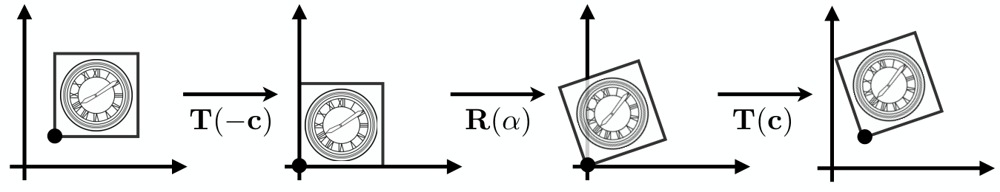

## 第 47 页 · Today’s Topics

Why Study Transformation?

Basic transformations

3D transformations

MVP Transformation

## 第 48 页 · 3D Transformations

Use homogeneous coordinates again:

- 3D point   = (x, y, z, 1)T
- 3D vector = (x, y, z, 0)T

In general,

is the 3D point

$$
(x,y,z,w)^{\mathsf T}\sim(x/w,y/w,z/w,1)^{\mathsf T},\qquad w\ne0.
$$

## 第 49 页 · 3D Transformations

Scale

Translation

$$
S=\begin{bmatrix}s_x&0&0&0\\0&s_y&0&0\\0&0&s_z&0\\0&0&0&1\end{bmatrix},\qquad
T=\begin{bmatrix}1&0&0&t_x\\0&1&0&t_y\\0&0&1&t_z\\0&0&0&1\end{bmatrix}.
$$

## 第 50 页 · 2D and 3D Rotations

2D rotations implicitly rotate about a third out-of-plane axis

## 第 51 页 · 3D Transformations

Rotation around x-, y-, or z-axis

y

Rotation

around

x-axis

x

z

Anything strange about Ry?

$$
R_x(\alpha)=\begin{bmatrix}1&0&0&0\\0&\cos\alpha&-\sin\alpha&0\\0&\sin\alpha&\cos\alpha&0\\0&0&0&1\end{bmatrix},\quad
R_y(\alpha)=\begin{bmatrix}\cos\alpha&0&\sin\alpha&0\\0&1&0&0\\-\sin\alpha&0&\cos\alpha&0\\0&0&0&1\end{bmatrix},
$$

$$
R_z(\alpha)=\begin{bmatrix}\cos\alpha&-\sin\alpha&0&0\\\sin\alpha&\cos\alpha&0&0\\0&0&1&0\\0&0&0&1\end{bmatrix}.
$$

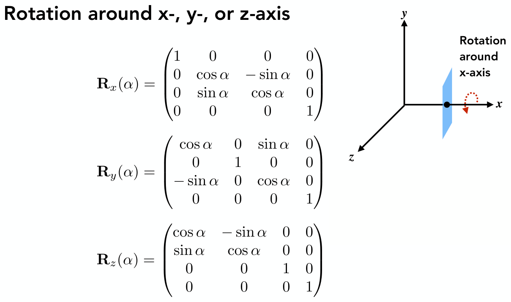

## 第 52 页 · 3D Rotation Around Arbitrary Axis

## 第 53 页 · 3D Rotations

Compose any 3D rotation from Rx, Ry, Rz?

- So-called Euler angles
- Often used in flight simulators: roll, pitch, yaw

$$
R_{xyz}(\alpha,\beta,\gamma)=R_x(\alpha)R_y(\beta)R_z(\gamma).
$$

## 第 54 页 · Rodrigues’ Rotation Formula

Rotation by angle α around axis n

How to prove this magic formula?

$$
R(\mathbf n,\alpha)=\cos\alpha\,I+(1-\cos\alpha)\,\mathbf n\mathbf n^{\mathsf T}+\sin\alpha
\begin{bmatrix}0&-n_z&n_y\\n_z&0&-n_x\\-n_y&n_x&0\end{bmatrix}.
$$

## 第 55 页 · Rodrigues’ Rotation Formula

## 第 56 页 · Hierarchical Transforms

## 第 57 页 · Skeleton - Linear Representation

head

torso

right upper arm

right lower arm

right hand

left upper arm

left lower arm

left hand

right upper leg

right lower leg

right foot

left upper leg

left lower leg

left foot

## 第 58 页 · Linear Representation

Each shape associated with its own transform

A single edit can require updating many transforms

- E.g. raising arm requires updating transforms for all arm parts

## 第 59 页 · Skeleton - Hierarchical Representation

torso

head

right arm

upper arm

lower arm

hand

left arm

right leg

upper leg

lower leg

foot

left leg

## 第 60 页 · Skeleton - Hierarchical Representation

Torso

torso

head

right arm

Head

left arm

…

upper arm

lower arm

r. up arm

hand

r. low arm

right leg

r. hand

upper leg

lower leg

foot

left leg

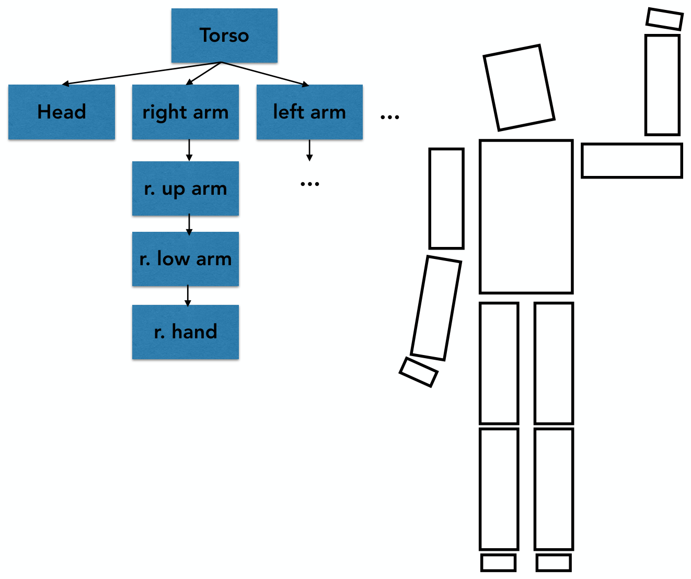

## 第 61 页 · Hierarchical Representation

Grouped representation (tree)

- Each group contains subgroups and/or shapes
- Each group is associated with a transform relative to parent group
- Transform on leaf-node shape is concatenation of all transforms on path from root node to leaf
- Changing a group’s transform affects all parts
- Allows high level editing by changing only one node
- E.g. raising left arm requires changing only one transform for that group

## 第 62 页 · Skeleton - Hierarchical Representation

```cpp
translate(0, 10);
drawTorso();

pushmatrix();  // push a copy of transform onto stack
    translate(0, 5);  // right-multiply onto current transform
    rotate(headRotation);  // right-multiply onto current transform
    drawHead();
popmatrix();  // pop current transform off stack

pushmatrix();
    translate(-2, 3);
    rotate(rightShoulderRotation);
    drawUpperArm();
    translate(0, -3);
    rotate(elbowRotation);
    drawLowerArm();
    pushmatrix();
        translate(0, -3);
        rotate(wristRotation);
        drawHand();
    popmatrix();
popmatrix();
…
```

Right arm group · Lower arm group · Right hand

## 第 63 页 · Skeleton - Hierarchical Representation

```cpp
translate(0, 10);
drawTorso();

pushmatrix();  // push a copy of transform onto stack
    translate(0, 5);  // right-multiply onto current transform
    rotate(headRotation);  // right-multiply onto current transform
    drawHead();
popmatrix();  // pop current transform off stack

pushmatrix();
    translate(-2, 3);
    rotate(rightShoulderRotation);
    drawUpperArm();
    translate(0, -3);
    rotate(elbowRotation);
    drawLowerArm();
    pushmatrix();
        translate(0, -3);
        rotate(wristRotation);
        drawHand();
    popmatrix();
popmatrix();
…
```

Right arm group · Lower arm group · Right hand

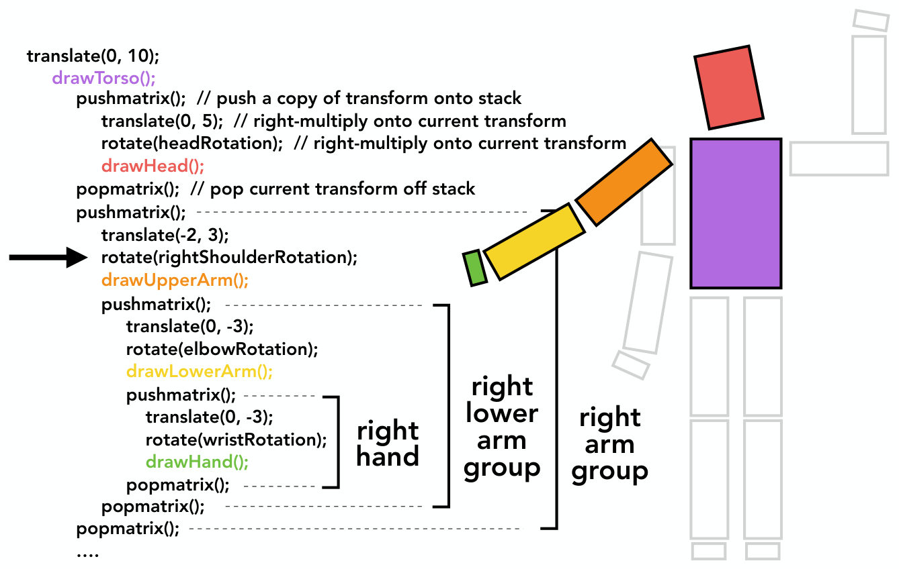

## 第 64 页 · Today’s Topics

Why Study Transformation?

Basic transformations

3D transformations

MVP Transformation

## 第 65 页 · View / Camera Transformation

- What is view transformation?
- Think about how to take a photo

MVP变换

- Find a good place and arrange people (Model transformation)
- Find a good “angle” to put the camera (View transformation)
- Cheese! (Projection transformation)

## 第 66 页 · Overview of Transforms

View

transformation

Projection

The sequence of spaces and transformations that gets objects

from their original coordinates into screen space.

## 第 67 页 · View / Camera Transformation

- Define the camera first

Up direction

⃗e

- Position
- Look-at/gaze direction
- Up direction ̂t

̂g

Position

Look-at direction

Consider A Camera Pointing in The World

u = up vector

v = view direction

e = eye point

(position of camera)

CS184/284A

Ren Ng, James O’Brien

## 第 68 页 · View / Camera Transformation

- Key observation
    - If the camera and all objects move together, the “photo” will be the same

==

## 第 69 页 · View / Camera Transformation

- Key observation
    - If the camera and all objects move together, the “photo” will be the same

Y

==

(0, 0, 0)

-Z

X

- How about that we always transform the camera to
    - The origin, up at Y, look at -Z
    - And transform the objects along with the camera

## 第 70 页 · View / Camera Transformation

- Transform the camera by $M_{\mathrm{view}}$
- So it’s located at the origin, up at Y, look at −Z

$M_{\mathrm{view}}$ in math?

- Translate $\vec e$ to origin
- Rotate $\hat g$ to −Z
- Rotate $\hat t$ to Y
- Rotate $(\hat g\times\hat t)$ to X

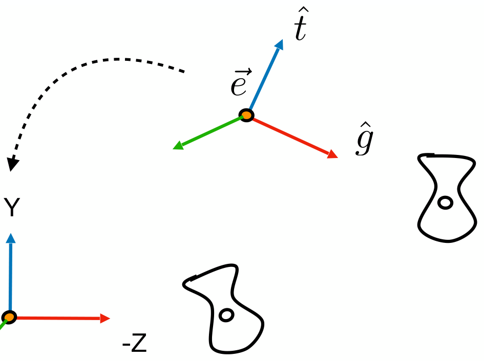

## 第 71 页 · View / Camera Transformation

- $M_{\mathrm{view}}$ in math?
    - Let’s write $M_{\mathrm{view}}=R_{\mathrm{view}}T_{\mathrm{view}}$
    - Translate to origin
    - Rotate $\hat g$ to −Z, $\hat t$ to Y, $(\hat g\times\hat t)$ to X
    - Consider its inverse rotation: X to $(\hat g\times\hat t)$, Y to $\hat t$, Z to $-\hat g$

$$
M_{\mathrm{view}}=R_{\mathrm{view}}T_{\mathrm{view}},\quad T_{\mathrm{view}}=
\begin{bmatrix}1&0&0&-x_e\\0&1&0&-y_e\\0&0&1&-z_e\\0&0&0&1\end{bmatrix}.
$$

$$
R_{\mathrm{view}}=\begin{bmatrix}(\hat{\mathbf g}\times\hat{\mathbf t})^{\mathsf T}&0\\
\hat{\mathbf t}^{\mathsf T}&0\\-\hat{\mathbf g}^{\mathsf T}&0\\0\quad 0\quad 0&1\end{bmatrix},\qquad R_{\mathrm{view}}^{-1}=R_{\mathrm{view}}^{\mathsf T}.
$$

## 第 72 页 · Overview of Transforms

View

transformation

Projection

The sequence of spaces and transformations that gets objects

from their original coordinates into screen space.

## 第 73 页 · Projection Transformation

- Perspective projection vs. orthographic projection

透视投影

正交投影

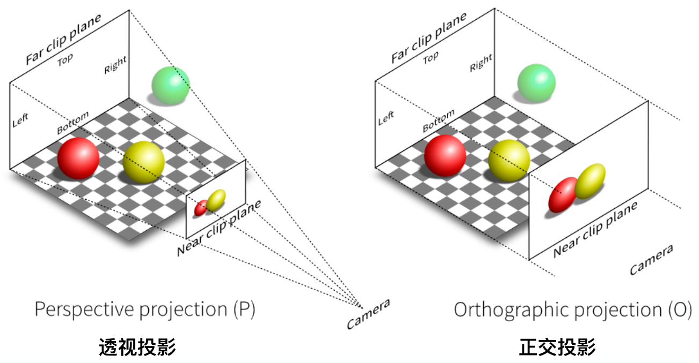

## 第 74 页 · Orthographic Projection

- A simple way of understanding
    - Camera located at origin, looking at -Z, up at Y
    - Drop Z coordinate
    - Translate and scale the resulting rectangle to [-1,1]2

## 第 75 页 · Orthographic Projection

- In general
    - We want to map a cuboid $[l,r]\times[b,t]\times[f,n]$ to the “canonical” cube $[-1,1]^3$.

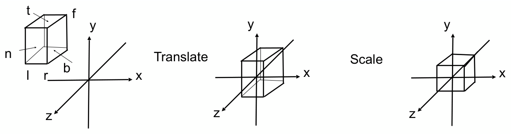

## 第 76 页 · Orthographic Projection

- Transformation matrix?
    - Translate (cuboid center to origin) first, then scale (length/width/height to 2)

t

f

y

n

b

Translate

Scale

x

l

r

z

$$
M_{\mathrm{ortho}}=
\begin{bmatrix}2/(r-l)&0&0&0\\0&2/(t-b)&0&0\\0&0&2/(n-f)&0\\0&0&0&1\end{bmatrix}
\begin{bmatrix}
1&0&0&-(r+l)/2\\0&1&0&-(t+b)/2\\0&0&1&-(n+f)/2\\0&0&0&1
\end{bmatrix}.
$$

## 第 77 页 · Orthographic Projection

- map a cuboid ([l,r] [b,t] [f,n]) to the “canonical”

×

3

cube [-1,1]

Projection

transformation

View

Q: Why not directly map the cuboid to the 2D square？

A: The z-coordinate will now be in [−1, 1]. We don’t take advantage of this now, but it will be useful when we examine z-buffer algorithms.

## 第 78 页 · Perspective Projection

- Most common in Computer Graphics, art, visual system
- Further objects are smaller
- Parallel lines not parallel; converge to a single point

## 第 79 页 · Perspective Projection

- Euclid was wrong??!!

https://en.wikipedia.org/wiki/Parallel_(geometry)

## 第 80 页 · Example: Incorrect Perspective Drawing

Carolingian painting from the 8-9th century

## 第 81 页 · Example: Towards correct Perspective Drawing

Ambrogio Lorenzetti Annunciation, 1344

Masaccio – The Tribute Money c.1426-27

Brunelleschi, elevation of Santo Spirito,

Fresco, The Brancacci Chapel, Florence

1434-83, Florence

## 第 82 页 · Example: Perspective Drawing

## 第 83 页 · Example: Perspective Lines

## 第 84 页 · Pinhole Camera Model

## 第 85 页 · Pinhole Camera

## 第 86 页 · Projective Transform

x, y

(x, y, z)T

Scene point

-z

C

Image

point

d

Inverted image (as in real pinhole camera)

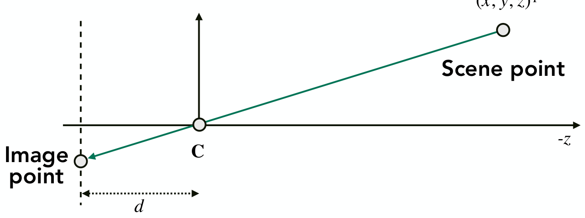

## 第 87 页 · Pinhole Camera Projective Transform

x, y

(x, y, z)T

Image

Scene point

point

-z

C

d

Upright image

## 第 88 页 · Projective Transforms

Standard perspective projection

- Center of projection: (0, 0, 0)T
- Image plane at z = d

x, y

(x,y,z)T

} x

} ?

C

-z

z = d

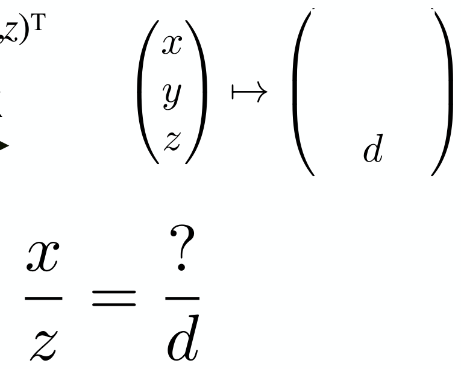

## 第 89 页 · Projective Transforms

Standard perspective projection

- Center of projection: (0, 0, 0)T
- Image plane at z = d

x, y

(x,y,z)T

} x

} ?

C

-z

z = d

$$
\frac{x}{z}=\frac{x'}{d},\qquad (x,y,z)^{\mathsf T}\longmapsto (xd/z,yd/z,d)^{\mathsf T}.
$$

## 第 90 页 · Projective Transforms

Standard perspective projection

- Center of projection: (0, 0, 0)T
- Image plane at z = d

Perspective foreshortening

- Need division by z
- Matrix representation?

(objects shrink in distance, 解释了为什么近大远小)

➡Homogeneous coordinates!

$$
\frac{x}{z}=\frac{x'}{d},\qquad (x,y,z)^{\mathsf T}\longmapsto (xd/z,yd/z,d)^{\mathsf T}.
$$

## 第 91 页 · Homogenous Coordinates (3D)

Note non-zero term in final row.

First time we have seen this.

将物体投影到相机坐标系下的相机投影平面上。

$$
M=\begin{bmatrix}1&0&0&0\\0&1&0&0\\0&0&1&0\\0&0&1/d&0\end{bmatrix},\qquad
M(x,y,z,1)^{\mathsf T}=(x,y,z,z/d)^{\mathsf T}\sim(xd/z,yd/z,d,1)^{\mathsf T}.
$$

## 第 92 页 · Perspective Projection

- In general
    - Similar to orthographic projection that maps a cuboid ([l,r] [b,t] [f,n]) to the “canonical” cube

×

3

[-1,1] , for perspective projection, we want to

maps a frustum to the “canonical” cube [-1,1] , not 2D plane.

## 第 93 页 · Specifying Real Camera Perspectives

## 第 94 页 · Specifying Perspective Projection

From Angel and Shreiner, Interactive Computer Graphics

## 第 95 页 · View Frustum in Camera Space

View frustum is the region the camera can see:

x₈

y

x₄

x₇

x₃

z

θ

x₁

x₅

x₂

x

Pinhole

Camera

(0,0)

x₆

znear

zfar

- Top/bottom/left/right planes correspond to the sides of screen
- Near/far planes correspond to closest/furthest thing we want to draw

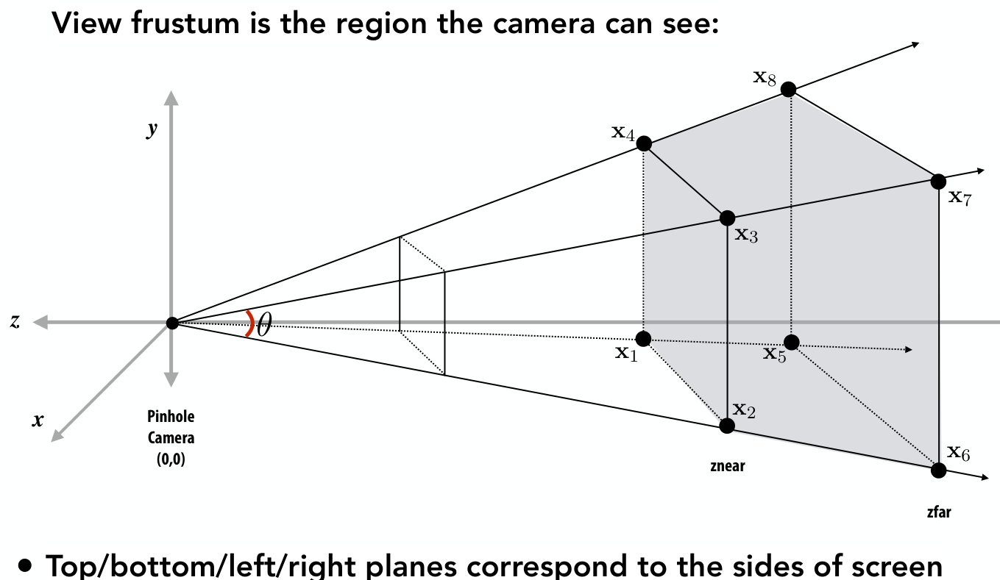

## 第 96 页 · Specifying Perspective Viewing Volume

Parameterized by

| Parameter | Meaning |
| --- | --- |
| fovy | vertical angular field of view |
| aspect ratio | width / height of field of view |
| near | depth of near clipping plane |
| far | depth of far clipping plane |

Derived quantities

$$
t=\mathrm{near}\,\tan(\mathrm{fovy}/2),\quad b=-t,\quad r=t\,\mathrm{aspect},\quad l=-r.
$$

## 第 97 页 · Mapping frustum to cube

Before mapping to 2D, map corners of frustum to corners of cube:

y

x₄

x₈

x₇

x₃

(1,1,1)

z

x₁

(-1,-1,-1)

x₅

θ

x₂

x

znea

x₆

zfar

Camera Coordinates

Normalized Device Coords

“NDC”

Later we will “flatten and scale ” NDC to get framebuffer coordinates

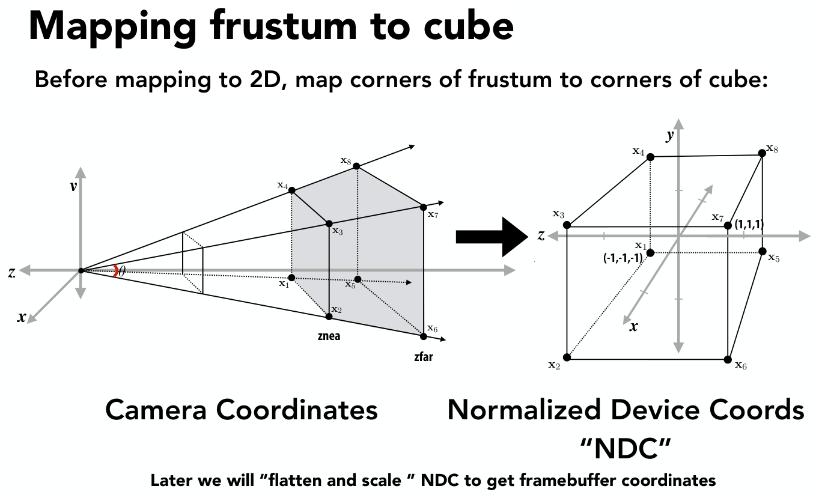

## 第 98 页 · Perspective Projection

- How to do perspective projection
    - First “squish” the frustum into a cuboid ($M_{\mathrm{persp}\to\mathrm{ortho}}$)
    - Do orthographic projection ($M_{\mathrm{ortho}}$)

## 第 99 页 · Perspective Projection

- In order to find a transformation
    - Recall the key idea: Find the relationship between transformed point $(x',y',z')$ and the original point $(x,y,z)$.

$$
y'=\frac{n}{z}y,\qquad x'=\frac{n}{z}x.
$$

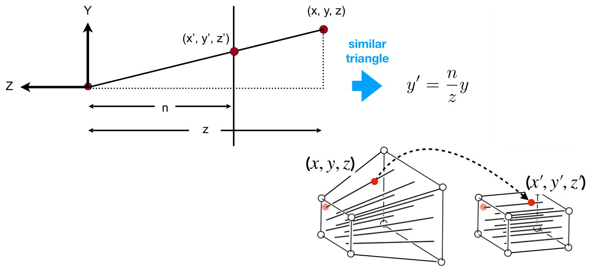

## 第 100 页 · Perspective Projection

- In order to find a transformation
    - Recall the key idea: Find the relationship between transformed point $(x',y',z')$ and the original point $(x,y,z)$.

In homogeneous coordinates, $(nx/z,ny/z,\mathrm{unknown},1)^\mathsf{T}$ is equivalent to $(nx,ny,\mathrm{still\ unknown},z)^\mathsf{T}$.

$$
y'=\frac{n}{z}y,\qquad x'=\frac{n}{z}x.
$$

## 第 101 页 · Perspective Projection

- So the “squish” (persp to ortho) projection does this
- Already good enough to figure out part of Mpersp→ortho

WHY?

$$
M_{\mathrm{persp}\to\mathrm{ortho}}=
\begin{bmatrix}n&0&0&0\\0&n&0&0\\?&?&?&?\\0&0&1&0\end{bmatrix}.
$$

## 第 102 页 · Perspective Projection

- How to figure out the third row of
    - Any information that we can use?

?

- Observation: the third row is responsible for
    - Any point on the near plane will not change
    - Any point on the far plane will not change

(

)

( x′, y′, z′

n

f

$$
M_{\mathrm{persp}\to\mathrm{ortho}}=
\begin{bmatrix}n&0&0&0\\0&n&0&0\\?&?&?&?\\0&0&1&0\end{bmatrix}.
$$

## 第 103 页 · Perspective Projection

- Any point on the near plane will not change

replace

z with n

- So the third row must be the form (0 0 A B)

n2  has nothing

to do with x and y

$$
\begin{bmatrix}0&0&A&B\end{bmatrix}(x,y,n,1)^{\mathsf T}=n^2.
$$

## 第 104 页 · Perspective Projection

- What do we have now?
- Any point’s z on the far plane will not change
    - Similar to near plane

$$
An+B=n^2,\qquad Af+B=f^2.
$$

## 第 105 页 · Perspective Projection

- Solve for A and B.
- Finally, every entry in $M_{\mathrm{persp}\to\mathrm{ortho}}$ is known!

$$
A=n+f,\qquad B=-nf.
$$

$$
M_{\mathrm{persp}\to\mathrm{ortho}}=
\begin{bmatrix}n&0&0&0\\0&n&0&0\\0&0&n+f&-nf\\0&0&1&0\end{bmatrix}.
$$

## 第 106 页 · Matrix for Perspective Transform

- What’s next?
    - Do orthographic projection ($M_{\mathrm{ortho}}$) to finish

$$
M_{\mathrm{persp}}=M_{\mathrm{ortho}}M_{\mathrm{persp}\to\mathrm{ortho}}
=\begin{bmatrix}
\frac{2n}{r-l}&0&\frac{r+l}{r-l}&0\\
0&\frac{2n}{t-b}&\frac{t+b}{t-b}&0\\
0&0&-\frac{f+n}{f-n}&-\frac{2fn}{f-n}\\
0&0&-1&0
\end{bmatrix}.
$$

## 第 107 页 · Matrix for Perspective Transform

What does this do to z-values?

- 当 $z'=1$ 时，$z=-n$，此时点刚好位于视锥体的近平面处。
- 当 $z'=-1$ 时，$z=-f$，此时点刚好位于视锥体的远平面处。
- 图中可见 $z'$ 与 $z$ 是非线性关系。
- 透视变换不是线性变换！

(Why are these z values negative?)

$$
z'=\frac{f+n}{f-n}+\frac{1}{z}\frac{2fn}{f-n}.
$$

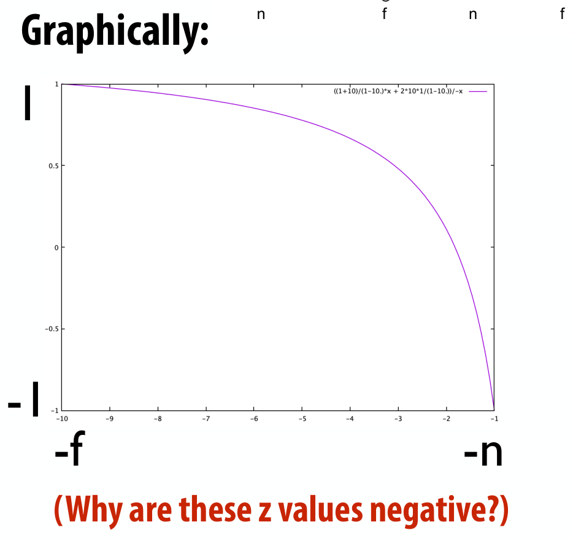

## 第 108 页 · Overview of Transforms

View

transformation

Projection

Viewport

The sequence of spaces and transformations that gets objects

from their original coordinates into screen space.

## 第 109 页 · Canonical Cube to Screen

- What is a screen?
    - An array of pixels
    - Size of the array: resolution
    - A typical kind of raster display
- Raster == screen in German
    - Rasterize == drawing on the screen
- Pixel (FYI, short for “picture element”)
    - For now: A pixel is a little square with uniform color
    - Color is a mixture of (red, green, blue)

## 第 110 页 · Canonical Cube to Screen

- Defining the screen space
    - Slightly different from the “tiger book”

Y

array of pixels

- Pixels’ indices are in the form of (x,y), where both x and y are integers
- Pixels’ indices are from (0,0) to (width-1, height-1)
- Pixel (x,y) is centered at (x+0.5, y+0.5)
- The screen covers range from (0,0) to (width, height)

(0, 0)

X

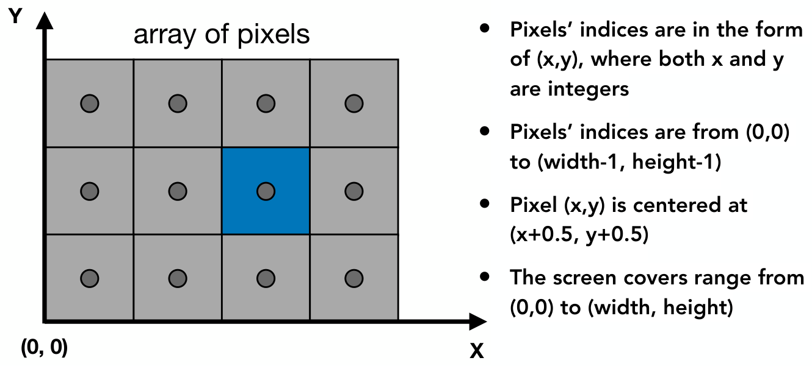

## 第 111 页 · Canonical Cube to Screen

- Irrelevant to z
- Transform in xy plane: $[-1,1]^2$ to $[0,\mathrm{width}]\times[0,\mathrm{height}]$

## 第 112 页 · Canonical Cube to Screen

- Irrelevant to z
- Transform in xy plane: $[-1,1]^2$ to $[0,\mathrm{width}]\times[0,\mathrm{height}]$
- View port transform matrix

$$
M_{\mathrm{viewport}}=
\begin{bmatrix}w/2&0&0&w/2\\0&h/2&0&h/2\\0&0&1&0\\0&0&0&1\end{bmatrix}.
$$

## 第 113 页 · Transforms Recap

Coordinate Systems

- Object coordinates
    - Apply modeling transforms…
- World (scene) coordinates
    - Apply viewing transform…
- Camera (eye) coordinates
    - Apply perspective transform + homog. divide…
- Normalized device coordinates
    - Apply 2D screen transform…
- Screen coordinates

## 第 114 页 · Transforms Recap

Modeling

transforms

Object coords

World coords

## 第 115 页 · Transforms Recap

Viewing

transform

World coords

Camera coords

## 第 116 页 · Transforms Recap

(1, 1, 1)

Perspective

projection

and

homogeneous

(–1, –1, –1)

divide

Camera coords

NDC

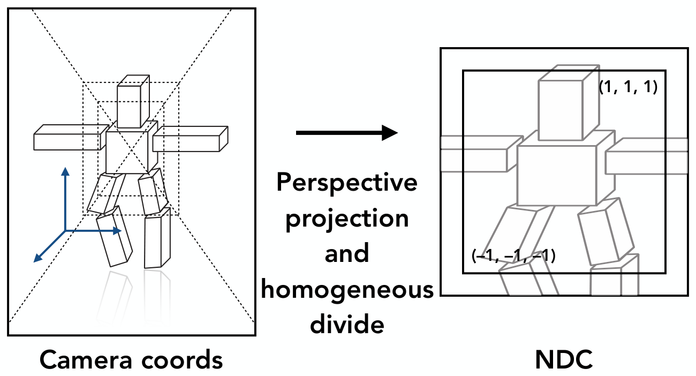

## 第 117 页 · Transforms Recap

(w, h)

(1, 1, 1)

Screen

transform

(–1, –1, –1)

(0, 0)

NDC

Screen coords

## 第 118 页 · Transforms Recap

(w, h)

Rasterization

(0, 0)

Screen coords
