# Lecture 5 · Shading

原课件共 88 页。[打开 PDF](../../ppt/lec-05-shading.pdf)

按 PDF 页序提取，保留课件原有中英文。关键公式以 Markdown 数学式或原页局部图呈现。

## 第 1 页 · Shading

Computer Graphics 2026 Fuzhou University - Computer Science

## 第 2 页 · The Rasterization Pipeline

- Rough sketch of rasterization pipeline:

1. Transform/position objects in the world
2. Project objects onto the screen
3. Sample triangle coverage
4. Interpolate triangle attributes at covered samples
5. Sample texture maps / evaluate shaders
6. Combine samples into final image (depth, alpha, …)

## 第 3 页 · Today’s Topics

Visibility/Occlusion (Z-Buffering)

Barycentric Coordinates

Shading

## 第 4 页 · Visibility

## 第 5 页 · Which triangle is visible at each covered sample point?

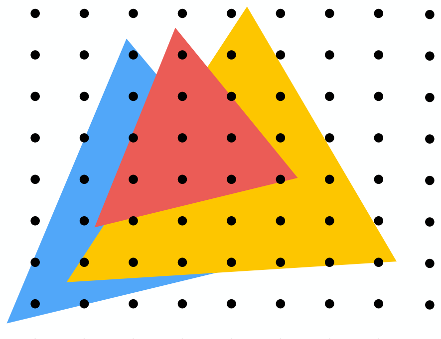

## 第 6 页 · Painter’s Algorithm

Inspired by how painters paint

Paint from back to front, overwrite in the framebuffer

[Wikipedia]

## 第 7 页 · Painter’s Algorithm

文字同第 6 页。

## 第 8 页 · Painter’s Algorithm

文字同第 6 页。

## 第 9 页 · Painter’s Algorithm

文字同第 6 页。

## 第 10 页 · Painter’s Algorithm

文字同第 6 页。

## 第 11 页 · Painter’s Algorithm

文字同第 6 页。

## 第 12 页 · Painter’s Algorithm

文字同第 6 页。

## 第 13 页 · Painter’s Algorithm

文字同第 6 页。

## 第 14 页 · Painter’s Algorithm

文字同第 6 页。

## 第 15 页 · Painter’s Algorithm

文字同第 6 页。

## 第 16 页 · Painter’s Algorithm

文字同第 6 页。

## 第 17 页 · Painter’s Algorithm

Requires sorting in depth (O(n log n) for n triangles)

Can have unresolvable depth order

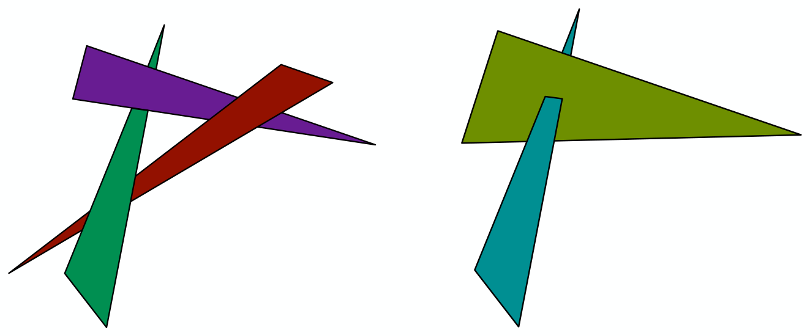

## 第 18 页 · Triangle Coordinates with Depths

Assume we have a triangle given by:

- The projected 2D coordinates ( xᵢ, yᵢ

) of each vertex

dᵢ

- The “depth”  of each vertex (distance from the viewer)

screen

Q: How do we compute the depth  at a given sample point ( x, y

d

)?

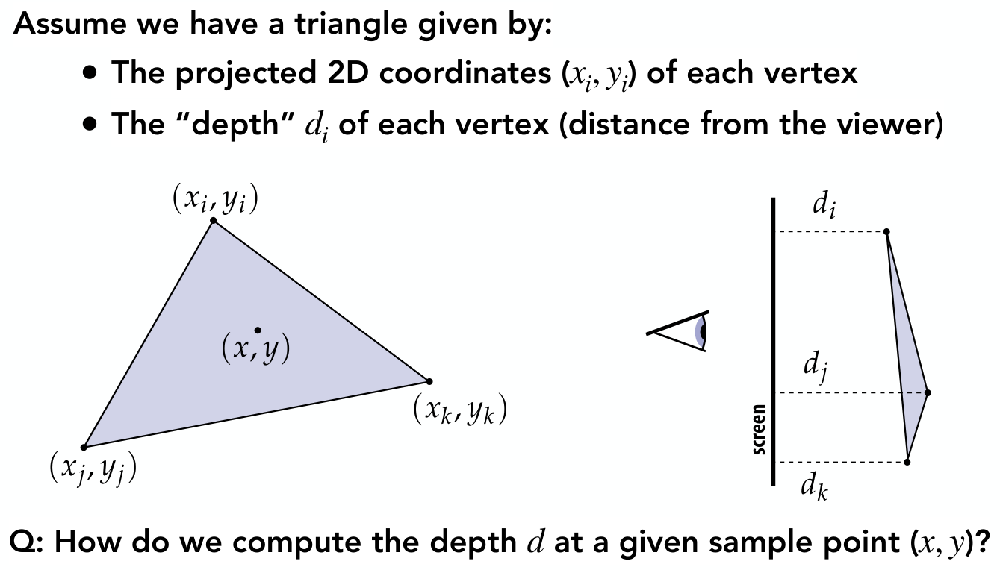

## 第 19 页 · Z-buffer

深度缓冲

计算并记录每个采样点的深度值

Idea:

- Store current min. z-value for each sample position
- Needs an additional buffer for depth values
- framebuffer stores RBG color values
- depth buffer (z-buffer) stores depth (16 to 32 bits)

## 第 20 页 · Z-Buffer Example

Image source: Dominic Alves, flickr.

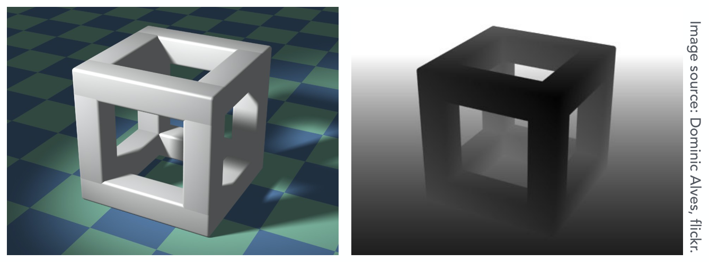

## 第 21 页 · Z-Buffer Algorithm

Initialize depth buffer to ∞

During rasterization:

```text
for (each triangle T)
  for (each sample (x,y,z) in T)
    if (z < zbuffer[x,y])       // closest sample so far
       framebuffer[x,y] = rgb;  // update color
       zbuffer[x,y]     = z;    // update z
    else
       ;    // do nothing, this sample is not closest
```

## 第 22 页 · Z-Buffer Algorithm

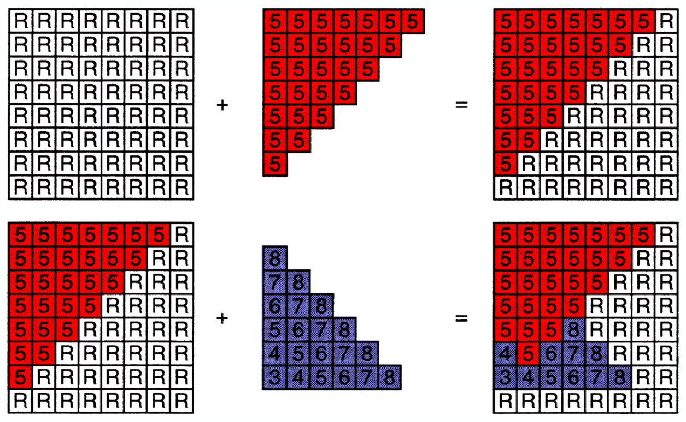

## 第 23 页 · Z-Buffer Complexity

Complexity

- O(n) for n triangles
- How can we sort n triangles in linear time?

(Counting sort)

Drawing triangles in different orders?

Most important visibility algorithm

- Implemented in hardware for all GPUs
- Used by OpenGL

## 第 24 页 · Z-buffer can handle interpenetrating triangles

Green triangle in front of yellow triangle

Yellow triangle in front of green triangle

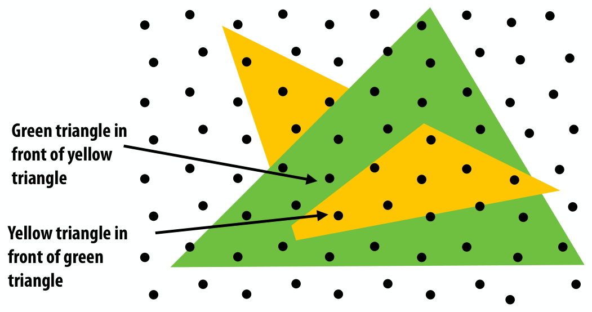

## 第 25 页 · Does Z-buffer work with super sampling?

Yes! Occlusion test is per sample, not per pixel.

## 第 26 页 · Z-buffer And Super Sampling

## 第 27 页 · Z-buffer And Super Sampling

Note anti-aliasing of edge due to filtering of green and yellow samples.

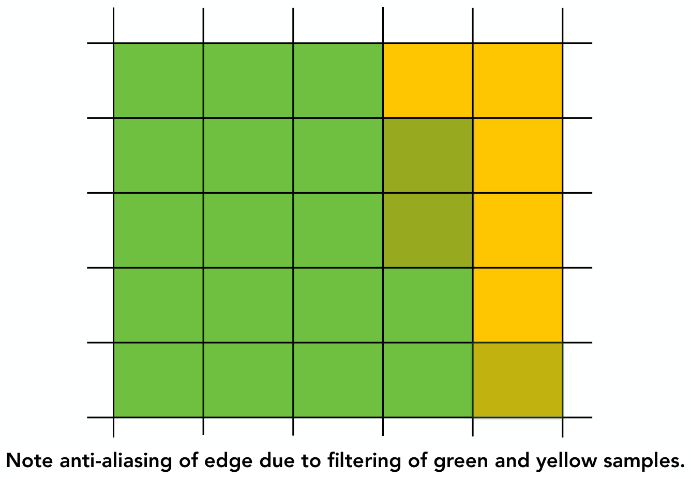

## 第 28 页 · How to Compute Depth?

Before mapping to 2D, map corners of frustum to corners of cube:

y

x₄

x₈

x₇

x₃

(1,1,1)

z

x₁

(-1,-1,-1)

x₅

θ

x₂

x

znea

x₆

zfar

Camera Coordinates

Normalized Device Coords

“NDC”

Z-value is preserved after projection

## 第 29 页 · Recall Z-value Computation

z-value are the same

z-value are different

$$
z'=\frac{f+n}{f-n}+\frac{1}{z}\frac{2fn}{f-n}.
$$

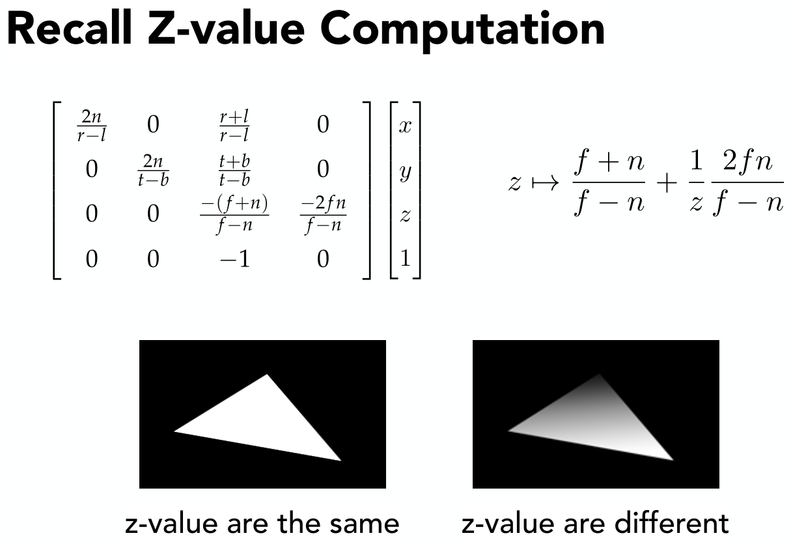

## 第 30 页 · Z-value Computation

1. Compute for all samples
2. or interpolation between triangle vertices

$$
z'=\frac{f+n}{f-n}+\frac{1}{z}\frac{2fn}{f-n}.
$$

## 第 31 页 · Today’s Topics

Visibility/Occlusion (Z-Buffering)

Barycentric Coordinates

Shading

## 第 32 页 · Interpolation Across Triangles

Why do we want to interpolate?

- Specify values (e.g. texture coordinates) at vertices, and obtain smoothly varying values across surface

C

Interpolate from f(A), f(B), f(C)

to get f(x, y)?

B

What do we want to interpolate?

A

- Texture coordinates, colors, normal vectors, …

How do we interpolate?

- Barycentric coordinates

## 第 33 页 · Barycentric Coordinates

A coordinate system for triangles

Inside the triangle if all three coordinates are non-negative

$$
P=(x,y)=\alpha A+\beta B+\gamma C,\qquad \alpha+\beta+\gamma=1.
$$

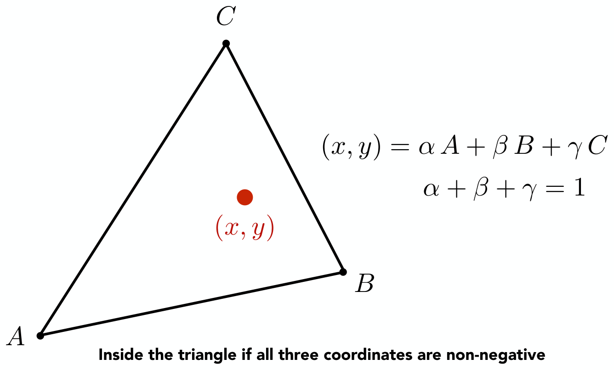

## 第 34 页 · Barycentric Coordinates Derivation

可看成由

两个向量

组成的坐标系下的点的坐标， 其仅有两个维度（自由度）

$$
P=(x,y)=\alpha A+\beta B+\gamma C,\qquad \alpha+\beta+\gamma=1.
$$

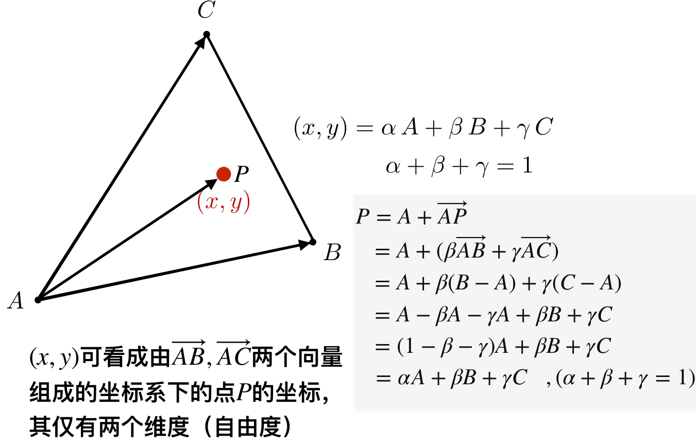

## 第 35 页 · Barycentric Coordinates - Examples

$$
(\alpha,\beta,\gamma)=(1,0,0),\qquad P=A.
$$

## 第 36 页 · Understanding Barycentric Coordinates

Center of mass!

## 第 37 页 · Understanding Barycentric Coordinates

文字同第 36 页。

## 第 38 页 · Barycentric Coordinate Formulas

$$
\alpha=\frac{-(x-x_B)(y_C-y_B)+(y-y_B)(x_C-x_B)}{-(x_A-x_B)(y_C-y_B)+(y_A-y_B)(x_C-x_B)},
$$

$$
\beta=\frac{-(x-x_C)(y_A-y_C)+(y-y_C)(x_A-x_C)}{-(x_B-x_C)(y_A-y_C)+(y_B-y_C)(x_A-x_C)},\quad \gamma=1-\alpha-\beta.
$$

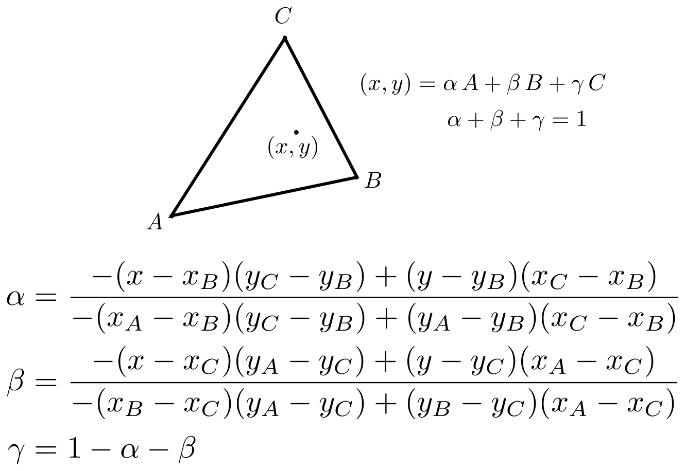

## 第 39 页 · Barycentric Coordinate Formulas

Derivation:

## 第 40 页 · Barycentric Coordinates

How to Compute α, β, γ?

Geometric viewpoint — proportional distances

C

Similar construction for other coordinates

α

(1 −α)

B

A

## 第 41 页 · Computing Barycentric Coordinates

Recall the line equation we derived in Lecture 2.

LPQ(x,y) is proportional to the distance from line PQ.

L\_{P Q}(x, y) = −(x −x\_P )(y\_Q −y\_P ) + (y −y\_P )(x\_Q −x\_P )

Q

(x, y)

}

P

## 第 42 页 · Computing Barycentric Coordinates

Geometric viewpoint — proportional distances

Similar construction for other coordinates

$$
\alpha=\frac{L_{BC}(x,y)}{L_{BC}(x_A,y_A)}.
$$

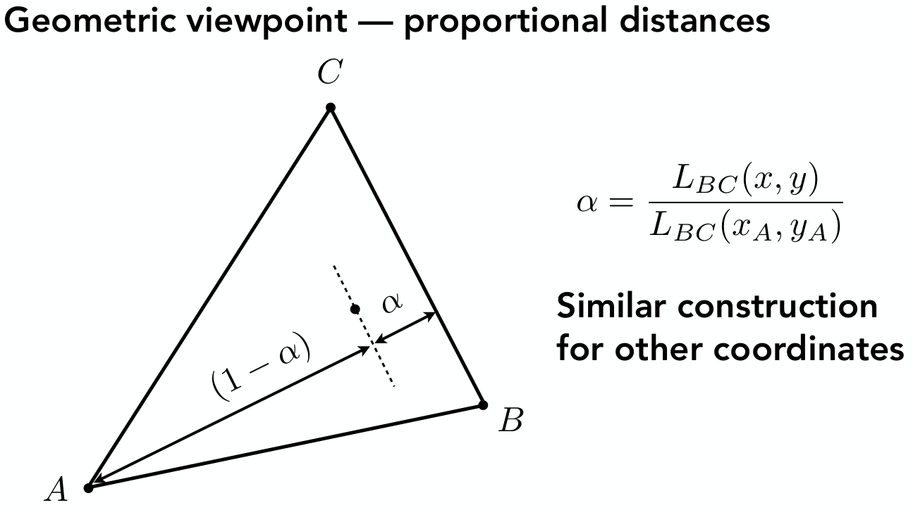

## 第 43 页 · Barycentric Coordinates

How to Compute

?  Proportional Areas!

$$
(\alpha,\beta,\gamma)=\frac{(A_A,A_B,A_C)}{A_A+A_B+A_C},\qquad A_A=\frac12\left\|\overrightarrow{PB}\times\overrightarrow{PC}\right\|.
$$

## 第 44 页 · Barycentric Coordinates

How to compute triangle areas? Cross Product!

$$
(\alpha,\beta,\gamma)=\frac{(A_A,A_B,A_C)}{A_A+A_B+A_C},\qquad A_A=\frac12\left\|\overrightarrow{PB}\times\overrightarrow{PC}\right\|.
$$

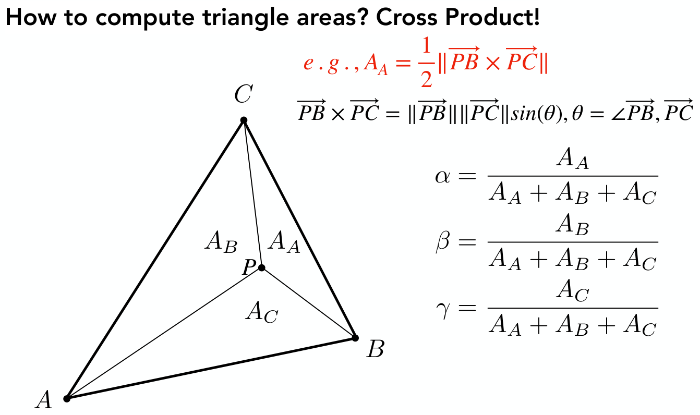

## 第 45 页 · Perspective Projection and Interpolation

## 第 46 页 · Recall Perspective Transform

透视变换不是线性变换

Graphically:

1

In equation form:

-1

-f

-n

$$
z'=\frac{f+n}{f-n}+\frac{1}{z}\frac{2fn}{f-n}.
$$

## 第 47 页 · Perspective Projection and Interpolation

What’s wrong?

Correct

Interpolate after projection

Interpolate before projection

Image Function

Plane tilted down with perspective projection

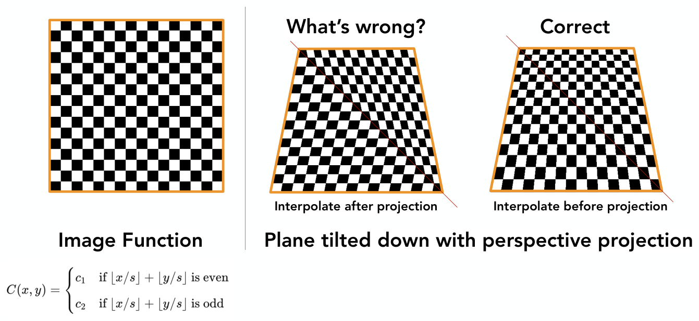

## 第 48 页 · Perspective Projection Creates Non Linearity

Linear interpolation in world coordinates yields nonlinear interpolation in screen coordinates!

Image

plane

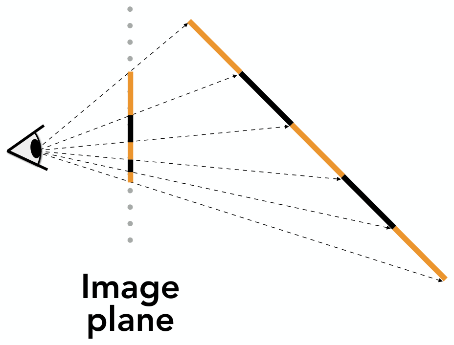

## 第 49 页 · Perspective-Correct Interpolation

以 $y$ 坐标为例，由透视变换得到 $y'=(n/z)y$。屏幕空间线性插值用 $\alpha$，三维空间线性插值用 $\beta$。

接下来计算 $\alpha,\beta$ 之间的关系（屏幕空间的插值转换成原三维空间的插值）。课件依次展开 $y'_P$，代入 $y'_A,y'_B$，再代入 $z_P$ 的线性插值。

$$
y'=\frac{n}{z}y,\qquad
y'_P=\alpha y'_A+(1-\alpha)y'_B,\qquad
y_P=\beta y_A+(1-\beta)y_B.
$$

课件给出的最后一步

$$
\beta=\frac{(1-\alpha)z_A}{z_B+(1-\alpha)(z_A-z_B)}.
$$

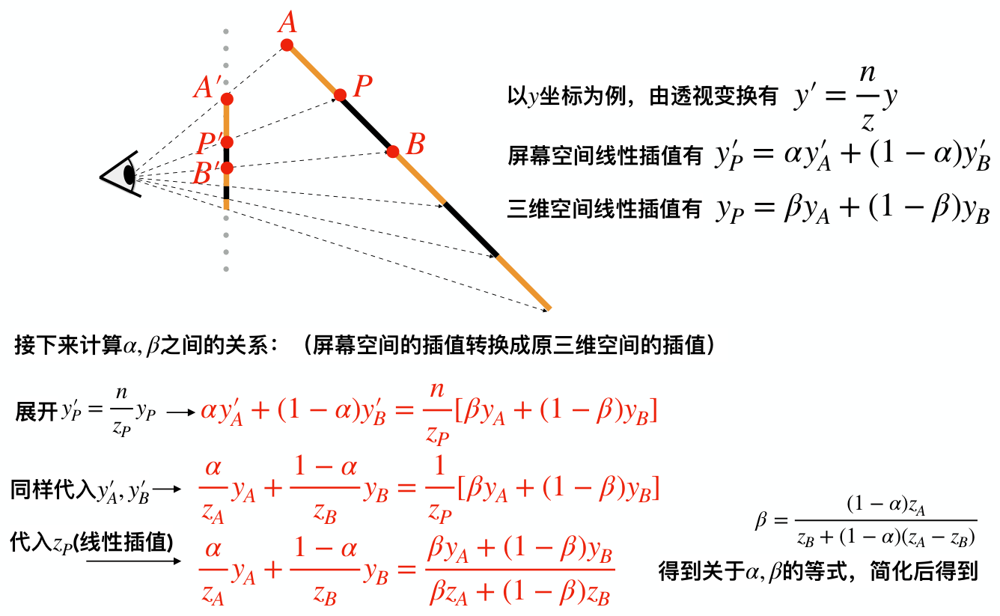

## 第 50 页 · Linear Interpolation Across Triangle

Barycentric coords linearly interpolate values at vertices

VA, VB, VC can be positions, texture coordinates, color, normal vectors, material attributes…

$$
V=\alpha V_A+\beta V_B+\gamma V_C.
$$

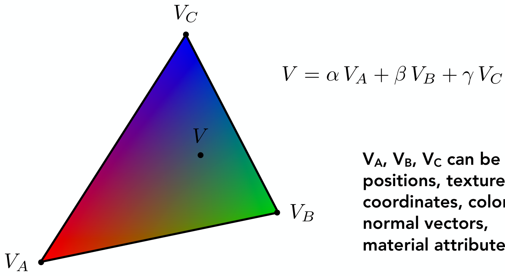

## 第 51 页 · Today’s Topics

Visibility/Occlusion (Z-Buffering)

Barycentric Coordinates

Shading

## 第 52 页 · What We’ve Covered So Far

1. Transform/position objects in the world
2. Project objects onto the screen
3. Sample triangle coverage
4. Interpolate triangle attributes at covered samples
5. Sample texture maps / evaluate shaders
6. Combine samples into final image (depth, alpha, …)

## 第 53 页 · Rotating Cubes in Perspective

## 第 54 页 · Rotating Cubes in Perspective

文字同第 53 页。

## 第 55 页 · What Else Are We Missing?

Credit: Bertrand Benoit. “Sweet Feast,” 2009. [Blender /VRay]

## 第 56 页 · Shading: Definition

In Merriam-Webster Dictionary

In this course

The process of applying a material to an object.

## 第 57 页 · Simple Shading vs Realistic Lighting & Materials

What we will cover today

- A local shading model: simple, per-pixel, fast
- Based on perceptual observations, not physics

What we will cover later in the course

- Physics-based lighting and material representations
- Global light transport simulation

## 第 58 页 · Simple Shading (Blinn-Phong Reflection Model)

## 第 59 页 · Perceptual Observations

Specular highlights

Diffuse reflection

Ambient lighting

Photo credit: Jessica Andrews, flickr

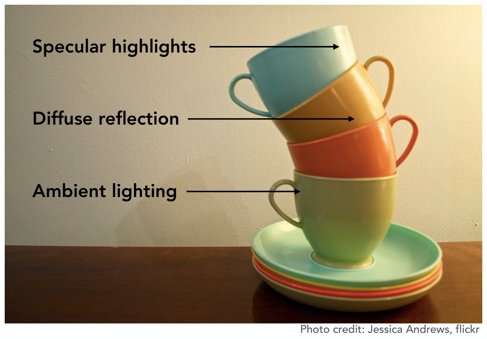

## 第 60 页 · Local Shading

Compute light reflected toward camera

Inputs:

Unit length (normalized) vectors!!!

- Viewer direction, v
- Surface normal, n
- Light direction, l (for each of many lights)
- Surface parameters (color, shininess, …)

n

l

v

## 第 61 页 · Diffuse Reflection

- Light is scattered uniformly in all directions
    - Surface color is the same for all viewing directions

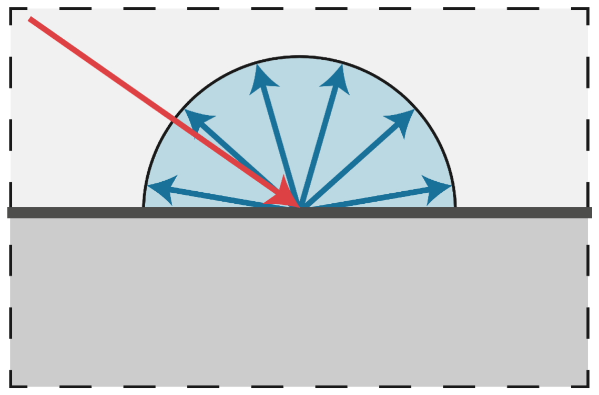

## 第 62 页 · Diffuse Reflection

Light is scattered uniformly in all directions

- Surface color is the same for all viewing directions

Lambert’s cosine law

l

n

Q

Top face of cube

receives a certain

Top face of

60º rotated cube

intercepts half the light

In general, light per unit

area is proportional to

amount of light

cos θ = l • n

How much light (energy) is received at a shading point?

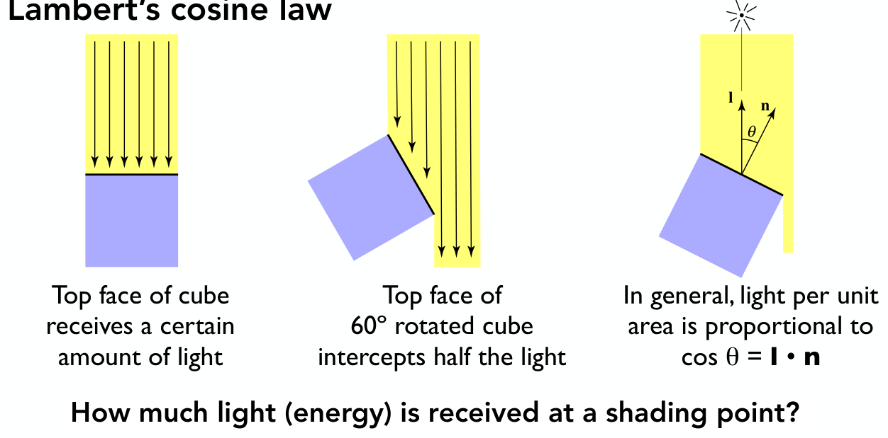

## 第 63 页 · Light Falloff

intensity

here: I/r2

r

1

here: I

## 第 64 页 · Falloff

Physically correct:          light intensify falloff

- Tends to look bad with local shading (why?)

1/r2

Sometimes compromise of        used.

1/r

Very important to use          for correct global illumination methods.

## 第 65 页 · Lambertian (Diffuse) Shading

Shading independent of view direction

illumination

from source

n

l

v

diffuse

coefficient

diffusely

reflected

light

$$
L_d=k_d(I/r^2)\max(0,\mathbf n\cdot\mathbf l).
$$

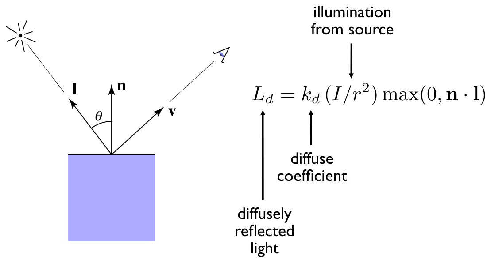

## 第 66 页 · Lambertian (Diffuse) Shading

Produces matte appearance

[Foley et al.]

k\_d

## 第 67 页 · Perceptual Observations

Specular highlights

Diffuse reflection

Ambient lighting

Photo credit: Jessica Andrews, flickr

## 第 68 页 · Specular Shading (Blinn-Phong)

Intensity depends on view direction

- Bright near mirror reflection direction

n

l

v

## 第 69 页 · Specular Shading (Blinn-Phong)

Intensity depends on view direction

- Bright near mirror reflection direction

n

θ

l

v

Intensity decreased by cos θ , similar to Diffuse Shading

## 第 70 页 · Specular Shading (Blinn-Phong)

Close to mirror direction ⇔ half vector near normal

- Measure “near” by dot product of unit vectors

n

h

l

v

specularly

reflected

light

coefficient

specular

$$
\mathbf h=\frac{\mathbf v+\mathbf l}{\lVert\mathbf v+\mathbf l\rVert},\qquad
L_s=k_s(I/r^2)\max(0,\mathbf n\cdot\mathbf h)^p.
$$

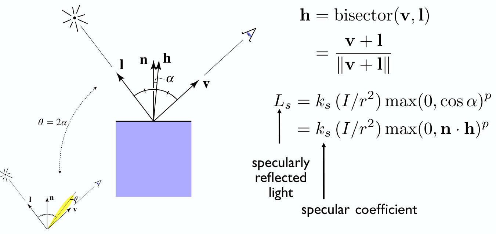

## 第 71 页 · Specular Shading (Blinn-Phong)

Close to mirror direction ⇔ half vector near normal

- Measure “near” by dot product of unit vectors

n

h

l

v

specularly

reflected

light

specular

coefficient

$$
\mathbf h=\frac{\mathbf v+\mathbf l}{\lVert\mathbf v+\mathbf l\rVert},\qquad
L_s=k_s(I/r^2)\max(0,\mathbf n\cdot\mathbf h)^p.
$$

## 第 72 页 · Cosine Power Plots

Increasing p narrows the reflection lobe

[Foley et al.]

n=1

n=2

n=8

n=64

## 第 73 页 · Specular Shading (Blinn-Phong)

n=1

n=2

n=4

n=8

n=16

n=32

n=64

n=128

n=256

## 第 74 页 · Specular Shading (Blinn-Phong)

[Foley et al.]

$$
\mathbf h=\frac{\mathbf v+\mathbf l}{\lVert\mathbf v+\mathbf l\rVert},\qquad
L_s=k_s(I/r^2)\max(0,\mathbf n\cdot\mathbf h)^p.
$$

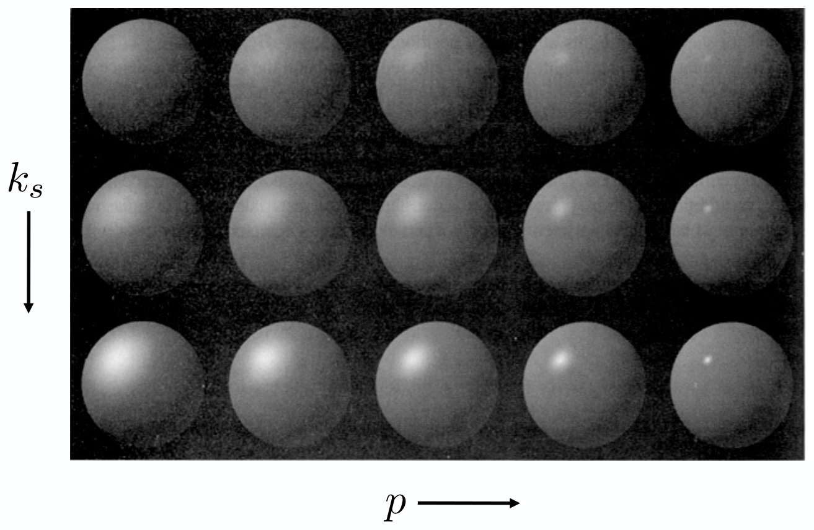

## 第 75 页 · Perceptual Observations

Specular highlights

Diffuse reflection

Ambient lighting

Photo credit: Jessica Andrews, flickr

## 第 76 页 · Ambient Shading

Shading that does not depend on anything

- Add constant color to account for disregarded illumination and fill in black shadows

ambient

coefficient

reflected

light

$$
L_a=k_a I_a.
$$

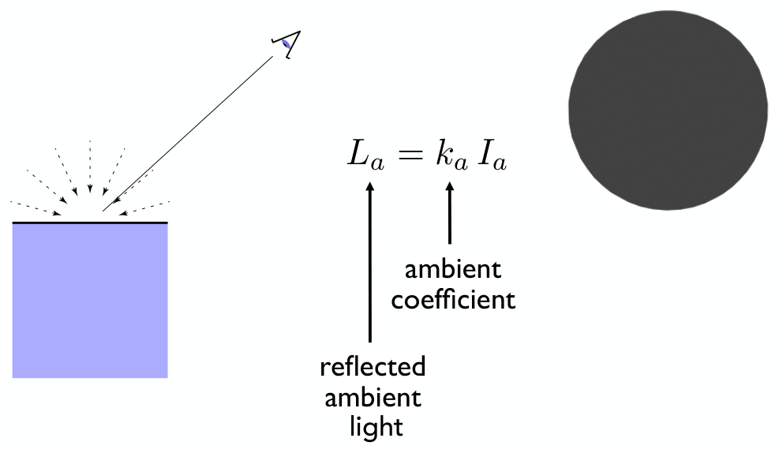

## 第 77 页 · Blinn-Phong Reflection Model

Ambient

+

Diffuse

Specular

=

Phong Reflection

$$
L=L_a+L_d+L_s=k_a I_a+k_d(I/r^2)\max(0,\mathbf n\cdot\mathbf l)+k_s(I/r^2)\max(0,\mathbf n\cdot\mathbf h)^p.
$$

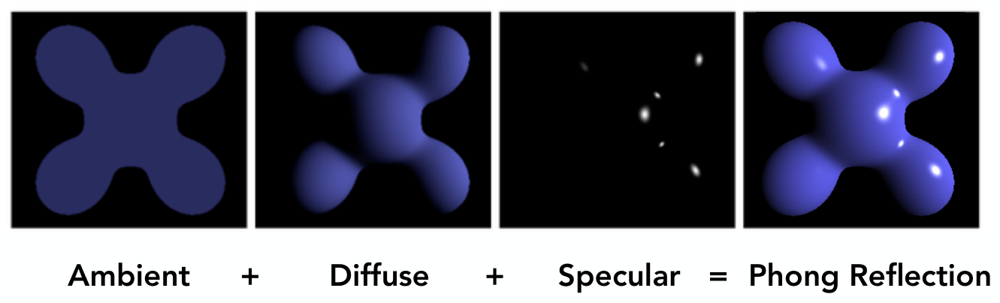

## 第 78 页 · Shading Triangle Meshes

## 第 79 页 · Shading Frequency: Triangle, Vertex or Pixel

## 第 80 页 · Shading Frequency: Triangle, Vertex or Pixel

Shade each triangle (flat shading)

- Triangle face is flat — one normal vector
- Not good for smooth surfaces

Shade each vertex (“Gouraud” shading)

- Interpolate colors from vertices across triangle
- Each vertex has a normal vector

Shade each pixel (“Phong” shading)

- Interpolate normal vectors across each triangle
- Compute full shading model at each pixel

## 第 81 页 · Shade each triangle (Flat shading)

- Flat shading
    - Triangle face is flat — one normal vector
    - Not good for smooth surfaces

## 第 82 页 · Shade each vertex (Gouraud shading)

- Gouraud shading
    - Interpolate colors from vertices across triangle
    - Each vertex has a normal vector (how?)

## 第 83 页 · Shade each pixel (Phong shading)

- Phong shading
    - Interpolate normal vectors across each triangle
    - Compute full shading model at each pixel
    - Not the Blinn-Phong Reflectance Model

## 第 84 页 · Shading Frequency: Face, Vertex or Pixel

Num

Vertices

Shading freq. :

Pixel

Shading type :

Phong (\*)

Face

Vertex

Gouraud

Flat

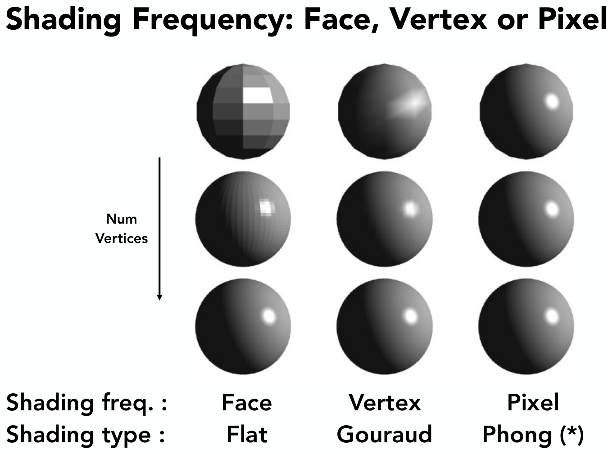

## 第 85 页 · Defining Per-Vertex Normal Vectors

Best to get vertex normals from the underlying geometry

- e.g. consider a sphere

## 第 86 页 · Defining Per-Vertex Normal Vectors

Best to get vertex normals from the underlying geometry

- e.g. consider a sphere

Otherwise have to infer vertex normals from triangle faces

- Simple scheme: average surrounding face normals

$$
N_v=\frac{\sum_i N_i}{\lVert\sum_i N_i\rVert}.
$$

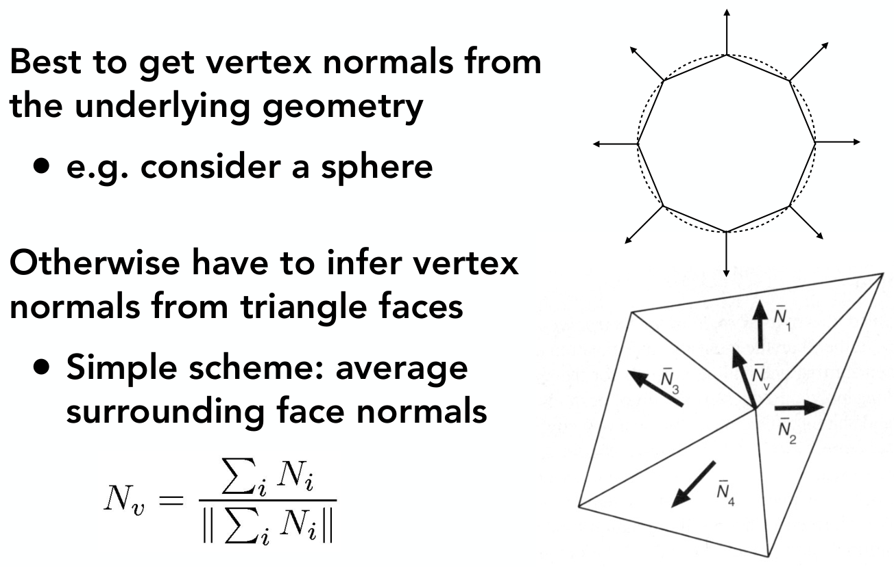

## 第 87 页 · Defining Per-Pixel Normal Vectors

Barycentric interpolation of vertex normals

Problem: length of vectors?

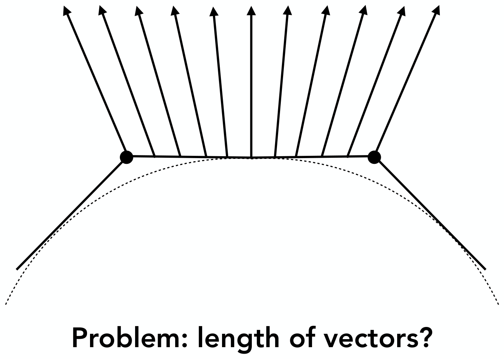

## 第 88 页 · Things to Remember

Visibility

- Painter’s algorithm and Z-Buffer algorithm

Simple Shading Model

- Key geometry: lighting, viewing & normal vectors
- Ambient, diffuse & specular reflection functions
- Shading frequency: triangle, vertex or fragment

Barycentric coordinates

- Interpolation across triangles
