# Lecture 6 · Texture Mapping

原课件共 93 页。[打开 PDF](../../ppt/lec-06-texture-mapping.pdf)

按 PDF 页序提取，保留课件原有中英文。关键公式以 Markdown 数学式或原页局部图呈现。

## 第 1 页 · Texture Mapping

Computer Graphics 2026 Fuzhou University - Computer Science

## 第 2 页 · What We’ve Covered So Far

1. Transform/position objects in the world
2. Project objects onto the screen
3. Sample triangle coverage
4. Interpolate triangle attributes at covered samples
5. Sample texture maps / evaluate shaders
6. Combine samples into final image (depth, alpha, …)

## 第 3 页 · Today’s Topics

What is Texture Mapping?

Applying Textures

Texture Filtering

## 第 4 页 · Drawing Surface with Complex Details

k\_d (I/r²) max(0, n · l)

Pattern on ball

Wood grain on floor

## 第 5 页 · Texture Coordinate Mappings

## 第 6 页 · Think Chocolate Wrappers

Texture image

## 第 7 页 · Surfaces are 2D

三维物体的表面是二维的（可

撕扯、摊开成二维图像）

Surface lives in 3D world space

Every 3D surface point also has a place where it goes in the 2D image and in the 2D texture.

π

ɸ

y

x

ys

v

xs

z

u

Screen space

World space

Texture space

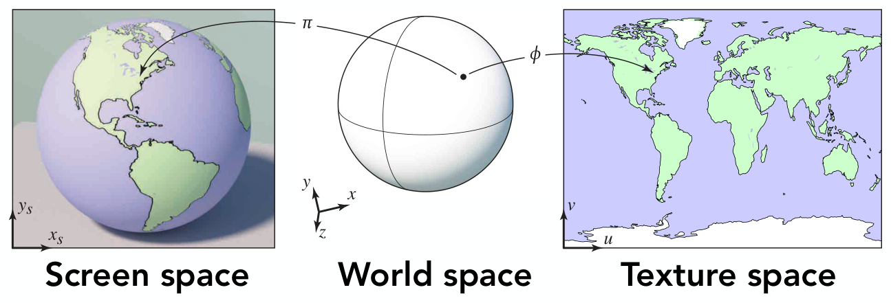

## 第 8 页 · Texture Applied to Surface

Rendering without texture

Rendering with texture

Texture image

Zoom

Each triangle “copies” a piece of the texture image back to the surface.

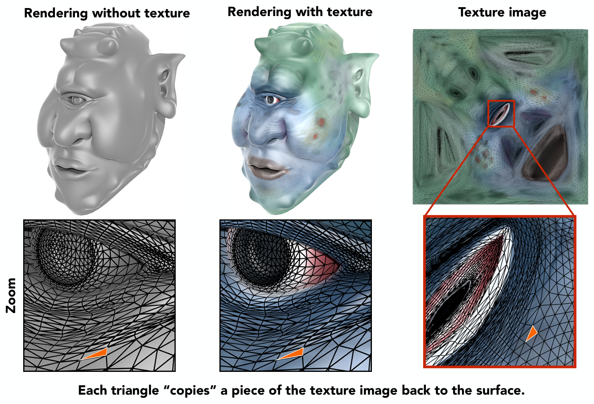

## 第 9 页 · Visualization of Texture Coordinates

Each surface point is assigned a texture coordinate (u,v)

Triangle vertices in texture space

v

Visualization of texture coordinates

u

## 第 10 页 · Image Texture Applied to Surface

Each surface point is assigned a texture coordinate (u,v)

Rendered result

Triangle vertices in texture space

v

u

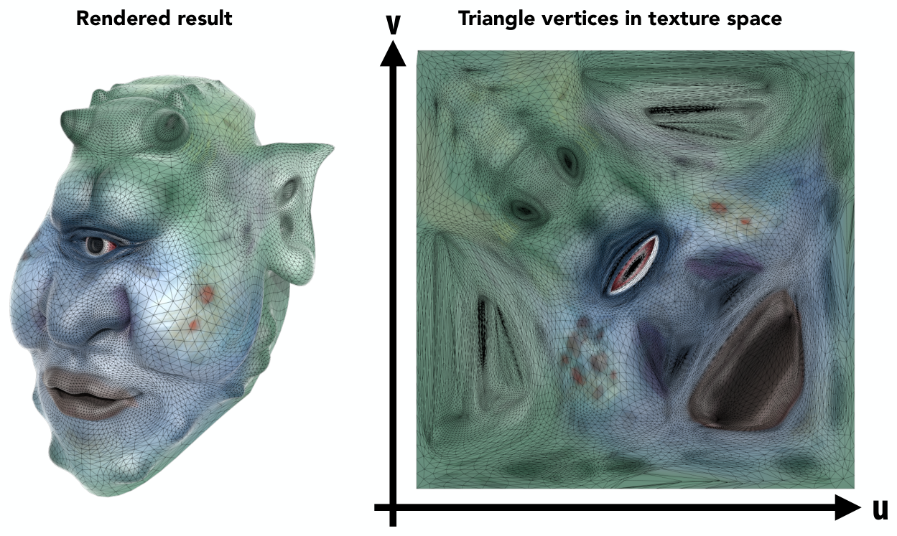

## 第 11 页 · Sponza Palace Model

Textures applied to surfaces

## 第 12 页 · Sponza Palace Model

Visualization of texture coordinates

## 第 13 页 · UV Unwrapping

Before a texture image is mapped onto the surface of a 3D object, UV unwrapping is required to flatten the surface into 2D space, and generate UV coordinates for each vertex of the object.

https://www.youtube.com/watch?v=-sPGZprp5JU

## 第 14 页 · Creating Good Surface Coordinates is Hard

Finding cuts

Texture atlases

Levy et al: Least Squares Conformal Maps

for Automatic Texture Atlas Generation, SIGGRAPH, 2002

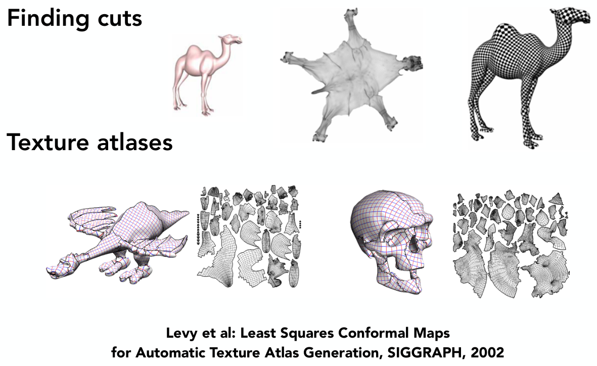

## 第 15 页

曲面参数化

参考GAMES301课程

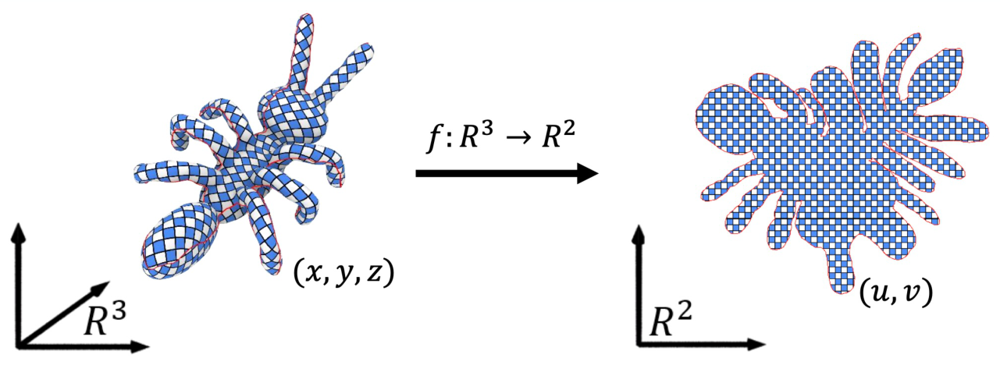

## 第 16 页 · Today’s Topics

What is Texture Mapping?

Applying Textures

Texture Filtering

## 第 17 页 · Simple Texture Mapping Operation

(x, y)

(u, v)

## 第 18 页 · Simple Texture Mapping Operation

for each rasterized screen sample (x,y):

(u,v) = evaluate texcoord value at (x,y)

float3 texcolor = texture.sample(u,v);

Interpolation

using barycentric

set sample’s color to texcolor;

coordinates!

Usually the diffuse coefficient k\_d

对纹理图像

(recall the Blinn-Phong reflectance model)

进行采样

## 第 19 页 · Point Sampling Textures

Moire

Jaggies

High-res reference

Point sampling

Source image: 1280x1280 pixels

256x256 pixels

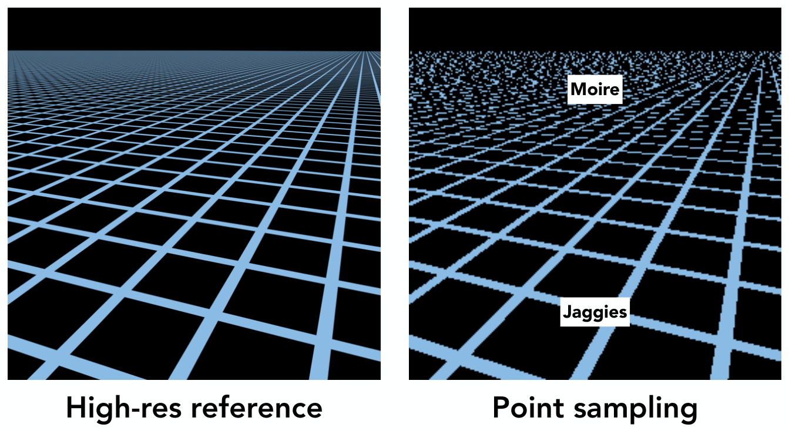

## 第 20 页 · Sampling Rate on Screen vs Texture

600 pixels

像素

纹素

Screen space (x,y)

Texture space (u,v)

1:1 mapping

## 第 21 页 · Sampling Rate on Screen vs Texture

600 pixels

Screen space (x,y)

Texture space (u,v)

Magnified

## 第 22 页 · Sampling Rate on Screen vs Texture

600 pixels

Screen space (x,y)

Texture space (u,v)

“Minified”

## 第 23 页 · Screen Pixel Area vs Texel Area

At optimal viewing size:

- 1:1 mapping between pixel sampling rate and texel sampling rate
- Dependent on texture resolution!  e.g. 512x512

When larger (magnification)

- Multiple pixel samples per texel sample

When smaller (minification)

- One pixel sample per multiple texel samples

## 第 24 页 · Screen Pixel Footprint in Texture

Screen space

Texture space

NB: texture sampling pattern not rectilinear or isotropic

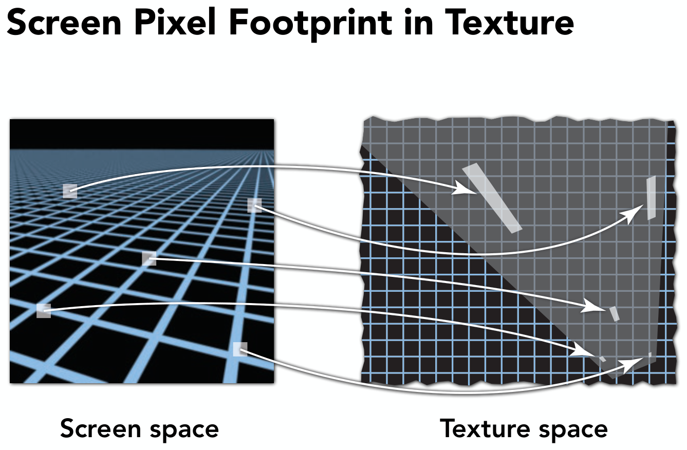

## 第 25 页 · Today’s Topics

What is Texture Mapping?

Applying Textures

Texture Filtering

## 第 26 页 · Will Supersampling Antialias?

High quality, but costly

High-res reference

512x supersampling

Point sampling

## 第 27 页 · Texture Antialiasing

Will supersampling work?

- Yes, high quality, but costly
- When highly minified, many texels in pixel footprint

Goal: efficient texture antialiasing

- Want antialiasing with one/few texels per pixel
- How? Antialiasing = filtering before sampling!

## 第 28 页 · Texture Magnification - Easy Case

(Generally don’t want this — insufficient resolution)

This is image interpolation (will see kernel function)

Nearest

Bilinear

Bicubic

## 第 29 页 · Bilinear Filtering

Want to sample

texture value f(u,v) at red point

Black points indicate texture sample locations

## 第 30 页 · Bilinear Filtering

u₀₁

u₁₁

Take 4 nearest

sample locations, with texture values as labeled.

u₀₀

u₁₀

## 第 31 页 · Bilinear Filtering

u₀₁

u₁₁

And fractional

offsets, (s,t) as shown

t

u₁₀

u₀₀

s

## 第 32 页 · Bilinear Filtering

Linear interpolation (1D)

lerp(x, v₀, v₁) = v₀ + x(v₁ −v₀)

u₀₁

u₁₁

t

u₁₀

u₀₀

s

## 第 33 页 · Bilinear Filtering

u₁

Linear interpolation (1D)

lerp(x, v₀, v₁) = v₀ + x(v₁ −v₀)

u₀₁

u₁₁

Two helper lerps (horizontal)

u₀ = lerp(s, u₀₀, u₁₀)

t

u₁₀

u₁ = lerp(s, u₀₁, u₁₁)

u₀₀

s

u₀

## 第 34 页 · Bilinear Filtering

Linear interpolation (1D)

Two helper lerps

Final vertical lerp, to get result:

$$
\operatorname{lerp}(x,v_0,v_1)=v_0+x(v_1-v_0).
$$

$$
u_0=\operatorname{lerp}(s,u_{00},u_{10}),\quad u_1=\operatorname{lerp}(s,u_{01},u_{11}),\quad f(x,y)=\operatorname{lerp}(t,u_0,u_1).
$$

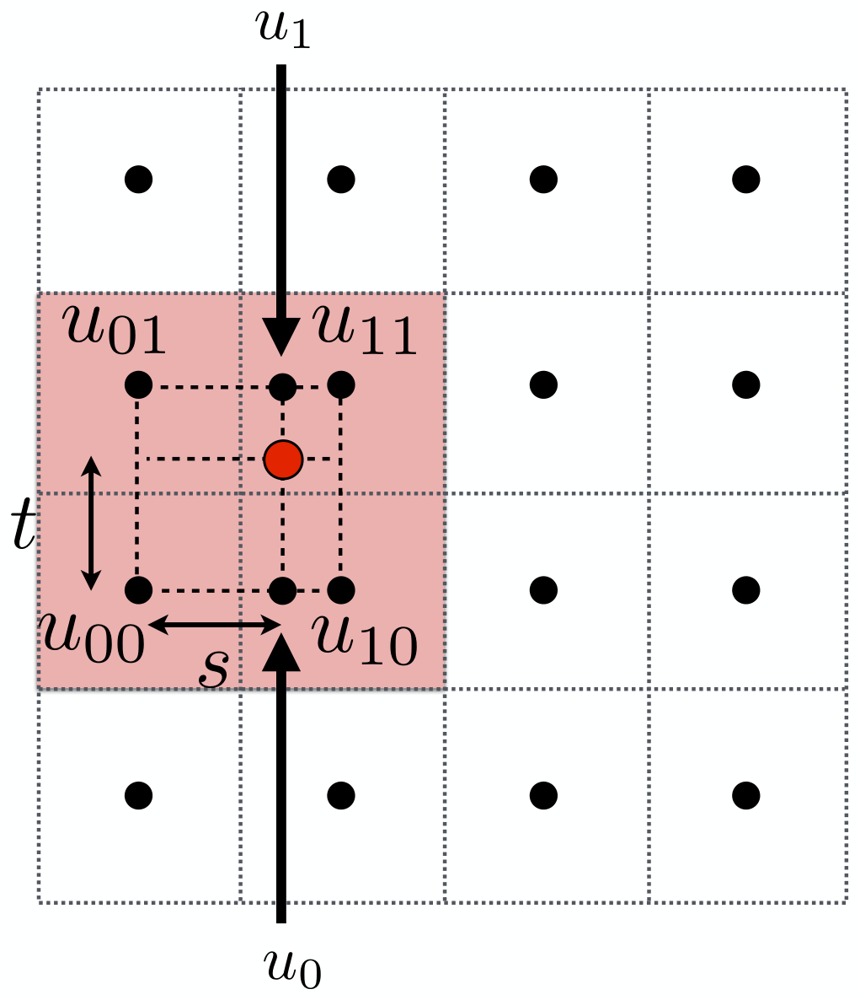

## 第 35 页 · Bilinear Filtering

?

Want to sample

texture value f(u,v) at red point

Black points indicate texture sample locations

## 第 36 页 · Texture Magnification - Easy Case

Nearest

Bilinear

Bicubic

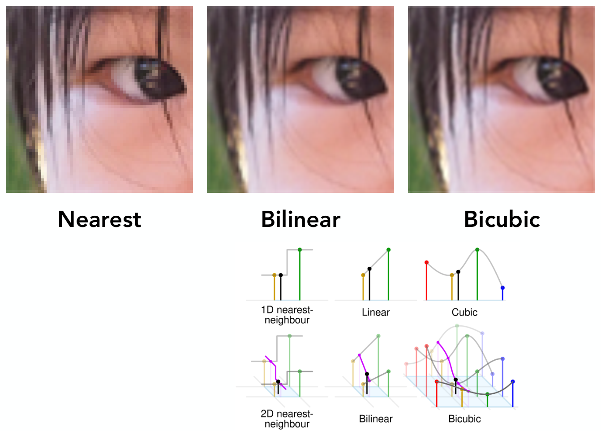

## 第 37 页 · Texture Minification - Hard Case

Challenging

- Many texels can contribute to pixel footprint
- Shape of pixel footprint can be complex

Idea:

- Take texture image file, then low-pass filter it (i.e. filter out high frequencies) and downsample it (i.e. sample at a lower resolution) texture file.  Do this recursively, and store successively lower resolution, each with successively lower maximum signal frequency.
- For each sample, use the texture file whose resolution approximates the screen sampling rate

## 第 38 页 · Level 0 - Full Resolution Texture

Minification

Aliasing

OK

1:1 Mapping

## 第 39 页 · Level 2 - Downsample 4x4

(bilinear resampling)

Minification

Aliasing

Blurring

Magnification

## 第 40 页 · Level 4 - Downsample 16x16

(bilinear resampling)

1:1 Mapping

OK

Blurring

Magnification

## 第 41 页 · Mipmap (L. Williams 83)

Level 2 = 32x32

Level 3 = 16x16

Level 0 = 128x128

Level 1 = 64x64

Level 4 = 8x8

Level 5 = 4x4

Level 6 = 2x2

Level 7 = 1x1

“Mip” comes from the Latin “multum in parvo", meaning a multitude in a small space

‘Much in little’，既“放置很多东西的小空间”

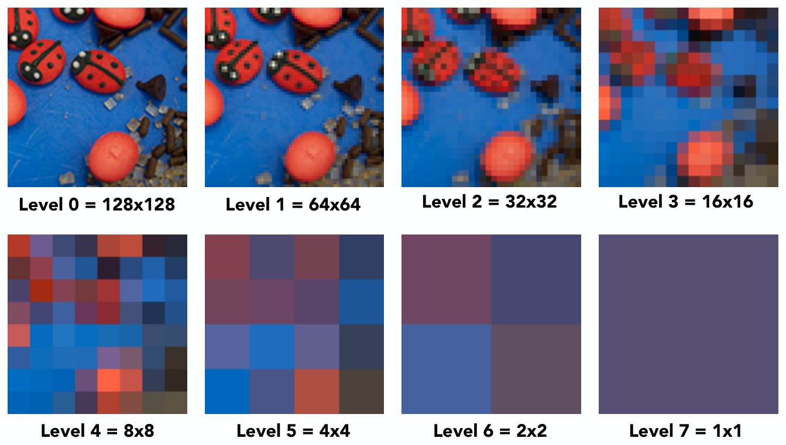

## 第 42 页 · Mipmap (L. Williams 83)

D

v

u

Williams’ original

proposed mipmap layout

“Mip hierarchy”

level = D

What is the storage overhead of a mipmap?

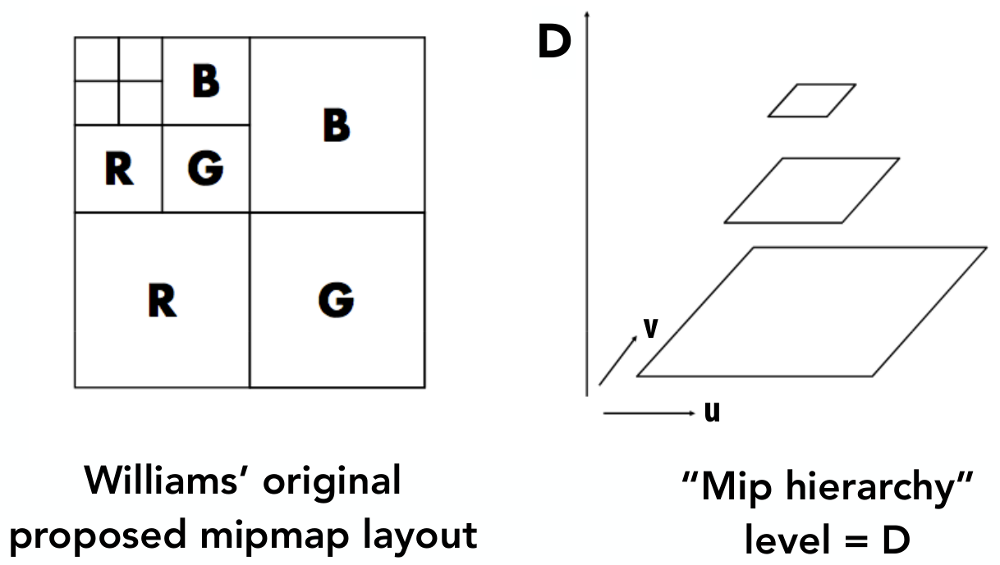

## 第 43 页 · How to compute Mipmap Level?

Squared pixels from screen space map to irregular regions in texture space.

## 第 44 页 · Computing Mipmap Level D

mipmap 是各向同性的（正方形），只需要知道footprint最长边有多长就够了，所以不直接算平行四边形面积，而是量它的两条边。

v

u

Screen space (x,y)

Texture space (u,v)

Estimate texture footprint using texture coordinates of neighboring screen samples

## 第 45 页 · Computing Mipmap Level D

(u,v)01

v

(u,v)00

(u,v)10

du/dx

dv/dx

L

u

向右走一个像

素对应的纹理

坐标变化

向上走一个像

$$
L=\max\left(\sqrt{(\partial u/\partial x)^2+(\partial v/\partial x)^2},\sqrt{(\partial u/\partial y)^2+(\partial v/\partial y)^2}\right),\qquad D=\log_2 L.
$$

## 第 46 页 · Computing Mipmap Level D

Level 0 = 128x128

Level 1 = 64x64

Level 2 = 32x32

Level 3 = 16x16

Level 4 = 8x8

Level 5 = 4x4

Level 6 = 2x2

Level 7 = 1x1

(u,v)01

v

(u,v)00

(u,v)10

du/dx

L

dv/dx

u

Mip Map Level

$$
L=\max\left(\sqrt{(\partial u/\partial x)^2+(\partial v/\partial x)^2},\sqrt{(\partial u/\partial y)^2+(\partial v/\partial y)^2}\right),\qquad D=\log_2 L.
$$

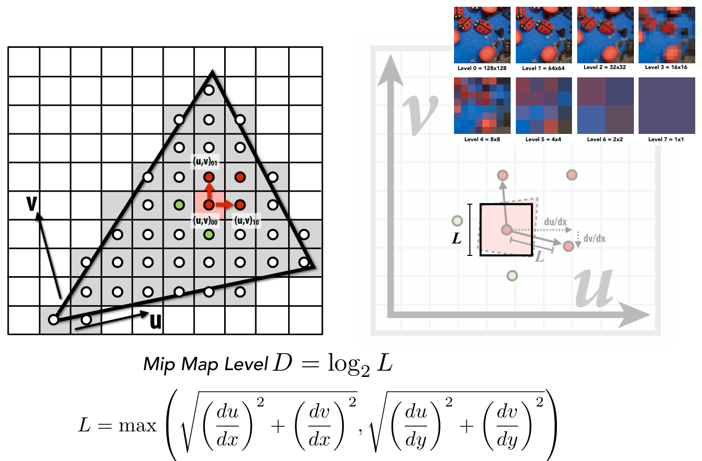

## 第 47 页 · Visualization of Mipmap Level

D rounded to nearest integer level

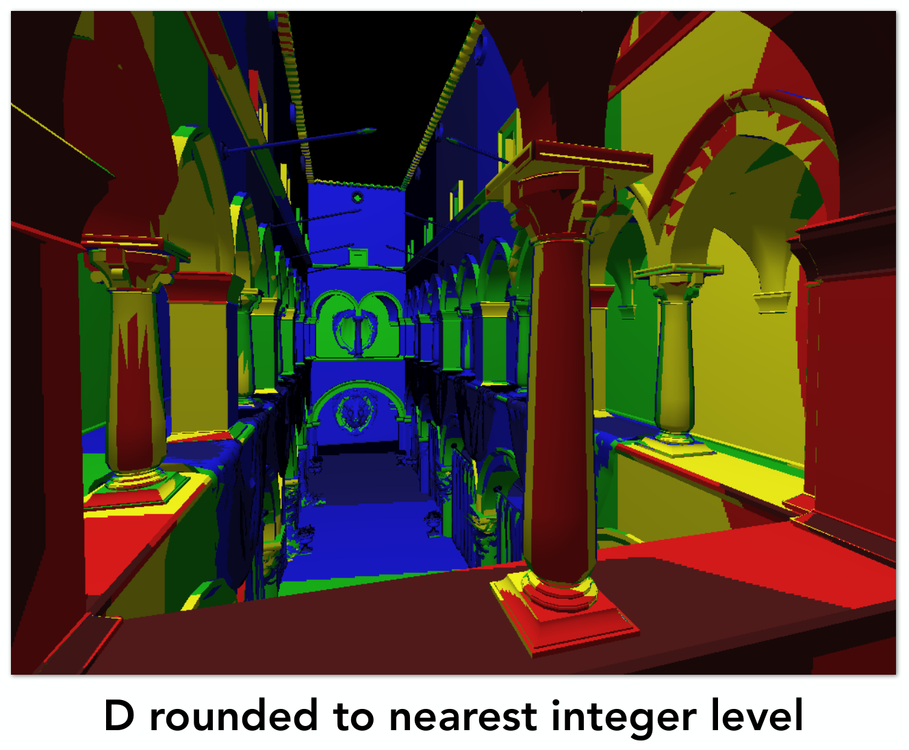

## 第 48 页 · Trilinear Filtering

Mipmap Level D

Mipmap Level D+1

Bilinear result

Linear interpolation based on continuous D value

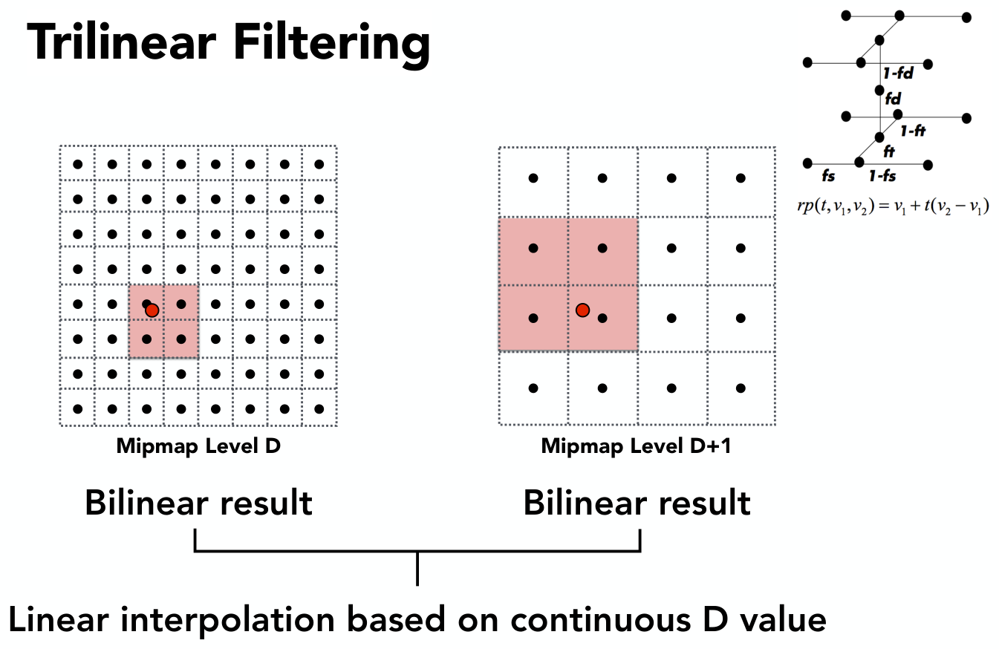

## 第 49 页 · Visualization of Mipmap Level

Trilinear filtering: visualization of continuous D

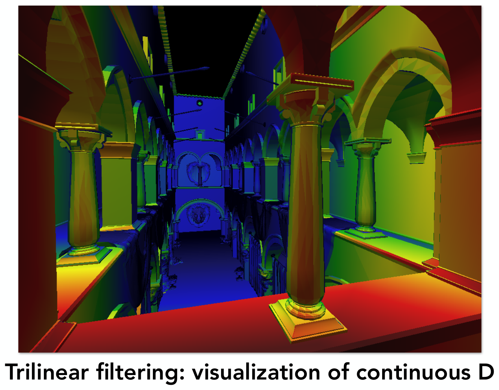

## 第 50 页 · Texture Filtering

Image resampling choices

- Nearest
- Bilinear interpolation

2 x 3 = 6 choices

Mipmap level resampling choices

- Always level 0
- Nearest D
- Linear interpolation

## 第 51 页 · Mipmap Limitations

Point sampling

## 第 52 页 · Mipmap Limitations

Supersampling 512x

Point sampling

## 第 53 页 · Mipmap Limitations

Overblur

Why?

Mipmap trilinear sampling

Point sampling

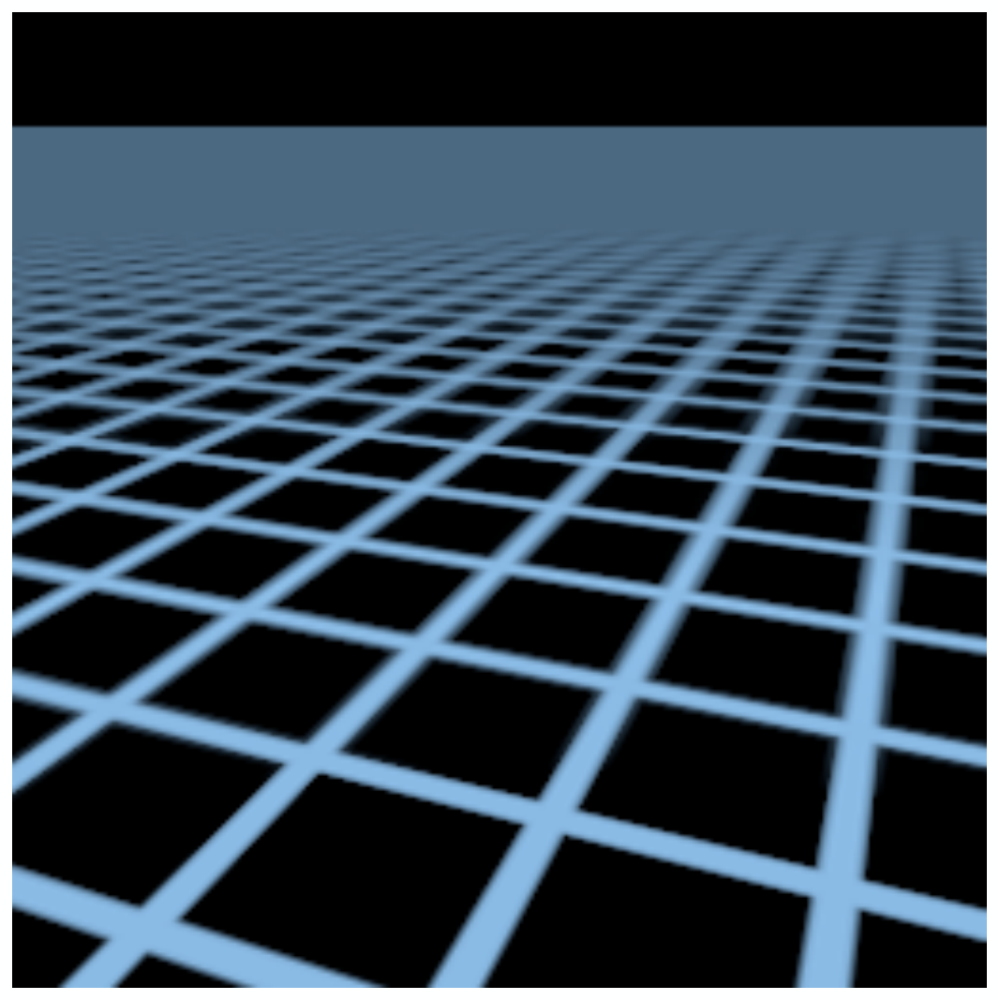

## 第 54 页 · Mipmap Assumes Regular Footprint in Texture

(u,v)01

v

(u,v)00

(u,v)10

du/dx

L

dv/dx

u

Irregular

pixel

footprint!

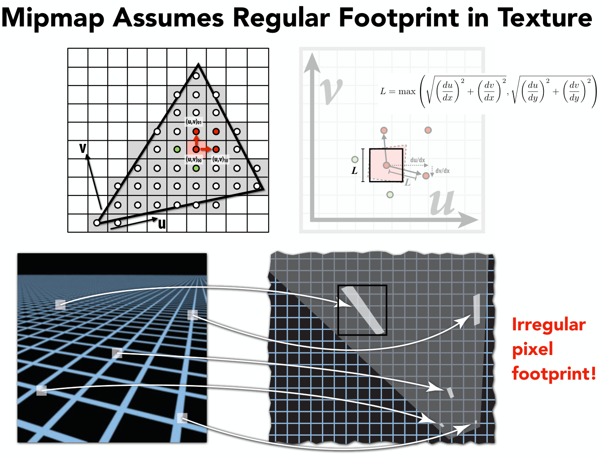

## 第 55 页 · Mipmap Assumes Regular Footprint in Texture

(u,v)01

v

(u,v)00

(u,v)10

du/dx

L

dv/dx

u

Shared texels

Non-overlapping pixels

Irregular

pixel

footprint!

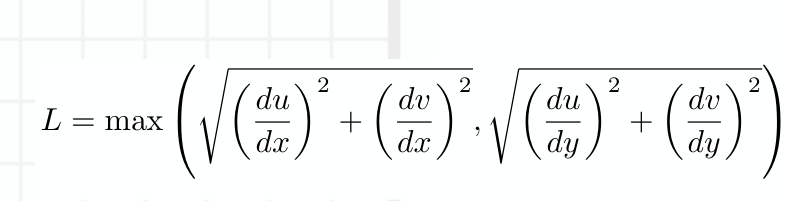

## 第 56 页 · Mipmap Assumes Regular Footprint in Texture

(u,v)01

v

(u,v)00

(u,v)10

du/dx

L

dv/dx

u

Irregular

pixel

footprint!


## 第 57 页 · Anisotropic Filtering

各向异性滤波：相对于Mipmap各向同性（isotropic）而言的改进

Ripmaps and summed area tables

- Can look up axis-aligned rectangular zones
- Diagonal footprints still a problem

Wikipedia

EWA filtering

- Use multiple lookups
- Weighted average
- Mipmap hierarchy still helps

Greene & Heckbert ‘86

Elliptical Weighted Average

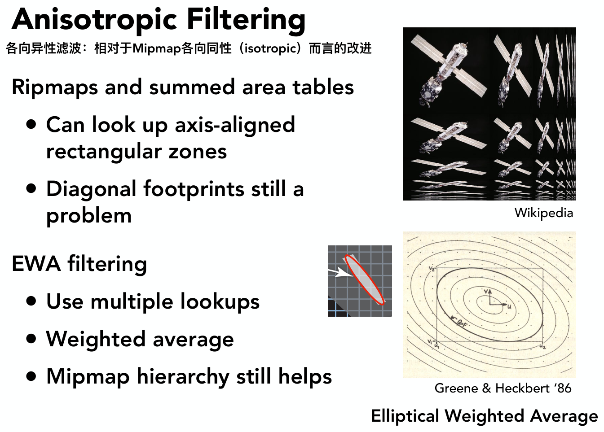

## 第 58 页 · Anisotropic Filtering

Elliptical weighted average (EWA) filtering

算法实现原理介绍可参考：https://zhuanlan.zhihu.com/p/105167411

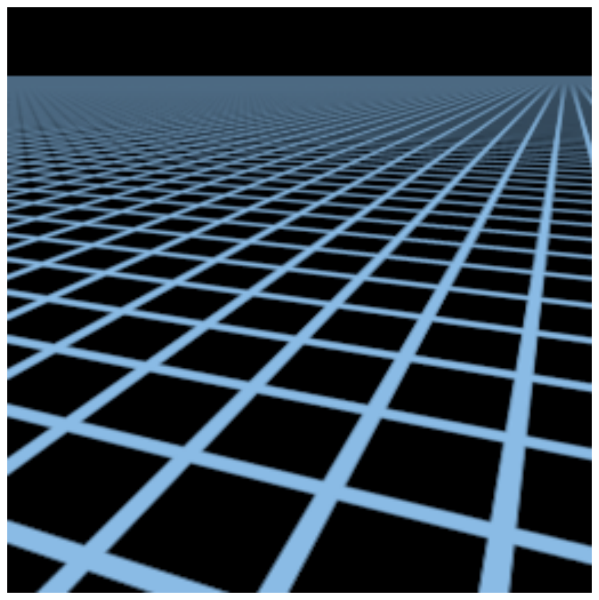

## 第 59 页 · Things to Remember

Many uses of texturing

- Bring high-resolution data to fragment calculations
- Colors, normals, lighting on sphere, volumetric data, …

How does texturing work?

- Texture coordinate parameterization
- Barycentric interpolation of coordinates
- Texture sampling pattern and frequency
- Mipmaps: texture filtering hierarchy, level calculation, trilinear interpolation
- Anisotropic sampling

## 第 60 页 · Course Roadmap

Rasterization Pipeline

Intro

Rasterization

Core Concepts

- Sampling
- Antialiasing

Visibility, Shading

- Transforms

Transforms & Projection

Texture Mapping

Today: Visibility, Shading, Overall Pipeline

Geometric Modeling

Lighting & Materials

Cameras & Imaging

## 第 61 页 · Rasterization Pipeline

3

Application

1

4

Input: vertices in 3D space

2

Vertex Processing

Vertices positioned in screen space

Vertex Stream

Triangle Processing

Triangle Stream

Triangles positioned in screen space

Rasterization

Fragment Stream

Fragments (one per covered sample)

Fragment Processing

Shaded Fragments

Shaded fragments

Framebuffer Operations

Output: image (pixels)

Display

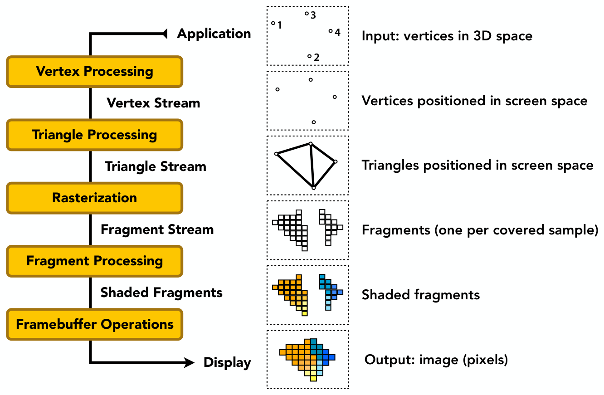

## 第 62 页 · Rasterization Pipeline

Application

Model, View, Projection transforms

Vertex Processing

Vertex Stream

Triangle Processing

y

Triangle Stream

Rasterization

z

Fragment Stream

x

Fragment Processing

Shaded Fragments

Framebuffer Operations

Display

## 第 63 页 · Rasterization Pipeline

Application

Sampling triangle coverage

Vertex Processing

Vertex Stream

Triangle Processing

Triangle Stream

Rasterization

Fragment Stream

Fragment Processing

Shaded Fragments

Framebuffer Operations

Display

## 第 64 页 · Rasterization Pipeline

Application

Z-Buffer Visibility Tests

Vertex Processing

Vertex Stream

Triangle Processing

Triangle Stream

Rasterization

Fragment Stream

Fragment Processing

Shaded Fragments

Framebuffer Operations

Display

## 第 65 页 · Rasterization Pipeline

Application

Shading

Vertex Processing

Vertex Stream

Triangle Processing

Triangle Stream

Rasterization

Ambient

+

Diffuse

Fragment Stream

Fragment Processing

Shaded Fragments

Framebuffer Operations

Blinn-Phong

+ Specular

=

Reflectance Model

Display

## 第 66 页 · Rasterization Pipeline

Application

Vertex Processing

Texture Mapping

Vertex Stream

Triangle Processing

Triangle Stream

Rasterization

Fragment Stream

Fragment Processing

Shaded Fragments

Framebuffer Operations

Display

## 第 67 页 · Shader Programs

- Shader programs are the programmable parts of the rendering pipeline
- Runs on the GPU (Graphics Processing Unit).
- Written in a shading language (like GLSL, HLSL, or Metal Shading Language)
- Responsible for controlling how vertices and pixels (fragments) are processed during rendering.
    - Vertex Shader: Runs once per vertex. Transforms vertex positions (e.g., from model space → world space → screen space). Passes data (like color, normals, texture coordinates) to the next stage.
    - Fragment Shader (Pixel Shader): Runs once per fragment (potential pixel). Determines the final color, texture, lighting, transparency, etc.

## 第 68 页 · Shader Programs

- Program vertex and fragment processing stages
- Describe operation on a single vertex (or fragment)

Example GLSL fragment shader program

```glsl
uniform sampler2D myTexture;
uniform vec3 lightDir;
varying vec2 uv;
varying vec3 norm;

void diffuseShader()
{
    vec3 kd;
    kd = texture2d(myTexture, uv);
    kd *= clamp(dot(-lightDir, norm), 0.0, 1.0);
    gl_FragColor = vec4(kd, 1.0);
}
```

- Shader function executes once per fragment.
- Outputs color of surface at the current fragment’s screen sample position.
- This shader performs a texture lookup to obtain the surface’s material color at this point, then performs a diffuse lighting calculation.

## 第 69 页 · Shader Programs

- Program vertex and fragment processing stages
- Describe operation on a single vertex (or fragment)

Example GLSL fragment shader program

```glsl
uniform sampler2D myTexture; // program parameter
uniform vec3 lightDir;       // program parameter
varying vec2 uv;             // per fragment value (interp. by rasterizer)
varying vec3 norm;           // per fragment value (interp. by rasterizer)

void diffuseShader()
{
    vec3 kd;
    kd = texture2d(myTexture, uv);                 // material color from texture
    kd *= clamp(dot(-lightDir, norm), 0.0, 1.0);    // Lambertian shading model
    gl_FragColor = vec4(kd, 1.0);                  // output fragment color
}
```

## 第 70 页 · Snail Shader Programs

Inigo Quilez

Procedurally modeled, 800 line shader.

http://shadertoy.com/view/ld3Gz2

## 第 71 页 · Goal: Highly Complex 3D Scenes in Realtime

- 100’s of thousands to millions of triangles in a scene
- Complex vertex and fragment shader computations
- High resolution (3-5+ megapixel + supersampling)
- 30-60 frames per second (even higher for VR)

Unreal Engine Kite Demo (Epic Games 2015)

## 第 72 页 · What’s More?

What is Texture Mapping?

Applying Textures

Texture Filtering

Advanced Texturing Methods

## 第 73 页 · Many, Many Uses for Texturing

In modern GPUs, texture = memory + filtering

- General method to bring data to fragment calculations

科学计算里很多问题也是“大量独立数据做相同运算”，比如矩阵乘法、蒙特卡洛估计、卷积等，早期使用gpu进行科学计算用图形管线当执行载体，其将数据打包成纹理，把计算写成片段着色器。

Many applications

- Environment lighting
- Store microgeometry
- Procedural textures
- Solid modeling
- Volume rendering
- …

## 第 74 页 · Environment Map

环境光贴图

A function from the sphere to colors, stored as a texture.

[Blinn & Newell 1976]

Lat / long texture map

Reflection vector indexes into texture map

模型烘焙：提供足够的细节同时保持性能。在游戏和VR中做为模型渲染的替代。

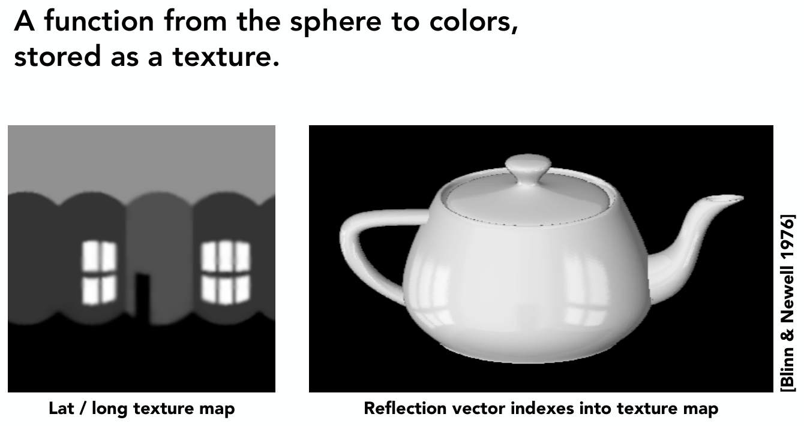

## 第 75 页 · Environment Map

[Dror, Willsky, & Adelson 2004]

With environment map

Without environment map

(a)

(b)

Imagine placing a reflective sphere in the real world and capturing what it "sees." That captured image can then be used as a texture that describes the entire environment in all directions.

Figure 2. (a). A shiny sphere rendered under photographically acquired real-world illumination. (b). The same sphere rendered

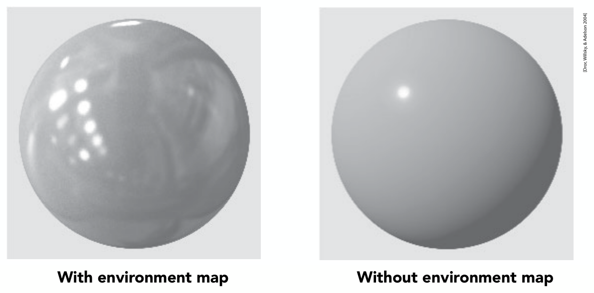

## 第 76 页 · Spherical Environment Map

Hand with Reflecting Sphere. M. C. Escher, 1935. lithograph

Light Probes, Paul Debevec

## 第 77 页 · Spherical Environment Map

Prone to distortion (top and bottom parts)!

## 第 78 页 · Cube Map

(u, v) = (1, 1)

x = y = z

right face has

x &gt; |y| and

x &gt; |z|

(u, v) = (0, 0)

x = –y = –z

A vector maps to cube point along that direction.

The cube is textured with 6 square texture maps.

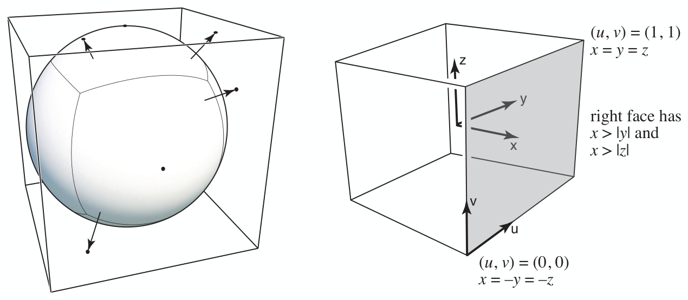

## 第 79 页

[Emil Persson]

CS184/284A

Ren Ng, James O’Brien

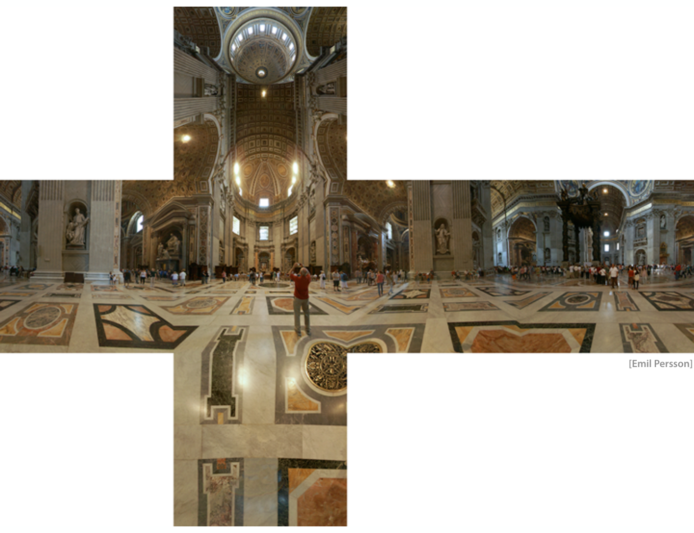

## 第 80 页 · Textures can affect shading!

- Textures doesn’t have to only represent colors
    - What if it stores the height / normal?
    - Bump / normal mapping
    - Fake the detailed geometry

Relative height to the

height -&gt; normal -&gt; shading

underlying surface

## 第 81 页 · Textures can affect shading!

- Textures doesn’t have to only represent colors
    - What if it stores the height / normal?
    - Bump / normal mapping
    - Fake the detailed geometry

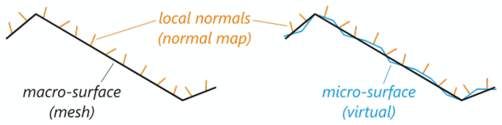

## 第 82 页 · Bump Mapping (Normal Mapping)

法向贴图

- Adding surface details without adding more triangles
    - Perturb surface normal per pixel (for shading computations only)
    - “Height shift” per texel defined by a texture
    - How to modify normal vector?

n = ?

p

Bump texture

b(u,v)

## 第 83 页 · How to perturb the normal (in flatland)

- Original surface normal n(p) = (0,1)
- Derivative at  is dp = c \* [h(p + 1) −h(p)]

p

(1,dp)

dp

1

## 第 84 页 · How to perturb the normal (in flatland)

- Original surface normal
- Derivative at  is
- Perturbed normal is then

.normalized()

1

$$
dp=c[h(p+1)-h(p)],\qquad \mathbf n(p)=\operatorname{normalize}(-dp,1).
$$


## 第 85 页 · How to perturb the normal (in 3D)

- Original surface normal
- Derivative at  are
    - 
    - 
- Perturbed normal is then

.normalized()

- Note that this is in local coordinate!

$$
\frac{dp}{du}=c_1[h(u+1)-h(u)],\quad
\frac{dp}{dv}=c_2[h(v+1)-h(v)],\quad
\mathbf n(p)=\operatorname{normalize}(-dp/du,-dp/dv,1).
$$

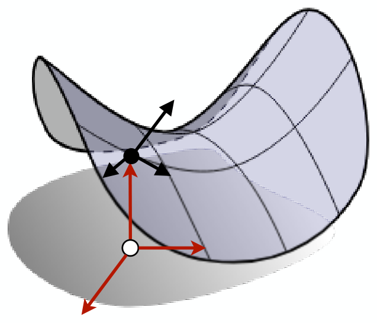

## 第 86 页 · Displacement Mapping

位移贴图

Texture stores perturbation to surface position

## 第 87 页

base surface

hand-painted displacement map (detail)

Paweł Filip

tolas.wordpress.com

displaced surface

## 第 88 页 · Textures can affect shading!

- Displacement mapping — a more advanced approach
    - Uses the same texture as in bumping mapping
    - Actually moves the vertices

Geometry

Bump mapping

Displacement mapping

Perturbs normals

Perturbs positions

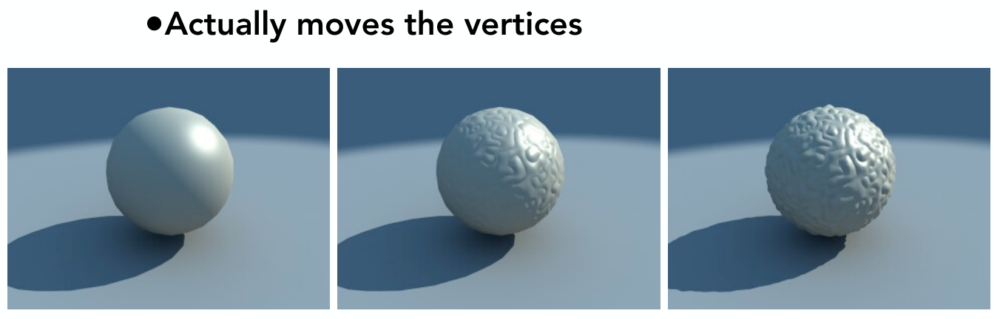

## 第 89 页 · Provide Precomputed Shading

Autodesk

Simple

shading

Ambient occlusion

With ambient

texture map

occlusion

## 第 90 页 · 3D Textures

[Wolfe / SG97 Slide set]

Textures is a function of (u,v,w). Solid modeling.

## 第 91 页 · 3D Procedural Noise + Solid Modeling

Perlin noise, Ken Perlin

Ken Perlin

## 第 92 页 · 3D Textures and Volume Rendering

Marc Levoy

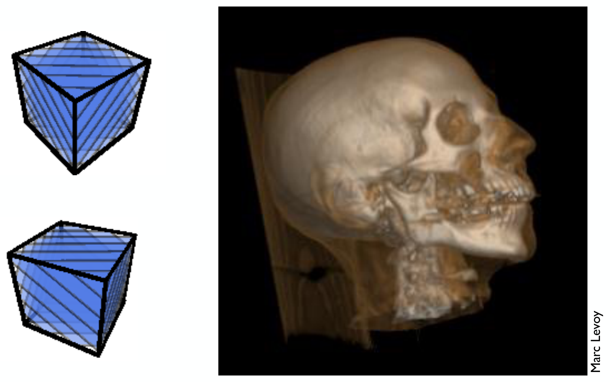

## 第 93 页 · Homework 1

- 实现一个光栅化器

本次作业包括 6 个部分，覆盖了第 2–6 讲的内容。

1. 绘制三角形
2. 基于超采样的反走样算法
3. 几何变换
4. 质心坐标
5. 基于像素采样的纹理映射
6. MipMap 纹理映射

- 作业完成日期：10.12
