# Lecture 7 · Introduction to Geometry, Implicit and Explicit Representation

原课件共 45 页。[打开 PDF](../../ppt/lec-07-intro-geometry.pdf)

按 PDF 页序提取，保留课件原有中英文。关键公式以 Markdown 数学式或原页局部图呈现。

## 第 1 页 · Introduction to Geometry, Implicit and Explicit Representation

Computer Graphics 2026 Fuzhou University - Computer Science

## 第 2 页 · Course Roadmap

Rasterization Pipeline

Intro

Rasterization

Core Concepts

Transforms & Projection

- Sampling
- Antialiasing
- Transforms

Texture Mapping

Visibility, Shading, Overall Pipeline

Starting today

Geometric Modeling

Lighting & Materials

Cameras & Imaging

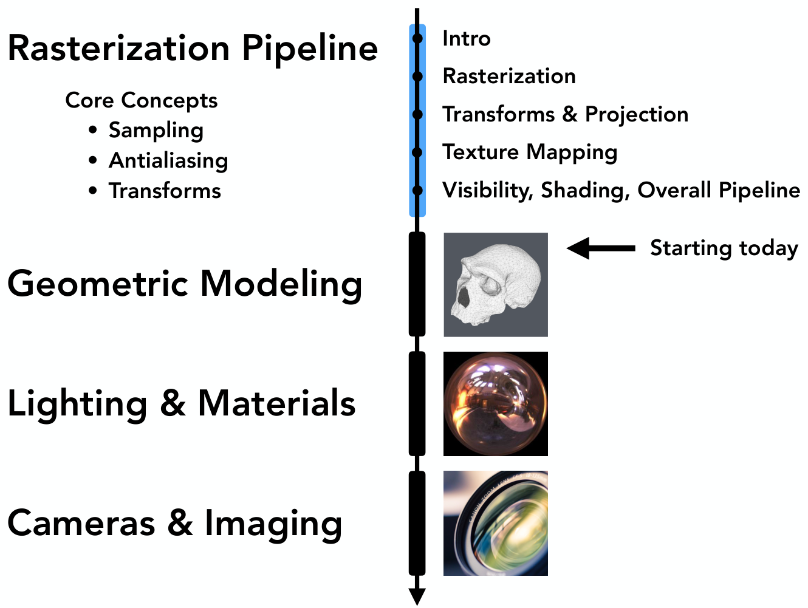

## 第 3 页 · Increasing the Complexity of Our Models

Transformations       Geometry         Materials, lighting, …

## 第 4 页 · What Is Geometry?

“Earth”

“measure”

土地测量、测地术

ge•om•et•ry   /jēˈämətrē/ n.

1. The study of shapes, sizes, patterns, and positions.
2. The study of spaces where some quantity (lengths, angles, etc.) can be measured.

Plato:”… the earth is in appearance like one of those balls which have leather coverings in twelve pieces…”

## 第 5 页 · How Can We Describe Geometry?

Implicit                   Linguistic                Explicit

“unit circle”

TOMOGRAPHIC

DYNAMIC

(constant density)

DISCRETE

SYMMETRIC

rotate

CURVATURE

n ➞∞

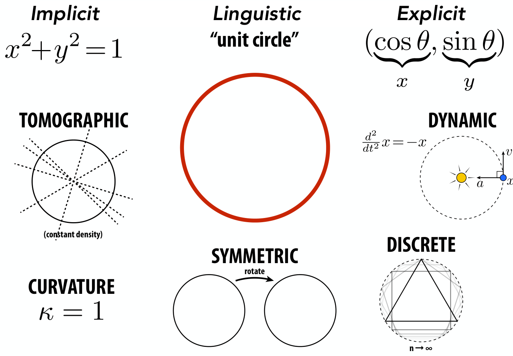

## 第 6 页 · Given all these options, what’s the best way to encode geometry on a computer?

## 第 7 页 · Examples of Geometry

## 第 8 页 · Examples of Geometry

NetCarShow.com

## 第 9 页 · Examples of Geometry

## 第 10 页 · Examples of Geometry

文字同第 9 页。

## 第 11 页 · Examples of Geometry

文字同第 9 页。

## 第 12 页 · Examples of Geometry

文字同第 9 页。

## 第 13 页 · Examples of Geometry

文字同第 9 页。

## 第 14 页 · Representations

## 第 15 页 · Many Ways to Represent Geometry

Explicit

- point cloud
- polygon mesh
- subdivision, NURBS
- ...

Implicit

- level sets
- algebraic surface
- distance functions
- ...

Each choice best suited to a different task/type of geometry

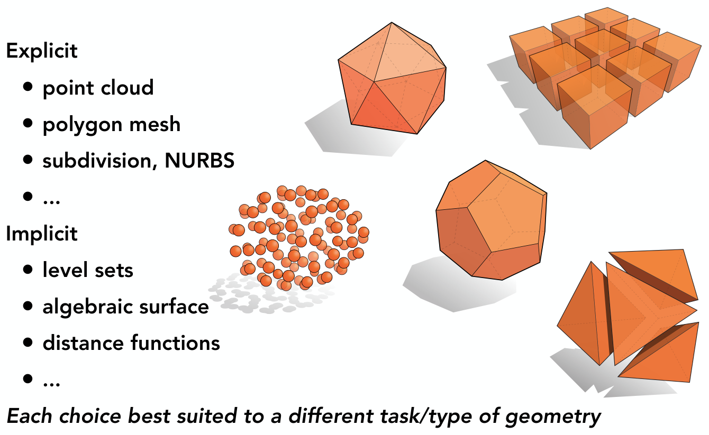

## 第 16 页 · “Implicit” Representations of Geometry

- Points are not known directly, but satisfy some relationship
- E.g., unit sphere is all points such that x² + y² + z² = 1
- More generally, f(x, y, z) = 0

f(x, y)

+1

f = 0

y

0

-1

x

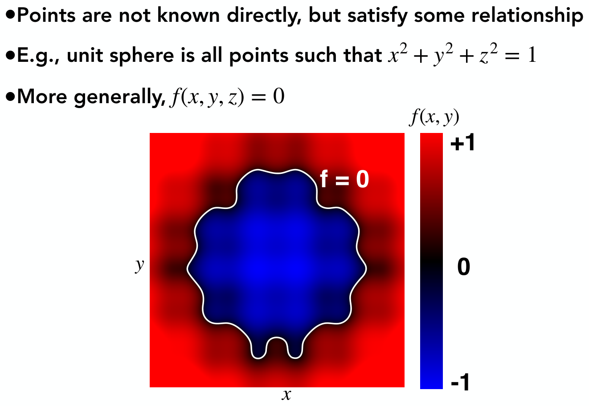

## 第 17 页 · Many Implicit Representations in Graphics

ons in graphics

- Algebraic surfaces
- Constructive Solid Geometry
- Level set methods
- Blobby surfaces
- Fractals
- …

## 第 18 页 · Implicit Surface - Sampling Can Be Hard

What points lie on

?

$$
f(x,y,z)=\bigl(2-\sqrt{x^2+y^2}\bigr)^2+z^2-1,\qquad f(x,y,z)=0.
$$

## 第 19 页 · Implicit Surface - Sampling Can Be Hard

What points lie on

?

y

x

z

Torus

$$
f(x,y,z)=\bigl(2-\sqrt{x^2+y^2}\bigr)^2+z^2-1,\qquad f(x,y,z)=0.
$$

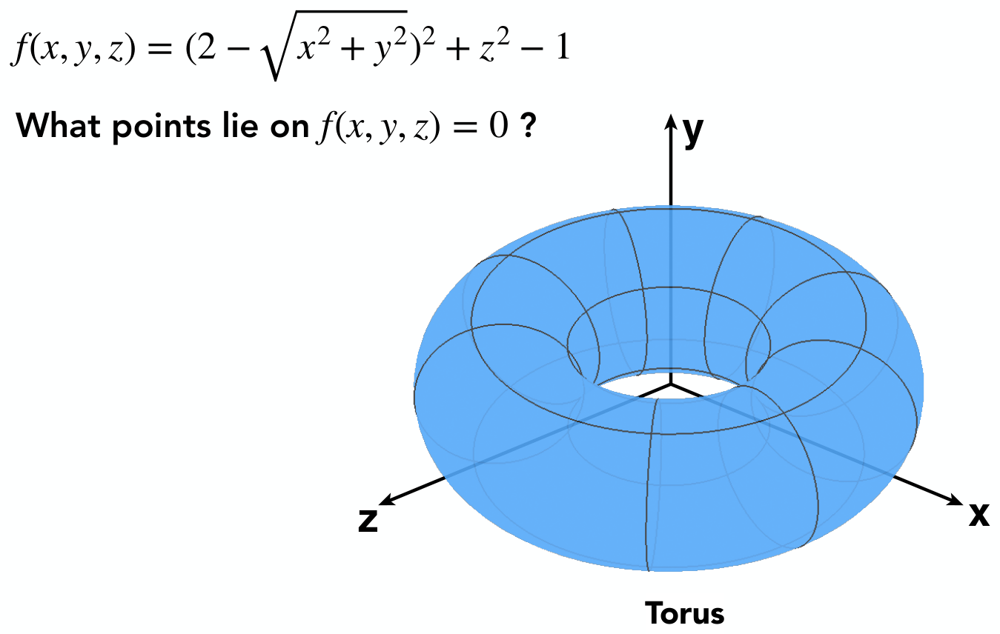

## 第 20 页 · Implicit Surface - Inside/Outside Tests Easy

y

Is (3/4, 1/2, 1/4) inside ?

Just plug it in:

-1/8 &lt; 0

( 3/4, 1/2, 1/4 )

Yes, inside.

x

z

$$
f(x,y,z)=x^2+y^2+z^2-1,\qquad f(3/4,1/2,1/4)=-1/8<0.
$$

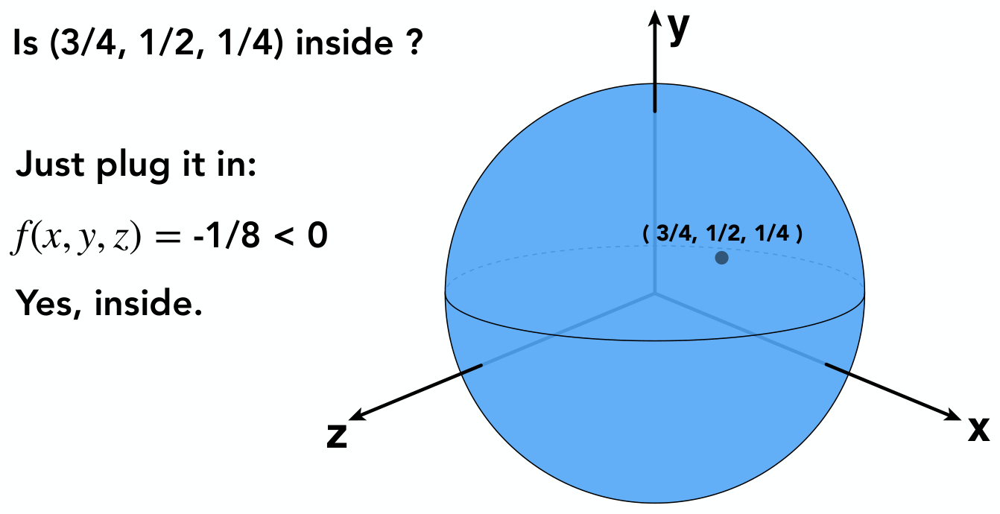

## 第 21 页 · “Explicit” Representations of Geometry

All points are given directly

## 第 22 页 · “Explicit” Representations of Geometry

All points are given directly or via parameter mapping

Generally:

$$
f:\mathbb R^2\to \mathbb R^3,\qquad (u,v)\mapsto(x,y,z).
$$

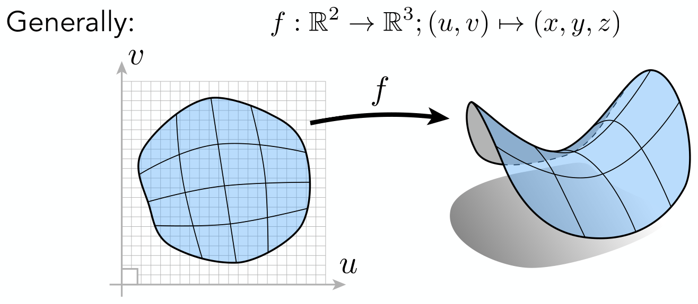

## 第 23 页 · “Explicit” Representations of Geometry

f(θ, ϕ) = (cosφsinθ, sinφsinθ, cosθ)

$$
f(\theta,\phi)=(\cos\phi\sin\theta,\ \sin\phi\sin\theta,\ \cos\theta).
$$

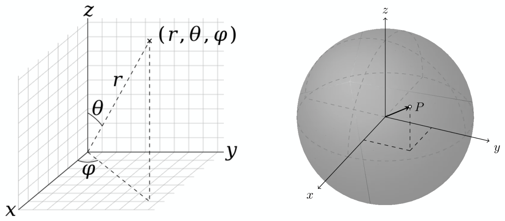

## 第 24 页 · Many Explicit Representations in Graphics

- Triangle meshes
- Polygon meshes
- Subdivision surfaces
- Point clouds
- NURBS
- …

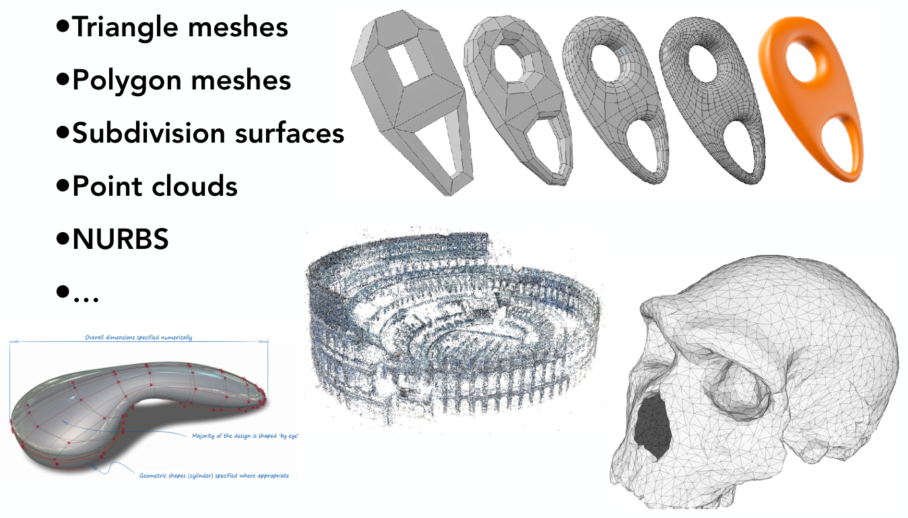

## 第 25 页 · Explicit Surface - Sampling is Easy

f(u, v) = ((2 + cosu)cosv, (2 + cosu)sinv, sinu)

What points lie on this surface ?

y

Just plug in (u,v) values!

z

x

$$
f(u,v)=\bigl((2+\cos u)\cos v,\ (2+\cos u)\sin v,\ \sin u\bigr).
$$

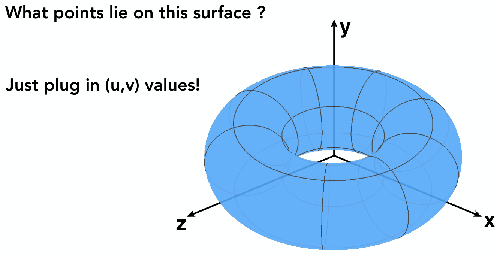

## 第 26 页 · Explicit Surface - Inside/Outside Tests Hard

f(u, v) = ((2 + cosu)cosv, (2 + cosu)sinv, sinu)

Is (3/4, 1/2, 1/4) inside ?

y

( 3/4, 1/2, 1/4 )

z

x

$$
f(u,v)=\bigl((2+\cos u)\cos v,\ (2+\cos u)\sin v,\ \sin u\bigr).
$$

## 第 27 页 · Conclusion: Some representations work better than others—depends on the task!

## 第 28 页

Different representations will also be better suited to different types of geometry.

Let’s take a look at some common representations used in computer graphics.

## 第 29 页 · Algebraic Surfaces (Implicit)

Surface is zero set of a polynomial in x, y, z

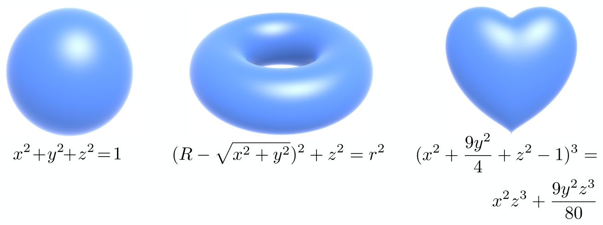

## 第 30 页 · Algebraic Surfaces (Implicit)

Surface is zero set of a polynomial in x, y, z

What about more complicated shapes?

## 第 31 页 · Constructive Solid Geometry (Implicit)

Combine implicit geometry via boolean operations

Union

Intersection

Difference

- Q: How do we implement a Boolean union of

is represented by

, their union

- A: Assume is the function

$$
f(\mathbf x)=\min\bigl(d_A(\mathbf x),d_B(\mathbf x)\bigr)\quad\text{for } A\cup B.
$$

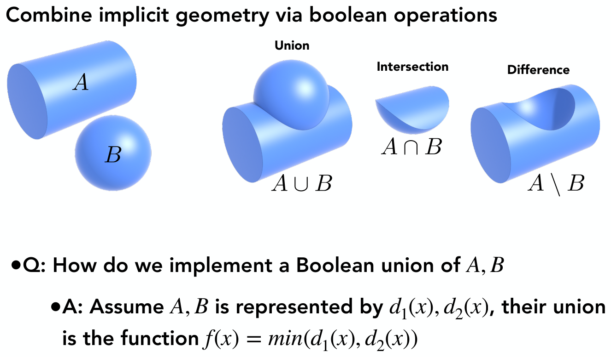

## 第 32 页 · Constructive Solid Geometry (Implicit)

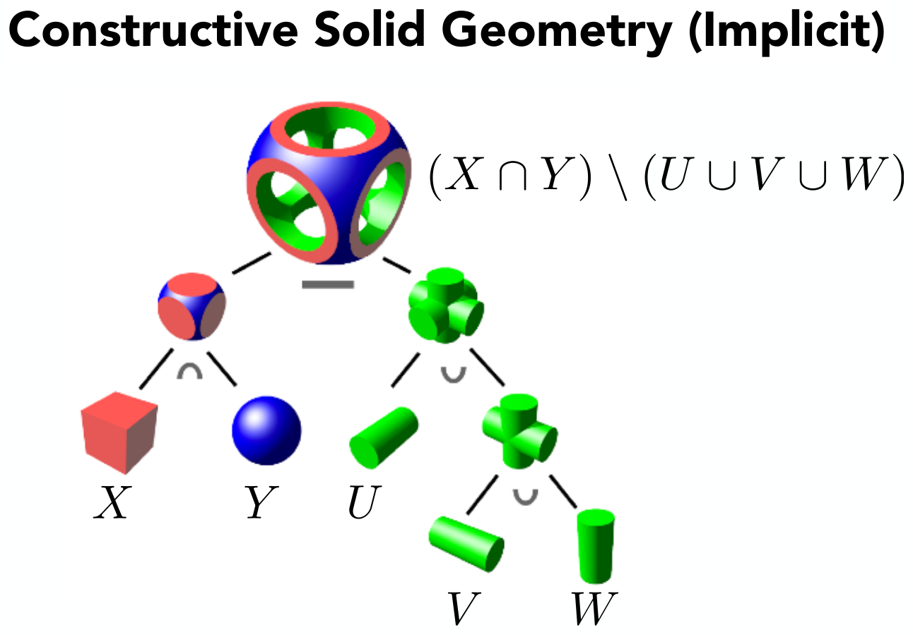

## 第 33 页 · Blobby Surfaces (Implicit)

- Instead of Booleans, gradually blend surfaces together:
- Easier to understand in 2D:

(Gaussian centered at p)

(Sum of Gaussians centered at different points)

f=.5

f=.4

f=.3

C

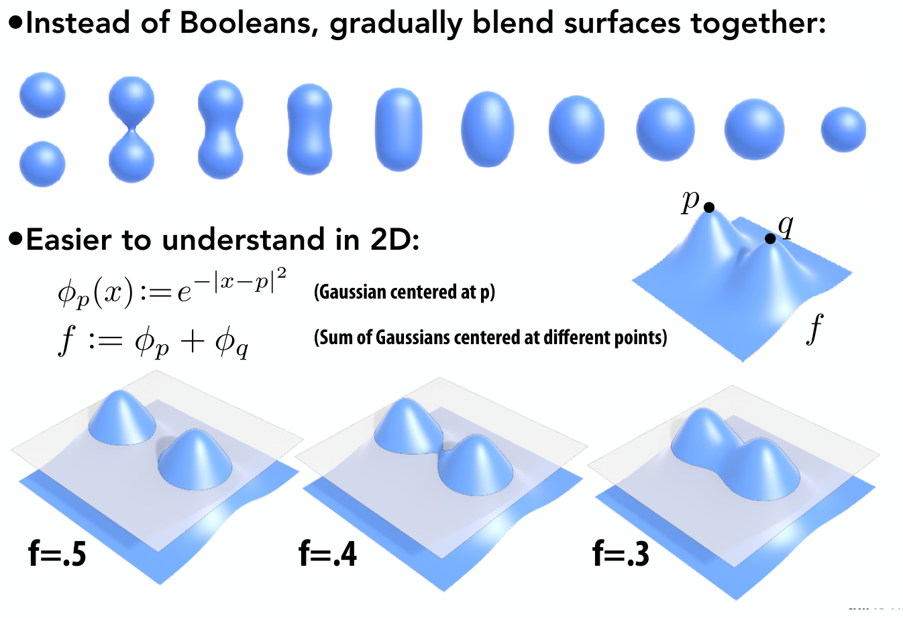

## 第 34 页 · Blending Distance Functions

f = 0

- A distance function gives distance to closest point on object
- Can blend any two distance functions d1, d2
- Similar strategy to points, though many possibilities, E.g.,
- Appearance depends on how we combine functions

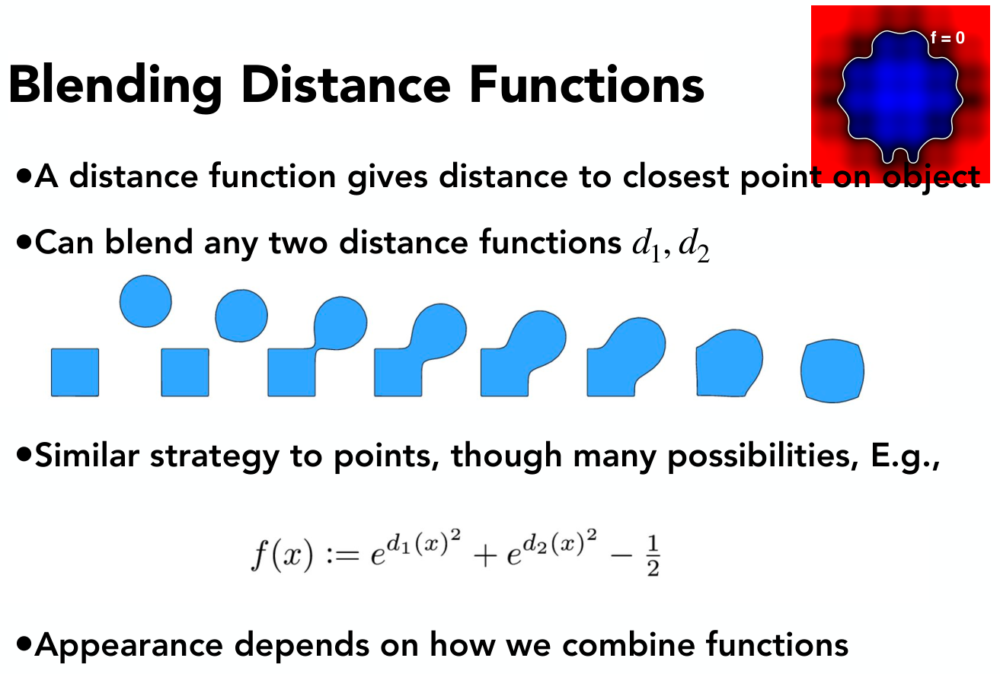

## 第 35 页 · Scene of Pure Distance Functions

https://iquilezles.org/www/articles/raymarchingdf/raymarchingdf.htm

## 第 36 页 · Level Set Methods (Implicit)

- Implicit surfaces have some nice features (e.g., merging/blending)
- But, hard to describe complex shapes in closed form
- Alternative: store a grid of values approximating function (离散化)

-.55

-.45

-.35

-.30

-.25

-.20

-.10

-.15

.10

.15

-.05

.05

.25

.35

.20

.55

.60

- Surface is found where interpolated values equal zero
- Provides much more explicit control over shapes (like a texture)

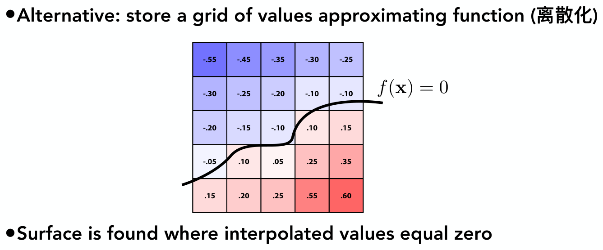

## 第 37 页 · Level Sets from Medical Data

- Level sets encode, e.g., constant tissue density

## 第 38 页 · Level Sets in Physical Simulation

- Level sets encode distance to air-liquid boundary

http://physbam.stanford.edu

## 第 39 页 · Level Sets Storage

- Drawback: storage for 2D surface is now O(n³)
- Can reduce cost by storing only a narrow band around surface:

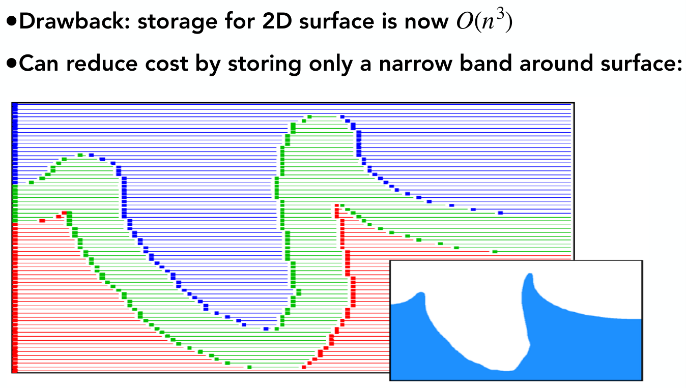

## 第 40 页 · Fractals

- No precise definition; exhibit self-similarity, detail at all scales
- “Language” for describing natural phenomena
- Hard to control shape

## 第 41 页 · Implicit Representations - Pros & Cons

- Pros:
    - description can be very compact (e.g., a polynomial)
    - easy to determine if a point is in our shape (just plug it in!)
    - other queries may also be easy (e.g., distance to surface)
    - for simple shapes, exact description/no sampling error
- Cons:
    - expensive to find all points in the shape (e.g., for drawing)
    - very difficult to model complex shapes

## 第 42 页 · Point Cloud (Explicit)

)

- Easiest representation: list of points (x,y,z)
- Often augmented with normals
- Easily represent any kind of geometry
- Useful for LARGE datasets (&gt;&gt;1 point/pixel)
- Hard to interpolate undersampled regions
- Hard to do processing / simulation / ...

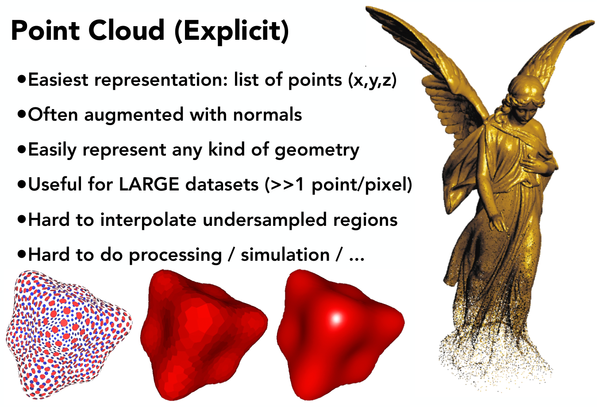

## 第 43 页 · Polygon Mesh (Explicit)

- Store vertices and polygons (most often triangles or quads)
- Easier to do processing/simulation, adaptive sampling
- More complicated data structures
- Perhaps most common representation in graphics

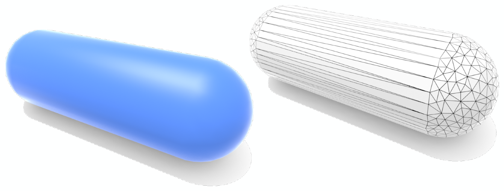

## 第 44 页 · Bézier Surface (Explicit)

- Connect Bézier patches to get a surface:

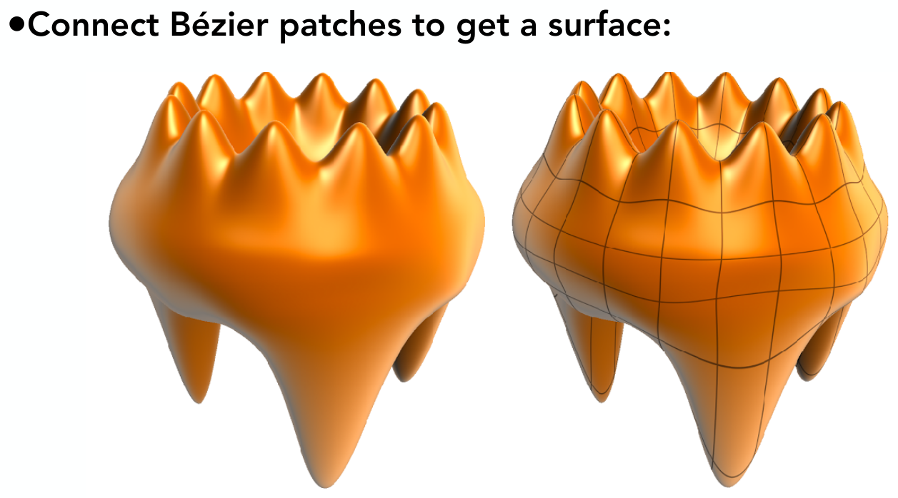

## 第 45 页 · Next time: Curves, Surfaces
