# Lecture 8 · Curves and Surfaces

原课件共 127 页。[打开 PDF](../../ppt/lec-08-curves-surfaces.pdf)

按 PDF 页序提取，保留课件原有中英文。关键公式以 Markdown 数学式或原页局部图呈现。

## 第 1 页 · Curves and Surfaces

Computer Graphics 2026 Fuzhou University - Computer Science

## 第 2 页 · Curves

## 第 3 页 · Vector Fonts

The Quick Brown

Fox Jumps Over

The Lazy Dog

ABCDEFGHIJKLMNOPQRSTUVWXYZ abcdefghijklmnopqrstuvwxyz 0123456789

credit: Randall Branding

Baskerville font - represented as cubic Bézier splines

## 第 4 页 · Animation Curves

Maya Animation Tutorial: https://youtu.be/b-o5wtZlJPc

## 第 5 页 · CAD Design

3D Car Modeling with Rhinoceros

## 第 6 页 · Splines

样

条

## 第 7 页 · A Real Draftsperson’s Spline

http://www.alatown.com/spline-history-architecture/

## 第 8 页

A ship comprised of splines

## 第 9 页

A ship’s body plan comprised of splines

## 第 10 页 · Spline Topics

Defined by a set of points

Interpolation between points

- Cubic Hermite interpolation
- Catmull-Rom interpolation

Bezier curves

Bezier surfaces

## 第 11 页 · Goal: Interpolate Values

## 第 12 页 · Nearest Neighbor Interpolation

Problem: values not continuous

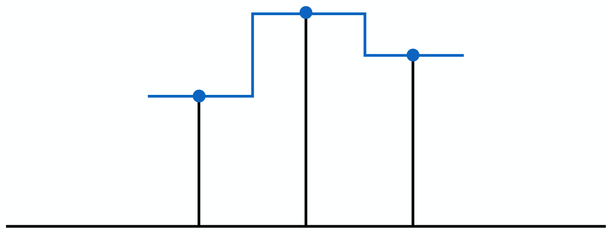

## 第 13 页 · Linear Interpolation

Problem: derivatives not continuous

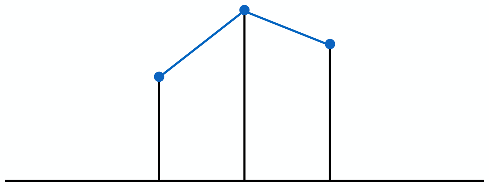

## 第 14 页 · Smooth Interpolation?

## 第 15 页 · Cubic Hermite Interpolation

## 第 16 页 · Some Differential Geometry

Tangent to curve

Tangents to surface

Normal of surface

Degeneracies:                 or

$$
\mathbf t(u)=\frac{\partial\mathbf x}{\partial u},\quad
\mathbf t_u=\frac{\partial\mathbf x}{\partial u},\quad
\mathbf t_v=\frac{\partial\mathbf x}{\partial v},\quad
\mathbf n=\frac{\mathbf t_u\times\mathbf t_v}{\|\mathbf t_u\times\mathbf t_v\|}.
$$

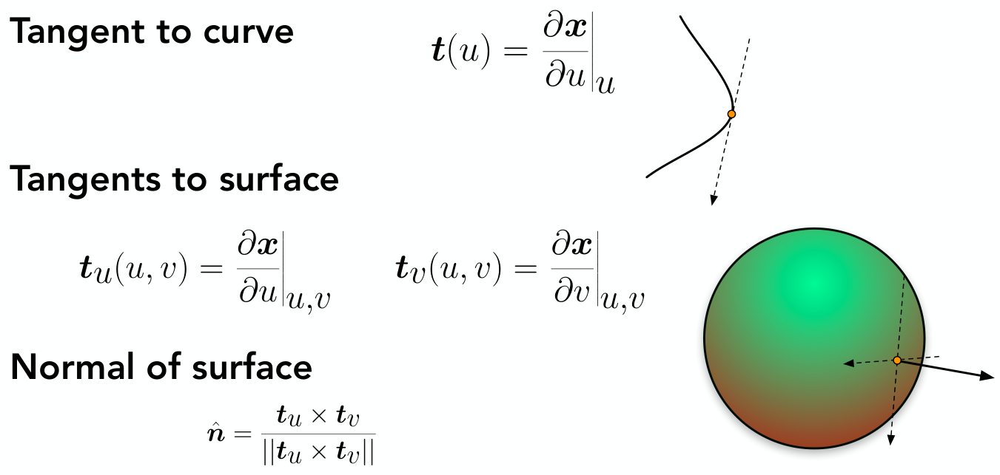

## 第 17 页 · Cubic Hermite Interpolation

P ′(1)

P ′(0)

P(1)

P(0)

0

1

Inputs: values and derivatives at endpoints

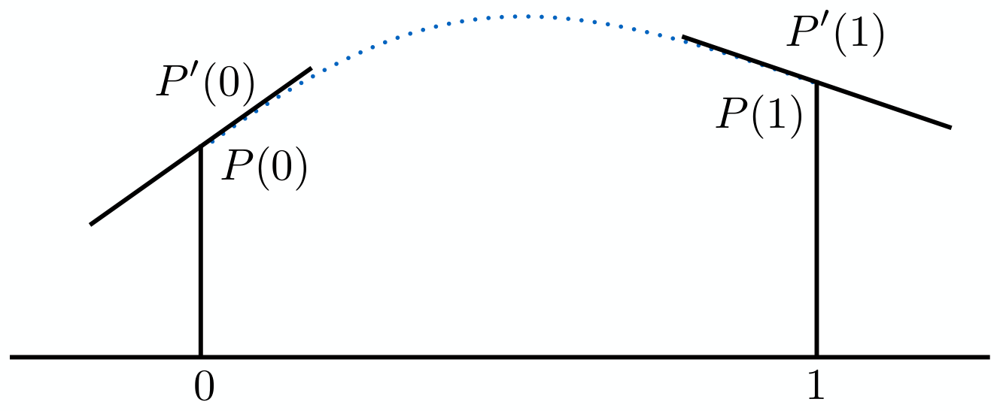

## 第 18 页 · Polynomial Basis Functions

Power Basis

e.g. a cubic polynomial

The elements of      are linearly independent

i.e. no good approximation

$$
x(u)=\sum_{i=0}^n c_i u^i,\qquad x(u)=c_0+c_1u+c_2u^2+c_3u^3 \quad (n=3).
$$

## 第 19 页 · Specifying a Curve

Given desired values (constraints) how do we determine the coefficients for cubic power basis?

For now, assume

$$
x(0)=x_0,\quad x(1)=x_1,\quad x'(0)=d_0,\quad x'(1)=d_1.
$$

## 第 20 页 · Specifying a Curve

文字同第 19 页。

## 第 21 页 · Specifying a Curve

Given desired values (constraints) how do we determine the coefficients for cubic power basis?

For now, assume

$$
c_0=x_0,\qquad c_0+c_1+c_2+c_3=x_1,\qquad c_1=d_0,\qquad c_1+2c_2+3c_3=d_1.
$$

## 第 22 页 · Specifying a Curve

文字同第 21 页。

## 第 23 页 · Specifying a Curve

文字同第 21 页。

## 第 24 页 · Specifying a Curve

(From previous slide for reference.)

Given desired values (constraints) how do we determine the coefficients for cubic power basis?

For now, assume

Matrix

Coefficients (unknown)

Constraint Values

$$
B\,\mathbf c=\mathbf h,\quad
B=\begin{bmatrix}1&0&0&0\\1&1&1&1\\0&1&0&0\\0&1&2&3\end{bmatrix},\quad
\mathbf c=(c_0,c_1,c_2,c_3)^{\mathsf T},\quad
\mathbf h=(x_0,x_1,d_0,d_1)^{\mathsf T}.
$$

## 第 25 页 · Specifying a Curve

Given desired values (constraints) how do we determine the coefficients for cubic power basis?

For now, assume

Often called

“control points”, but note

the d in this case are directions, not points.

$$
B\,\mathbf c=\mathbf h,\quad
B=\begin{bmatrix}1&0&0&0\\1&1&1&1\\0&1&0&0\\0&1&2&3\end{bmatrix},\quad
\mathbf c=(c_0,c_1,c_2,c_3)^{\mathsf T},\quad
\mathbf h=(x_0,x_1,d_0,d_1)^{\mathsf T}.
$$

## 第 26 页 · Specifying a Curve

For now, assume

$$
B\,\mathbf c=\mathbf h,\quad
B=\begin{bmatrix}1&0&0&0\\1&1&1&1\\0&1&0&0\\0&1&2&3\end{bmatrix},\quad
\mathbf c=(c_0,c_1,c_2,c_3)^{\mathsf T},\quad
\mathbf h=(x_0,x_1,d_0,d_1)^{\mathsf T}.
$$

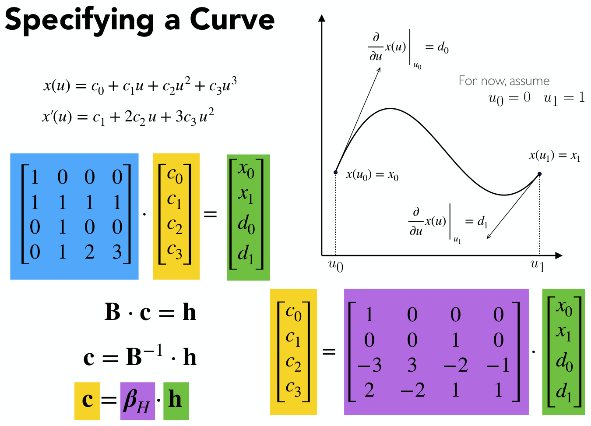

## 第 27 页 · Cubic Hermite Basis

For now, assume

Hermite Basis Matrix

$$
x(u)=[1,u,u^2,u^3]\,\beta_H\,\mathbf h,\qquad \beta_H=B^{-1}=
\begin{bmatrix}1&0&0&0\\0&0&1&0\\-3&3&-2&-1\\2&-2&1&1\end{bmatrix}.
$$

## 第 28 页 · Cubic Hermite Basis

For now, assume

$$
x(u)=[1,u,u^2,u^3]\,\beta_H\,\mathbf h,\qquad \beta_H=B^{-1}=
\begin{bmatrix}1&0&0&0\\0&0&1&0\\-3&3&-2&-1\\2&-2&1&1\end{bmatrix}.
$$

## 第 29 页 · Cubic Hermite Basis

Hermite Basis Functions

Basis matrix depends on

and

We could use this same approach for higher order than cubic.

$$
x(u)=[1,u,u^2,u^3]\,\beta_H\,\mathbf h,\qquad \beta_H=B^{-1}=
\begin{bmatrix}1&0&0&0\\0&0&1&0\\-3&3&-2&-1\\2&-2&1&1\end{bmatrix}.
$$

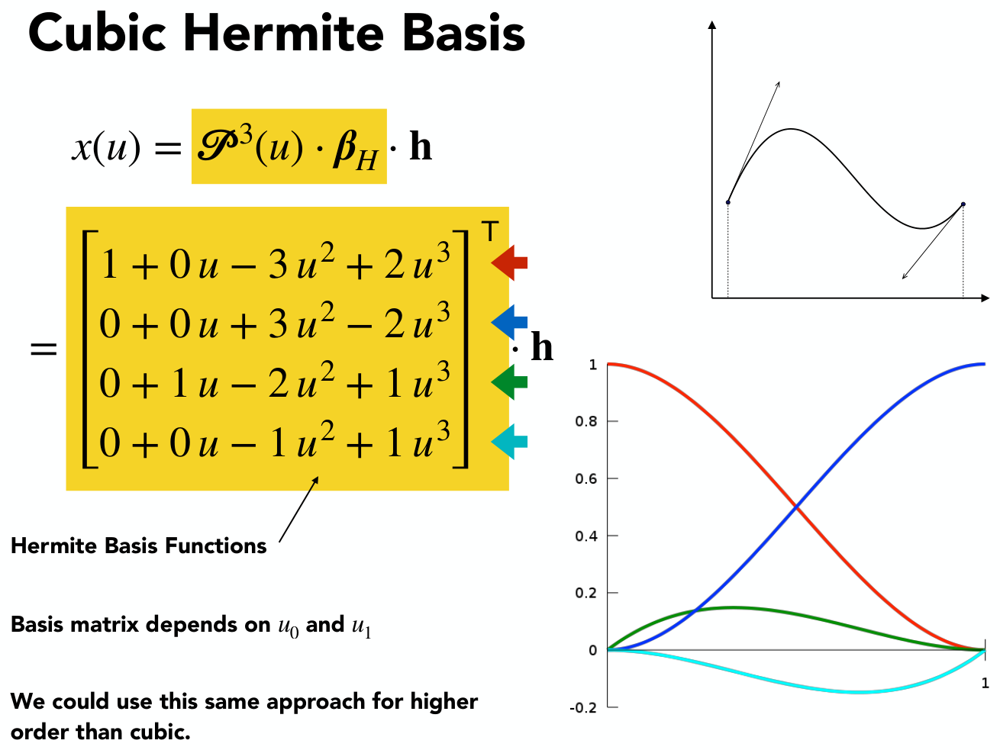

## 第 30 页 · Recap: Cubic Hermite Interpolation

Inputs: values and derivatives at endpoints Output: cubic polynomial that interpolates Solution: weighted sum of Hermite basis functions

$$
P(t)=h_0H_0(t)+h_1H_1(t)+h_2H_2(t)+h_3H_3(t).
$$

$$
H_0=2t^3-3t^2+1,\quad H_1=-2t^3+3t^2,\quad H_2=t^3-2t^2+t,\quad H_3=t^3-t^2.
$$

## 第 31 页 · Recap: Cubic Hermite Interpolation

$$
P(t)=h_0H_0(t)+h_1H_1(t)+h_2H_2(t)+h_3H_3(t).
$$

$$
H_0=2t^3-3t^2+1,\quad H_1=-2t^3+3t^2,\quad H_2=t^3-2t^2+t,\quad H_3=t^3-t^2.
$$

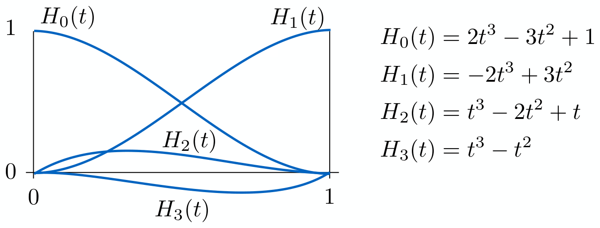

## 第 32 页 · Hermite Spline Interpolation

Inputs: sequence of values and derivatives

Question: Why not use higher-order polynomial?

Higher order polynomials tend to wiggle excessively.

Would like to keep effect of edits “local”.

## 第 33 页

Example of interpolation divergence for a set of Lagrange polynomials.

https://en.wikipedia.org/wiki/Lagrange_polynomial

Question: Why not use higher-order polynomial?

Higher order polynomials tend to wiggle excessively.

## 第 34 页 · Higher-Order Polynomial?

High-degree polynomials don’t behave well

- Unstable
- No local edits
- Expensive

## 第 35 页 · Catmull-Rom Interpolation

## 第 36 页 · Catmull-Rom Interpolation

y₃

y₁

y₀

y₂

0

1

2

3

Inputs: sequence of values

## 第 37 页 · Catmull-Rom Interpolation

Rule for derivatives:

Match slope between previous and next values

$$
m_i=\frac12(P_{i+1}-P_{i-1}).
$$

## 第 38 页 · Catmull-Rom Interpolation

Then use Hermite interpolation

$$
m_i=\frac12(P_{i+1}-P_{i-1}).
$$

## 第 39 页 · Catmull-Rom Spline

Input: sequence of points

Output: spline that interpolates all points with C1 continuity

- Piecewise Cubic Curve - C1 continuous!

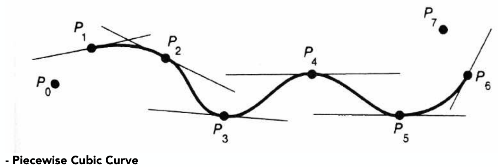

## 第 40 页 · Interpolating Points & Vectors

## 第 41 页 · Can Interpolate Points As Easily As Values

p₄

p₀

E.g. point (0,1,3) in 3D space, or even a general vector in N dimensions

p₃

p₁

p₂

Catmull-Rom 3D spline control points

## 第 42 页 · Can Interpolate Points As Easily As Values

Tangent Vectors

Catmull-Rom 3D tangent vectors

$$
m_i=\frac12(P_{i+1}-P_{i-1}).
$$

## 第 43 页 · Can Interpolate Points As Easily As Values

Notice where function is defined!

$$
m_i=\frac12(P_{i+1}-P_{i-1}).
$$

## 第 44 页 · Can Interpolate Points As Easily As Values

p₄

p₀

1

2(p₄ −p₂)

p₃

p₁

p₂

2(p₃ −p₁)

Catmull-Rom 3D space curve

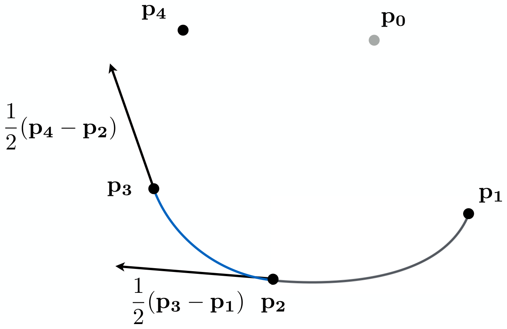

## 第 45 页 · Use Basis Functions to Define Curves

General formula for a particular interpolation scheme:

Coefficients pi can be points & vectors, not just values

Fi(t) are basis functions for the interpolation scheme.

$$
\mathbf p(t)=\sum_{i=0}^n\mathbf p_i F_i(t),\qquad x(t)=\sum_{i=0}^n x_iF_i(t),\quad y(t)=\sum_{i=0}^n y_iF_i(t),\quad z(t)=\sum_{i=0}^n z_iF_i(t).
$$

## 第 46 页 · Use Basis Functions to Define Curves

Saw Hi(t) for Hermite interpolation earlier.  Will see Ci(t) for Catmull-Rom shortly, and Bi(t) for Bézier scheme later. The basis functions are properties of the interpolation scheme.

$$
\mathbf p(t)=\sum_{i=0}^n\mathbf p_i F_i(t),\qquad x(t)=\sum_{i=0}^n x_iF_i(t),\quad y(t)=\sum_{i=0}^n y_iF_i(t),\quad z(t)=\sum_{i=0}^n z_iF_i(t).
$$

## 第 47 页 · Matrix Form of Catmull-Rom Space Curve?

Use Hermite matrix form

- Points & tangents given by Catmull-Rom rules

Power Basis

Hermite Basis Matrix βH

Hermite points

Hermite Control Values

Hermite tangents

$$
(h_0,h_1,h_2,h_3)=\bigl(P_1,P_2,\tfrac12(P_2-P_0),\tfrac12(P_3-P_1)\bigr).
$$

## 第 48 页 · Matrix Form of Catmull-Rom Space Curve?

Use Hermite matrix form

- Points & tangents given by Catmull-Rom rules

Power Basis

Hermite Basis Matrix βH

Hermite points

Convert Catmull-Rom to Hermite

Catmull-Rom Control Points

Hermite tangents

$$
(h_0,h_1,h_2,h_3)=\bigl(P_1,P_2,\tfrac12(P_2-P_0),\tfrac12(P_3-P_1)\bigr).
$$

## 第 49 页 · Matrix Form of Catmull-Rom Space Curve?

文字同第 48 页。

## 第 50 页 · Matrix Form of Catmull-Rom Space Curve?

Use Hermite matrix form

- Points & tangents given by Catmull-Rom rules

Power Basis

Catmull-Rom Basis Matrix βCR

Hermite points

Catmull-Rom Control Points

Hermite tangents

$$
\mathbf p(u)=[1,u,u^2,u^3]\,\beta_{\mathrm{CR}}\,\mathbf p,\qquad
\beta_{\mathrm{CR}}=\frac12\begin{bmatrix}0&2&0&0\\-1&0&1&0\\2&-5&4&-1\\-1&3&-3&1\end{bmatrix}.
$$

## 第 51 页 · Matrix Form of Catmull-Rom Space Curve?

文字同第 50 页。

## 第 52 页 · Catmull-Rom Basis Functions

Matrix columns are Catmull-Rom basis functions

Compare to Hermite

$$
\mathbf p(u)=[1,u,u^2,u^3]\,\beta_{\mathrm{CR}}\,\mathbf p,\qquad
\beta_{\mathrm{CR}}=\frac12\begin{bmatrix}0&2&0&0\\-1&0&1&0\\2&-5&4&-1\\-1&3&-3&1\end{bmatrix}.
$$

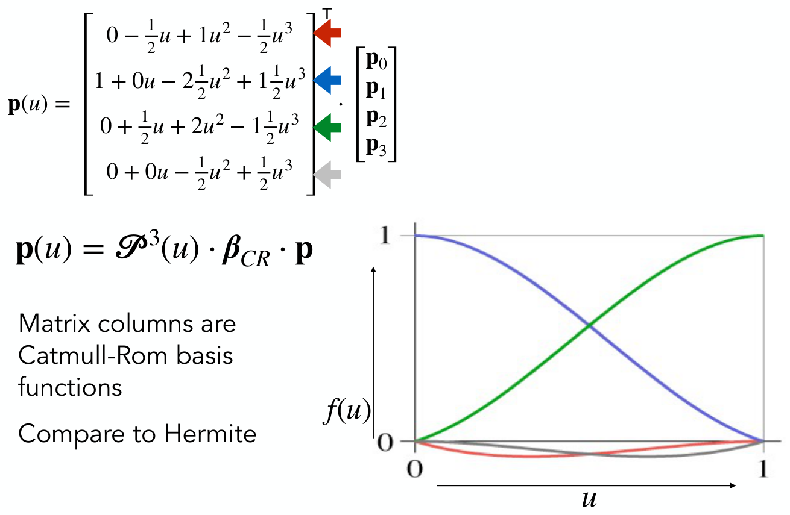

## 第 53 页 · Bézier Curves

## 第 54 页 · Defining Cubic Bézier Curve With Tangents

Shown 2/3rd scale

$$
P(0)=P_0,\quad P(1)=P_3,\quad
P'(0)=3(P_1-P_0),\quad P'(1)=3(P_3-P_2).
$$

## 第 55 页 · Cubic Bézier

Similar to Hermite, but specify tangents indirectly

x(u) = c₀ + c₁u + c₂u² + c₃u³

∂

∂u x(u)

= 3(p₁ −p₀)

u₀

x(u₁) = p₃

x(u₀) = p₀

u = 0

u = 1

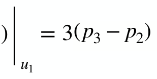

## 第 56 页 · Cubic Bézier

Similar to Hermite, but specify tangents indirectly

$$
P(0)=P_0,\quad P(1)=P_3,\quad
P'(0)=3(P_1-P_0),\quad P'(1)=3(P_3-P_2).
$$

## 第 57 页 · Cubic Bézier

Similar to Hermite, but specify tangents indirectly

Bézier

Note: all the control points are actually points in space, no tangents.

$$
P(0)=P_0,\quad P(1)=P_3,\quad
P'(0)=3(P_1-P_0),\quad P'(1)=3(P_3-P_2).
$$

## 第 58 页 · Cubic Bézier

Similar to Hermite, but specify tangents indirectly

$$
P(0)=P_0,\quad P(1)=P_3,\quad
P'(0)=3(P_1-P_0),\quad P'(1)=3(P_3-P_2).
$$

## 第 59 页 · Cubic Bézier

Similar to Hermite, but specify tangents indirectly

$$
\mathbf x(u)=[1,u,u^2,u^3]\beta_Z\mathbf p,\qquad
\beta_Z=\begin{bmatrix}1&0&0&0\\-3&3&0&0\\3&-6&3&0\\-1&3&-3&1\end{bmatrix}.
$$

## 第 60 页 · Cubic Bézier

Bézier basis functions

T

$$
\mathbf x(u)=[1,u,u^2,u^3]\beta_Z\mathbf p,\qquad
\beta_Z=\begin{bmatrix}1&0&0&0\\-3&3&0&0\\3&-6&3&0\\-1&3&-3&1\end{bmatrix}.
$$

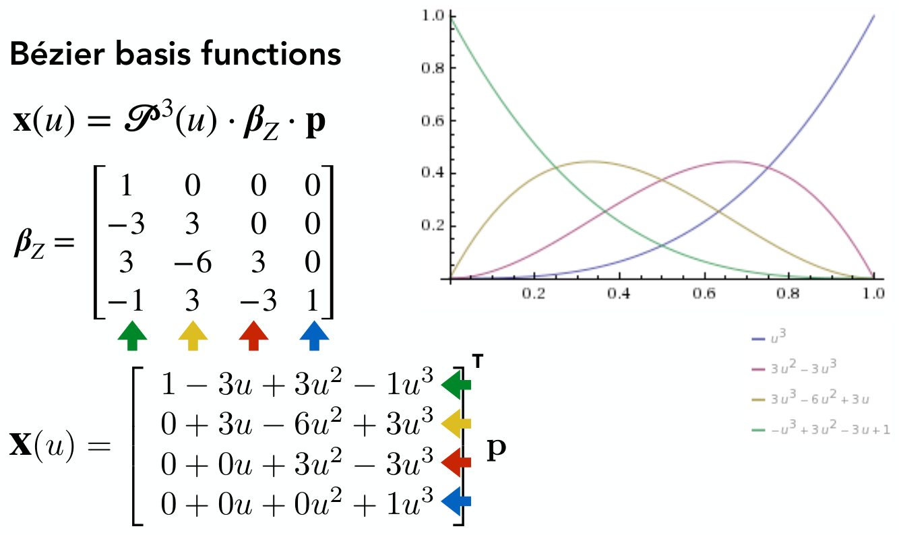

## 第 61 页 · Useful Properties of a Basis

Convex Hull Property

- All points on curve inside convex hull of control points

p

bᵢ(u) ≥0

∀u ∈ Ω

## 第 62 页 · What’s a Convex Hull

[from Wikipedia]

## 第 63 页 · Useful Properties of a Basis

Convex Hull Property

- All points on curve inside convex hull of control points
- Bézier basis has convex hull property!
- Convex hull if the following are true:
- Basis functions sum to one
- Basis functions are positive over domain

ver domain

Linear interpolation

among p0, p1, p2, p3

Ren Ng, James O’Brien

$$
\sum_i b_i(u)=1,\qquad b_i(u)\geq0\quad\text{for all }u\in\Omega.
$$

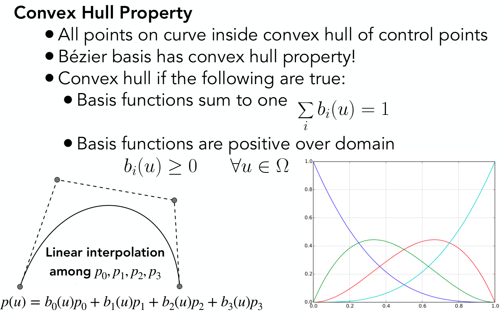

## 第 64 页 · Useful Properties of a Basis

Invariance under class of transforms

- Transforming curve is same as transforming control points
- Bézier basis invariant w.r.t. affine transforms

Af(x) = f(Ax)

仿射不变性

T ⋅p₀

T ⋅p₁

T ⋅p₂

T ⋅p₃

p₀

p₁

p₂

p₃

x(u) = 퓟³(u) ⋅β\_Z ⋅

T ⋅x(u) = 퓟³(u) ⋅β\_Z ⋅

## 第 65 页 · Useful Properties of a Basis

Invariance under class of transforms

- Transforming curve is same as transforming control points
- Bézier basis invariant w.r.t. affine transforms
- Bézier NOT invariant for perspective transforms
- NURBS are invariant w.r.t. perspective transforms

p₀

p₁

p₂

p₃

T ⋅p₀

T ⋅p₁

T ⋅p₂

T ⋅p₃

x(u) = 퓟³(u) ⋅β\_Z ⋅

T ⋅x(u) = 퓟³(u) ⋅β\_Z ⋅

## 第 66 页 · More Useful Properties of a Basis

- Local support
- Changing one control point does not change the entire curve

Local support

## 第 67 页 · Properties of Bézier Curves

Interpolates endpoints

- For cubic Bézier:

b(0) = b₀;

b(1) = b₃

Tangent to end segments

- Cubic case:

b′(0) = 3(b₁ −b₀);

b′(1) = 3(b₃ −b₂)

Affine transformation property

- Transform curve by transforming control points

Convex hull property

- Curve is within convex hull of control points

Well behaved

Local control (when joining)

## 第 68 页 · Evaluating Bézier Curves

Matrix Formula

## 第 69 页 · Bézier Curve – Matrix Formula

For now, assume

$$
\mathbf x(u)=[1,u,u^2,u^3]\beta_Z\mathbf p,\qquad
\beta_Z=\begin{bmatrix}1&0&0&0\\-3&3&0&0\\3&-6&3&0\\-1&3&-3&1\end{bmatrix}.
$$

## 第 70 页 · Evaluating Bézier Curves

De Casteljau Algorithm

## 第 71 页 · Bézier Curves – de Casteljau Algorithm

Consider three points (quadratic Bezier)

b₁

Pierre Bézier

1910 – 1999

b₀

b₂

Paul de Casteljau

1930 – 2022

## 第 72 页 · Bézier Curves – de Casteljau Algorithm

Insert a point using linear interpolation

b₁

Pierre Bézier

b¹

(1 −t)

1910 – 1999

0

t)

b₀

b₂

t

1

Paul de Casteljau

1930 – 2022

## 第 73 页 · Bézier Curves – de Casteljau Algorithm

Insert on both edges

b₁

b¹

t)

1

Pierre Bézier

1910 – 1999

0

(1 −t)

b₀

b₂

t

Paul de Casteljau

1930 – 2022

## 第 74 页 · Bézier Curves – de Casteljau Algorithm

Repeat recursively

b₁

b¹

1

b²

Pierre Bézier

0

1910 – 1999

(1 −t)

t)

b₀

b₂

t

Paul de Casteljau

1930 – 2022

## 第 75 页 · Bézier Curves – de Casteljau Algorithm

文字同第 74 页。

## 第 76 页 · Bézier Curves – de Casteljau Algorithm

Algorithm defines the curve

b₁

b¹

b²

Pierre Bézier

1

0

1910 – 1999

b₀

b₂

“Corner cutting” recursive subdivision

Successive linear interpolation

1930 – 2022

Paul de Casteljau

b. 1930

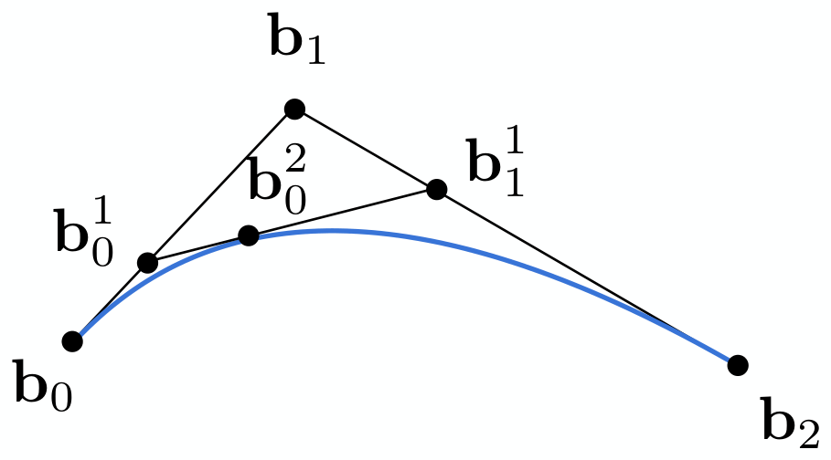

## 第 77 页 · Cubic Bézier Curve – de Casteljau

Consider four points Same recursive linear interpolations

b⁰

2

1

0

3

## 第 78 页 · Cubic Bézier Curve – de Casteljau

Consider four points Same recursive linear interpolations

b⁰

2

1

(1 −t)

b¹

0

t

3

## 第 79 页 · Cubic Bézier Curve – de Casteljau

Consider four points Same recursive linear interpolations

b⁰

2

b¹

1

0

3

t

## 第 80 页 · Cubic Bézier Curve – de Casteljau

文字同第 79 页。

## 第 81 页 · Cubic Bézier Curve – de Casteljau

Consider four points Same recursive linear interpolations

b⁰

2

b¹

1

b²

0

3

t

## 第 82 页 · Cubic Bézier Curve – de Casteljau

Consider four points Same recursive linear interpolations

b⁰

2

b¹

1

b³

b²

0

x(t)

3

t

## 第 83 页 · Cubic Bézier Curve – de Casteljau

Consider four points Same recursive linear interpolations

$$
b_i^{(r)}(t)=(1-t)b_i^{(r-1)}(t)+t\,b_{i+1}^{(r-1)}(t),\qquad b_i^{(0)}=b_i.
$$

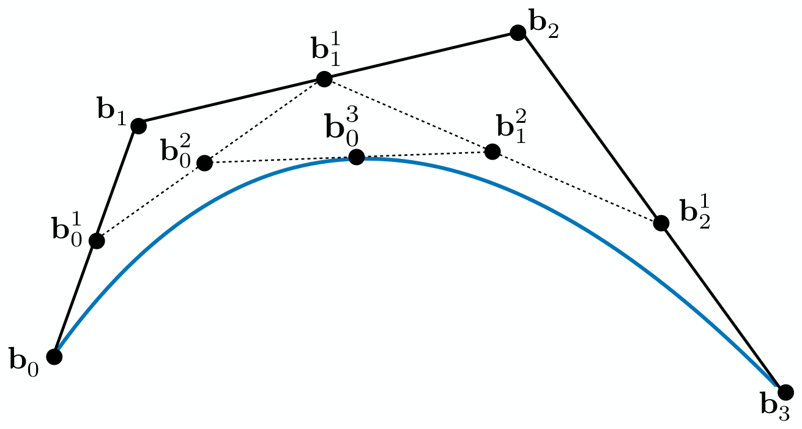

## 第 84 页 · Visualizing de Casteljau Algorithm

Animation: Steven Wittens, Making Things with Maths, http://acko.net

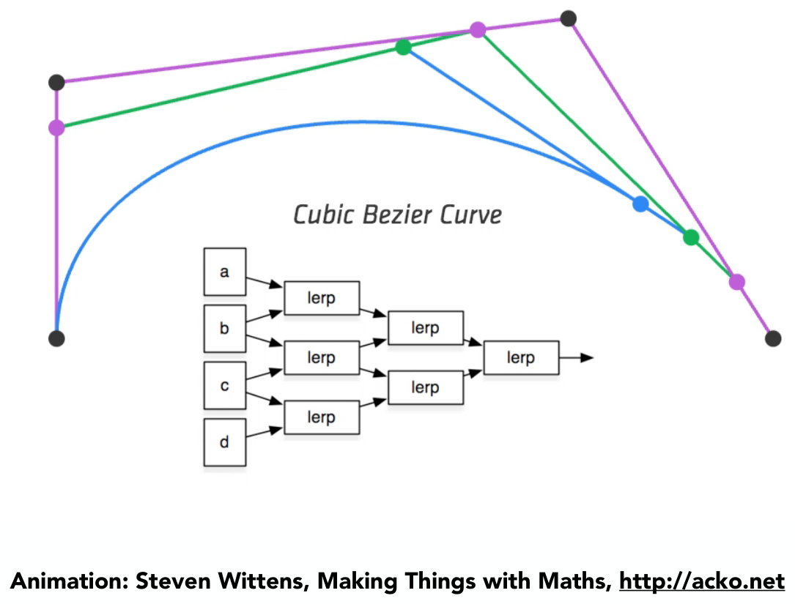

## 第 85 页 · Bézier Curve – Algebraic Formula

de Casteljau algorithm gives a pyramid of coefficients

Every rightward arrow is multiplication by t,

Every leftward arrow by (1–t)

$$
b_i^{(r)}(t)=(1-t)b_i^{(r-1)}(t)+t\,b_{i+1}^{(r-1)}(t),\qquad b_i^{(0)}=b_i.
$$

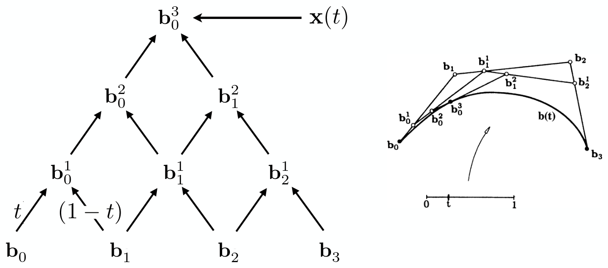

## 第 86 页 · Bézier Curve – Algebraic Formula

Example: quadratic Bézier curve from three points

$$
b_0^{(2)}(t)=(1-t)^2b_0+2t(1-t)b_1+t^2b_2.
$$

## 第 87 页 · Bézier Curve – Algebraic Formula

T

$$
b_0^{(3)}(t)=(1-t)^3 b_0+3t(1-t)^2 b_1+3t^2(1-t)b_2+t^3 b_3.
$$

## 第 88 页 · Bézier Curve - General Algebraic Formula

Bernstein form of a Bézier curve of order n:

Bézier curve order n

Bernstein polynomial

(vector polynomial of degree n)

(scalar polynomial of degree n)

Bézier control points

(vector in RN)

Bernstein polynomials:

$$
\mathbf b^n(t)=\sum_{i=0}^n\mathbf b_i B_i^n(t),\qquad
B_i^n(t)=\binom ni t^i(1-t)^{n-i}.
$$

## 第 89 页 · Bézier Curve - Algebraic Formula: Example

Bernstein form of a Bézier curve of order n:

Example: assume n = 3 and we are in R3

i.e. we could have control points in 3D such as:

These points define a Bezier curve in 3D that is a cubic polynomial in t:

$$
b_0^{(3)}(t)=(1-t)^3 b_0+3t(1-t)^2 b_1+3t^2(1-t)b_2+t^3 b_3.
$$

## 第 90 页 · Cubic Bézier Basis Functions

Bernstein Polynomials

Sergei N. Bernstein

1880 – 1968

$$
\mathbf b^n(t)=\sum_{i=0}^n\mathbf b_i B_i^n(t),\qquad
B_i^n(t)=\binom ni t^i(1-t)^{n-i}.
$$

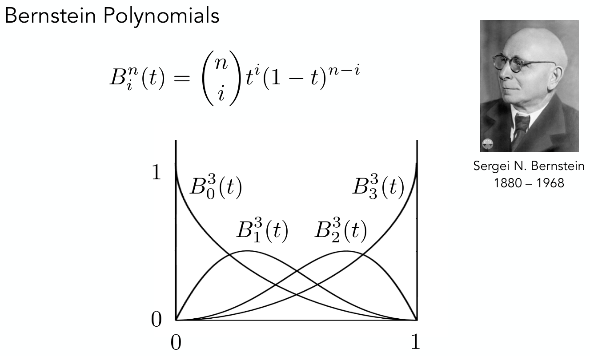

## 第 91 页 · Piecewise Bézier Curves

(Bézier Spline)

## 第 92 页 · Higher Orders Bézier Curves?

Very hard to control!

Uncommon

## 第 93 页 · Piecewise Bézier Curves

Instead, chain many low-order Bézier curve

Piecewise cubic Bézier the most common technique

Widely used (fonts, paths, Illustrator, Keynote, …)

## 第 94 页 · Demo – Piecewise Cubic Bézier Curve

David Eck, http://math.hws.edu/eck/cs424/notes2013/canvas/bezier.html

## 第 95 页 · Piecewise Bézier Curve – Continuity

Two Bézier curves

a : [k, k + 1] → IR^N

b : [k + 1, k + 2] → IR^N

a₃

b₀

b₁

Assuming integer partitions here,

a₂

can generalize

b₂

a₁

a₀

b₃

k + 1

k + 2

k

Definition

## 第 96 页 · Piecewise Bézier Curve – Continuity

C0 continuity:

$$
C^0:\quad a_n=b_0.
$$

## 第 97 页 · Piecewise Bézier Curve – Continuity

C1 continuity:

1     :     1

$$
C^1:\quad a_n=b_0=\tfrac12(a_{n-1}+b_1).
$$

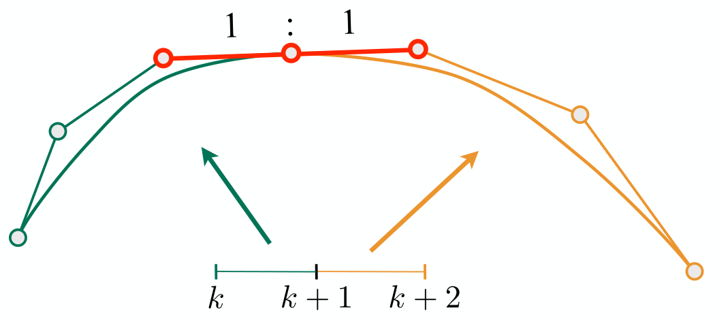

## 第 98 页 · Bézier Surfaces

## 第 99 页 · Bézier Surfaces

Extend Bézier curves to surfaces

renderspirit.com

P. Rideout

Ed Catmull’s “Gumbo” model

Utah Teapot

## 第 100 页 · Bicubic Bézier Surface Patch

Bezier surface and 4 x 4 array of control points

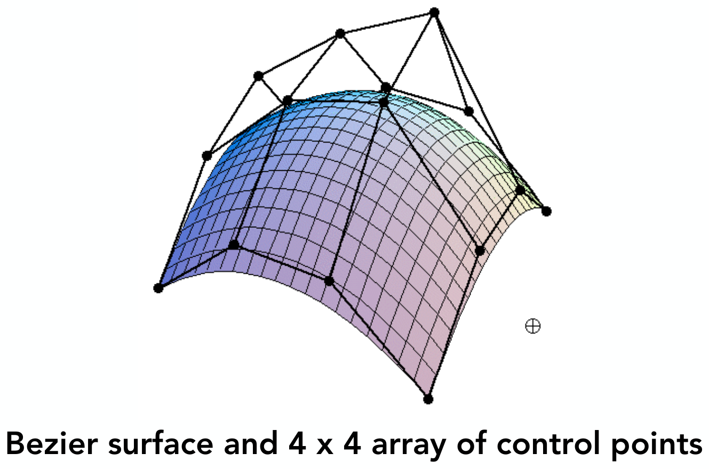

## 第 101 页 · Visualizing Bicubic Bézier Surface Patch

Animation: Steven Wittens, Making Things with Maths, http://acko.net

## 第 102 页 · Visualizing Bicubic Bézier Surface Patch

4x4 control points

- Each 4x1 control points in u define a Bezier curve
    - (4 Bezier curves in u)
- Corresponding points on these 4 Bezier curves define 4 control points for a “moving curve” in v
    - This “moving” curve sweeps out the 2D surface

## 第 103 页 · Evaluating Bézier Surfaces

## 第 104 页 · Evaluating Surface Position For Parameters (u,v)

For bi-cubic Bezier surface patch, Input: 4x4 control points Output is 2D surface parameterized by (u,v) in [0,1]2

## 第 105 页 · Method 1: Separable 1D de Casteljau Algorithm

Goal: Evaluate surface position corresponding to (u,v)

(u,v)-separable application of de Casteljau algorithm

- Use de Casteljau to evaluate point u on each of the 4 Bezier curves in u. This gives 4 control points for the “moving” Bezier curve
- Use 1D de Casteljau to evaluate point v on the “moving” curve

Bezier curves in u

“Moving” Bezier curve

u

v

Surface point (u,v)

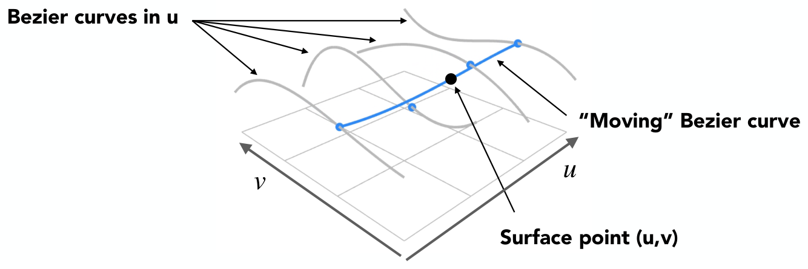

## 第 106 页 · Method 1: Separable 1D de Casteljau Algorithm

## 第 107 页 · Method 2: Algebraic Evaluation

Let the moving curve be a degree m Bézier curve

(remember, Bernstein polynomials)

Let each control point bi be moving along a Bézier curve of degree n

Tensor product Bézier patch

$$
\mathbf b^{m,n}(u,v)=\sum_{i=0}^m\sum_{j=0}^n \mathbf b_{i,j} B_i^m(u)B_j^n(v).
$$

## 第 108 页 · Method 3: Linear Algebra Method 3: Linear Algebra

Method 2: Linear Algebra

p\_{0,0}

p\_{0,1}

p\_{0,2}

p\_{0,3}

p₀

p₁

p₂

p₃

p₀(v) = 퓟³(v) ⋅β\_Z ⋅

x(u) = 퓟³(u) ⋅β\_Z ⋅

p\_{1,0}

p\_{1,1}

p\_{1,2}

p\_{1,3}

p₁(v) = 퓟³(v) ⋅β\_Z ⋅

p\_{2,0}

p\_{2,1}

p\_{2,2}

p\_{2,3}

p₂(v) = 퓟³(v) ⋅β\_Z ⋅

v

u

p\_{3,0}

p\_{3,1}

p\_{3,2}

p\_{3,3}

p₃(v) = 퓟³(v) ⋅β\_Z ⋅

## 第 109 页 · Method 3: Linear Algebra

Method 2: Linear Algebra

$$
\mathbf x(u,v)=\mathcal P^3(u)\beta_Z P\beta_Z^{\mathsf T}\mathcal P^3(v)^{\mathsf T},\quad \mathcal P^3(t)=[1,t,t^2,t^3].
$$

## 第 110 页 · Method 4: Bézier Subdivision

## 第 111 页 · Bézier Subdivision

x(u) = [1,u,u2,u3]bzP

1

0

−3

3

−6

−1

bz =

$$
\mathbf x(u)=[1,u,u^2,u^3]\beta_Z P,\qquad \beta_Z=\begin{bmatrix}1&0&0&0\\-3&3&0&0\\3&-6&3&0\\-1&3&-3&1\end{bmatrix}.
$$

## 第 112 页 · Bézier Subdivision

x(u) = [1,u,u2,u3]bzP

1

0

−3

3

−6

−1

bz =

u ∈ [0..1/2]

u ∈ [1/2..1]

$$
\mathbf x(u)=[1,u,u^2,u^3]\beta_Z P,\qquad \beta_Z=\begin{bmatrix}1&0&0&0\\-3&3&0&0\\3&-6&3&0\\-1&3&-3&1\end{bmatrix}.
$$

## 第 113 页 · Bézier Subdivision

x(u) = [1,u,u2,u3]bzP

Can’t change these....

1

0

−3

3

−6

−1

bz =

u ∈ [0..1]

$$
\mathbf x(u)=[1,u,u^2,u^3]\beta_Z P,\qquad \beta_Z=\begin{bmatrix}1&0&0&0\\-3&3&0&0\\3&-6&3&0\\-1&3&-3&1\end{bmatrix}.
$$

## 第 114 页 · Bézier Subdivision

u ∈ [0..1

x(u) = [1,u,u2,u3]bzP

2]

2,u2

4 ,u3

u ∈ [0..1]

x(u) = [1,u

8 ]bzP

x(u) = [1,u,u2,u3]S1bzP

1

0

1/2

1/4

1/8

S1 =

$$
\mathbf x(u/2)=[1,u/2,u^2/4,u^3/8]\,\beta_ZP=[1,u,u^2,u^3]S_1\beta_ZP,\qquad S_1=\operatorname{diag}(1,1/2,1/4,1/8).
$$

## 第 115 页 · Bézier Subdivision

x(u) = [1,u,u2,u3]bzP

u ∈ [0..1

2]

2,u2

4 ,u3

u ∈ [0..1]

x(u) = [1,u

8 ]bzP

x(u) = [1,u,u2,u3]S1bzP

x(u) = [1,u,u2,u3]bzb−1

z S1bzP

1

0

1/2

1/4

1/8

x(u) = [1,u,u2,u3]bzHz1P

S1 =

$$
[1,u,u^2,u^3]S_1\beta_Z P=[1,u,u^2,u^3]\beta_Z H_{Z1} P,\qquad H_{Z1}=\beta_Z^{-1}S_1\beta_Z.
$$

## 第 116 页 · Bézier Subdivision

x(u) = [1,u,u2,u3]bzb−1

z S1bzP

x(u) = [1,u,u2,u3]bzHz1P x(u) = [1,u,u2,u3]bzP1

1

0

2

4

Hz1 =

8

3

P1 = Hz1P

1/2

1/4

1/8

S1 =

$$
P_1=H_{Z1}P,\qquad H_{Z1}=\frac18
\begin{bmatrix}8&0&0&0\\4&4&0&0\\2&4&2&0\\1&3&3&1\end{bmatrix}.
$$

## 第 117 页 · Bézier Subdivision

x(u) = [1,u,u2,u3]bzP2

P2 = Hz2P

1

8

0

4

3

2

Hz2 =

S2 =

$$
P_2=H_{Z2}P,\qquad H_{Z2}=\frac18
\begin{bmatrix}1&3&3&1\\0&2&4&2\\0&0&4&4\\0&0&0&8\end{bmatrix}.
$$

## 第 118 页 · Bézier Subdivision

P1 = Hz1P

P2 = Hz2P

1

0

2

4

Hz1 =

8

3

Hz2 =

Rows of H\_Z\_⋅

sum to  and ≥0

⇒ Convex Hull ⇒

P1 and P2 ∈ConvexHull (P)

Curve remains constant ⇒

Control Mesh converges to surface!!

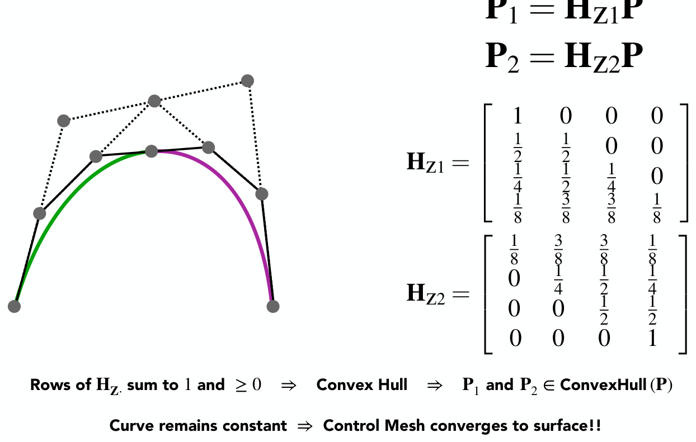

## 第 119 页 · Bézier Subdivision

P1 = Hz1P

P2 = Hz2P

1

0

2

4

Hz1 =

8

3

Hz2 =

Rows of

sum to  and

Convex Hull

P1 and P2 ∈ConvexHull (P)

Curve remains constant

Control Mesh converges to surface!!

$$
P_{11}=H_{Z1}P_1=H_{Z1}^2P.
$$

## 第 120 页 · Bézier Subdivision

P1 = Hz1P

P2 = Hz2P

1

0

2

4

Hz1 =

8

3

Hz2 =

Rows of

sum to  and

Convex Hull

P1 and P2 ∈ConvexHull (P)

Curve remains constant

Control Mesh converges to surface!!

$$
P_{12}=H_{Z2}P_1=H_{Z2}H_{Z1}P.
$$

## 第 121 页 · Bézier Subdivision

P2· = HZ2 P

x(u,v) = [1,u,u2,u3]bzPb

Tz[1,v,v2,v3]

T

4 x 4 matrix of control points

p\_{0,0} p\_{0,1} p\_{0,2} p\_{0,3}

p\_{1,0} p\_{1,1} p\_{1,2} p\_{1,3}

p\_{2,0} p\_{2,1} p\_{2,2} p\_{2,3}

p\_{3,0} p\_{3,1} p\_{3,2} p\_{3,3}

x(u, v) = 퓟³(u) ⋅β\_Z ⋅

⋅β^햳

\_Z ⋅퓟³(v)^햳

## 第 122 页 · Bézier Subdivision

P21 = HZ2 P HT

Z1

x(u,v) = [1,u,u2,u3]bzPb

Tz[1,v,v2,v3]

T

4 x 4 matrix of control points

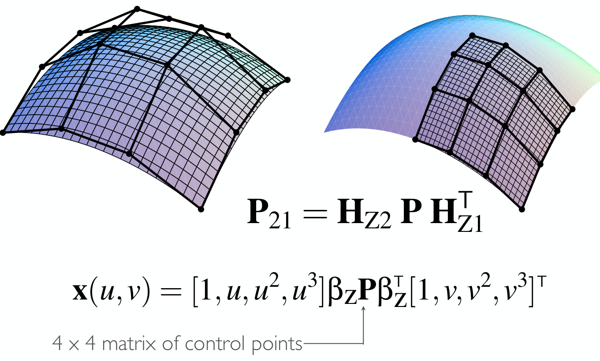

## 第 123 页 · Bézier Surface Continuity

## 第 124 页 · Piecewise Bézier Surfaces

C0 continuity: Boundary curves

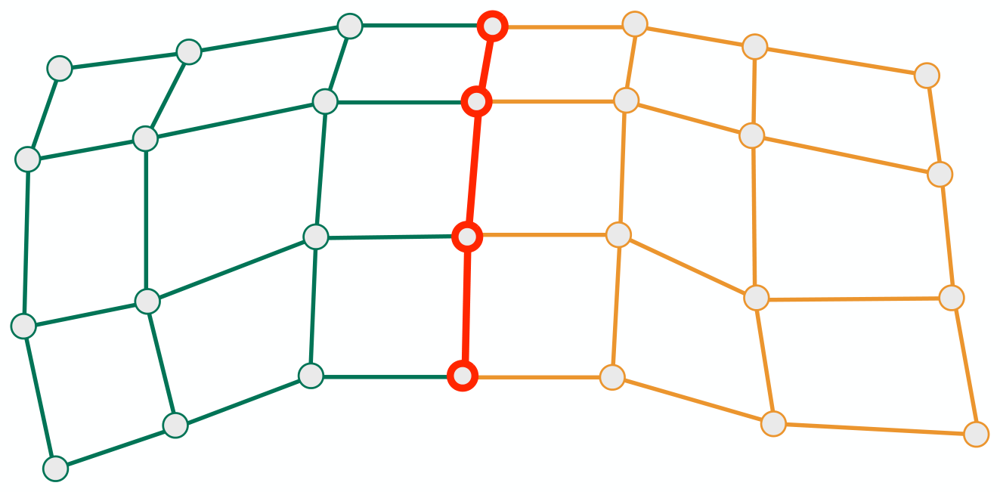

## 第 125 页 · Piecewise Bézier Surfaces

C1 continuity: Collinearity

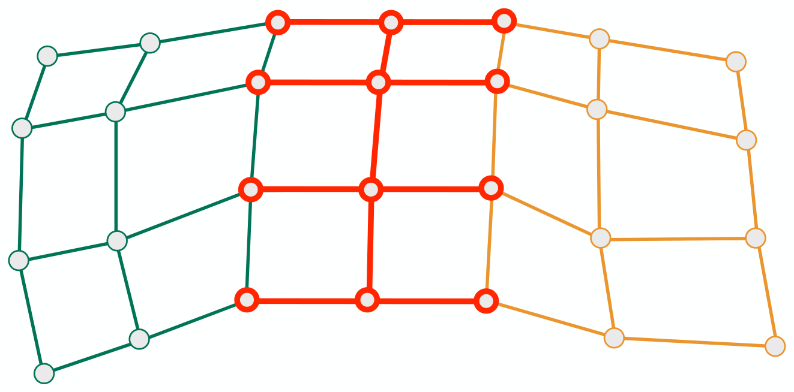

## 第 126 页 · Piecewise Bézier Surfaces

文字同第 125 页。

## 第 127 页 · Things to Remember

Splines

- Cubic Hermite and Catmull-Rom interpolation
- Matrix representation of cubic polynomials

Bézier curves

- Easy-to-control spline
- Recursive linear interpolation – de Casteljau algorithm
- Properties of Bézier curves
- Piecewise Bézier curve – continuity types and how to achieve

Bézier surfaces

- Bicubic Bézier patches – tensor product surface
- 2D de Casteljau algorithm
