# Lecture 9 · Mesh Representation & Geometry Processing

原课件共 96 页。[打开 PDF](../../ppt/lec-09-geometry-processing.pdf)

按 PDF 页序提取，保留课件原有中英文。关键公式以 Markdown 数学式或原页局部图呈现。

## 第 1 页 · Mesh Representation & Geometry Processing

Computer Graphics 2026 Fuzhou University - Computer Science

## 第 2 页 · Mesh Representations

网格表示

## 第 3 页

“网”格 &lt;—&gt; 线框

## 第 4 页 · A Small Triangle Mesh

8 vertices, 12 triangles

## 第 5 页 · List of Triangles

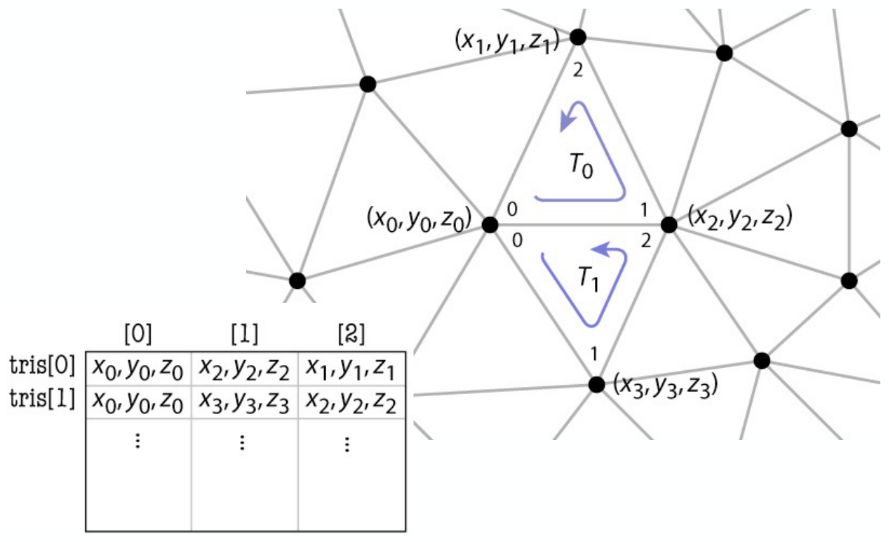

## 第 6 页 · Lists of Points / Indexed Triangle

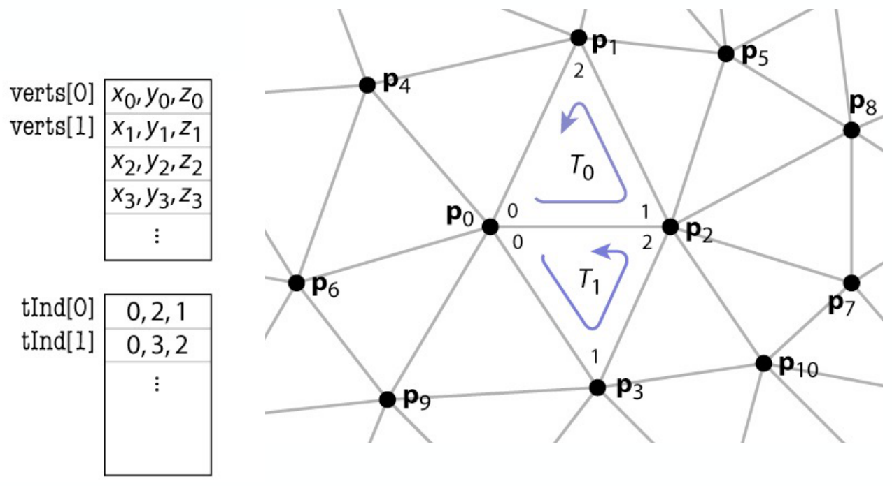

## 第 7 页 · Comparison

Triangles

+ Simple

– Redundant information

Points + Triangles

+ Sharing vertices reduces memory usage

+ Ensure integrity of the mesh (moving a vertex causes that vertex in all the polygons to move)

## 第 8 页 · Good Data Structure For Mesh

- Constant time access to neighbors e.g. surface normal calculation, subdivision
- Editing the geometry e.g. adding/removing vertices, faces, edges, etc.

```text
c
```

flip

```text
           c
a                      d
```

- Can we do better?

```text
a                      d
                                                                     c
```

split

```text
                                                                                         c
b                              b
                                               a                      d       a           m          d
                                                          b                              b
               a
```

collapse

```text
                                                        a
c                                                         m
               d
       b                                                b
```

## 第 9 页 · Bitmap Images

To encode images, we used a regular grid of pixels:

## 第 10 页 · But images are not fundamentally made of little squares:

photomicrograph of paint

Goyō Hashiguchi, Kamisuki (ca 1920)

## 第 11 页 · So why did we choose a square grid?

Rather than dozens of possible alternatives?

## 第 12 页 · Regular grids make life easy

- One reason: SIMPLICITY/EFFICIENCY
    - E.g., always have four neighbors

```text
(i,j-1)
```

- Easy to index, easy to filter…
- Storage is just a list of numbers

```text
(i-1,j)  (i,j)  (i+1,j)
```

- Another reason: GENERALITY
    - Can encode basically any image

```text
(i,j+1)
```

- Are regular grids always the best choice for bitmap images?
    - No. E.g., suffer from anisotropy, don’t capture edges,…
    - But more often than not are a pretty good choice
- Similar story with geometry…

## 第 13 页 · So, how should we encode 3d objects?

## 第 14 页 · • Pixel -&gt; Voxel

- Solid model
- Too expensive

## 第 15 页 · Smooth Surfaces

- Intuitively, a surface is the boundary or “shell” of an object
- (Think about the candy shell, not the chocolate.)
- Surfaces are manifold:
    - If you zoom in far enough (at any point) looks like a plane
    - E.g., the Earth from space vs. from the ground

## 第 16 页 · Isn’t every shape manifold?

流

形

- No, for instance:

Center point never looks like the plane, no matter how close we get.

流形的局部放大后近似平面，图中形状的中心点处不能，固非流形

## 第 17 页 · Manifold Definition

Definition: a 2D manifold is a surface that when cut with a small sphere always yields a disk.

Manifold

Not manifold

Mesh manifolds have the following properties:

- An edge connects exactly two faces
- An edge connects exactly two vertices
- A face consists of a ring of edges and vertices
- A vertex consists of a ring of edges and faces
- Euler’s formula #f - #e + #v = 2 (for a surface topologically equivalent to a sphere) (Check for a cube: 6 – 12 + 8 = 2)

With border

Manifold with boundary: cut with a small sphere yields a half-disc.

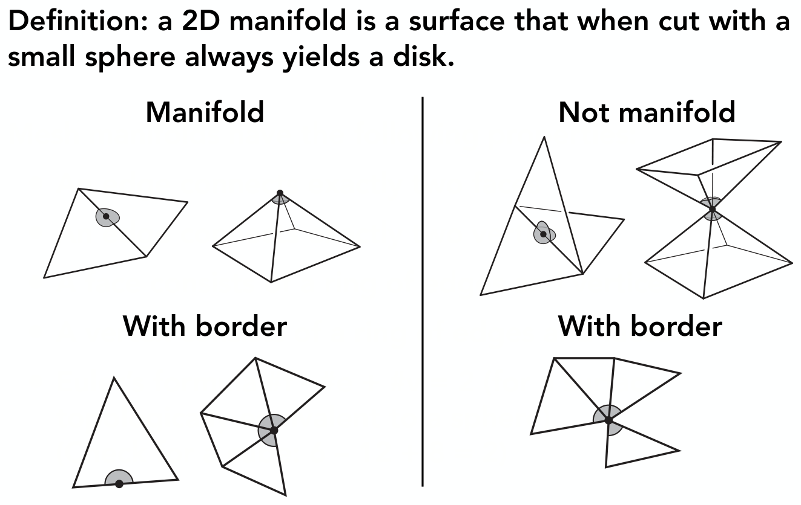

## 第 18 页 · More Examples of Smooth Surfaces

- Which of these shapes are manifold?

## 第 19 页 · A manifold polygon mesh has fans, not fins

- For polygonal surfaces just two easy conditions to check:
    - Every edge is contained in only two polygons (no “fins”)
    - The polygons containing each vertex make a single “fan”

YES

NO

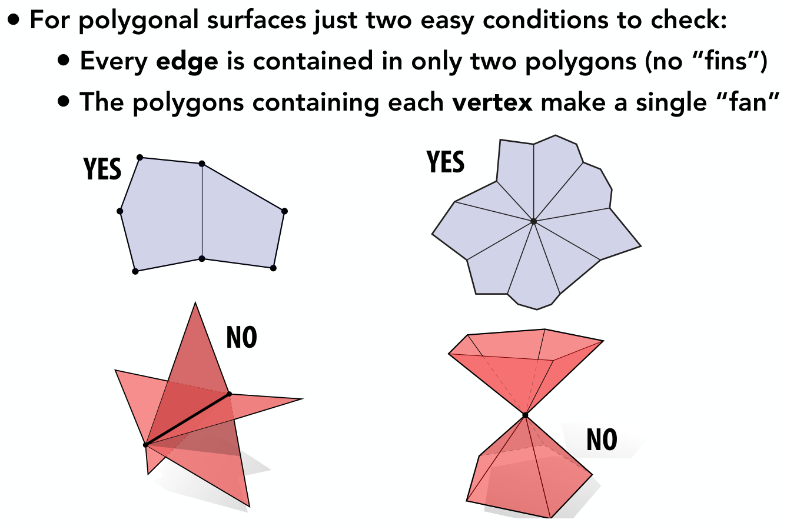

## 第 20 页 · Why is the manifold assumption useful?

## 第 21 页 · Keep it Simple!

- Same motivation as for images:
    - Make some assumptions about our geometry to keep data structure/algorithms simple and efficient
    - In many common cases, doesn’t fundamentally limits what we can do with geometry

```text
        (i,j-1)
(i-1,j)  (i,j)  (i+1,j)
        (i,j+1)
```

## 第 22 页 · How do we actually encode all this data?

## 第 23 页 · Adjacency List (Array-like)

邻接表

```text
3
```

- Store triples of coordinates (x,y,z), tuples of indices
- E.g., tetrahedron:

VERTICES

POLYGONS

```text
    x  y  z      i  j  k
0: -1 -1 -1      0  2  1
                                               2
1:  1 -1  1      0  3  2
2:  1  1 -1      3  0  1
                           0
3: -1  1  1      3  1  2
```

- Q: How do we find all the polygons touching vertex 2?
- Ok, now consider a more complicated mesh:

```text
1
```

~1 billion polygons

Very expensive to find the neighboring triangles! (What’s the cost?)

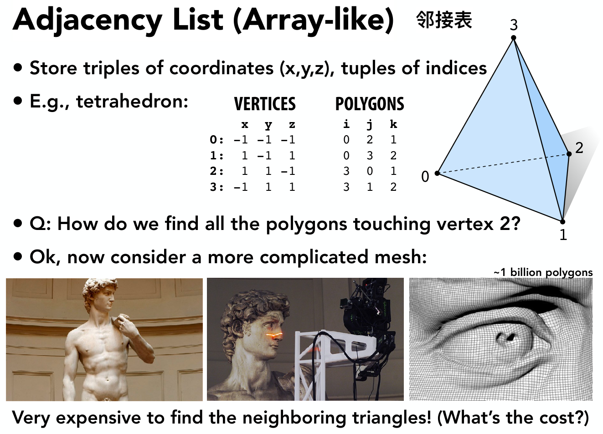

## 第 24 页 · Incidence Matrices

Incidence Matrices

关联矩阵

- If we want to answer neighborhood queries, why not simply store a list of neighbors?
- Can encode all neighbor information via incidence matrices
- E.g., tetrahedron:

VERTEX⬌EDGE

EDGE⬌FACE

```text
  v0 v1 v2 v3    e0 e1 e2 e3 e4 e5
                                  e5
                                             v3
                                             v3
e0 1  1  0  0    f0 1  0  0  1  0  1
                                   1
e1 0  1  1  0    f1 0  1  0  0  1  1
                                   1
e2 1  0  1  0    f2 1  1  1  0  0  0
                                   0
e3 1  0  0  1    f3 0  0  1  1  1  0
                                   0             e4
                                                 e4
                                       e3
                                       e3   f3
                                            f3
e4 0  0  1  1
e5 0  1  0  1                               f0
                                            f0
                                               e
                                               e5
                                           e2       v2
                                                 f1
                                   v0         f2
```

- 1 means “touches”; 0 means “does not touch”
- Instead of storing lots of 0’s, use sparse matrices
- Still large storage cost, but finding neighbors is now O(1)
- Hard to change connectivity, since we used fixed indices

```text
        e1
e0
```

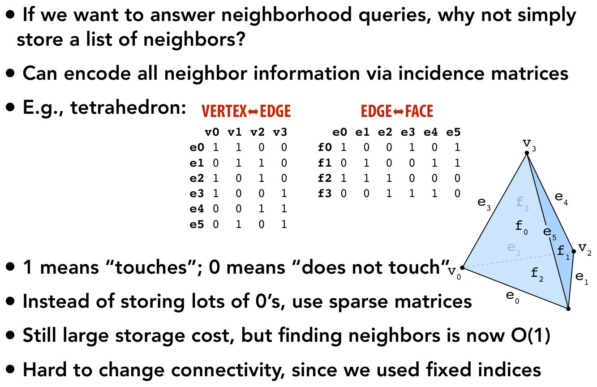

## 第 25 页 · Half-Edge Data Structure (Linked-list-like)

（半边）

- Store some information about neighbors
- Don’t need an exhaustive list; just a few key pointers
- Key idea: two halfedges act as “glue” between mesh elements:
- 每条边被拆成两条“半边”， 每条半边都有方向，并且记录邻接信息。
- 比如一条边连接顶点 A 和 B： 在半边结构中，这条边会被拆为：

HalfEdge₁：从 A 指向 B HalfEdge₂：从 B 指向 A

- 这两条半边互为对偶（twin）。

## 第 26 页 · Half-Edge Data Structure (Linked-list-like)

- 每条边被拆成两条“半边”， 每条半边都有方向，并且记录邻接信息。
- 比如一条边连接顶点 A 和 B： 在半边结构中，这条边会被拆为：

HalfEdge₁：从 A 指向 B HalfEdge₂：从 B 指向 A

- 这两条半边互为对偶（twin）。

```text
struct Halfedge
{                                                        struct Edge
   Halfedge* twin;                                       {
   Halfedge* next;                                       Halfedge* halfedge;
   Vertex* vertex;                                       };
   Edge* edge;
   Face* face;
};
```

halfedge

edge

```text
                                                                                                            Face
                                                                                struct Face
                                                                                {
                                                                                Halfedge* halfedge;
                                                                                };
next
```

Halfedge

```text
               twin
face
                                                                                  halfedge
                                                                       vertex
                                                          struct Vertex
         vertex
                                                          {
                                                          Halfedge* halfedge;
                                                          };
```

## 第 27 页 · Half-Edge Data Structure

Key idea: two half-edges act as “glue” between mesh elements.

```cpp
struct Halfedge {
    Halfedge *twin;
    Halfedge *next;
    Vertex *vertex;
    Edge *edge;
    Face *face;
}

struct Vertex {
    Point pt;
    Halfedge *halfedge;
}

struct Edge {
    Halfedge *halfedge;
}

struct Face {
    Halfedge *halfedge;
}
```

Each vertex, edge and face points to one of its half edges.

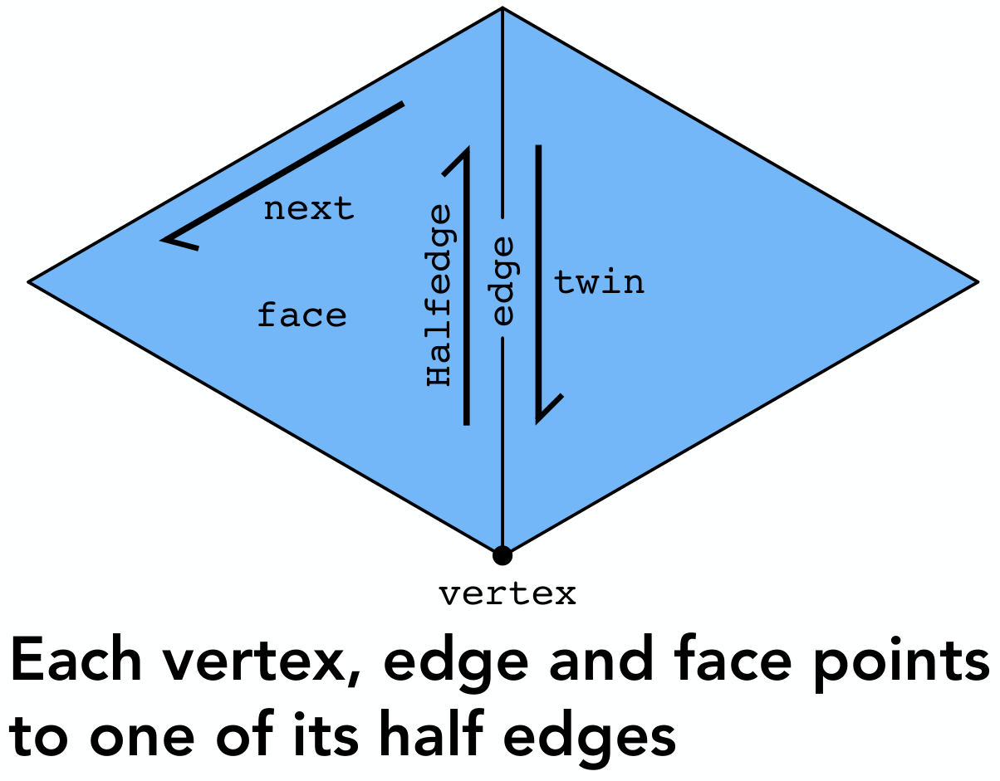

## 第 28 页 · Half-Edge Facilitates Mesh Traversal

Use twin and next pointers to move around mesh.

Process vertex, edge and/or face pointers.

Example 1: process all vertices of a face.

```cpp
Halfedge* h = f->halfedge;
do {
    process(h->vertex);
    h = h->next;
}
while (h != f->halfedge);
```

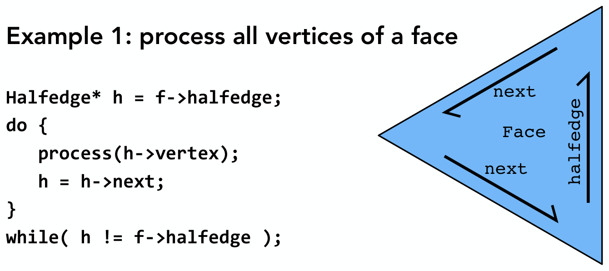

## 第 29 页 · Half-Edge Facilitates Mesh Traversal

Example 2: process all edges around a vertex.

```cpp
Halfedge* h = v->halfedge;
do {
    process(h->edge);
    h = h->twin->next;
}
while (h != v->halfedge);
```

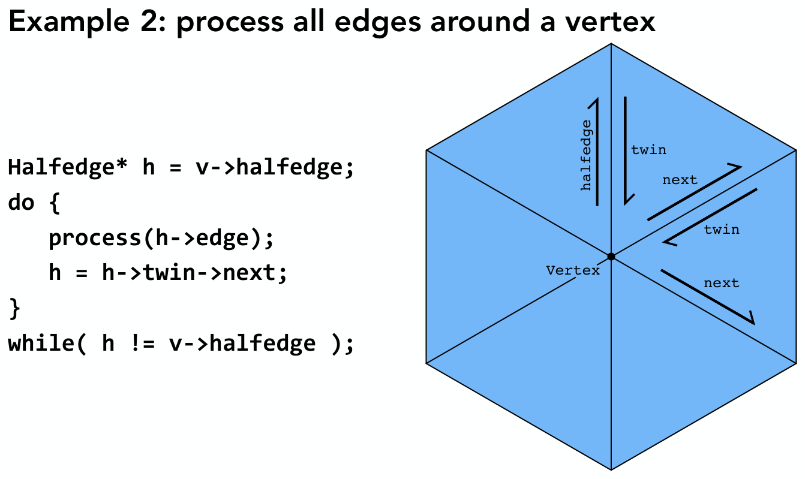

## 第 30 页 · Half-Edge Data Structure

- “半边数据结构” 就像在每条边上放两条带方向的箭头， 每个箭头都知道：
    - 自己从哪个点出发（vertex）
    - 指向哪个面（face）
    - 下一个箭头是谁（next）
    - 自己的反方向箭头是谁（twin）

这样一来，整个网格就变成一个可以“顺着箭头走”的拓扑网络。 任何点、边、面之间的关系都能通过这些指针快速找到。

## 第 31 页 · Half-Edge Meshes are Easy to Edit

- Remember key feature of linked list: insert/delete elements
- E.g., for triangle meshes, several atomic operations:

flip

```text
           c                              c
                               a
a                      d                              d
```

split

```text
                                                          c                              c
b                              b
                                               a                      d       a           m          d
                                                          b                              b
               a
```

collapse

```text
                                                        a
                                                          m
c              d
       b                                                b
```

- How? Allocate/delete elements; reassigning pointers.
- Must be careful to preserve manifoldness!

## 第 32 页 · Edge Flip (Triangles)

- Triangles (a,b,c), (b,d,c) become (a,d,c), (a,b,d):

```text
c                              c
```

flip

```text
a                      d       a                      d
           b                              b
```

- Long list of pointer reassignments (edge-&gt;halfedge = …)
- However, no elements created/destroyed.

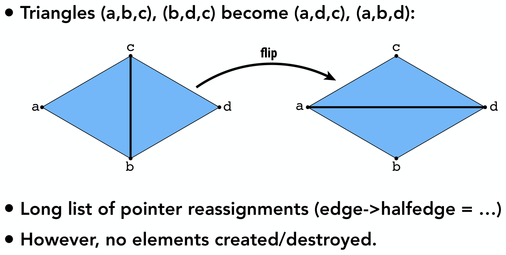

## 第 33 页 · Edge Split (Triangles)

- Insert midpoint m of edge (c,b), connect to get four triangles:

```text
c                              c
```

split

```text
a                      d       a                      d
                                           m
           b                              b
```

- This time, have to add new elements.
- Lots of pointer reassignments.

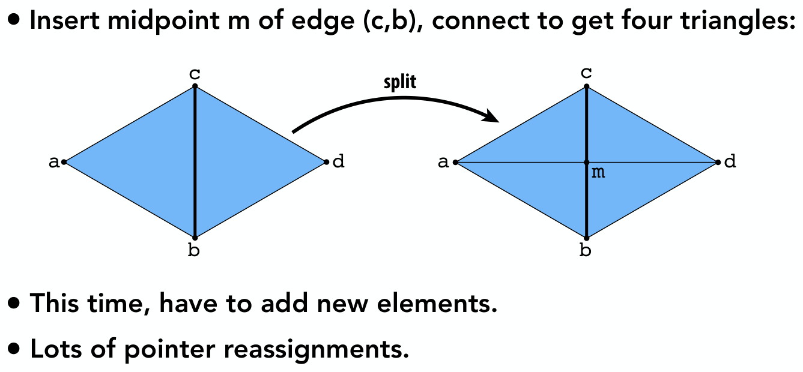

## 第 34 页 · Edge Collapse (Triangles)

- Replace edge (b,c) with a single vertex m:

```text
a                                                a
```

collapse

```text
                                                          m
c              d
       b                                                b
```

- Now have to delete elements.
- Still lots of pointer assignments!

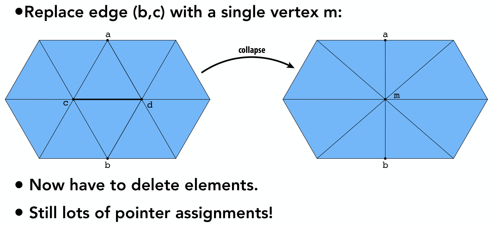

## 第 35 页 · Geometry Processing

## 第 36 页 · Digital Geometry Processing Digital Geometry Processing

- Extend traditional digital signal processing (audio, video, etc.) to deal with geometric signals:
    - Upsampling/ downsampling/ resampling/ filtering …
    - Aliasing (reconstructed surface gives “false impression”)

## 第 37 页 · Digital Geometry Processing

3D Scanning

3D Printing

## 第 38 页 · Geometry Processing Pipeline

scan

print

process

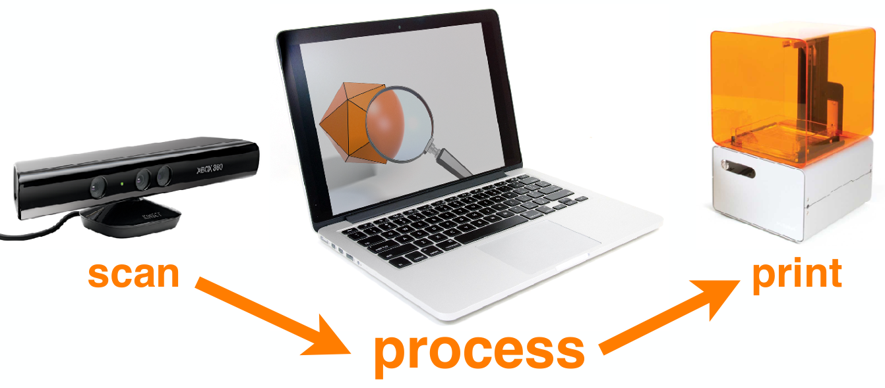

## 第 39 页 · Geometry Processing Tasks

reconstruction

filtering

remeshing

compression

parameterization

shape analysis

p

CMU

62/662

## 第 40 页 · Geometry Processing: Reconstruction

- Given samples of geometry, reconstruct surface
- What are “samples”? Many possibilities:
    - Points, points with normals, …
    - Image pairs/ sets (multi-view stereo)
    - Line density integrals (MRI/CT scans)
- How do you get a surface? Many techniques:
    - Silhouette-based (visual hull)
    - Voronoi-based (e.g., power crust)
    - PDE-based (e.g., Poisson reconstruction)
    - Iso-surfacing (marching cubes)

## 第 41 页 · Geometry Processing: Upsampling

- Increase resolution via interpolation
- Images: e.g., bilinear, bicubic interpolation
- Polygon meshes:
    - Subdivision
    - Bilateral upsampling
    - …

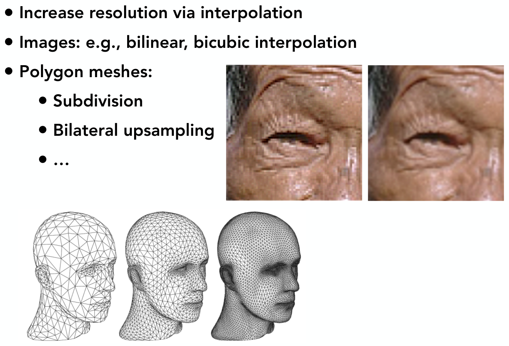

## 第 42 页 · Geometry Processing: Downsampling

- Decrease resolution; try to preserve shape/appearance
- Images: nearest-neighbor, bilinear, bicubic interpolation
- Point clouds: subsampling (just take fewer points!)
- Polygon meshes:
    - Iterative decimation, variational shape approximation, …

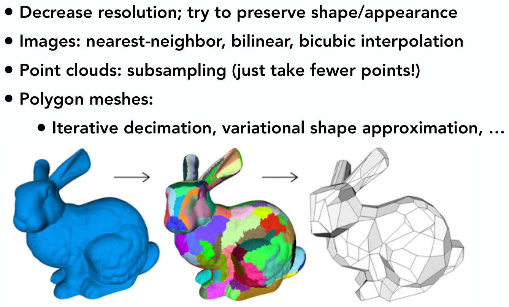

## 第 43 页 · Geometry Processing: Resampling

- Modify sample distribution to improve quality
- Images: not an issue! (Pixels always stored on a regular grid)
- Meshes: shape of polygons is extremely important!
    - Different notion of “quality” depending on tasks
    - e.g., visualization vs. solving equation

## 第 44 页 · Geometry Processing: Filtering

- Remove noise, or emphasize important features (e.g., edges)
- Images: blurring, bilateral filter, edge detection, …
- Polygon meshes:
    - Curvature flow
    - Bilateral filter
    - Spectral filter

## 第 45 页 · Geometry Processing: Compression

- Reduce storage size by eliminating redundant data/ approximating unimportant data
- Images:
    - Run-length, Huffman coding - lossless
    - Cosine/wavelet (JPEG/MPEG) - lossy
- Polygon meshes:
    - Compress geometry and connectivity
    - Many techniques (lossy & lossless)

840kb

8kb

## 第 46 页 · Geometry Processing: Shape Analysis

- Identify/ understand important semantic features
- Images: computer vision, segmentation, face detection, …
- Polygon meshes:
    - Segmentation, correspondence, symmetry detection, …

## 第 47 页

Geometry Processing

Tasks: 3 Examples

Mesh Upsampling – Subdivision

Mesh Downsampling – Simplification

Mesh Regularization

Increase resolution via subdivision

Decrease resolution; try to preserve shape/appearance

Modify sample distribution to improve quality

## 第 48 页 · Subdivision Surfaces

细分曲面

## 第 49 页 · Subdivision Surfaces

Start with coarse polygon mesh (“control cage”)

- Subdivide each element
- Update vertices via local averaging

Many possible rule:

- Catmull-Clark (quads)
- Loop (triangles)
- ...

Common issues:

- interpolating or approximating?
- continuity at vertices?

Relatively easy for modeling; harder to guarantee continuity

## 第 50 页 · Loop Subdivision

## 第 51 页 · Loop Subdivision

文字同第 50 页。

## 第 52 页 · Loop Subdivision Algorithm

- Split each triangle into four

## 第 53 页 · Loop Subdivision Algorithm

文字同第 52 页。

## 第 54 页 · Loop Subdivision Algorithm

- Split each triangle into four
- Assign new vertex positions according to weights:

1/8

3/8

New vertices

## 第 55 页 · Loop Subdivision Algorithm

- Split each triangle into four
- Assign new vertex positions according to weights:

1/8

u

3/8

n: vertex degree

1 – n\*u

u: 3/16 if n=3, 3/(8n) otherwise

New vertices

Old vertices

$$
p_{\mathrm{new}}=\frac38(p_0+p_1)+\frac18(p_2+p_3),
$$

$$
p'=(1-nu)p+u\sum_{j=1}^n p_j,\qquad u=\begin{cases}3/16&n=3,\\3/(8n)&n\ne3.\end{cases}
$$

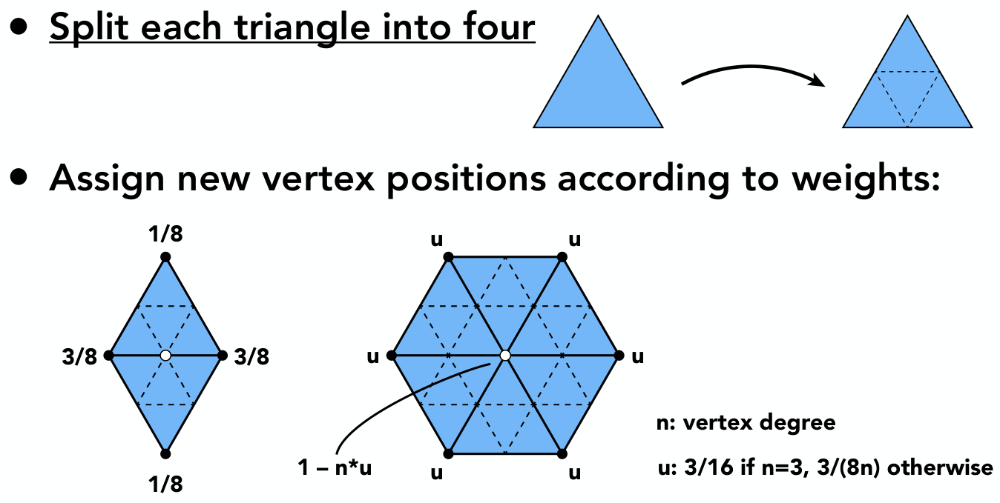

## 第 56 页 · Loop Subdivision Algorithm

Example, for degree 6 vertices

1/16

10/16

$$
p'=\frac{10}{16}p+\frac1{16}\sum_{j=1}^6 p_j.
$$

## 第 57 页 · Loop Subdivision Results

3D Scanning

## 第 58 页 · Catmull-Clark Subdivision

## 第 59 页 · Catmull-Clark Subdivision (Regular Quad Mesh)

## 第 60 页 · Catmull-Clark Subdivision (Regular Quad Mesh)

文字同第 59 页。

## 第 61 页 · Catmull-Clark Subdivision (Regular Quad Mesh)

Each subdivision step:

Add vertex in each face

Add midpoint on each edge

Connect all new vertices

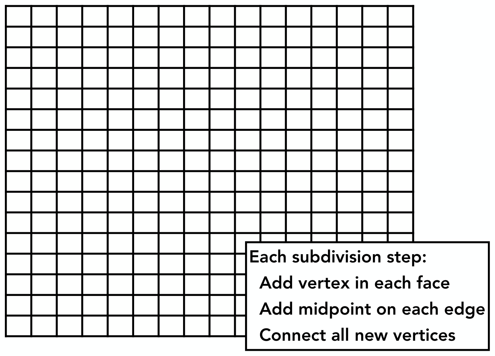

## 第 62 页 · Catmull-Clark Subdivision (General Mesh)

## 第 63 页 · Catmull-Clark Subdivision (General Mesh)

Non-quad face

Extraordinary

vertex

(valence != 4)

Each subdivision step:

Add vertex in each face

Add midpoint on each edge

Connect all new vertices

## 第 64 页 · Catmull-Clark Subdivision (General Mesh)

## 第 65 页 · Catmull-Clark Subdivision (General Mesh)

After

Before

How many extraordinary vertices after first subdivision?

What are their valences?

Ren

How many non-quad faces?

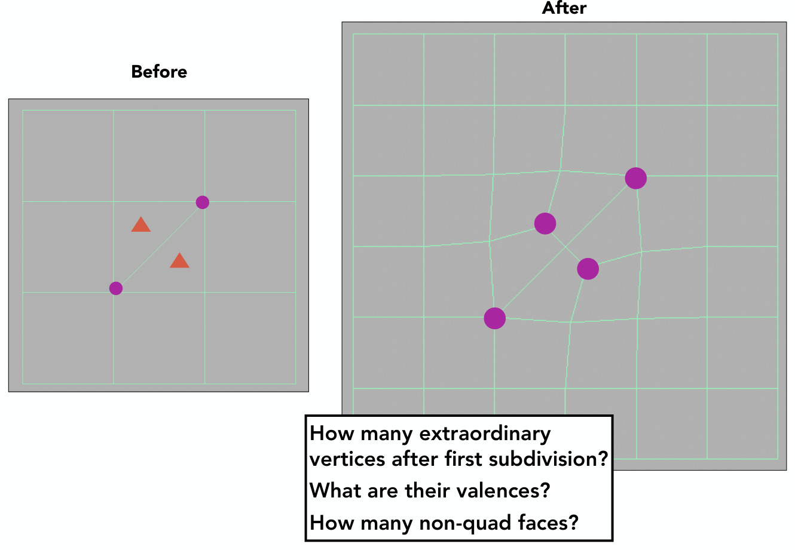

## 第 66 页 · Catmull-Clark Subdivision (General Mesh)

## 第 67 页 · Catmull-Clark Subdivision (General Mesh)

文字同第 66 页。

## 第 68 页 · Catmull-Clark Vertex Update Rules (Quad Mesh)

Face point

f = v1 +v2 +v3 +v4

Edge point

v1

4

v4

e

e = v1 +v2 + f1 + f2

f1

f2

f

v2

v3

Vertex point

m1

v = f1 + f2 + f3 + f4 +2(m1 +m2 +m3 +m4)+4p

p

16

m4

v

m2

f3

f4

m3

m

midpoint of edge, not “edge point”

old “vertex point”

$$
f=\frac{v_1+v_2+v_3+v_4}{4},\quad e=\frac{v_1+v_2+f_1+f_2}{4},
$$

$$
v=\frac{f_1+f_2+f_3+f_4+2(m_1+m_2+m_3+m_4)+4p}{16}.
$$

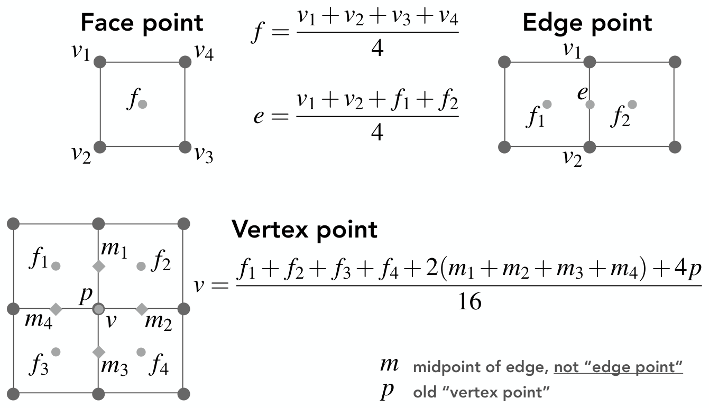

## 第 69 页 · Catmull-Clark Vertex Update Rules (General Mesh)

f = average of surrounding vertices

e = f1 + f2 +v1 +v2

These rules reduce to earlier quad rules for ordinary vertices / faces

4

¯f

n + 2 ¯m

n + p(n−3)

v =

n

¯m = average of adjacent midpoints ¯f = average of adjacent face points

n = valence of vertex

$$
v=\frac{\bar f}{n}+\frac{2\bar m}{n}+\frac{n-3}{n}p.
$$

## 第 70 页 · Catmull-Clark Subdivision Results

(Very few irregular vertices)

Good normal approximation almost everywhere:

Smooth

reflection lines

caustics

## 第 71 页 · Catmull-Clark on triangle mesh

(Huge number of irregular vertices!)

Poor normal approximation almost everywhere:

Jagged

reflection lines

caustics

ALIASING!

## 第 72 页 · What About Sharp Creases?

Figure from:  Hakenberg et al. Volume Enclosed by Subdivision Surfaces with Sharp Creases

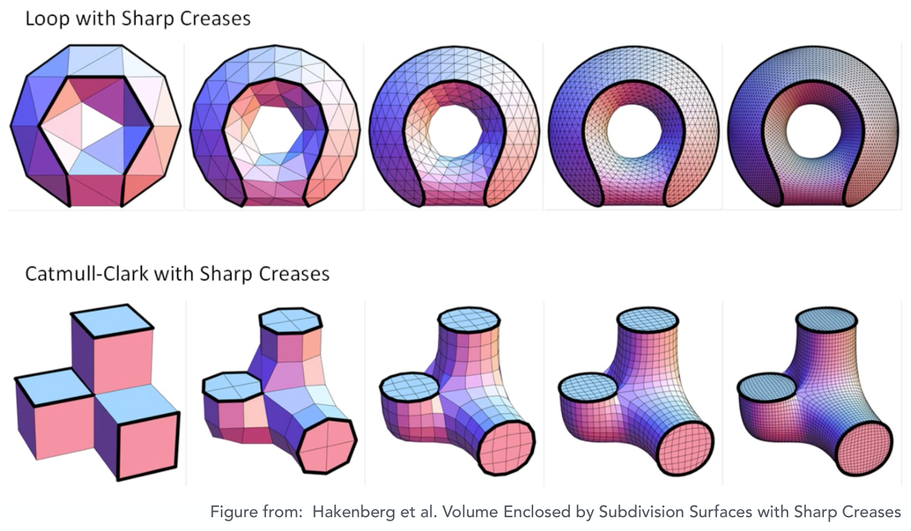

## 第 73 页 · Update vertex positions in 3D

pᵢ

p′i

p′i = αpi + (1 −α)Σ(pij)

## 第 74 页 · What About Sharp Creases?

Sharp vertices, edges, and faces

## 第 75 页 · What About Controlled Smoothing?

Partial sharpness

Use sharp rule for N levels, then use smooth rules.

## 第 76 页 · Creases + Boundaries

Can create creases in subdivision surfaces by marking certain edges as “sharp”. Boundary edges can be handled the same way

- Use different subdivision rules for vertices along these “sharp” edges

1

2

8

3

4

Insert new midpoint vertex,

Update existing vertices,

weights as shown

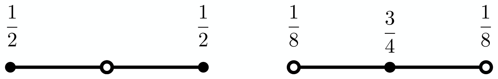

## 第 77 页 · Subdivision in Modeling

## 第 78 页 · Subdivision in Action (“Geri’s Game”, Pixar)

Subdivision used for entire character:

- Hands and head
- Clothing, tie, shoes

## 第 79 页 · Subdivision in Action (Pixar’s “Geri’s Game”)

1997

## 第 80 页 · Mesh Simplification

## 第 81 页 · Mesh Simplification

Goal: reduce number of mesh elements while maintaining overall shape

30,000 triangles

3,000

300

30

How to compute?

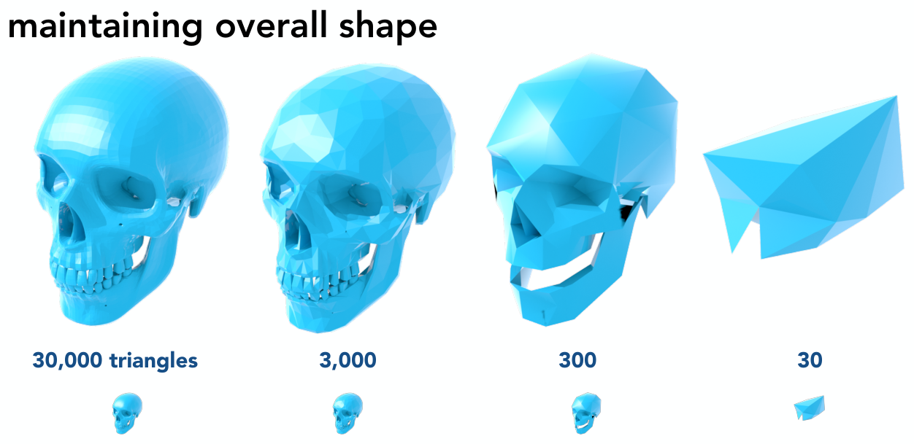

## 第 82 页 · How Do We Resample Meshes? (Reminder)

Edge split is (local) upsampling:

```text
c                              c
```

split

```text
a                      d       a                      d
                                           m
           b                              b
```

Edge collapse is (local) downsampling:

```text
a                                                a
```

collapse

```text
                                                          m
c              d
```

Edge flip is (local) resampling:

```text
b                                                b
   c
```

flip

```text
                                          c
a                      d       a                      d
```

Still need to intelligently decide which edges to modify!

```text
b                              b
```

## 第 83 页 · Estimate: Error Introduced by Collapsing An Edge?

- Suppose we simplify a mesh using edge collapsing
- How much geometric error for collapsing an edge?
    - Where to place the new vertex that minimize the error?

collapse

- Idea: Compute edge midpoint.
- Better idea: new vertex should minimize its sum of square distance to previously related triangle planes -&gt; Quadric error

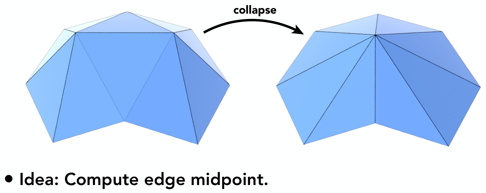

## 第 84 页 · Quadric Error Metrics

- Quadric error: new vertex should minimize its sum of square distance to previously related triangle planes.

误差最小化的顶点可以写成矩阵形式。课件给出的参考资料为 [Garland 与 Heckbert 的论文](https://www.cs.cmu.edu/~garland/Papers/quadrics.pdf)和 [Stanford CS468 课件](http://graphics.stanford.edu/courses/cs468-10-fall/LectureSlides/08_Simplification.pdf)。

下式沿用原页写法。课件同页的文字定义是让新顶点到相关三角形平面的距离平方和最小。

$$
d(\mathbf x):=\sum_{i=1}^k\mathbf N_i\cdot(\mathbf x-\mathbf p).
$$

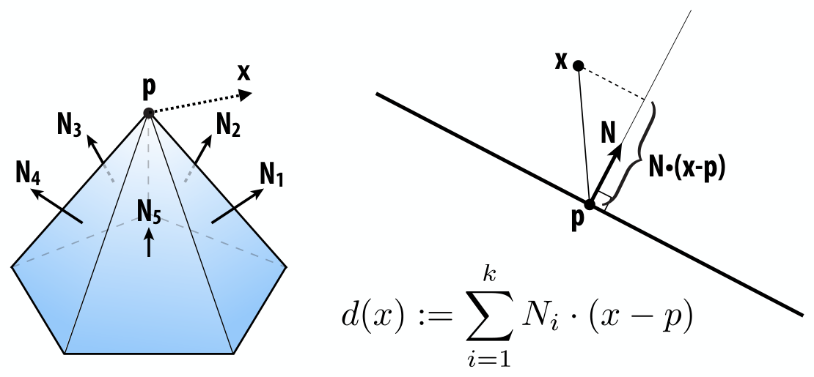

## 第 85 页 · Simplification via Quadric Error

Iteratively collapse edges

Which edges?  Assign score with quadric error metric\*

- Iteratively collapse edge with smallest score
- Greedy algorithm… great results!

## 第 86 页 · Comparison of Different Errors

average

median

di

error quadric

d i

## 第 87 页 · Quadric Error Mesh Simplification

Garland and Heckbert ‘97

5,804

994

532

248

64

30,000 triangles

3,000

300

30

## 第 88 页 · Mesh Regularization

## 第 89 页 · What Makes a “Good” Triangle Mesh?

One rule of thumb: triangle shape

“GOOD”

“BAD”

## 第 90 页 · What Makes a “Good” Triangle Mesh?

One rule of thumb: triangle shape

“GOOD”

“BAD”

More specific condition: Delaunay

- “Circumcircle interiors contain no vertices.”

Not always a good condition, but often\*

- Good for simulation
- Not always best for shape approximation

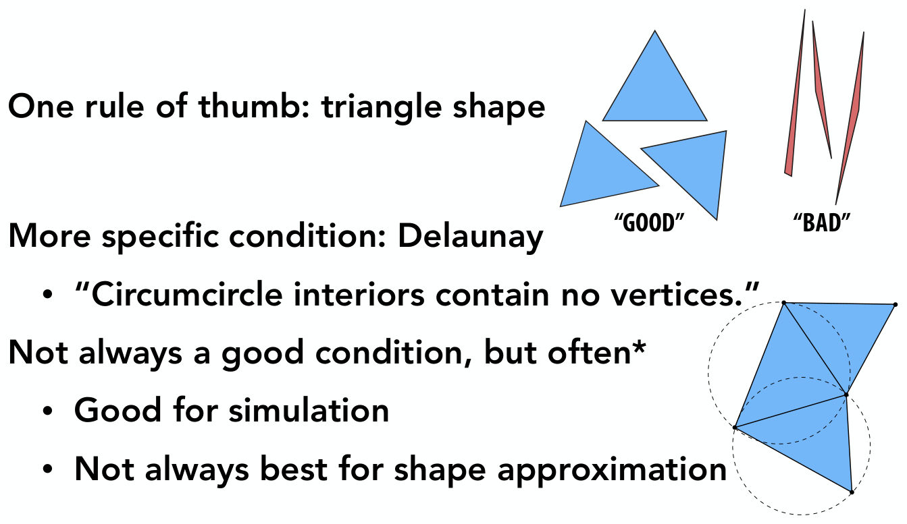

## 第 91 页 · What Else Constitutes a Good Mesh?

Rule of thumb: regular vertex degree Triangle meshes: ideal is every vertex with valence 6:

“GOOD”

“OK”

“BAD”

## 第 92 页 · What Else Constitutes a Good Mesh?

Rule of thumb: regular vertex degree Triangle meshes: ideal is every vertex with valence 6:

“GOOD”

“OK”

“BAD”

Why? Better triangle shape, important for  (e.g.) subdivision:

subdivide

\*See Shewchuk, “What is a Good Linear Element”

## 第 93 页 · Isotropic Remeshing

Try to make triangles uniform in shape and size

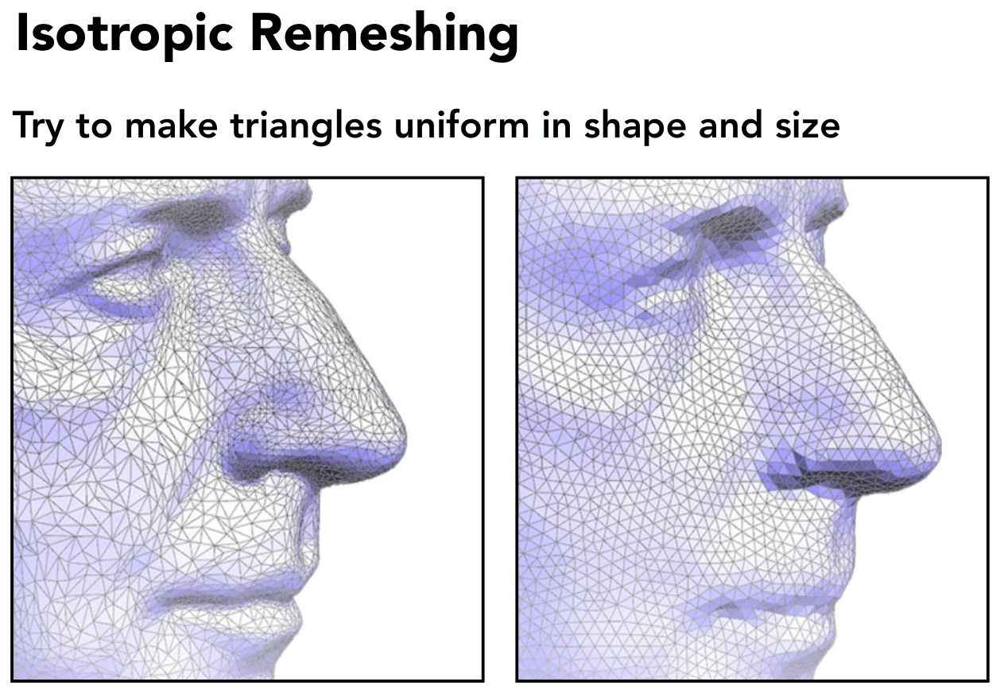

## 第 94 页 · How Do We Improve Degree?

Edge flips!

If total deviation from degree 6 gets smaller, flip it!

flip

Iterative edge flipping acts like “discrete diffusion” of degree

No (known) guarantees; works well in practice

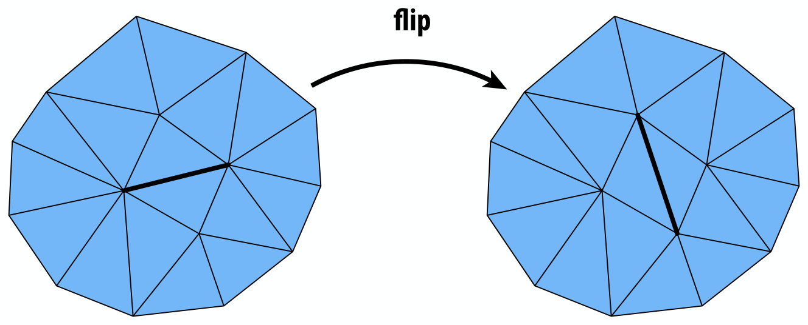

## 第 95 页 · How Do We Make Triangles “More Round”?

Delaunay doesn’t mean equilateral triangles

Can often improve shape by centering vertices:

average

Consider vertex motion in-surface and off-surface

## 第 96 页 · Isotropic Remeshing Algorithm\*

Repeat four steps:

- Split edges over 4/3rds mean edge legth
- Collapse edges less than 4/5ths mean edge length
- Flip edges to improve vertex degree
- Center vertices tangentially

\*Based on Botsch & Kobbelt, “A Remeshing Approach to Multiresolution Modeling”
