# Lecture 10 · Radiometry

原课件共 62 页。[打开 PDF](../../ppt/lec-10-radiometry.pdf)

按 PDF 页序提取，保留课件原有中英文。关键公式以 Markdown 数学式或原页局部图呈现。

## 第 1 页 · Radiometry

Computer Graphics 2026 Fuzhou University - Computer Science

## 第 2 页 · Course Roadmap

Rasterization Pipeline

Rasterization

Transforms & Projection

Core Concepts

- Sampling
- Antialiasing
- Transforms

Texture Mapping

Visibility, Shading, Overall Pipeline

Geometric Modeling

Intro to Geometry

Curves and Surfaces

Geometry Processing

- Splines, Bezier Curves
- Topological Mesh Representations
- Subdivision, Geometry Processing

Ray-Tracing & Acceleration

Today

Radiometry & Photometry

Lighting & Materials

Monte Carlo Integration

Global Illumination & Path Tracing

- Measuring Light
- Unbiased Integral Estimation
- Light Transport & Materials

Material Modeling

Cameras & Imaging

## 第 3 页

几何建模

（What is shown）

渲染

（How it looks）

## 第 4 页 · Ray Tracing vs. Rasterization

- Major difference: sophistication of illumination model
    - [Local] rasterizer processes one primitive at a time; hard to determine things like “ A is in the shadow of B”
    - [Global] ray tracer processes on ray at a time; ray knows about everything it intersects, easy to talk about shadows & other “global” illumination effects

局部光照

全局光照

RASTERIZATION

RAY TRACING

Q: What illumination effects are missing from the image on the left?

## 第 5 页 · Ray Tracing vs. Rasterization

RASTERIZATION

RAY TRACING

Unit length (normalized) vectors!!!

n

l

v

Local shading

Global illumination: Ray tracing

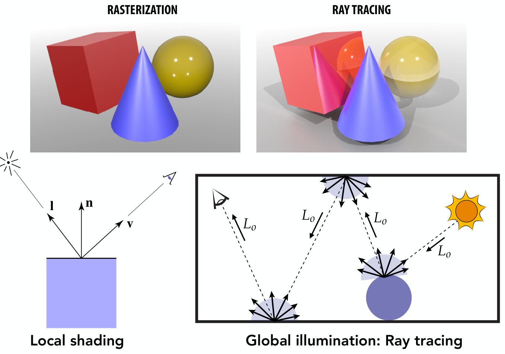

## 第 6 页 · Rendering is More Than Just Color

- Also need to know how much light hits each pixel:

（光能量在空

间中的分布）

color

intensity

## 第 7 页 · Rendering Pipeline

- Also need to know how much light hits each pixel

光能量在空间中的分布要如何计算？

此像素的

光线

明暗？

(Lecture7-9)

(Lecture10)

(Lecture11)

[几何建模] + 光源 → [光线传播 (Radiometry)] → [材质交互 (BRDF, Shading)] → [全局光照积分 (Rendering Equation)] → [图像合成 (Rendering)]

(Lecture12、13)

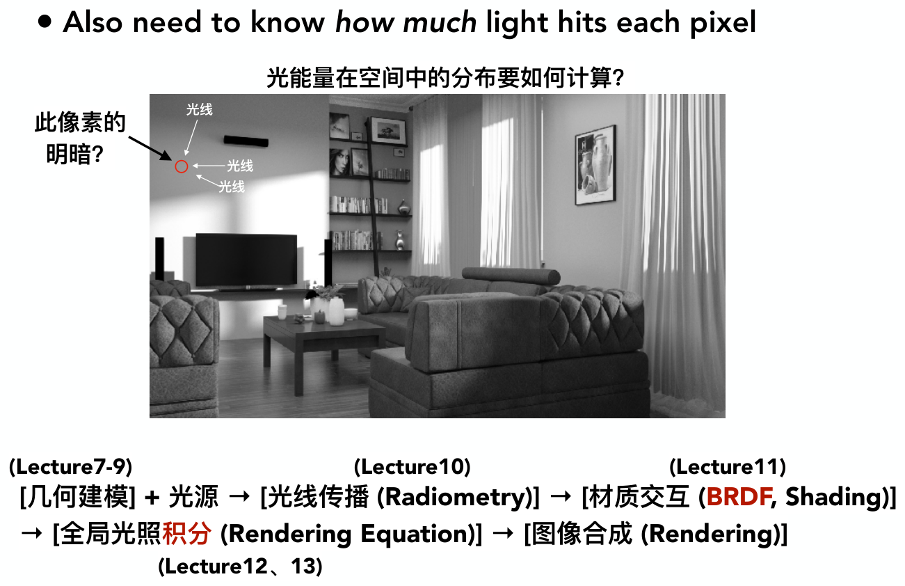

## 第 8 页 · How do we quantify measurements of light?

如何定量描述光线携带的能量？

## 第 9 页 · Radiometry

辐射度量学

- System of units and measures for measuring Electromagnetic (EM) Radiation (light)
- Geometric optics model of light (几何光学模型假设)
    - Photons travel in straight lines
    - Represented by rays
    - Wavelength &lt;&lt; size of objects
    - No diffraction, interference, …

测量光到达物体

表面时的能量

几何光学撇开光的波动本性，仅以光的直线传播、独立传播、反射/折射三大定律为基础，描述光在透明介质中的传播过程。 适用范围：波长无限小或者波长远小于物体尺寸，也就是仅在宏观层面成立；若要准确衡量衍射和干涉效应，则需要需要波动光学甚至量子光学，或一些度量辐射率的近似模型。

## 第 10 页 · What do we want to measure?

- Many physical processes convert energy into photons
    - E.g., incandescent lightbulb turns heat into light
    - Nuclear fusion in stars (sun!) generates photons
    - Etc.
- Each photon carries a small amount of energy
- Want some way of recording “how much energy”
- Energy of photons hitting an object ~ “brightness”
    - Film, eyes, CCD sensor, solar panels, …
    - Need this information to make accurate image
- Simplifying assumption: “steady state” process
    - How long does it take for lighting to reach steady state?

## 第 11 页 · What does light propagation look like?

Can’t see it with the naked eye!

Instead, repeat same experiment many times, take “snapshot” at slightly different offsets each time.

## 第 12 页

Imagine every photon is a little rubber ball hitting the scene:

How can we record this process? What information should we store?

## 第 13 页 · Radiant Energy is “total # of hits”

- One idea: just store the total number of “hit” at that occur anywhere in the scene, over the complete duration of the scene
- This quantify captures the total energy of all the photons hitting the scene

“Radiant energy”: 40

辐射能量

## 第 14 页 · Radiant Flux is “hits per second”

- For illumination phenomena at the level of human perception, usually safe to assume equilibrium is reached immediately.
- So, rather than record total energy over some (arbitrary) duration, may make more sense to record total hits per second.

Estimate of “radiant flux”:

40 hits/2s = 20 hits/s

辐射通量，亦称辐

射功率（power）

## 第 15 页 · Irradiance is “# hits per second, per unit area”

- Typically we want to get more specific than just the total
- To make images, also need to know where hits occurred
- So, compute hits per second in some “really small” area, divided by area:

Estimate of “radiant energy density”: 2/ϵ2

辐照度，既辐射通

量（功率）密度

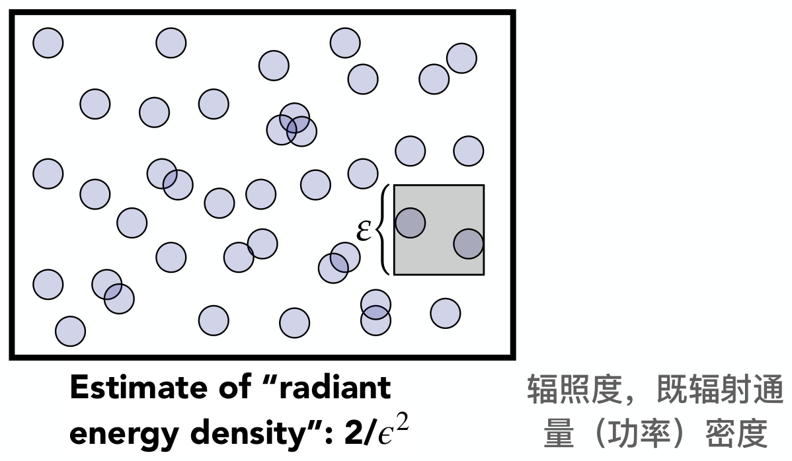

## 第 16 页 · Recap so far …

Radiant Energy

(total number of hits)

Radiant Energy Density

(hits per unit area)

Radiant Flux Density

Radiant Flux

(total hits per second)

a.k.a. Irradiance

(hits per second per unit area)

## 第 17 页 · Image generation as irradiance estimation

- From this point of view, our goal in image generation is to estimate the irradiance at each point of an image (or really:

the total radiant flux per pixel …):

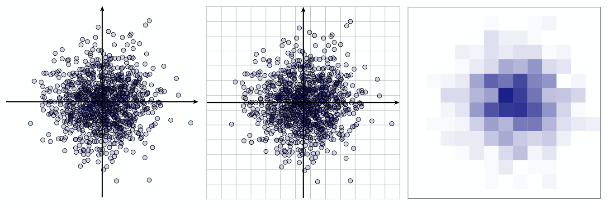

## 第 18 页 · Measuring Illumination: Radiant Energy

测量单位（量纲）

- How can we be more precise about the amount of energy?
- Said we were just going to count “the number of hits”, but do all hits contribute same amount of energy?
- Energy of a single photon
    - $h\approx6.626\times10^{-34}\,\mathrm{J\cdot s}$ (Planck’s constant)
    - $c\approx3.00\times10^8\,\mathrm{m/s}$ (speed of light)
    - $\lambda\approx390\text{–}700\,\mathrm{nm}$ (visible wavelength)

Q: What are units for a photon? $\mathrm{(J\cdot s)(m/s)/m=J}$（焦耳）。

$$
Q=\frac{hc}{\lambda}.
$$

## 第 19 页 · Measuring Illumination: Radiant Flux (Power)

Sensor

- Flux: energy per unit time (Watts) received by the sensor (or emitted by the light)

“Watts”

瓦特

- Can also go the other direction: time integral of flux is total radiant energy

$$
\Phi=\lim_{\Delta t\to0}\frac{\Delta Q}{\Delta t}=\frac{dQ}{dt}\quad[\mathrm W=\mathrm J/\mathrm s],\qquad Q=\int_{t_0}^{t_1}\Phi(t)\,dt.
$$

## 第 20 页 · Measuring Illumination: Irradiance

- Radiant flux: time density of energy
- Irradiance: area density of flux

Given a sensor of with area A, we can consider the average flux over the entire sensor area:

Irradiance (E) is given by taking the limit of area at a single point on the sensor:

$$
E(p)=\lim_{\Delta A\to0}\frac{\Delta\Phi(p)}{\Delta A}=\frac{d\Phi(p)}{dA}\quad[\mathrm W/\mathrm m^2].
$$

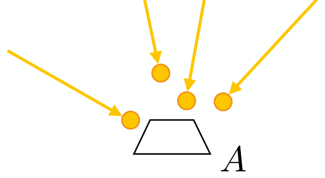

## 第 21 页 · Recap, with units

| Quantity | Meaning | Unit |
| --- | --- | --- |
| Radiant Energy | total number of hits | Joules (J) |
| Radiant Energy Density | hits per unit area | Joules per square meter (J/m²) |
| Radiant Flux | total hits per second | Joules per second (J/s) = Watts (W) |
| Radiant Flux Density a.k.a. Irradiance | hits per second per unit area | Watts per square meter (W/m²) |

## 第 22 页 · What about color?

How might we quantify, say

the “amount of green?”

## 第 23 页 · Spectral power distribution

- Describes irradiance per unit wavelength (units?)

Energy per unit time per unit area per unit wavelength …

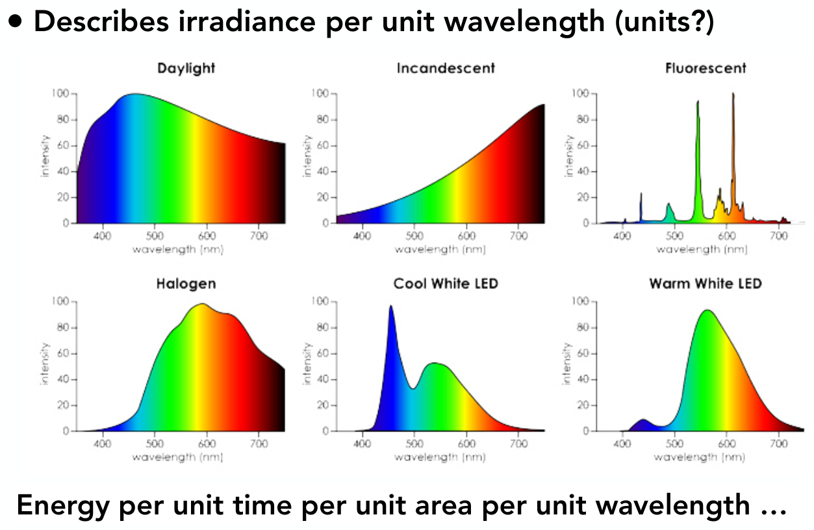

## 第 24 页

Given what we now know about

radiant energy …

Why do some parts of a surface look

lighter or darker?

Recall: “Said we were just going to count “the number of hits”, but do all hits contribute same amount of energy?”

## 第 25 页 · Recap: Diffuse Reflection

Diffuse Reflection

Light is scattered uniformly in all directions

- Surface color is the same for all viewing directions

Lambert’s cosine law

l

n

Q

Top face of cube

receives a certain

Top face of

60º rotated cube

intercepts half the light

In general, light per unit

area is proportional to

amount of light

cos θ = l • n

How much light (energy) is received at a shading point?

## 第 26 页 · Why do we have seasons?

Sun

Summer

(Northern hemisphere)

Winter

Earth’s axis of rotation: ~ 23.5^o

off axis

## 第 27 页 · Beam power in terms of irradiance 光束功率

Consider beam with flux

incident on surface with area A

radiant flux

(energy per time)

irradiance

(energy per time,

per area)

$$
E=\Phi/A,\qquad \Phi=EA.
$$

## 第 28 页 · Projected area

Consider beam with flux

incident on angled surface with area A’

A = projected area of surface

related to direction of beam light

A

A’

$$
A=A'\cos\theta.
$$

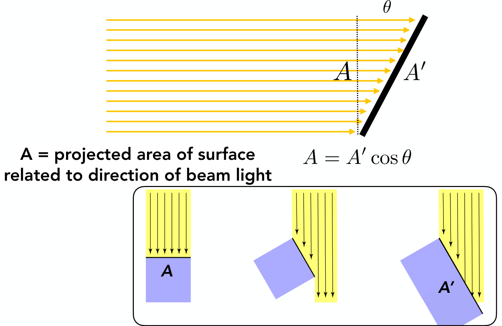

## 第 29 页 · Lambert’s Law

Irradiance at surface is proportional to cosine of angle between light direction and surface normal

$$
E=\frac{\Phi}{A'}=\frac{\Phi\cos\theta}{A}.
$$

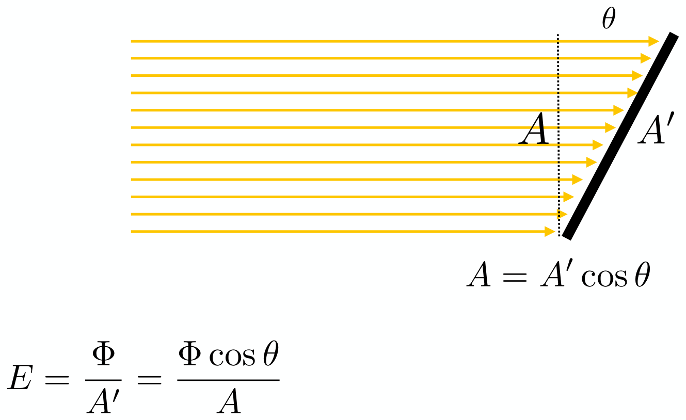

## 第 30 页 · “N-dot-L” Lighting

- Most basic way to shade a surface: take dot product of unit surface normal (N) and unit direction to light (L)

```text
double surfaceColor( Vec3 N, Vec3 L )
{
   return max( 0., dot( N, L ));
}
```

N

L

CMU 15-462/662

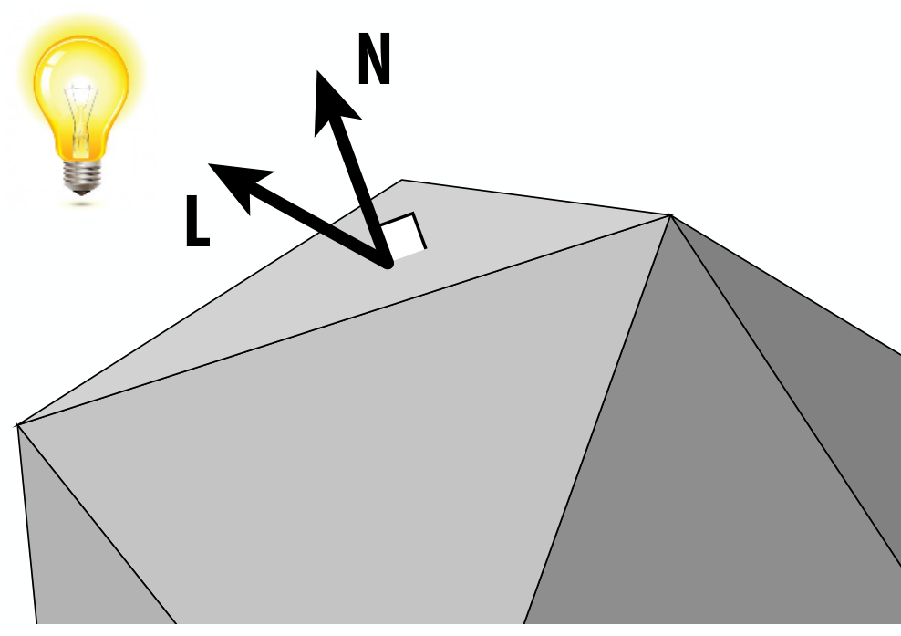

## 第 31 页 · Example: “directional” lighting

- Common abstraction: infinitely bright light source “at infinity”
- All light directions (L) are therefore identical

L

∞

## 第 32 页 · Isotropic point source

Suppose our light is such that:

Slightly more realistic model …

total radiant flux

“intensity”

p

$$
\Phi=\int_{S^2}I\,d\omega=4\pi I,\qquad I=\frac{\Phi}{4\pi}.
$$

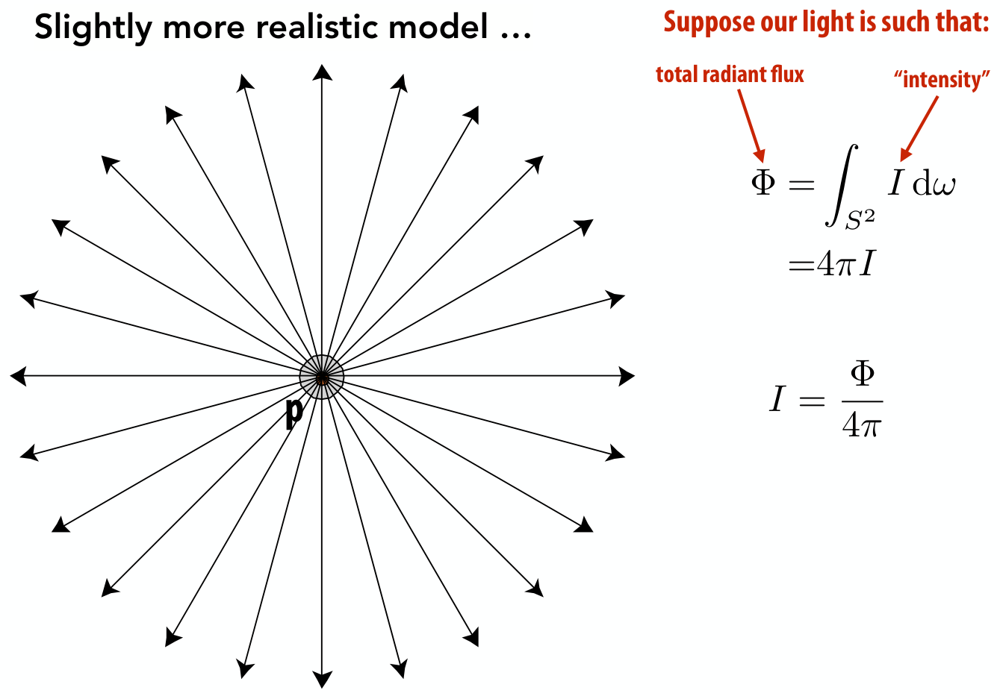

## 第 33 页 · Measuring Illumination: Radiant Intensity

- Power per solid angle emanating from a point source

辐照度（irradiance）等概念是从物体表面接收能量的角度来定义的； 光强（intensity)是从光源向外发射能量的角度来定义。

Intensity = 光源发向各方向的“输出密度”；

Irradiance = 表面从各方向“接收到的密度”。

$$
I(\omega)=\frac{d\Phi}{d\omega}\quad[\mathrm W/\mathrm{sr}].
$$

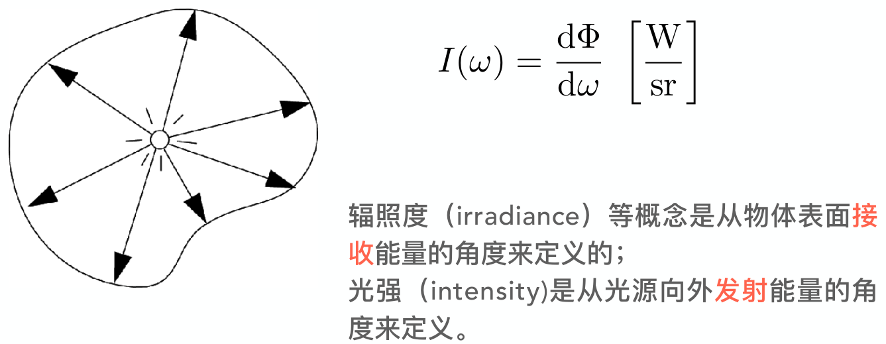

## 第 34 页 · Irradiance vs  intensity

total radiant flux

“intensity”

$$
E=\frac{I(\omega)}{r^2},\qquad E=\frac{d\Phi}{dA},\qquad I=\frac{d\Phi}{d\omega}.
$$

## 第 35 页 · Irradiance falloff with distance

Assume light is emitting flux in a uniform angular distribution

Compare irradiance at surface of two sphere:

Since same amount of energy is distributed over larger and larger spheres, has to get darker quadratically with distance.

$$
E_1=\frac{\Phi}{4\pi r_1^2},\quad E_2=\frac{\Phi}{4\pi r_2^2},\quad \frac{E_2}{E_1}=\left(\frac{r_1}{r_2}\right)^2.
$$

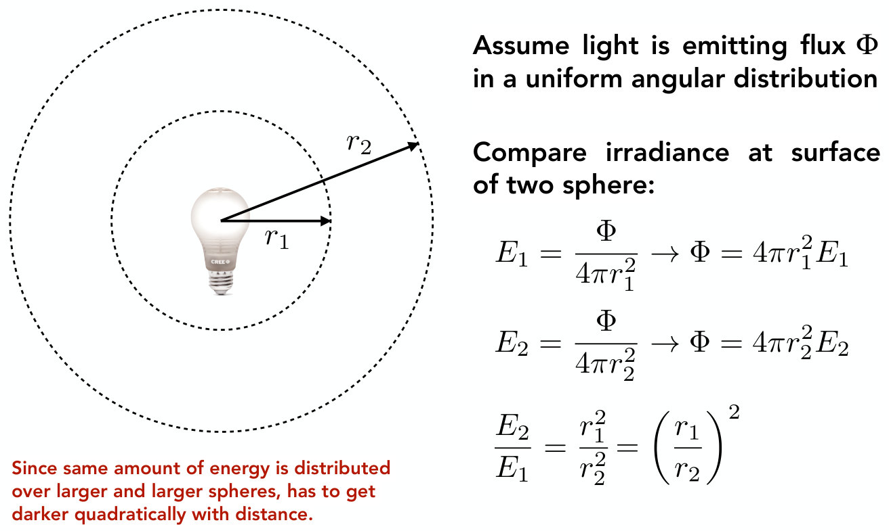

## 第 36 页 · What does quadratic falloff look like?

Single point light, move in 1m increments:

Things get dark fast!

## 第 37 页 · Angles and solid angles

立体角

- Angle: ratio of subtended arc length on circle to radius
    - 

radians

- Circle has

弧度

- Solid angle: ratio of subtended area on sphere to radius squared
    - 

steradians

- Sphere has

立体弧度（球面度）

$$
\theta=\frac{l}{r},\qquad \Omega=\frac{A}{r^2}.
$$

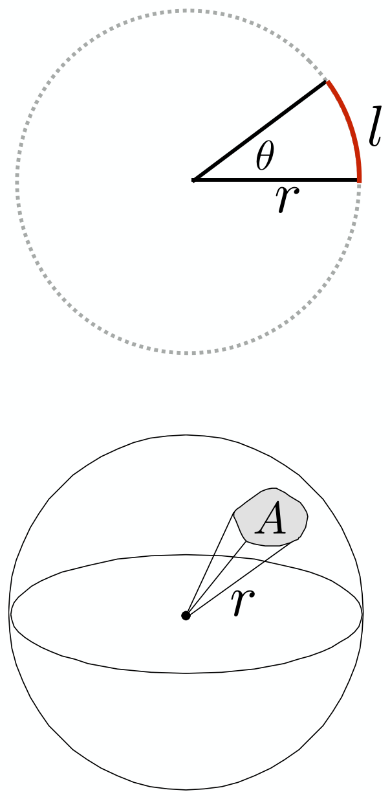

## 第 38 页 · Solid angles in Practice

- Sun and moon both subtend ~60  sr(steradian) as seen from the earth
- Surface area of earth:

~510M km

- Projected area:

μ

2

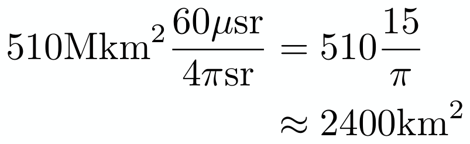

## 第 39 页 · Differential Solid Angle

Consider a tiny area swept out by a tiny angle in each direction…

Differential solid angle is just that tiny area on the unit sphere.

$$
dA=r^2\sin\theta\,d\theta\,d\phi,\qquad d\omega=\frac{dA}{r^2}=\sin\theta\,d\theta\,d\phi.
$$

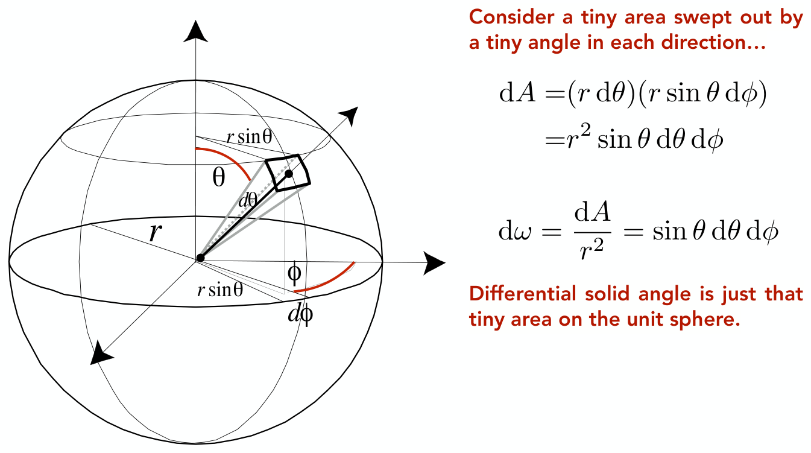

## 第 40 页 · Differential Solid Angle

$$
\Omega=\int_{S^2}d\omega=\int_0^{2\pi}\int_0^\pi\sin\theta\,d\theta\,d\phi=4\pi.
$$

## 第 41 页 · As a Direction Vector

ω

Will use  to donate a direction vector (unit length)

## 第 42 页 · Recall: Irradiance vs  intensity

单位面积上接收到的能量流密度。

光源朝某个方向发出的能量密度。

$$
E=\frac{I(\omega)}{r^2},\qquad E=\frac{d\Phi}{dA},\qquad I=\frac{d\Phi}{d\omega}.
$$

## 第 43 页 · Radiance

辐射率

- Radiance is the solid angle density of irradiance

In other words, radiance is energy along a ray defined by origin point  and direction

Energy per unit time per unit area per unit solid angle!

Where

denotes that the differential surface

area is oriented to face in the direction

$$
L(p,\omega)=\frac{dE_\omega(p)}{d\omega}\quad[\mathrm W/(\mathrm m^2\,\mathrm{sr})].
$$

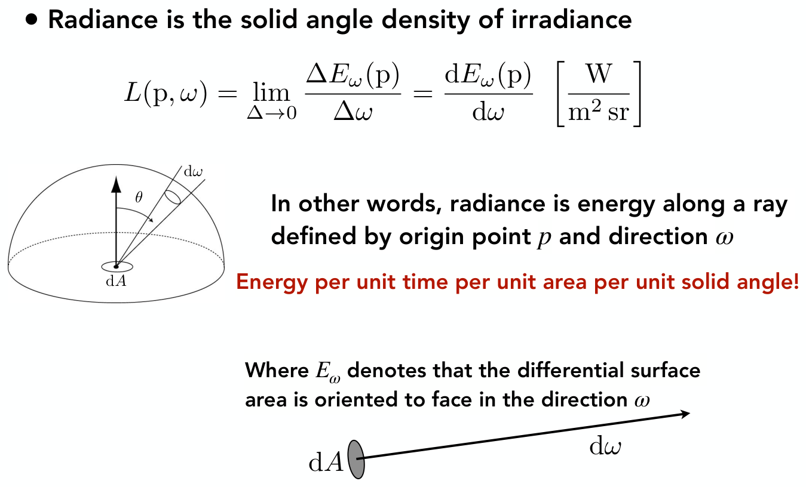

## 第 44 页 · Intensity, Irradiance & Radiance

Light Emitted

From A Source

Light Falling

On A Surface

Light Traveling

Along A Ray

“Radiant Intensity”

“Irradiance”

“Radiance”

量化一根光线的能量

## 第 45 页 · Surface Radiance

Equivalently,

A′cosθ =

cosθ

accounts for

projected surface area

‘

Definition: The radiance (luminance) is the power emitted, reflected, transmitted or received by a surface, per unit solid angle, per unit projected area.

$$
L(p,\omega)=\frac{dE(p)}{d\omega\cos\theta}=\frac{d^2\Phi(p,\omega)}{d\omega\,dA\cos\theta}.
$$

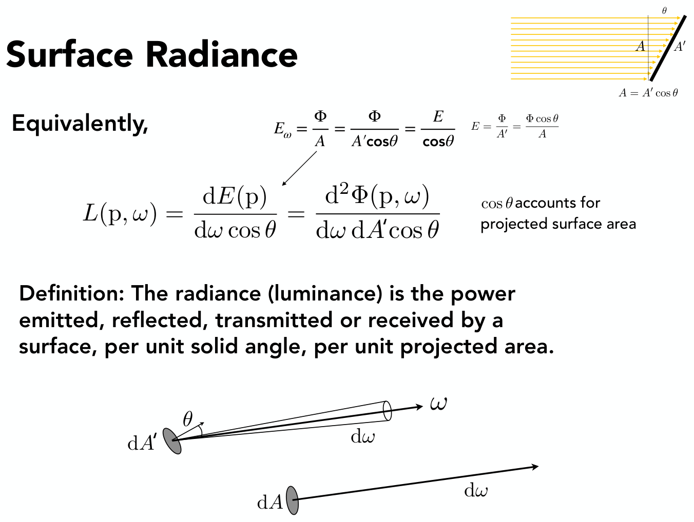

## 第 46 页 · Incident & Exiting Surface Radiance Differ!

Need to distinguish between incident radiance and exitant radiance functions at a point on a surface

In general:

$$
L_i(p,\omega)\ne L_o(p,\omega)\quad\text{in general}.
$$

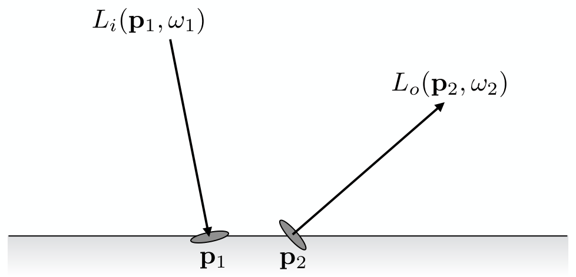

## 第 47 页 · Incident Surface Radiance

Equivalent: Incident surface radiance (luminance) is the irradiance per unit solid angle arriving at the surface.

i.e. it is the light arriving at the surface along a given ray (point on surface and incident direction).

$$
L_i(p,\omega)=\frac{dE(p)}{d\omega\cos\theta}=\frac{d^2\Phi(p,\omega)}{d\omega\,dA\cos\theta}.
$$

## 第 48 页 · Exiting Surface Radiance

Equivalent: Exiting surface radiance (luminance) is the intensity per unit projected area leaving the surface.

e.g. for an area light it is the light emitted along a given ray (point on surface and exit direction).

$$
L_o(p,\omega)=\frac{dI(p,\omega)}{dA\cos\theta}=\frac{d^2\Phi(p,\omega)}{d\omega\,dA\cos\theta}.
$$

## 第 49 页 · Spectral Radiance

- To summarize, radiance is: radiant energy per unit time per unit area per unit solid angle
- To really get a complete description of light we have to break this down just one more step: radiant energy per unit time per unit area per unit solid angle per unit wavelength
- Q: what additional information do we now get?
- A: Color!

## 第 50 页 · Properties of Radiance

- Radiance is a fundamental field quantity that characterizes the distribution of light in an environment
    - Radiance is the quantity associated with a ray
    - Rendering is all about computing radiance
- Radiance is constant along a ray (in a vacuum)
- A pinhole camera measures radiance

## 第 51 页 · Calculating with Radiance

## 第 52 页 · Irradiance from the environment

Computing flux per unit area on surface, due to incoming light from all directions.

Contribution to irradiance from light arriving from direction ω

(This is what we often want to do for rendering!)

$$
dE(p,\omega)=L_i(p,\omega)\cos\theta\,d\omega,\qquad E(p)=\int_{H^2}L_i(p,\omega)\cos\theta\,d\omega.
$$

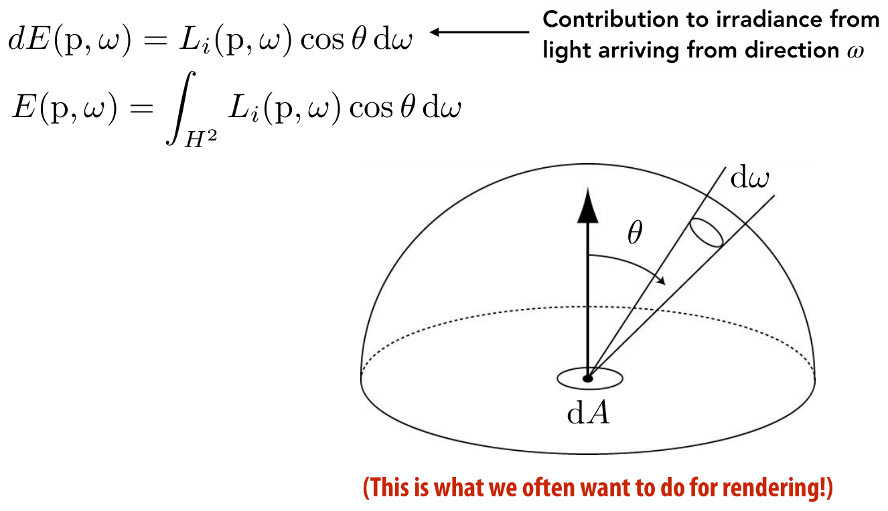

## 第 53 页 · Simple case: irradiance from uniform hemispherical source

$$
E(p)=L\int_0^{2\pi}\!\int_0^{\pi/2}\cos\theta\sin\theta\,d\theta\,d\phi=\pi L.
$$

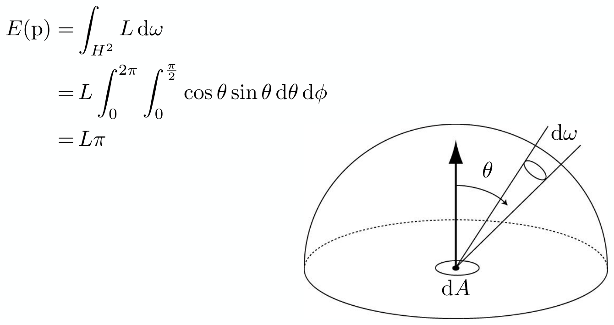

## 第 54 页 · Example of hemispherical light source

Q: Why didn’t we just get the same constant L  (white) at every point?

π

## 第 55 页 · Ambient Occlusion

环境光遮蔽(AO)

描绘物体和物体相交或靠近的时候遮挡周围漫反射光线的效果

- Assume spherical (vs. hemispherical) light source, “at infinity”
- Irradiance is now rotation, translation invariant
- Can pre-compute “bake” into texture to enhance shading

without AO map

with AO map

ambient occlusion map

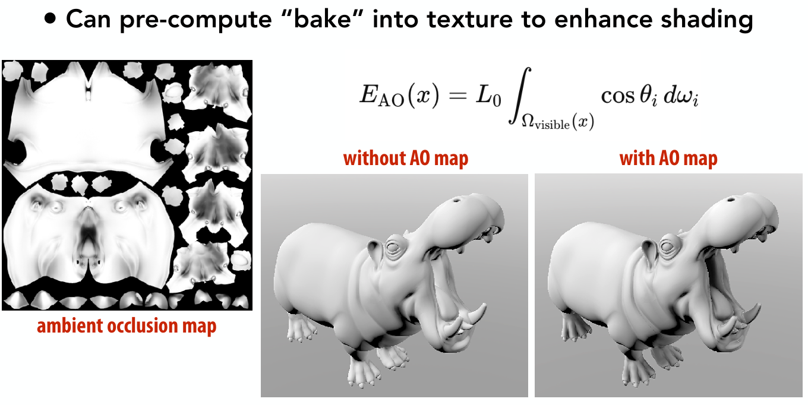

## 第 56 页 · Irradiance from a uniform area source

(Source emits radiance L)

Projected solid angle:

- Cosine-weighted solid angle
- Area of object  projected onto unit sphere, then projected onto plane

$$
E(p)=\int_\Omega L_i(p,\omega)\cos\theta\,d\omega=L\,\Omega^\perp,\qquad d\omega^\perp=|\cos\theta|\,d\omega.
$$

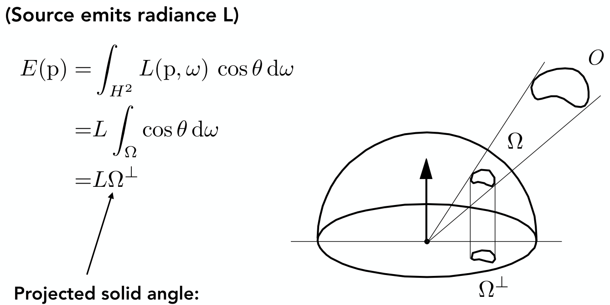

## 第 57 页 · Examples of Area Light Sources

Generally “softer” appearance than point lights:

And better model of real-world lights!

## 第 58 页 · More realistic light models via “goniometry”

Goniometric diagram measures light intensity as function of angle

http://www.mpi-inf.mpg.de/resources/mpimodel/v1.0/luminaires/index.html

http://www.visual-3d.com/tools/photometricviewer/

## 第 59 页 · Photometry: light + humans

光度测量学

- All radiometric quantities have equivalents in photometry
- Photometry: accounts for response of human visual system to electromagnetic radiation

Light meter

Eye

- Luminance (Y) is photometric quantity that corresponds to radiance: integrate radiance over all wavelengths, weight by eye’s luminous efficacy curve, e.g.:

Dark adapted

eye (scoptic)

Daytime adapted

eye (photoptic)

$$
Y(p,\omega)=\int_0^\infty L(p,\omega,\lambda)V(\lambda)\,d\lambda.
$$

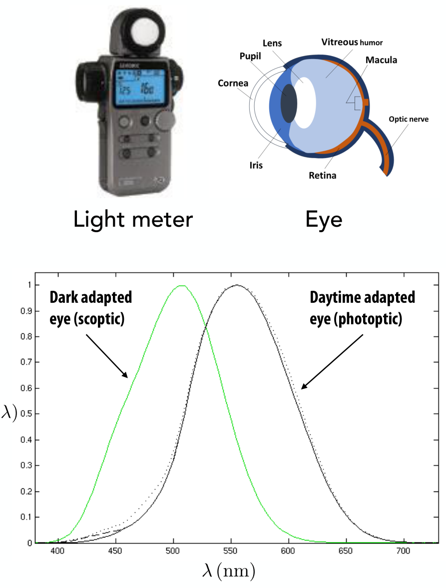

## 第 60 页 · Radiometric And Photometric Terms

| Physics | Radiometry | Photometry |
| --- | --- | --- |
| Energy | Radiant Energy | Luminous Energy |
| Flux (Power) | Radiant Power | Luminous Power |
| Flux Density | Irradiance (incoming)<br>Radiosity (outgoing) | Illuminance (incoming)<br>Luminosity (outgoing) |
| Angular Flux Density | Radiance | Luminance |
| Intensity | Radiant Intensity | Luminous Intensity |

## 第 61 页 · Photometric Units

| Photometry | MKS | CGS | British |
| --- | --- | --- | --- |
| Luminous Energy | Talbot | Talbot | Talbot |
| Luminous Power | Lumen | Lumen | Lumen |
| Illuminance / Luminosity | Lux | Phot | Footcandle |
| Luminance | Nit, Apostlib, Blondel | Stilb, Lambert | Footlambert |
| Luminous Intensity | Candela | Candela | Candela |

## 第 62 页 · Next time

The Rendering Equation

Integrate radiance over all directions

For every

surface point

$$
dE(p,\omega)=L_i(p,\omega)\cos\theta\,d\omega,\qquad E(p)=\int_{H^2}L_i(p,\omega)\cos\theta\,d\omega.
$$
