# Lecture 11 · The Rendering Equation

原课件共 74 页。[打开 PDF](../../ppt/lec-11-rendering-equation.pdf)

按 PDF 页序提取，保留课件原有中英文。关键公式以 Markdown 数学式或原页局部图呈现。

## 第 1 页 · The Rendering Equation

Computer Graphics 2026 Fuzhou University - Computer Science

## 第 2 页 · Today

The Rendering Equation/ Light transport Equation Lo(p, ω)

## 第 3 页 · The Rendering Equation

- Core functionality of photorealistic renderer is to estimate radiance at a given point p, in a given direction

本身是光源，直接

接收到外界的光辐

向外辐射

射，再反射出去

$$
L_o(p,\omega_o)=L_e(p,\omega_o)+L_r(p,\omega_o).
$$

## 第 4 页 · The Rendering Equation

表面点接收到的辐射能量

$$
E(p)=\int_{H^2} L_i(p,\omega_i)\cos\theta_i\,d\omega_i.
$$

## 第 5 页 · The Rendering Equation

- Core functionality of photorealistic renderer is to estimate radiance at a given point p, in a given direction

Contribution to irradiance from light arriving from direction ω

⋅Li(p, ωi)cosθdωi

点p的入射光线

从

方向反射出去的能量

fr(p, ωi →ωo)Li(p, ωi)cosθdωi

点p的所有入射光线

$$
dE(p,\omega_i)=L_i(p,\omega_i)\cos\theta_i\,d\omega_i.
$$

$$
L_r(p,\omega_o)=\int_{H^2} f_r(p,\omega_i\to\omega_o)\,L_i(p,\omega_i)\cos\theta_i\,d\omega_i.
$$

## 第 6 页 · The Rendering Equation

- Core functionality of photorealistic renderer is to estimate radiance at a given point p, in a given direction
- Summed up by the rendering equation (Kajiya, 1986):

angle between incoming direction and normal

outgoing/observed radiance

emitted radiance(e.g., light source)

incoming radiance

fr(p, ωi →ωo)Li(p, ωi)cosθdωi

point of interest

incoming direction

scattering function

all directions in hemisphere

direction of interest

Key challenge: to evaluate incoming radiance, we have to compute yet another integral.

I.e., rendering equation is recursive.

$$
L_o(p,\omega_o)=L_e(p,\omega_o)+
\int_{H^2} f_r(p,\omega_i\to\omega_o)\,L_i(p,\omega_i)\cos\theta_i\,d\omega_i.
$$

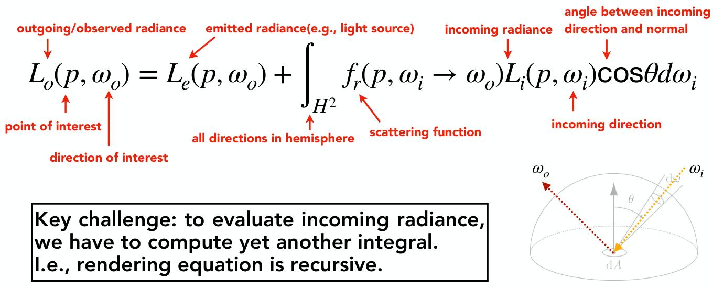

## 第 7 页 · Recursive Raytracing

- Basic strategy: recursively evaluate rendering equation!

Lᵢ

(This is why you’re writing a ray tracer—rasterizer isn’t enough!)

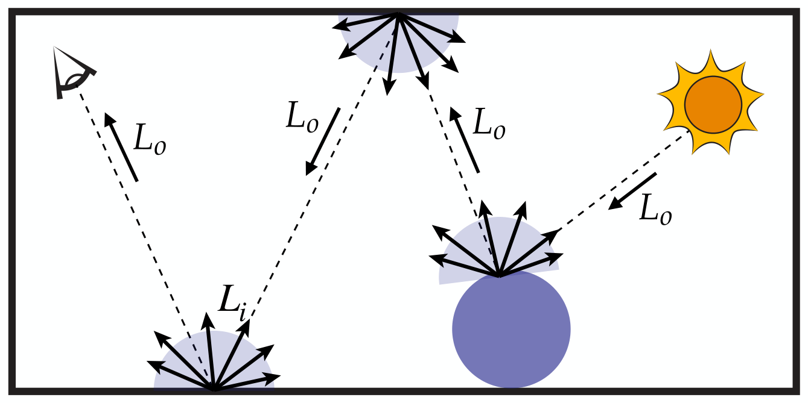

## 第 8 页 · Renderer measures radiance along a ray

y

d

x

Pinhole

o

At each “bounce”, want to measure radiance traveling in the direction opposite the ray direction.

## 第 9 页 · Renderer measures radiance along a ray

y

d

x

Pinhole

o

Radiance entering camera in direction d = light from scene light sources that is reflected off surface in direction d.

## 第 10 页 · The Rendering Equation

How does reflection of light affect

the outgoing radiance?

fr(p, ωi →ωo)Li(p, ωi)cosθdωi

反射率?

$$
dE(p,\omega_i)=L_i(p,\omega_i)\cos\theta_i\,d\omega_i.
$$

$$
L_r(p,\omega_o)=\int_{H^2} f_r(p,\omega_i\to\omega_o)\,L_i(p,\omega_i)\cos\theta_i\,d\omega_i.
$$

## 第 11 页 · Reflection Models

- Reflection is the process by which light incident on a surface interacts with the surface such that it leaves on the incident (same) side without change in frequency
- Choice of reflection function determines surface appearance

## 第 12 页 · Some basic reflection functions

- Ideal specular
    - Perfect mirror
- Ideal diffuse
    - Uniform reflection in all directions
- Glossy specular
    - Majority of light distributed in mirror direction
- Retro-reflective
    - Reflects light back toward source

Diagrams illustrate how incoming light energy from given direction is reflected in various directions.

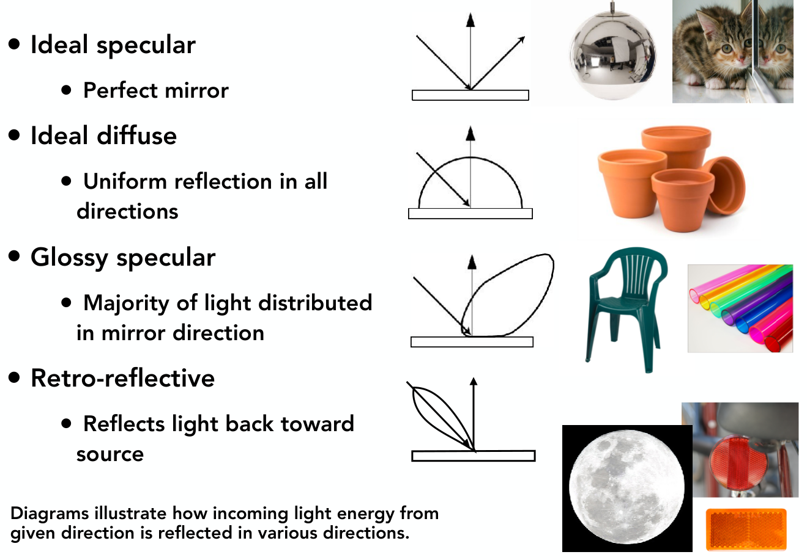

## 第 13 页 · Materials: Diffuse

## 第 14 页 · Materials: Mirror

## 第 15 页 · Materials: Plastic

## 第 16 页 · Materials: Red Semi-gloss Paint

## 第 17 页 · Materials: Ford Mystic Laquer Paint

## 第 18 页 · Materials: Gold

## 第 19 页 · Materials

## 第 20 页 · Models of Scattering

散射模型

- How can we model “scattering” of light?
- Many different things that could happen to a photon:
    - Bounces off surface
    - Transmitted through surface
    - Bounces around inside surface
    - Absorbed & re-emitted
- What goes in must come out! (Total energy must be conserved)
- In general, can talk about “probability” a particle arriving from a given direction is scattered in another direction

## 第 21 页 · Hemispherical Incident Radiance

At any point on any surface in the scene, there’s an incident radiance field that gives the directional distribution of illumination at the point

Lᵢ(ω)

Consider view of hemisphere from this point

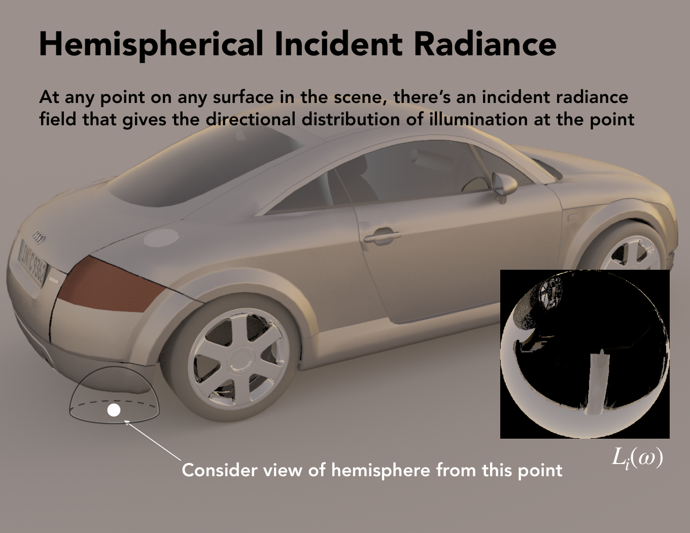

## 第 22 页 · Diffuse Reflection

Outgoing

Incident

Exitant radiance is the same in all directions

Incident radiance

Exitant radiance

fr(p, ωi →ωo)Li(p, ωi)cosθdωi

Lᵢ(p, ωᵢ)

Constant

Li(p, ωi)cosθdωi

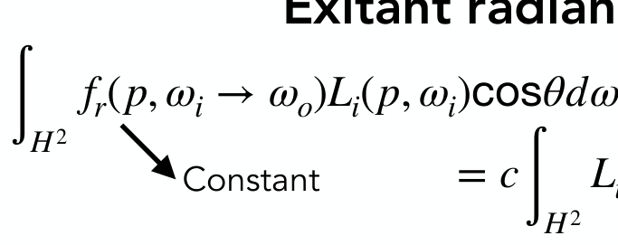

## 第 23 页 · Ideal Specular Reflection

ωᵣ

ωᵢ

Incident

Outgoing

Incident radiance is “flipped around normal” to get exitant radiance

Incident radiance

Exitant radiance

fr(p, ωi →ωo)Li(p, ωi)cosθdωi

Lᵢ(p, ωᵢ)

= fr(p, ωi →ωr)Li(p, ωi)cosθdωi

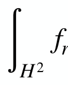

## 第 24 页 · Plastic

ωᵣ

ωᵢ

Incident

Outgoing

Incident radiance gets “flipped and blurred”

Incident radiance

Exitant radiance

Lᵢ(p, ωᵢ)

fr(p, ωi →ωo)Li(p, ωi)cosθdωi

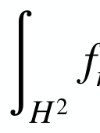

## 第 25 页 · Copper

More blurring, plus coloration (nonuniform absorption across frequencies)

Incident radiance

Exitant radiance

## 第 26 页 · Scattering Off A Surface: The BRDF

- “Bidirectional reflectance distribution function”
- Encodes behavior of light that “bounces off” surface
- Given incoming direction $\omega_i$, how much light gets scattered in any direction outgoing direction $\omega_o$?
- Describe as distribution $f_r(\omega_i\to\omega_o)$

反射率相关的量。能量守恒。对称性（光线可逆）。

Why less than or equal? Where did the rest of the energy go?

“Helmholtz reciprocity”  
Light behaves the same way if you reverse its path. (光线可逆)  
Why should Helmholtz reciprocity hold? Think about little mirrors…

$$
f_r(\omega_i\to\omega_o)\ge 0,\qquad
\int_{H^2} f_r(\omega_i\to\omega_o)\cos\theta\,d\omega_i\le1,\qquad
f_r(\omega_i\to\omega_o)=f_r(\omega_o\to\omega_i).
$$

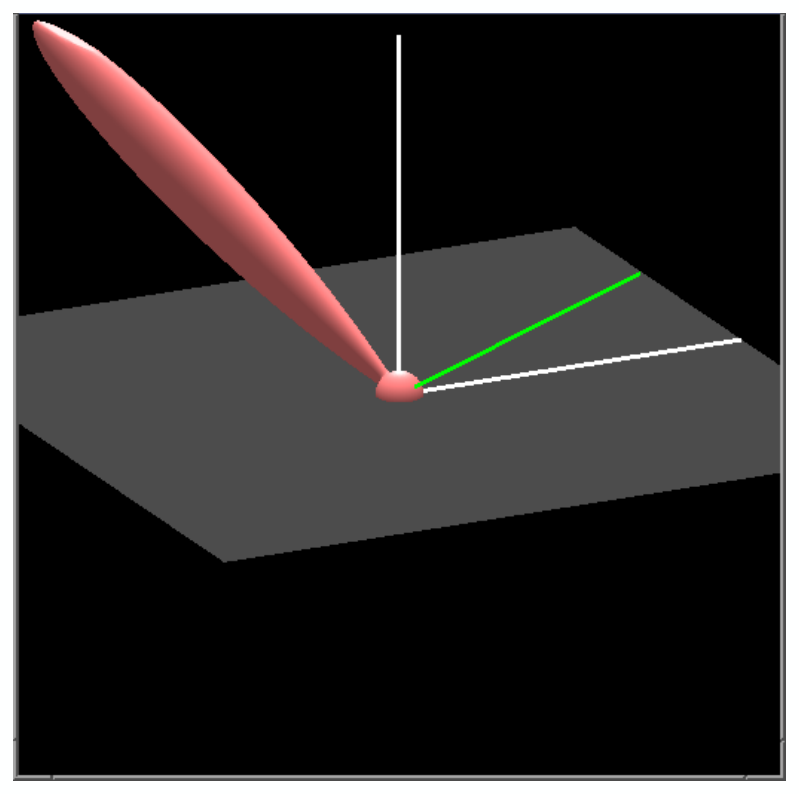

## 第 27 页 · Reflection at a Point

Differential irradiance incoming: dE(ωi) = L(ωi) cos θi dωi

Differential radiance exiting (due to              )

$$
dE(\omega_i)=L_i(\omega_i)\cos\theta_i\,d\omega_i.
$$

## 第 28 页 · Radiometric description of BRDF

NB:      points away from surface rather than into surface, by convention.

“For a given change in the incident irradiance, how much does the exitant radiance change?”

为什么不是简单地定义成“出射辐亮度除以入射辐亮度？

既

解释：

$$
f_r(\omega_i\to\omega_o)=\frac{dL_r(\omega_o)}{dE_i(\omega_i)}
=\frac{dL_r(\omega_o)}{L_i(\omega_i)\cos\theta_i\,d\omega_i}\quad[\mathrm{sr}^{-1}].
$$

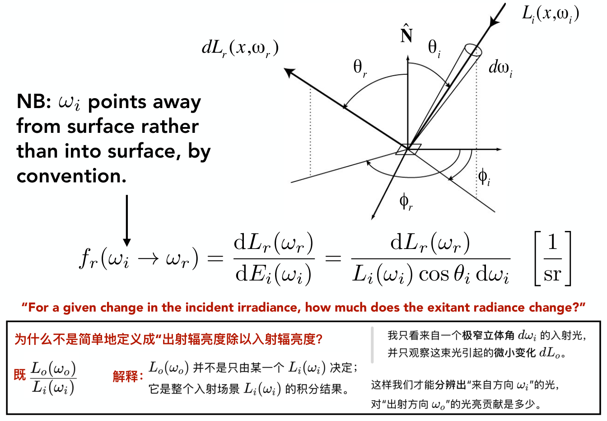

## 第 29 页 · Example: Lambertian Reflection

Assume light is equally likely to be reflected in each output direction

“albedo” (between 0 and 1)

反照率; 反射率; 漫反射系数;

$$
f_r=\frac{\rho}{\pi},\qquad L_o(\omega_o)=f_r E,\qquad L_o=\rho L_i\quad\text{if }L_i\text{ is uniform}.
$$

## 第 30 页 · Example: Lambertian Reflection

Assume light is equally likely to be reflected in each output direction

Suppose the incident lighting is uniform:

“albedo” (between 0 and 1)

反照率; 反射率; 漫反射系数;

$$
f_r=\frac{\rho}{\pi},\qquad L_o(\omega_o)=f_r E,\qquad L_o=\rho L_i\quad\text{if }L_i\text{ is uniform}.
$$

## 第 31 页 · Example: Lambertian Reflection

Assume light is equally likely to be reflected in each output direction

“albedo” (between 0 and 1)

反照率; 反射率; 漫反射系数;

fr 是否需要满足

？

根据表面反射的总能量 ≤ 入射能量，有下式：

对球面积分得到：

BRDF 的数值范围不必

限制在 0~1，它只需要

满足能量守恒条件。

$$
f_r=\frac{\rho}{\pi},\qquad L_o(\omega_o)=f_r E,\qquad L_o=\rho L_i\quad\text{if }L_i\text{ is uniform}.
$$

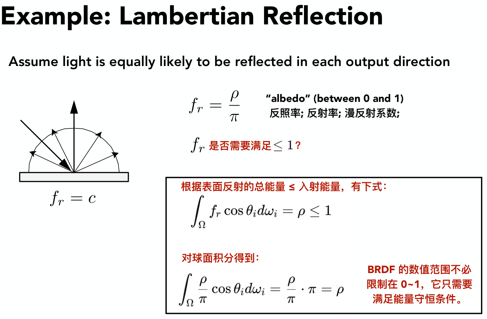

## 第 32 页 · Example: Perfect Specular Reflection

[Zátonyi Sándor]

## 第 33 页 · Geometry of Specular Reflection

Topdown view

(looking down on surface)

wo + wi = 2cosθ ⋅⃗n

方向角，与法向夹角

方位角，绕法向旋转

$$
\theta_o=\theta_i,\qquad \omega_o=-\omega_i+2(\omega_i\cdot\mathbf n)\mathbf n.
$$

## 第 34 页 · Specular Reflection BRDF

Lᵢ(θᵢ, φᵢ)

Lₒ(θₒ, φₒ)

θᵢ

θₒ

Dirac delta

验证是否满足能量守恒：

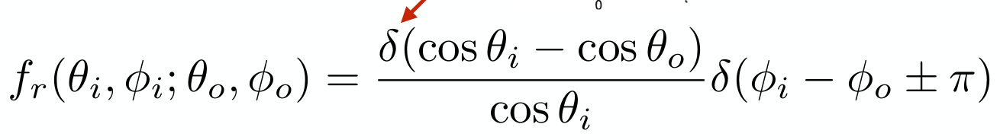

## 第 35 页 · Specular Reflection BRDF

Lᵢ(θᵢ, φᵢ)

Lₒ(θₒ, φₒ)

θᵢ

θₒ

Dirac delta

- Strictly speaking,  is a distribution, not a function
- In practice, no hope of finding reflected direction via random sampling; simple pick the reflected direction!

fᵣ

CMU 15-462/662

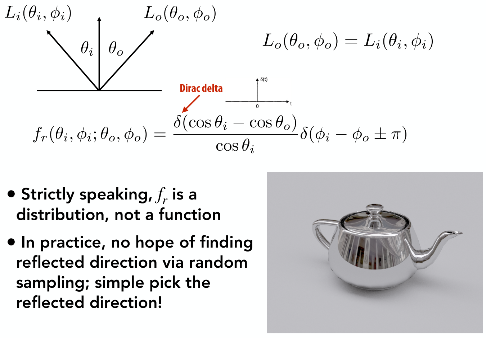

## 第 36 页 · Scattering Through A Surface: The BTDF

“Bidirectional transmittance distribution function”

In addition to reflecting off surface, light may be transmitted through surface.

Light refracts when it enters a new medium.

“Bidirectional scattering distribution function” (BSDF) = BRDF + BRTF…

## 第 37 页 · Snell’s Law

Transmitted angle depends on relative index of refraction of material ray is leaving/ entering.

Medium

\*

Vacuum

Air (sea level)

Water (20°C)

Glass

Diamond

1.0

1.00029

1.333

1.5-1.6

2.42

\*index of refraction is wavelength dependent (these are averages)

$$
\eta_i\sin\theta_i=\eta_t\sin\theta_t,\qquad
\cos\theta_t=\sqrt{1-(\eta_i/\eta_t)^2\sin^2\theta_i}.
$$

## 第 38 页 · Law of Refraction

$$
\eta_i\sin\theta_i=\eta_t\sin\theta_t,\qquad
\cos\theta_t=\sqrt{1-(\eta_i/\eta_t)^2\sin^2\theta_i}.
$$

## 第 39 页 · Law of Refraction

Total internal reflection: (全内反射)

When light is moving from a more optically dense

medium to a less optically dense medium:

Light incident on boundary from large enough angle will not exit medium

$$
\eta_i\sin\theta_i=\eta_t\sin\theta_t,\qquad
\cos\theta_t=\sqrt{1-(\eta_i/\eta_t)^2\sin^2\theta_i}.
$$

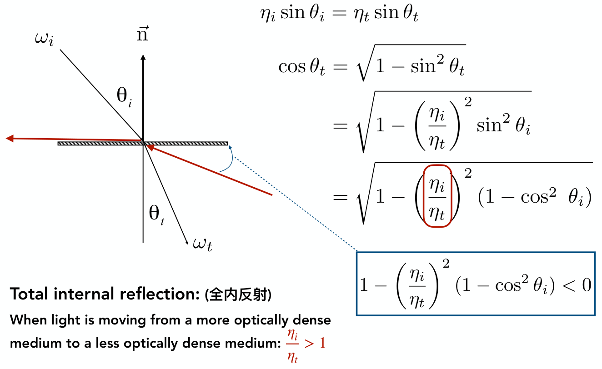

## 第 40 页 · Optical Manhole

Only small “cone” visible, due to total internal reflection (TIR)

## 第 41 页 · BTDF

对称性：

Ideal refraction (Snell’s law)：

代表反射相关系数

$$
f_t(\omega_i,\omega_o)=\frac{dL_t(\omega_o)}{dE_i(\omega_i)}.
$$

## 第 42 页 · BSDF: BTDF + BRDF

When a ray of

light hits the

interface

between two

media (e.g. air

and glass), some

light is reflected, and some is transmitted (refracted).

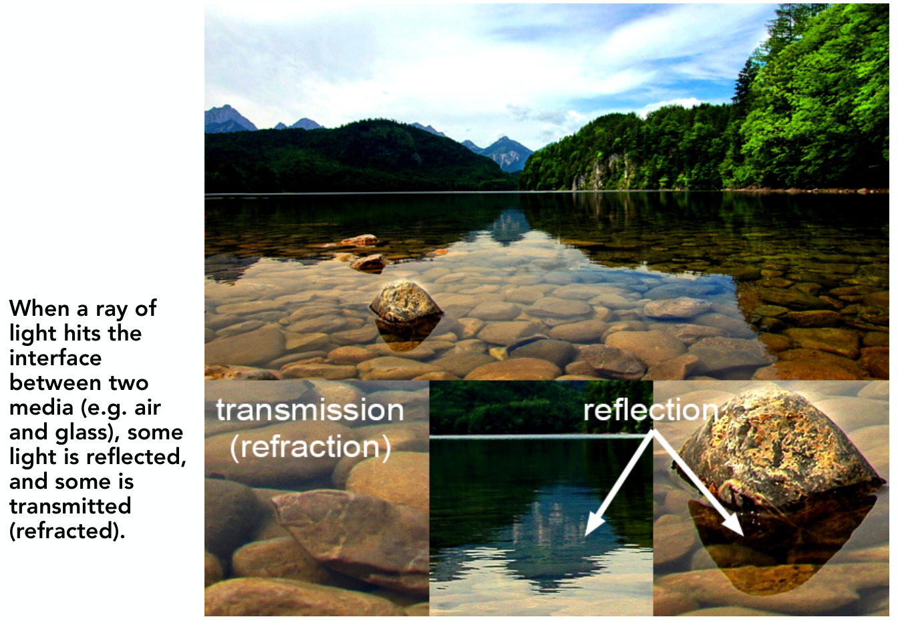

## 第 43 页 · BSDF: BTDF + BRDF

For a dielectric surface (like glass or water):

is constant for ideal specular reflection and refraction.

满足能量守恒：（BRDF+BTDF）

$$
f_r(\omega_i,\omega_o)=\frac{F(\omega_i)}{|\cos\theta_i|}\,\delta(\omega_o-\operatorname{reflect}(\omega_i)),
$$

$$
f_t(\omega_i,\omega_o)=\frac{1-F(\omega_i)}{|\cos\theta_i|}\,\delta(\omega_o-\operatorname{refract}(\omega_i)),
$$

$$
\int_{\mathrm{hemisphere}}(f_r+f_t)\cos\theta_o\,d\omega_o\le1.
$$

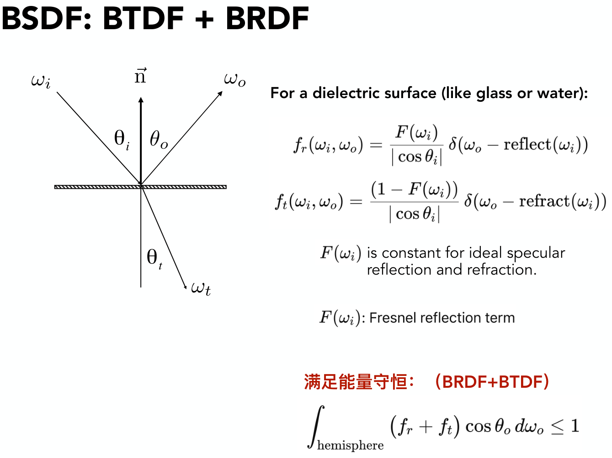

## 第 44 页 · Fresnel Reflection

菲涅尔

More reflective when viewed at grazing angles

Many real materials: Reflectance increase w/ Viewing angle

## 第 45 页 · Fresnel Reflection

菲涅尔

Fresnel Term (Dielectric,  =1.5, 介电常数)

η

Reflectance depends on incident angle (and polarization of light)

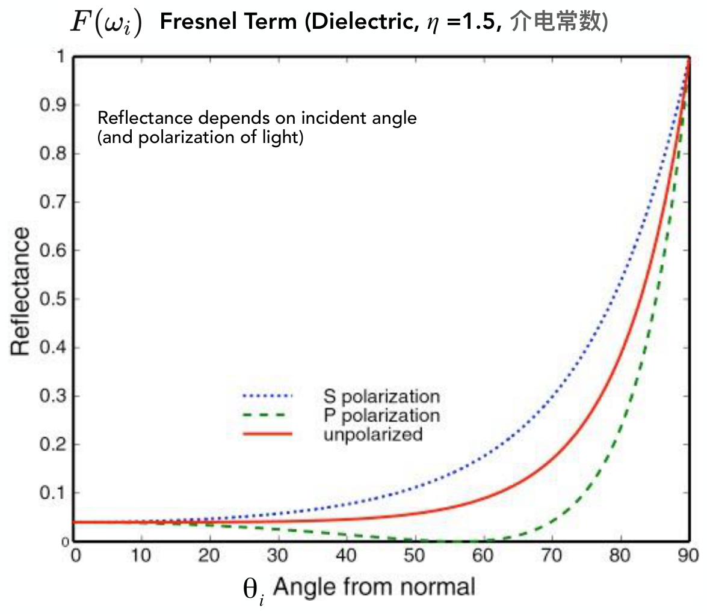

## 第 46 页 · Fresnel Equation

电磁理论 → 波动光学 → 几何光学

P偏振光

S偏振光

通过满足 Maxwell 边界条件，可以得到两个偏振分量各自的反射系数：

通过能量守恒定律，折射系数：

https://en.wikipedia.org/wiki/Fresnel_equations

## 第 47 页 · Fresnel Reflection (Conductor)

Are Fresnel equations valid in conductors?

绝缘体

导体

## 第 48 页 · Advance BSDF

~n

ωᵢ

ωₒ

？

θₒ

fᵣ = ρ

ωₜ

π

## 第 49 页 · Microfacet Reflection

微表面反射

https://twitter.com/Cmdr_Hadfield/status/318986491063828480/photo/1

## 第 50 页 · Microfacet Theory

”粗糙镜面反射“

Rough surface

- Macroscale: flat & rough
- Microscale: bumpy & specular

CMU 15-462/662

Individual elements of surface act like mirrors

- Known as “microfacets”
- Each microfacet has its own normal vector

microsurface

macrosurface

Air

Material

CS184/284A

Ng & O'Brien

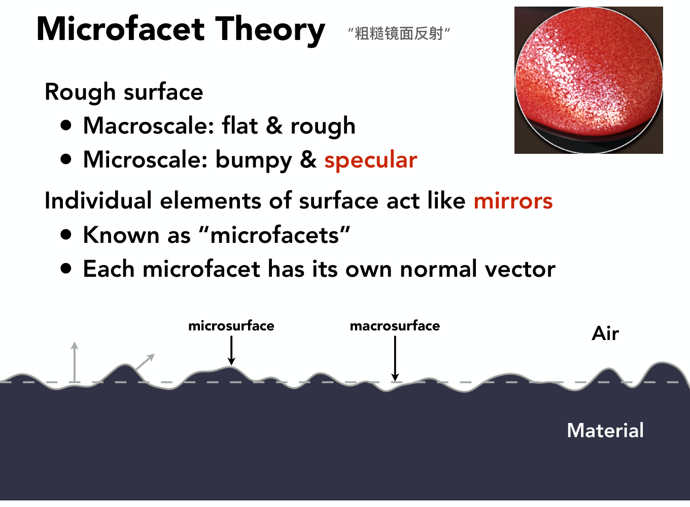

## 第 51 页 · Microfacet BRDF

- Key: the distribution of microfacets’ normals
    - Concentrated &lt;==&gt; glossy
    - Spread out &lt;==&gt; diffuse

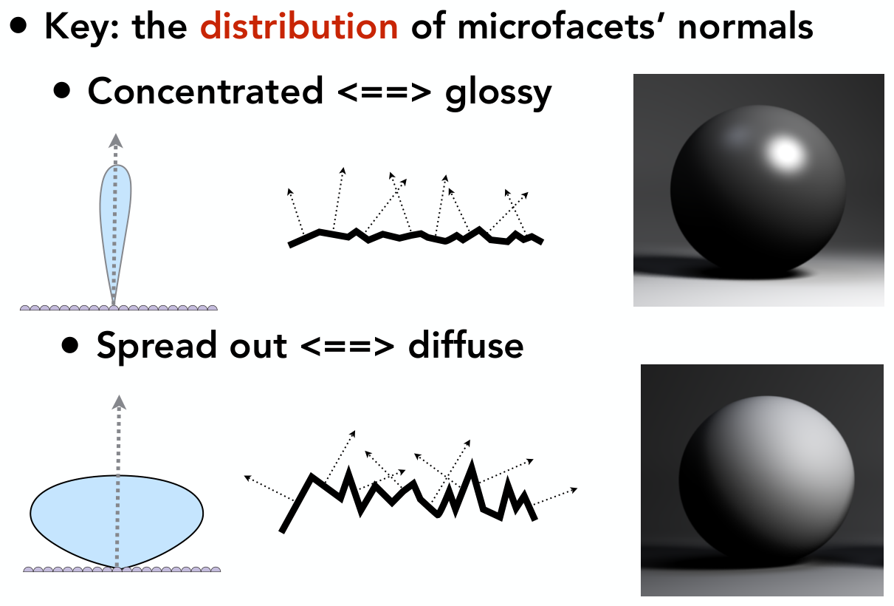

## 第 52 页 · Microfacet BRDF

- What kind of microfacets reflect wi to wo?

(hint: microfacets are mirrors)

half vector h

wi

wo

shadowing-

distribution

Fresnel

masking

of

normals

term

$$
f(\mathbf i,\mathbf o)=\frac{F(\mathbf i,\mathbf h)\,G(\mathbf i,\mathbf o,\mathbf h)\,D(\mathbf h)}{4(\mathbf n\cdot\mathbf i)(\mathbf n\cdot\mathbf o)}.
$$

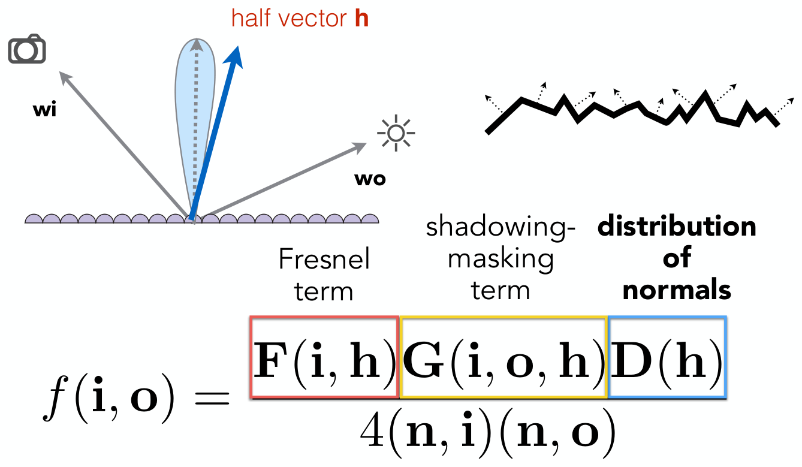

## 第 53 页 · Microfacet BRDF: Examples Microfacet BRDF: Examples

[Autodesk Fusion 360]

## 第 54 页 · Anisotropic BRDFs

## 第 55 页 · Isotropic vs Anisotropic Reflection

- So far, Point light + Metal = Round / Elliptical highlight
- But some reflection highlights look very different

## 第 56 页 · Isotropic vs Anisotropic Reflection

Isotropic

Anisotropic

## 第 57 页 · Anisotropic BRDF: Brushed Metal

- How is the pan brushed?

## 第 58 页 · Isotropic / Anisotropic Materials (BRDFs)

- Key: directionality of underlying surface

Isotropic

Anisotropic

Surface (normals)

BRDF (fix wi, vary wo)

## 第 59 页 · Isotropic / Anisotropic Materials (BRDFs)

- Imagine the surface is made up of tiny mirror-like facets (each facet is a perfect specular reflector).
- Isotropic Microfacet Surface: The micro- mirrors (facets) are randomly oriented in all directions around the surface normal.
- Anisotropic Microfacet Surface: The micro-mirrors are not oriented randomly — their normals tend to align more along certain tangent directions.

Isotropic

Anisotropic

Depending on how the microfacet normal distribution function (NDF) is defined.

f(i, o) = F(i, h)G(i, o, h)D(h)

4(n, i)(n, o)

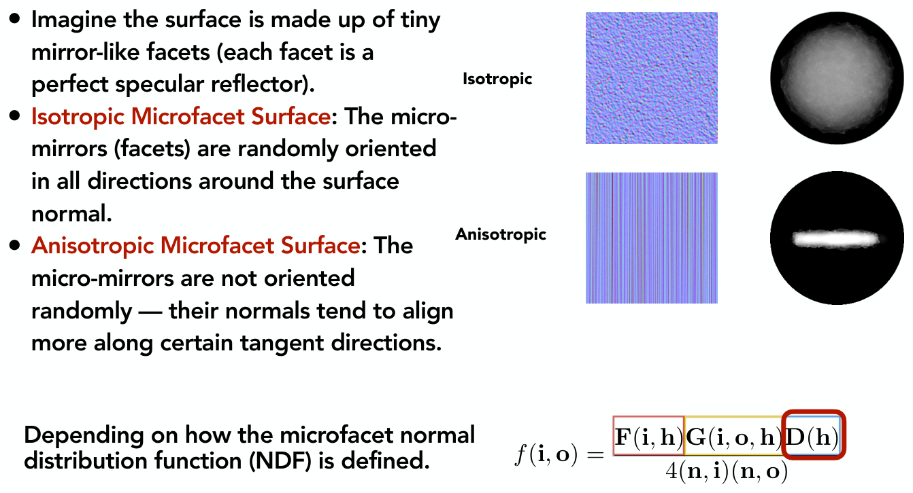

## 第 60 页 · Isotropic BRDFs

Reflection independent of azimuthal angle φ

fᵣ(θᵢ, φᵢ; θᵣ, φᵣ) = fᵣ(θᵢ, θᵣ, φᵣ −φᵢ)

Results from surface microstructure that lacks directional structure

## 第 61 页 · Anisotropic BRDFs

Reflection depends on azimuthal angle φ

/latexit&gt;fr(θi, φi; θr, φr) 6= fr(θi, θr, φr −φi)

Results from oriented microstructure of surface, e.g., brushed metal

## 第 62 页 · Anisotropic BRDF: Nylon

[Westin et al. 1992]

## 第 63 页 · Anisotropic BRDF: Velvet

[Westin et al. 1992]

## 第 64 页 · Translucent materials: Jade

## 第 65 页 · Translucent materials: Skin

## 第 66 页 · Translucent materials: Leaves

## 第 67 页 · Subsurface Scattering

次表面

- Visual characteristics of many surfaces caused by light entering at different points than it exits
    - Violates a fundamental assumption of the BRDF
    - Need to generalize scattering model (BSSRDF)

[Jensen et al 2001]

[Donner et al 2008]

The light does not bounce off immediately — it goes inside the object, bounces around between particles, and then exits somewhere else.

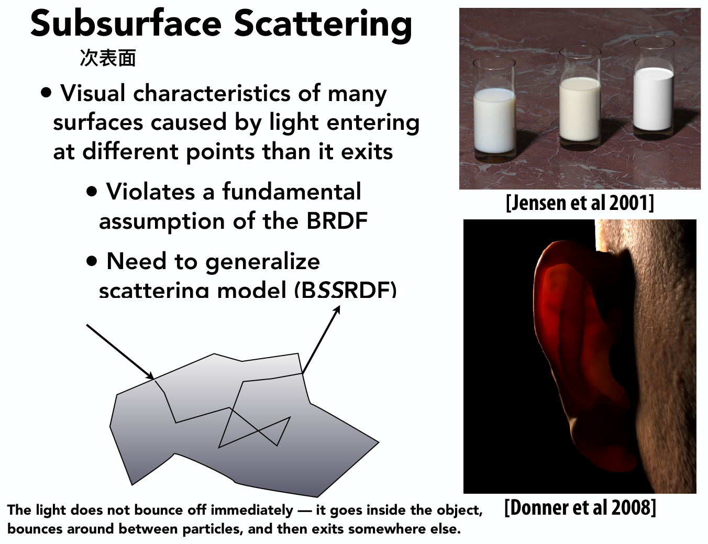

## 第 68 页 · Scattering Functions

- Generalization of BRDF; describe exitant radiance at one point due to incident differential irradiance at another point:

S(xᵢ, ωᵢ, xₒ, ωₒ)

- Generalization of reflection equation integrates over all points on the surface and all directions!

L(xₒ, ωₒ) =

\_H₂ S(xᵢ, ωᵢ, xₒ, ωₒ) Lᵢ(xᵢ, ωᵢ) cos θᵢ dωᵢ dA

A

Microstructure几何结构：如人类皮肤有多层结构（角质层、表皮层、 真皮层），含有色素细胞与血管

BRDF

BSSRDF

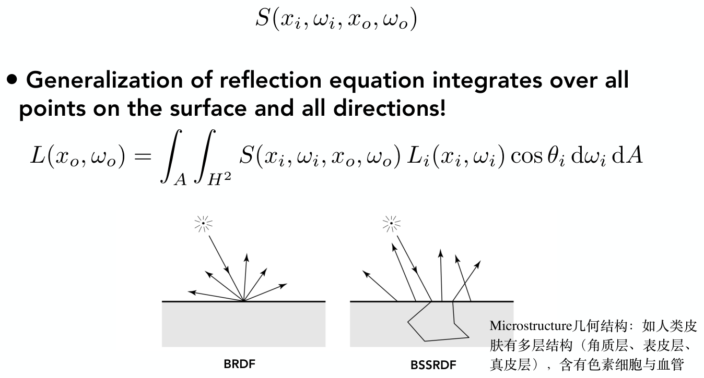

## 第 69 页

BRDF

CMU 15-462/662

## 第 70 页

BSSRDF

CMU 15-462/662

## 第 71 页 · BRDF vs BSSRDF

[Jensen et al. 2001]

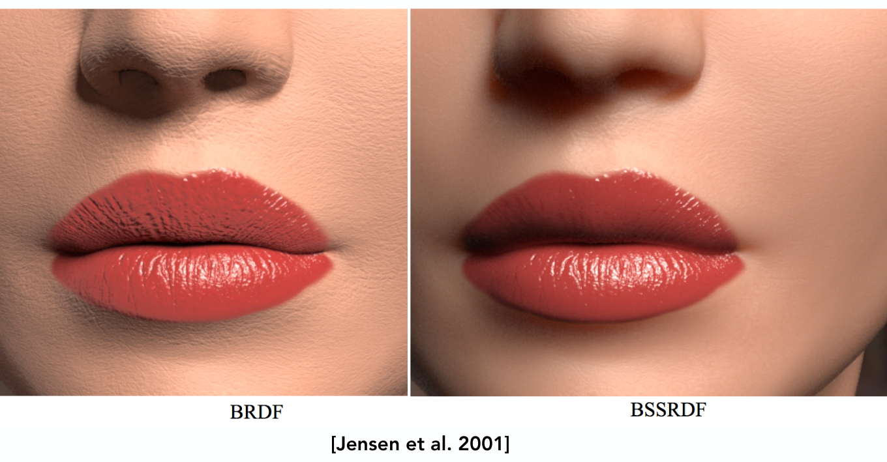

## 第 72 页 · BSSRDF: Application

[Artist: Teruyuki and Yuka]

[Artist: Dan Roarty]

[Artist: Hyun Kyung]

https://cgelves.com/10-most-realistic-human-3d-models-that-will-wow-you/

## 第 73 页 · So Far…

Get 光的传播规律、量化光辐射能量、光传输方程、反射、折射方程（既材质模型）…

$$
dE(p,\omega_i)=L_i(p,\omega_i)\cos\theta_i\,d\omega_i.
$$

$$
L_r(p,\omega_o)=\int_{H^2} f_r(p,\omega_i\to\omega_o)\,L_i(p,\omega_i)\cos\theta_i\,d\omega_i.
$$

## 第 74 页 · Next time

计算像素明暗，既光传输方程的数值求解和算法实现

- Ray-surface intersection (light geometry)

光线追踪

- Monte Carlo Integration (light radiance)

蒙托卡洛积分

$$
\int_\Omega f(p)\,dp\approx \operatorname{vol}(\Omega)\frac1N\sum_{i=1}^N f(X_i).
$$
