# Lecture 12 · Ray Tracing

原课件共 75 页。[打开 PDF](../../ppt/lec-12-ray-tracing.pdf)

按 PDF 页序提取，保留课件原有中英文。关键公式以 Markdown 数学式或原页局部图呈现。

## 第 1 页 · Ray Tracing

Computer Graphics 2026 Fuzhou University - Computer Science

## 第 2 页 · Photorealistic Rendering — Our Goal

照片级真实感渲染

输入各要素

camera

geometry

materials

lights

(“scene”)

Ray Tracer

输出图像

## 第 3 页 · Basic Ray-Tracing Algorithm

## 第 4 页 · Ray Casting

光线投射

Appel 1968 - Ray casting

1. Generate an image by casting one ray per pixel
2. Check for shadows by sending a ray to the light

## 第 5 页 · Ray Casting - Generating Eye Rays

Pinhole Camera Model

closest scene

intersection point

eye ray

(starts at eye and goes through pixel)

note: more

intersection points

eye point

image plane

light source

## 第 6 页 · Ray Casting - Shading Pixels (Local Only)

Pinhole Camera Model

eye ray

(starts at eye and goes through pixel)

eye point

image plane

perform shading calculation here to compute color of pixel

light source

(e.g. Blinn Phong model)

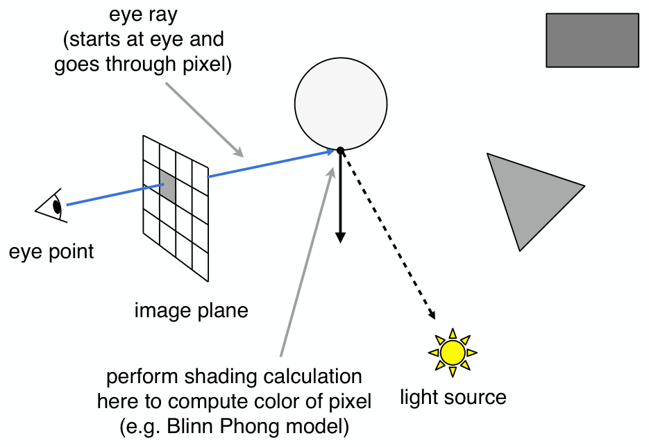

## 第 7 页 · Recursive Ray Tracing

光线追踪（光追）

“An improved Illumination model for shaded display” T. Whitted, CACM 1980

Time:

- VAX 11/780 (1979) 74m
- PC (2006) 6s
- GPU (2012) 1/30s

Spheres and Checkerboard, T. Whitted, 1979

## 第 8 页 · Recursive Ray Tracing

eye point

image plane

light source

## 第 9 页 · Recursive Ray Tracing

Mirror ray

(specular reflection)

eye point

image plane

light source

## 第 10 页 · Recursive Ray Tracing

Refractive rays

(specular transmission)

eye point

image plane

light source

## 第 11 页 · Recursive Ray Tracing

eye point

image plane

Shadow rays

light source

Is the light source visible from the surface point?

## 第 12 页 · Recursive Ray Tracing

secondary rays

primary ray

eye point

image plane

shadow rays

light source

- Trace secondary rays recursively until hit a non-specular surface (or max desired levels of recursion)
- At each hit point, trace shadow rays to test light visibility (no contribution if blocked)
- Final pixel color is weighted sum of contributions along rays, as shown

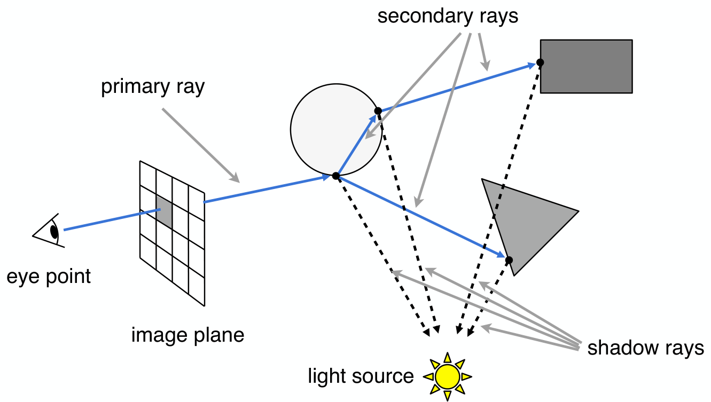

## 第 13 页 · Ray Tracing: Examples

Direct/Local Illumination

Global Illumination

直接/局部 光照

全局光照

Ray Casting

Ray Tracing

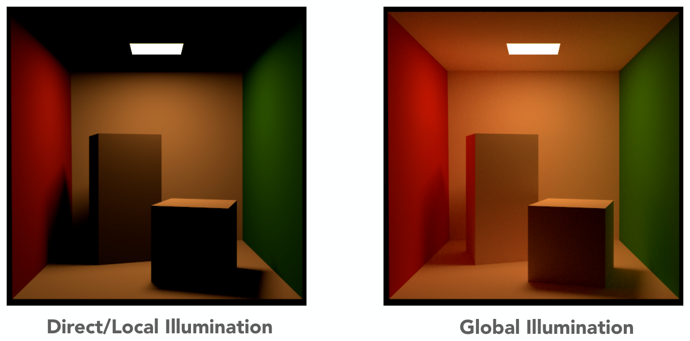

## 第 14 页 · Ray-Surface Intersection

## 第 15 页 · Ray Intersection With Triangle Mesh

Why?

- Rendering: visibility, shadows, lighting …
- Geometry: inside/outside test

hit\_p

How to compute?

Let’s break this down:

- Simple idea: just intersect ray with each triangle
- Simple, but slow (study acceleration later)
- Note: can have 0, 1 or multiple intersections

## 第 16 页 · Ray Equation

Ray is defined by its origin and a direction vector

Example:

Ray equation:

point along ray

“time”

origin

unit direction

$$
\mathbf r(t)=\mathbf o+t\mathbf d,\qquad 0\le t<\infty.
$$

## 第 17 页 · Plane Equation

Plane is defined by normal vector and a point on plane

Example:

Plane Equation:

all points on plane

point on plane

normal vector

$$
(\mathbf p-\mathbf p')\cdot\mathbf N=0,\qquad ax+by+cz+d=0.
$$

## 第 18 页 · Ray Intersection With Plane

Ray equation:

Plane equation:

Solve for intersection

Check:

$$
t=\frac{(\mathbf p'-\mathbf o)\cdot\mathbf N}{\mathbf d\cdot\mathbf N},\qquad 0\le t<\infty.
$$

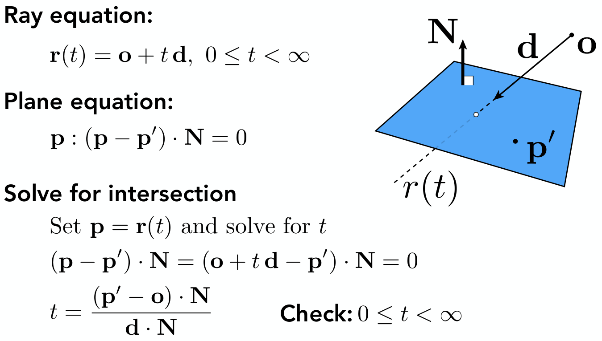

## 第 19 页 · Ray Intersection With Triangle

Triangle is in a plane

- Ray-plane intersection
- Test if hit point is inside triangle

Many ways to optimize…

## 第 20 页 · Can Optimize: e.g. Möller Trumbore Algorithm

https://en.wikipedia.org/wiki/M%C3%B6ller%E2%80%93Trumbore_intersection_algorithm

$$
\mathbf O+t\mathbf D=(1-b_1-b_2)\mathbf P_0+b_1\mathbf P_1+b_2\mathbf P_2.
$$

$$
\begin{bmatrix}t\\b_1\\b_2\end{bmatrix}
=\frac{1}{\mathbf S_1\cdot\mathbf E_1}
\begin{bmatrix}\mathbf S_2\cdot\mathbf E_2\\\mathbf S_1\cdot\mathbf S\\\mathbf S_2\cdot\mathbf D\end{bmatrix},\quad
\begin{aligned}\mathbf E_1&=\mathbf P_1-\mathbf P_0,\quad \mathbf E_2=\mathbf P_2-\mathbf P_0,\\
\mathbf S&=\mathbf O-\mathbf P_0,\quad \mathbf S_1=\mathbf D\times\mathbf E_2,\quad \mathbf S_2=\mathbf S\times\mathbf E_1.\end{aligned}
$$

## 第 21 页 · Ray Intersection With Sphere

Ray:

Sphere: p : (p −c)2 −R2 = 0

Solve for intersection:

$$
(\mathbf o+t\mathbf d-\mathbf c)\cdot(\mathbf o+t\mathbf d-\mathbf c)-R^2=0,
$$

$$
at^2+bt+c=0,\quad a=\mathbf d\cdot\mathbf d,\quad
b=2(\mathbf o-\mathbf c)\cdot\mathbf d,\quad c=(\mathbf o-\mathbf c)\cdot(\mathbf o-\mathbf c)-R^2.
$$

$$
t=\frac{-b\pm\sqrt{b^2-4ac}}{2a}.
$$

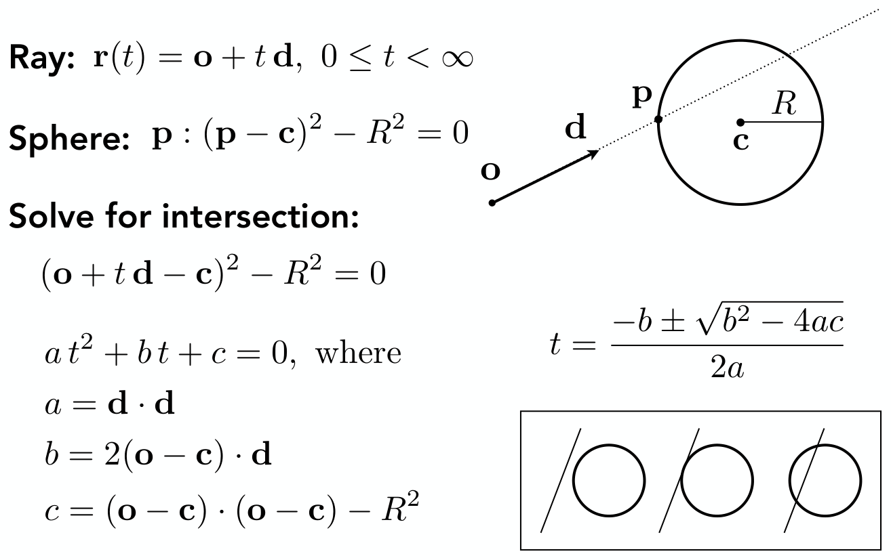

## 第 22 页 · Ray Intersection With Implicit Surface

Ray:

General implicit surface: p : f(p) = 0

Substitute ray equation: f(o + t d) = 0

Solve for real, positive roots

$$
f(\mathbf o+t\mathbf d)=0.
$$

## 第 23 页 · Accelerating Ray-Surface

Intersection

## 第 24 页 · Why care about performance?

Simple ray-scene intersection

- Exhaustively test ray-intersection with every object

Problem:

- Exhaustive algorithm = #pixels ⨉ #objects
- Very slow!

## 第 25 页 · Ray Tracing – Performance Challenges

Jun Yan, Tracy Renderer

San Miguel Scene, 10.7M triangles

## 第 26 页 · Ray Tracing – Performance Challenges

Deussen et al; Pharr & Humphreys, PBRT

Plant Ecosystem, 20M triangles

## 第 27 页 · Spatial Acceleration Data Structures

## 第 28 页 · Bounding Volumes

## 第 29 页 · Bounding Volumes

Quick way to avoid intersections: bound complex object with a simple volume

- Object is fully contained in the volume
- If it doesn’t hit the volume, it doesn’t hit the object
- So test bvol first, then test object if it hits

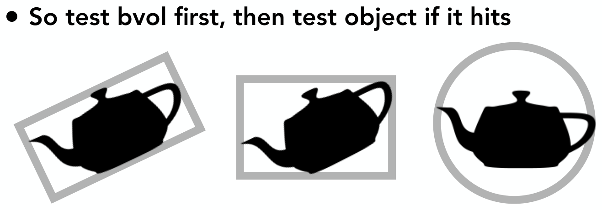

## 第 30 页 · Ray-Intersection With Box

Could intersect with 6 faces individually

Better way: box is the intersection of 3 slabs

## 第 31 页 · Ray Intersection with Axis-Aligned Box

2D example; 3D is the same!  Compute intersections with slabs and take intersection of tmin/tmax intervals

tmax

tmin

Note:  tmin &lt; 0

Intersections with x planes

Intersections with y planes

Final intersection result

max

, min

$$
t_{\mathrm{enter}}=\max_j t_{\min,j},\qquad t_{\mathrm{exit}}=\min_j t_{\max,j}.
$$

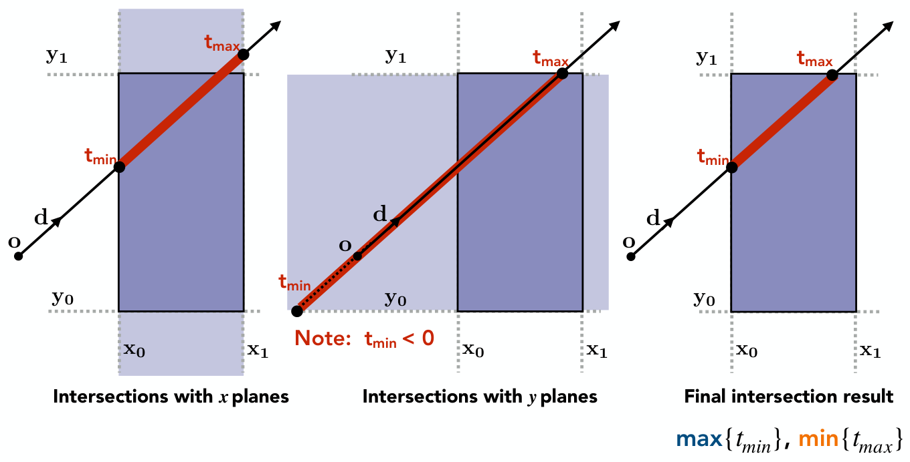

## 第 32 页 · Ray Intersection with Axis-Aligned Box

- Recall: a box (3D) = three pairs of infinitely large slabs

tmax

and

- For each pair, calculate the

tmin

=max

,

=min

- For the 3D box,

, we know the ray stays a while in

- If the box (so they must intersect!)

means the ray misses the box

-  completely

Final intersection result

Note:  tmin &lt; 0

$$
t_{\mathrm{enter}}=\max_j t_{\min,j},\qquad t_{\mathrm{exit}}=\min_j t_{\max,j}.
$$

## 第 33 页 · Ray Intersection with Axis-Aligned Box

- However, ray is not a line
    - Should check whether $t$ is negative for physical correctness!
- What if $t_\mathrm{exit}<0$?
    - The box is “behind” the ray — no intersection!
- What if $t_\mathrm{exit}\ge0$ and $t_\mathrm{enter}<0$?
    - The ray’s origin is inside the box — have intersection!
- In summary, ray and AABB intersect iff $t_\mathrm{enter}<t_\mathrm{exit}$ and $t_\mathrm{exit}\ge0$.

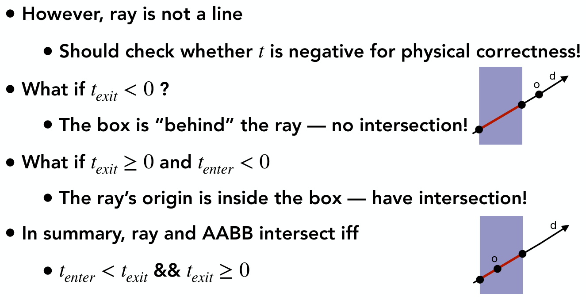

## 第 34 页

Optimize Ray-Plane Intersection For Axis-Aligned Planes?

General

3 subtractions, 6 multiplies, 1 division

Perpendicular

to x-axis

1 subtraction, 1 division

$$
t=\frac{p'_x-o_x}{d_x}\quad\text{for a plane perpendicular to the }x\text{-axis}.
$$

## 第 35 页 · Uniform Spatial Partitions (Grids)

Subdivision of AABB into smaller, equally sized boxes

## 第 36 页 · Preprocess – Build Acceleration Grid

1. Find bounding box

An AABB can be defined by two points:

## 第 37 页 · Preprocess – Build Acceleration Grid

1. Find bounding box
2. Create grid

## 第 38 页 · Preprocess – Build Acceleration Grid

1. Find bounding box
2. Create grid
3. Store each object in overlapping cells

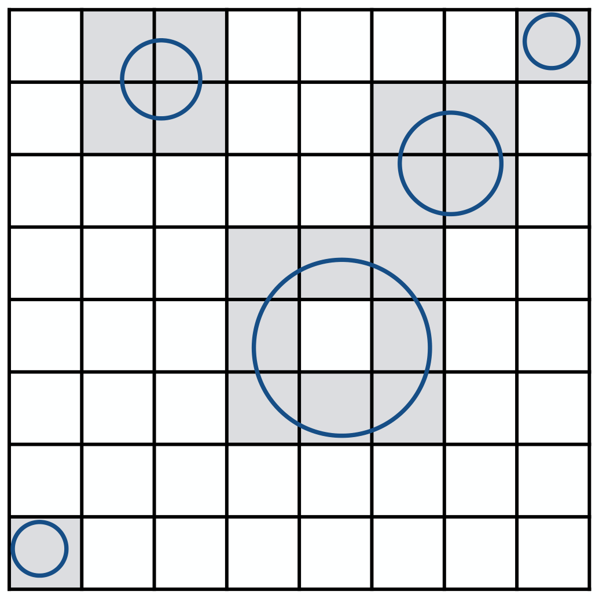

## 第 39 页 · Ray-Scene Intersection

Step through grid in ray traversal order (3D line - 3D DDA)

For each grid cell Test intersection with all objects stored at that cell

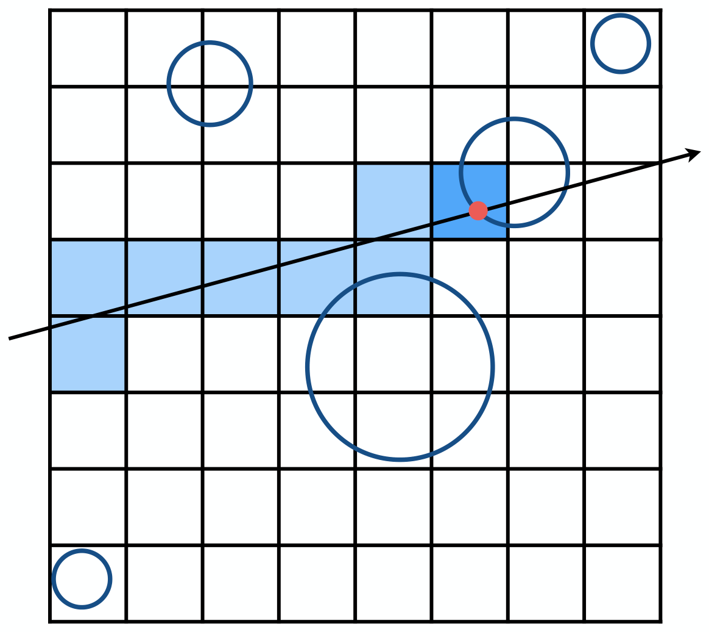

## 第 40 页 · Grid Resolution?

One cell

- No speedup

## 第 41 页 · Grid Resolution?

Too many cells

- Inefficiency due to extraneous grid traversal

## 第 42 页 · Grid Resolution?

Heuristic:

- #cells = C \* #objs
- C ≈ 27 in 3D

## 第 43 页 · Careful! Objects Overlapping Multiple Cells

What goes wrong here?

- First intersection found (red) is not the nearest!

Solution?

- Check intersection point is inside cell

Optimize

- Cache intersection to avoid re-testing (mailboxing)

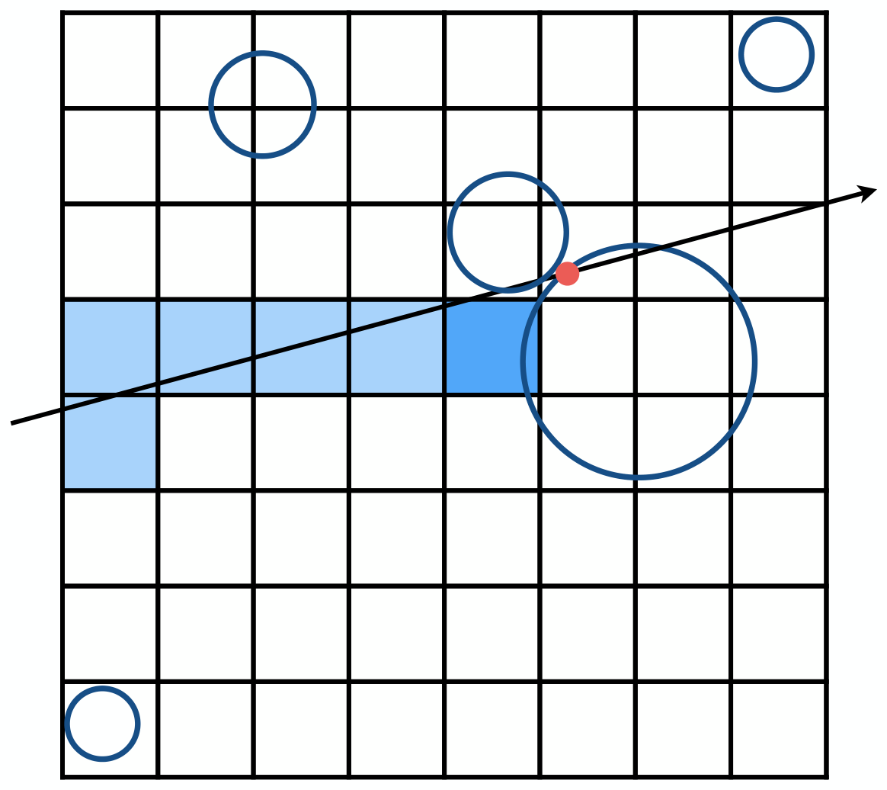

## 第 44 页 · Uniform Grids – When They Work Well

Deussen et al; Pharr & Humphreys, PBRT

Grids work well on large collections of objects

that are distributed evenly in size and space

## 第 45 页 · Uniform Grids – When They Fail

are inefficient

Jun Yan, Tracy Renderer

“Teapot in a stadium” problem

Almost every cell in that grid is empty, and the grid still allocates memory for every voxel. A ray traversing the scene must step through thousands or millions of empty voxels before it reaches the teapot.

## 第 46 页 · Non-Uniform Spatial Partitions:

Spatial Hierarchies

## 第 47 页 · Spatial Hierarchies

A

## 第 48 页 · Spatial Hierarchies

A

B

## 第 49 页 · Spatial Hierarchies

A

B

C

## 第 50 页 · Spatial Hierarchies

A

2

1

B

C

4

D

3

5

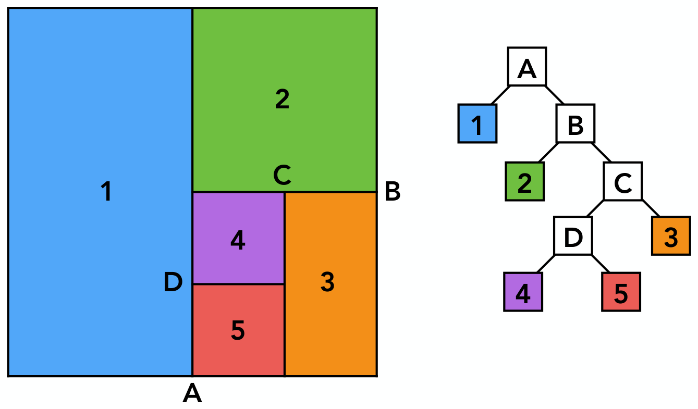

## 第 51 页 · Spatial Partitioning Variants

Oct-Tree

KD-Tree

BSP-Tree

Note: you could have these in both 2D and 3D.  In lecture we will illustrate

principles in 2D, but for assignment you will implement 3D versions.

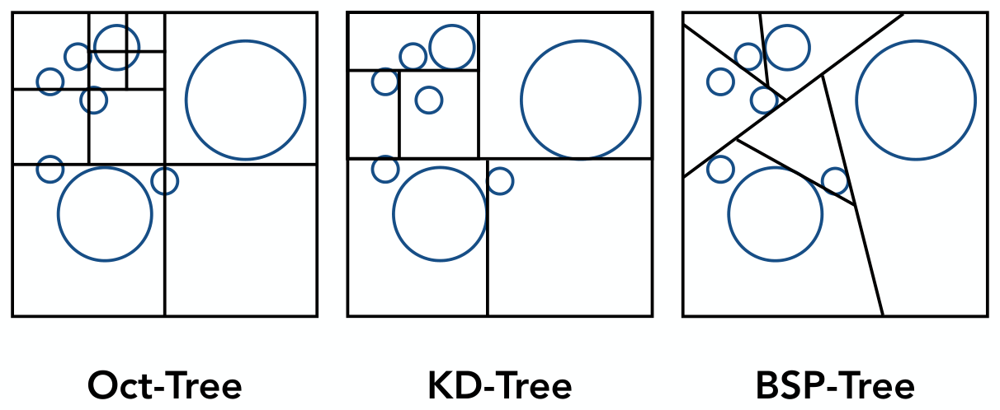

## 第 52 页 · KD-Trees

Internal nodes store

- split axis: x-, y-, or z-axis
- split position: coordinate of split plane along axis
- children: reference to child nodes

Leaf nodes store

- list of objects
- mailbox information

## 第 53 页 · KD-Tree Pre-Processing

- Find bounding box
- Recursively split cells, axis-aligned planes
- Until termination criteria met (e.g. max #splits or min #objs)
- Store obj references with each leaf node

C

B

D

A

## 第 54 页 · KD-Tree Pre-Processing

Choosing the split plane

- Simple: midpoint, median split
- Ideal: split to minimize expected cost of ray intersection

Termination criteria?

- Simple: common to prescribe maximum tree depth (empirical 8 + 1.3 log N, N = #objs) [PBRT]
- Ideal: stop when splitting does not reduce expected cost of ray intersection

## 第 55 页 · KD-Tree Pre-Processing

Root

A

1

B

2

Internal Nodes

C

D

3

4

5

Leaf Nodes

Only leaf nodes store references to geometry

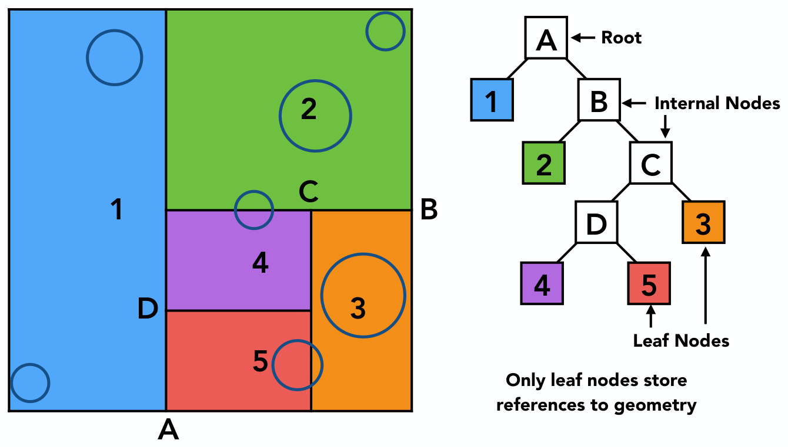

## 第 56 页 · Top-Down Recursive In-Order Traversal

A

1

B

C

2

D

3

4

5

## 第 57 页 · Top-Down Recursive In-Order Traversal

t\_{min}

t\_{split}

A

1

B

C

2

D

3

t\_{max}

4

5

Internal node: split

## 第 58 页 · Top-Down Recursive In-Order Traversal

t\_{min}

t\_{max}

A

1

B

C

2

D

3

4

5

Leaf node: intersect all objects

## 第 59 页 · Top-Down Recursive In-Order Traversal

t\_{min}

A

1

B

t\_{split}

C

2

D

3

t\_{max}

4

5

Internal node: split

## 第 60 页 · Top-Down Recursive In-Order Traversal

t\_{min}

A

1

B

t\_{max}

C

2

D

3

4

5

Leaf node: intersect all objects

## 第 61 页 · Top-Down Recursive In-Order Traversal

A

1

B

t\_{split}

C

t\_{min}

2

D

3

t\_{max}

4

5

Internal node: split

## 第 62 页 · Top-Down Recursive In-Order Traversal

A

1

B

C

t\_{min}

2

D

3

t\_{max}

4

5

Leaf node: intersect all objects

## 第 63 页 · Top-Down Recursive In-Order Traversal

A

1

B

C

2

t\_{hit}

D

3

4

5

Intersection found

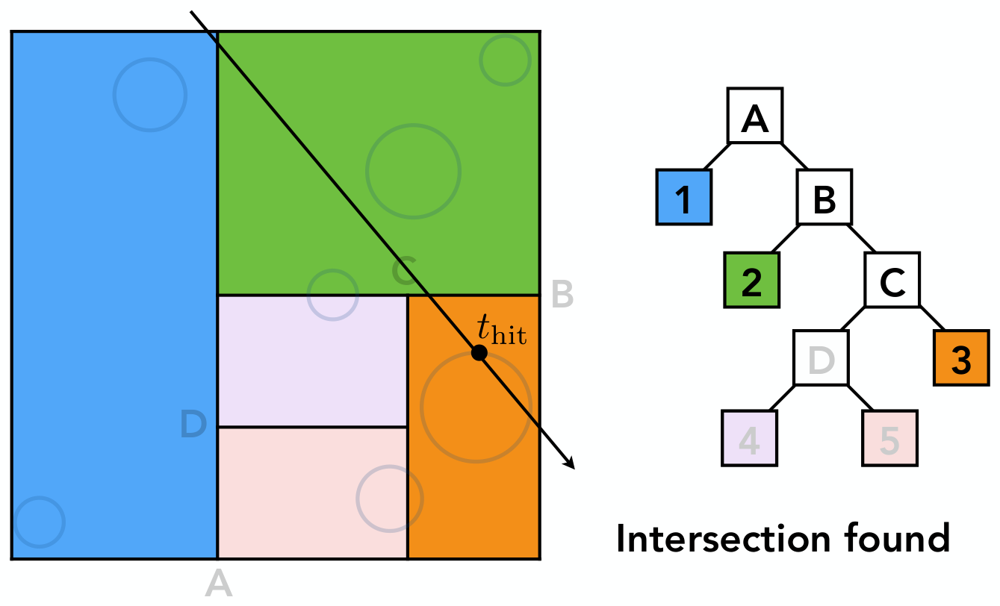

## 第 64 页 · Object Partitions &

Bounding Volume Hierarchy (BVH)

## 第 65 页 · Spatial vs Object Partitions

Spatial partition (e.g.KD-tree)

- Partition space into non- overlapping regions
- Objects can be contained in multiple regions

Object partition (e.g. BVH)

- Partition set of objects into disjoint subsets
- Bounding boxes for each set may overlap in space

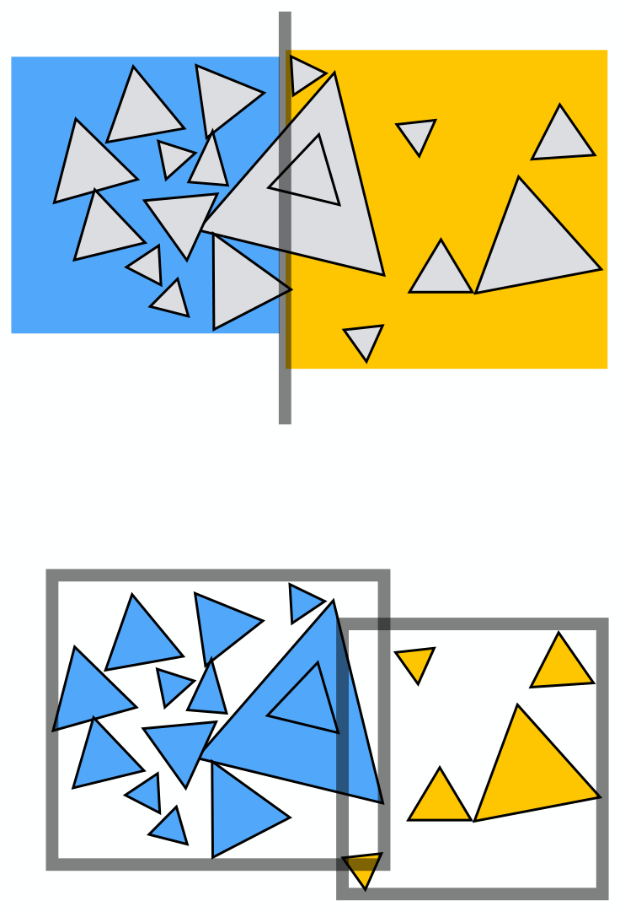

## 第 66 页 · Bounding Volume Hierarchy (BVH)

Root

## 第 67 页 · Bounding Volume Hierarchy (BVH)

## 第 68 页 · Bounding Volume Hierarchy (BVH)

文字同第 67 页。

## 第 69 页 · Bounding Volume Hierarchy (BVH)

A

C

B

D

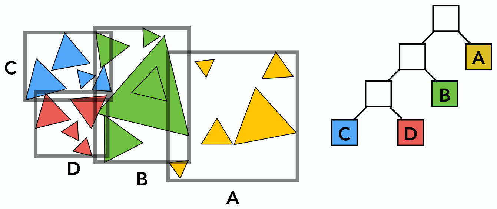

## 第 70 页 · Bounding Volume Hierarchy (BVH)

Internal nodes store

- Bounding box
- Children: reference to child nodes

Leaf nodes store

- Bounding box
- List of objects

Nodes represent subset of primitives in scene

- All objects in subtree

## 第 71 页 · BVH Pre-Processing

- Find bounding box
- Recursively split set of objects in two subsets
- Stop when there are just a few objects in each set
- Store obj reference(s) in each leaf node

## 第 72 页 · BVH Pre-Processing

Choosing the set partition

- Choose a spatial dimension to partition over (e.g. x,y,z)
- Simple #1: Split objects around spatial midpoint
- Simple #2: Split at location of median object
- Ideal: split to minimize expected cost of ray intersection

Termination criteria?

- Simple: stop when node contains few elements (e.g. 5)
- Ideal: stop when splitting does not reduce expected cost of ray intersection

## 第 73 页 · BVH Recursive Traversal

node

```text
Intersect (Ray ray, BVH node)
  if (ray misses node.bbox) return;
  if (node is a leaf node)
     test intersection with all objs;
     return closest intersection;
  hit1 = Intersect (ray, node.child1);
  hit2 = Intersect (ray, node.child2);
  return closer of hit1, hit2;
```

child1

child2

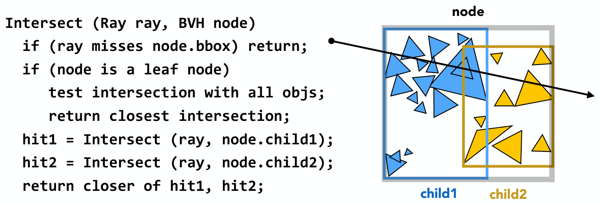

## 第 74 页 · Summary of Spatial Acceleration Structures

- Primitive vs. spatial partitioning:
    - Primitive partitioning: partition sets of objects
        - Bounded number of BVH nodes, simpler to update if primitives in scene change position
    - Spatial partitioning: partition space
        - Traverse space in order (first intersection is closest intersection), may intersect primitive multiple times
- Adaptive structures (BVH, K-D tree)
    - More costly to construct (must be able to amortize cost over many geometric queries)
    - Better intersection performance under non-uniform distribution of primitives
- Non-adaptive accelerations structures (uniform grids)
    - Simple, cheap to construct
    - Good intersection performance if scene primitives are uniformly distributed
- Many, many combinations thereof...

## 第 75 页 · Next Time: Monte Carlo Ray Tracing
