# Lecture 13 · Monte Carlo Ray Tracing

原课件共 110 页。[打开 PDF](../../ppt/lec-13-monte-carlo-ray-tracing.pdf)

按 PDF 页序提取，保留课件原有中英文。关键公式以 Markdown 数学式或原页局部图呈现。

## 第 1 页 · Monte Carlo Ray Tracing

Computer Graphics 2026 Fuzhou University - Computer Science

## 第 2 页 · Recall Rendering Equation

How can we possibly evaluate this integral?

$$
L_o(p,\omega_o)=L_e(p,\omega_o)+
\int_{H^2} f_r(p,\omega_i\to\omega_o)\,L_i(p,\omega_i)\cos\theta_i\,d\omega_i.
$$

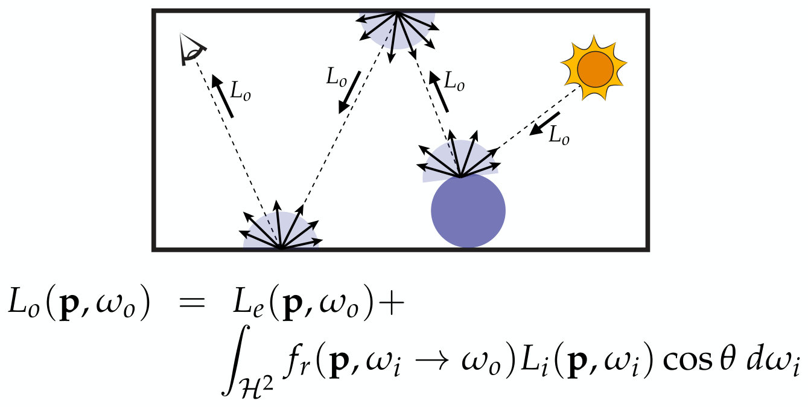

## 第 3 页 · Recall Ray Tracing

secondary rays

primary ray

eye point

image plane

shadow rays

light source

## 第 4 页 · Numerical Integration — Overview

- In graphics, many quantities we’re interested in are naturally expressed as integrals (total brightness, total area, ...)
- For very, very simple integrals, we can compute the solution analytically
- For everything else, we have to compute a numerical approximation
- Basic idea:
    - integral is “area under curve”
    - sample the function at many points
    - integral is approximated as weighted sum

f(x)

f( )

h

## 第 5 页 · Rendering: What Are We Integrating?

- Recall this view of the world:

Want to “sum up” — i.e., integrate!

— light from all directions

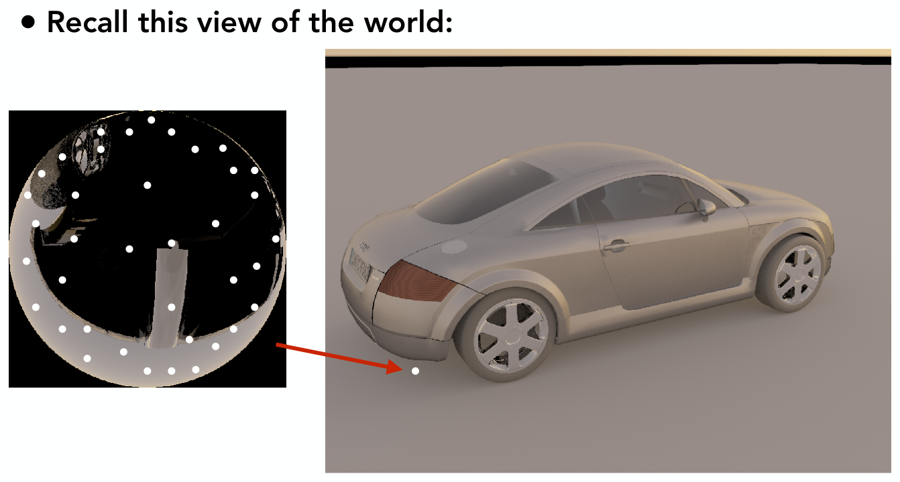

## 第 6 页 · Review: Integral as “area under curve”

$$
\int_a^b f(x)\,dx
$$

## 第 7 页 · Or: average value times size of domain

积分中值定理

$$
\int_a^b f(x)\,dx=(b-a)\operatorname{mean}(f).
$$

## 第 8 页 · Review: Fundamental Theorem of Calculus

$$
\int_a^b f(x)\,dx=F(b)-F(a),\qquad f(x)=\frac{dF(x)}{dx}.
$$

## 第 9 页 · Simple Case: Constant Function

$$
\int_a^b C\,dx=(b-a)C.
$$

## 第 10 页 · Affine Function:

Need  only one sample of the function

$$
\int_a^b f(x)\,dx=\tfrac12(f(a)+f(b))(b-a),\qquad f(x)=cx+d.
$$

## 第 11 页 · Piecewise Affine Function

For piecewise functions, just sum integral of each piece:

$$
\int_a^b f(x)\,dx=\frac12\sum_{i=0}^{n-2}(x_{i+1}-x_i)\bigl(f(x_i)+f(x_{i+1})\bigr).
$$

## 第 12 页 · Piecewise Affine Function

If N-1 segments are of equal length:

Weighted combination of measurements.

$$
h=\frac{b-a}{n-1},\qquad
\int_a^b f(x)\,dx=\frac{h}{2}\sum_{i=0}^{n-1}\bigl(f(x_i)+f(x_{i+1})\bigr)
=h\left(\sum_{i=1}^{n-1}f(x_i)+\frac{f(x_0)+f(x_n)}{2}\right)=\sum_{i=0}^n A_i f(x_i).
$$

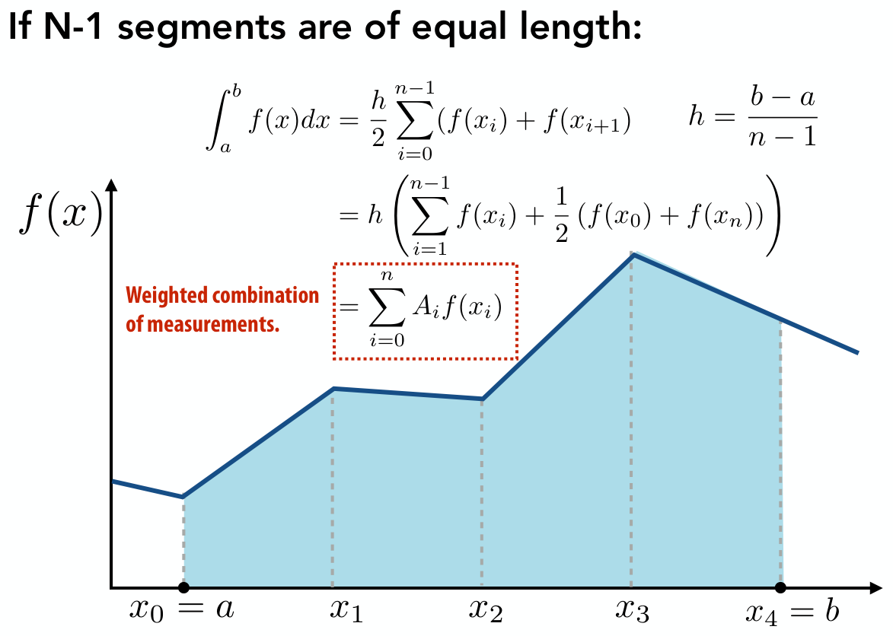

## 第 13 页 · More General Polynomials?

f(x)

x = b

x = a

## 第 14 页 · Gauss Quadrature

高斯求积

- For any polynomial of degree n, we can always obtain the exact integral by sampling at a special set of n points and taking a special weighted combination

n=1

n=2

n=4

n=3

n=5

https://en.wikipedia.org/wiki/Gaussian_quadrature

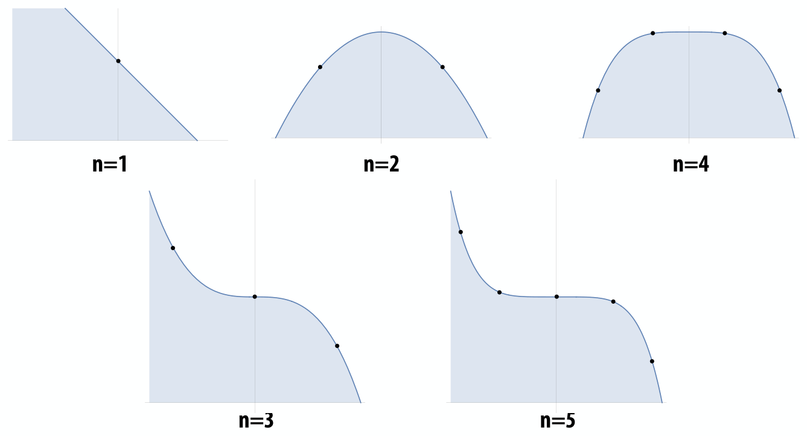

## 第 15 页 · Key idea so far:

To approximate an integral, we need

(i) quadrature points, and

(ii) Weights for each point

$$
\int_a^b f(x)\,dx\approx\sum_{i=1}^n w_i f(x_i).
$$

## 第 16 页 · Arbitrary Function

f(x)?

f(x)

x₀ = a

x₁

x₂

x₃

x₄ = b

## 第 17 页 · Trapezoid Rule

梯形法则

Approximate integral of

by assuming function is piecewise linear

For equal length segments:

$$
h=\frac{b-a}{n-1},\qquad
\int_a^b f(x)\,dx=h\left(\sum_{i=1}^{n-1}f(x_i)+\frac{f(x_0)+f(x_n)}{2}\right).
$$

## 第 18 页 · Trapezoid Rule

Consider cost and accuracy of estimate as

(or

)

Work: O(n)

Error can be shown to be:

(For

with continuous second derivative)

$$
O(h^2)=O(1/n^2).
$$

## 第 19 页 · What about a 2D function?

How should we approximate the area underneath?

## 第 20 页 · Integration in 2D (2D Trapezoidal Rule)

Consider integrating f(x, y)

using the trapezoidal rule

(Apply rule twice: when integrating in x and in y)

First application of rule

a\_y

aₓ

i=0

Second application

j=0

i=0 j=0

Errors add, so error still: O(h²)

Must perform much more work in 2D to get same error bound on integral!

But work is now: O(n²)

In K-D, let N = nk

(n x n set of measurements)

Error goes as:  O

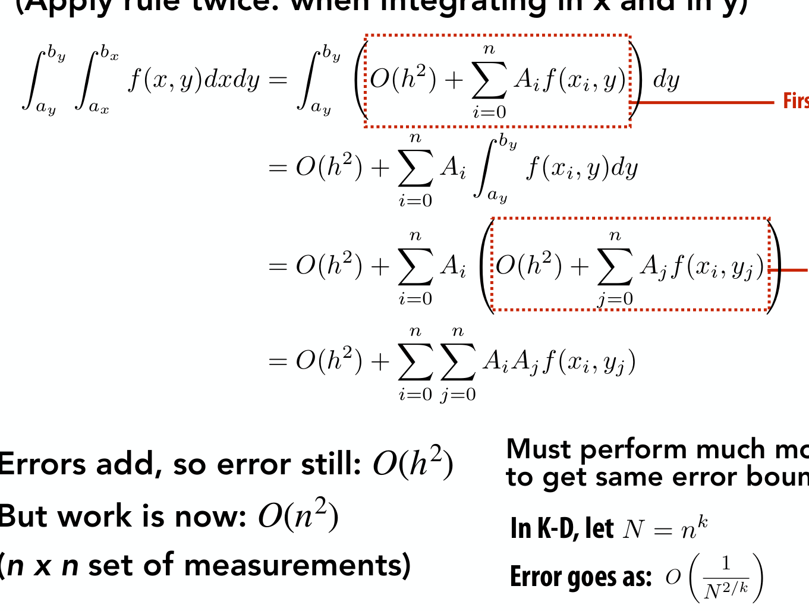

## 第 21 页 · Curse of Dimensionality

- How much does it cost to apply the trapezoid rule as we go up in dimension?
    - 1D: O(n)

…

- 2D: O(n²)
- …
- kD: O(n^k)
- For many problems in graphics (like rendering), k is very, very big (e.g., tens or hundreds or thousands)
- Applying trapezoid rule does not scale!
- Need a fundamentally different approach…

## 第 22 页 · Monte Carlo Integration

Simple idea: estimate the integral of a function by averaging random samples of the function’s value.

f(x)

f(x)dx

a

b

xᵢ

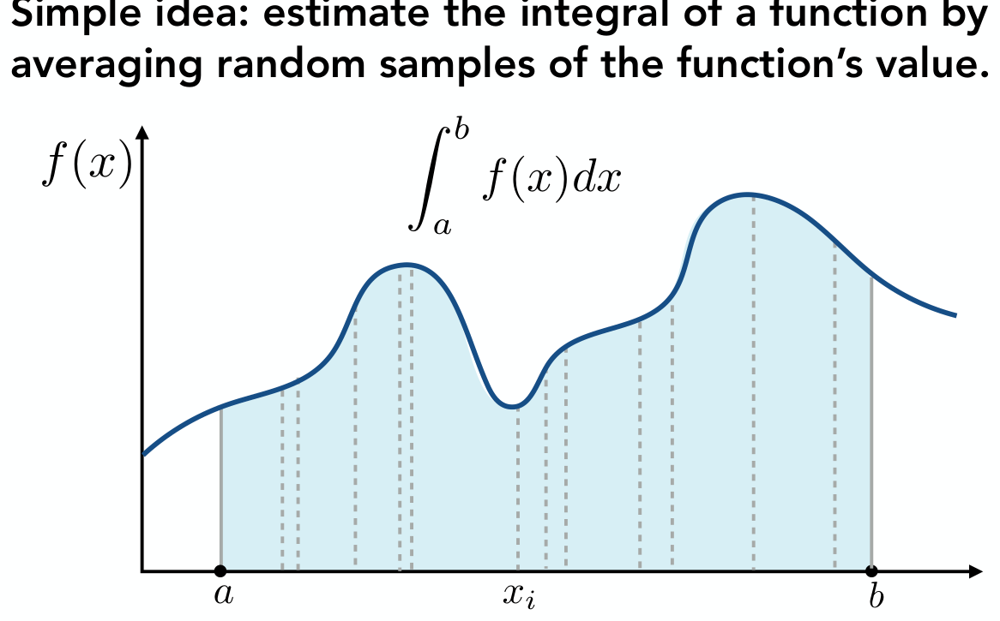

## 第 23 页 · Monte Carlo Integration

Let us define the Monte Carlo estimator for the definite integral of given function

Definite integral

Note: p(x) must

be nonzero for

Random variable

all x where

f(x) is nonzero

Monte Carlo estimator

$$
X_i\sim p(x),\qquad F_N=\frac1N\sum_{i=1}^N\frac{f(X_i)}{p(X_i)}.
$$

## 第 24 页 · Review: Random Variables

Random variable. Represents a distribution of potential values

X

X ∼p(x)

Probability density function (PDF). Describes relative probability of a random process choosing value x

Uniform PDF: all values over a domain are equally likely

e.g., for an unbiased die

X takes on values 1,2,3,4,5,6

p(1) = p(2) = p(3) = p(4) = p(5) = p(6)

## 第 25 页 · Discrete Probability Distributions

n discrete values

With probability

Requirements of a PDF:

Six-sided die example:

Think:  is the probability that a random measurement of  will yield the value

takes on the value  with probability

$$
p_i\ge 0,\qquad \sum_{i=1}^n p_i=1.
$$

## 第 26 页 · Cumulative Distribution Function (CDF)

(For a discrete probability distribution)

Cumulative PDF:

Where:

$$
P_i=\sum_{j=1}^i p_j,\qquad 0\le P_i\le1,\quad P_n=1.
$$

## 第 27 页 · How do we generate samples

of a discrete random variable

(with a known PDF?)

## 第 28 页

Idea: From uniform random → any distribution

## 第 29 页 · Sampling From Discrete Probability Distributions

To randomly select an event,

Select  if

Uniform random variable ∈[0,1)

$$
P_{i-1}<\xi\le P_i,\qquad \xi\sim U[0,1].
$$

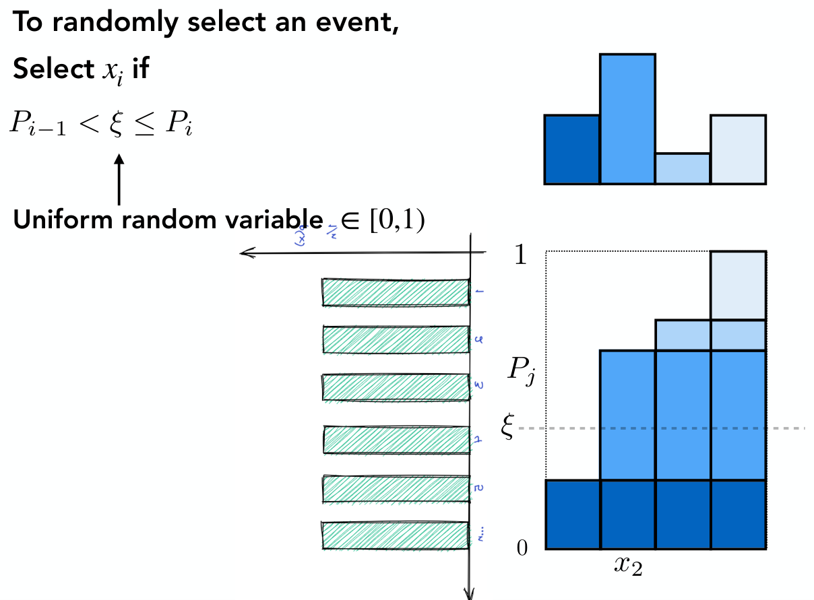

## 第 30 页 · Continuous Probability Distributions

PDF

Uniform distribution

(For random variable

)

CDF

0

1

$$
P(x)=\int_0^x p(z)\,dz=\Pr(X<x),\qquad \Pr(a\le X\le b)=P(b)-P(a).
$$

## 第 31 页 · Sampling continuous random variables using the inversion method

Cumulative probability distribution function

1

Construction of samples:

Solve for x = P−1(ξ)

Must know the formula for:

1. The integral of

0

2. The inverse function

$$
x=P^{-1}(\xi),\qquad \xi\sim U[0,1].
$$

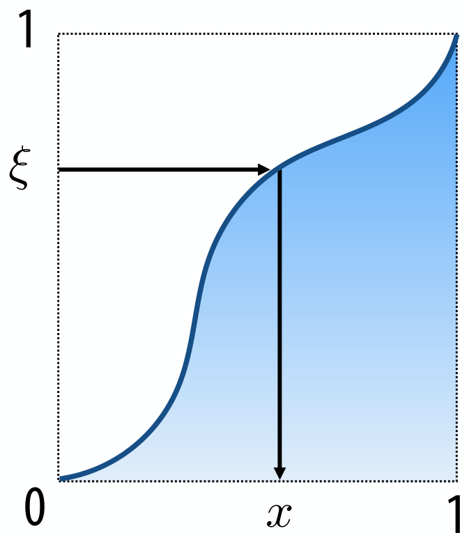

## 第 32 页 · Example — Sampling Quadratic Distribution

- As a toy example, consider the simple probability distribution

over the interval [0,1]

- How do we pick random samples distributed according to

?

- First, integrate probability distribution

to get cumulative

distribution

- Invert

by solving

for

- Finally, plug uniformly distributed random values  in [0,1] into this expression

$$
p(x)=3(1-x)^2,\quad P(x)=x^3-3x^2+3x,\quad x=P^{-1}(y)=1-(1-y)^{1/3}.
$$

## 第 33 页 · How do we uniformly sample the unit circle?

I.e., choose any point P=(px,py) in circle with equal probability

## 第 34 页 · Uniform Sampling via Rejection Sampling

Pick uniform samples in square (easy)

Then toss out any samples not in circle (easy)

Efficiency of technique: area of circle / area of square

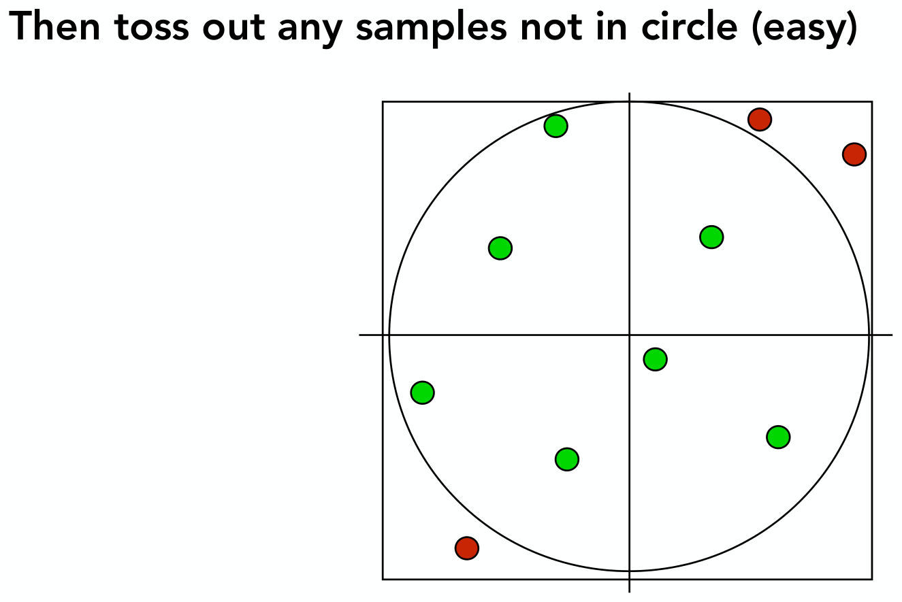

## 第 35 页 · Efficiency of via Rejection Sampling

- If the region we care about covers only a very small fraction of the region we’ve sampling, rejection is probability a bad idea:

Smarter in this case to “warp” our random variables to follow the spiral.

## 第 36 页 · Uniformly Sampling Unit Circle

θ

π

- = uniform random angle between 0 and 2
- = uniform random radius between 0 and 1

r

- Return point: (

rcos(θ), rsin(θ))

This algorithm does not produce the desire uniform sampling of the area of a circle. Why?

θ= 2πξ₁

r = ξ₂

## 第 37 页 · Because sampling is not uniform in area!

Points farther from center of circle are less likely to be chosen

rdrdθ

θ= 2πξ₁

r = ξ₂

So how should we pick samples? Well, think about how we integrate over a disk in polar coordinates…

## 第 38 页 · Uniformly Sampling Unit Circle: via Inversion in 2D

independent

$$
p(r,\theta)=r/\pi,\quad P(r)=r^2,\quad
\theta=2\pi\xi_1,\quad r=\sqrt{\xi_2}.
$$

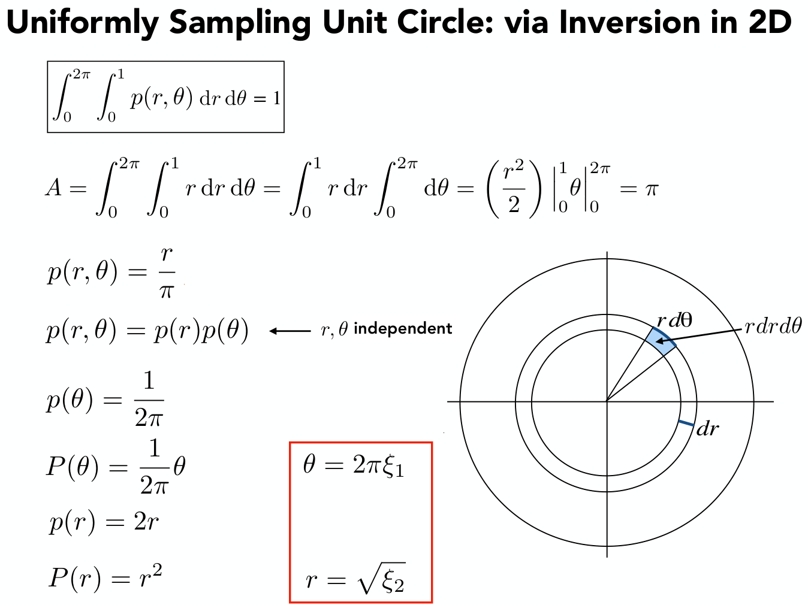

## 第 39 页 · Uniformly Area Sampling of Unit Circle

WRONG

RIGHT

Probability is uniform;

Probability is nonuniform;

Samples are uniform!

Samples are not!

$$
p(r,\theta)=r/\pi,\quad P(r)=r^2,\quad
\theta=2\pi\xi_1,\quad r=\sqrt{\xi_2}.
$$

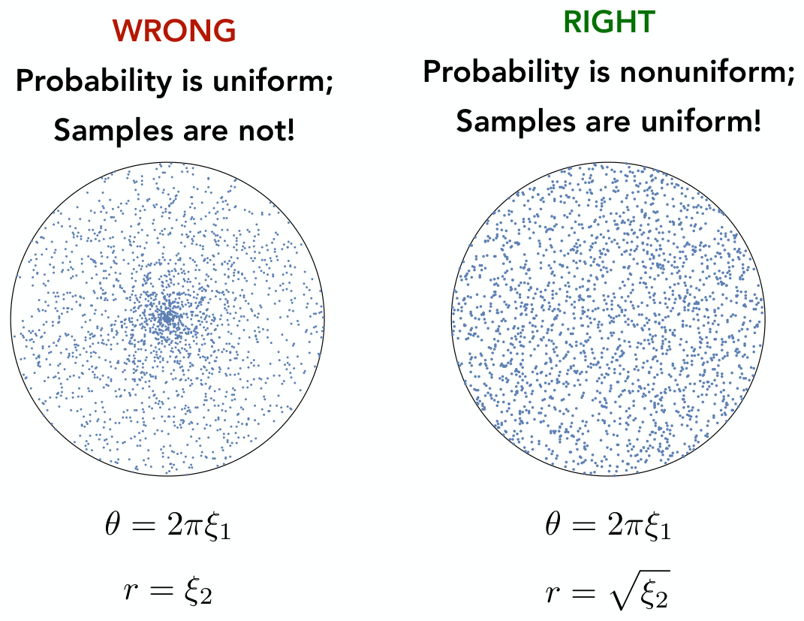

## 第 40 页 · Monte Carlo Integration

Let us define the Monte Carlo estimator for the definite integral of given function

Definite integral

Note: p(x) must

be nonzero for

Random variable

all x where

f(x) is nonzero

Monte Carlo estimator

$$
X_i\sim p(x),\qquad F_N=\frac1N\sum_{i=1}^N\frac{f(X_i)}{p(X_i)}.
$$

## 第 41 页 · Example: Basic Monte Carlo Estimator

The basic Monte Carlo estimator is a simple special case where we sample with a uniform random variable

Uniform random variable

(constant)

$$
p(x)=\frac1{b-a},\qquad F_N=\frac{b-a}{N}\sum_{i=1}^N f(X_i).
$$

## 第 42 页 · Example: Basic Monte Carlo Estimator

The basic Monte Carlo estimator is a simple special case where we sample with a uniform random variable

Basic Monte Carlo estimator (derivation)

(MC Estimator)

$$
p(x)=\frac1{b-a},\qquad F_N=\frac{b-a}{N}\sum_{i=1}^N f(X_i).
$$

## 第 43 页 · Unbiased Estimator

Definition: A randomized integral estimator is unbiased if its expected value is the desired integral.

Fact: the general and basic Monte Carlo estimators are unbiased

## 第 44 页 · Expected Value

Intuition: what value does a random variable take, on average?

- E.g., consider a fair coin where heads=1, tails=0
- Equal probability of head & tails is 1/2 for both
- Expected value is then (1/2)\*1+(1/2)\*0=1/2

Expected value of

Number of possible outcomes

random variable Y

Properties of

expected values:

Probability of ith outcome

Value of ith outcome

$$
\mathbb E[Y]=\sum_i p_i y_i,\qquad \mathbb E[aY]=a\mathbb E[Y].
$$

## 第 45 页 · Proof That Monte Carlo Estimator Is Unbiased

Properties of

expected values:

The expected value of the Monte Carlo estimator is the desired integral.

$$
\mathbb E[F_N]=\frac1N\sum_{i=1}^N\int_a^b\frac{f(x)}{p(x)}\,p(x)\,dx=\int_a^b f(x)\,dx.
$$

## 第 46 页 · Variance

Intuition: how far are our samples from the average, on average?

Definition

Q: which of these has higher variance?

p(xi)

方差的大小取决于f(x) 与采

样分布p(x)的匹配程度。

若p(x) 很小而 f(x) 大，方

差增加

x1

x2 x3 x4 x5 x6 x7

x1 x2 x3 x4 x5 x6 x7

$$
\operatorname{Var}[Y]=\mathbb E[(Y-\mathbb E[Y])^2].
$$

$$
\operatorname{Var}[F_N]=\frac1N\left(\int\frac{f(x)^2}{p(x)}\,dx-\left(\int f(x)\,dx\right)^2\right).
$$

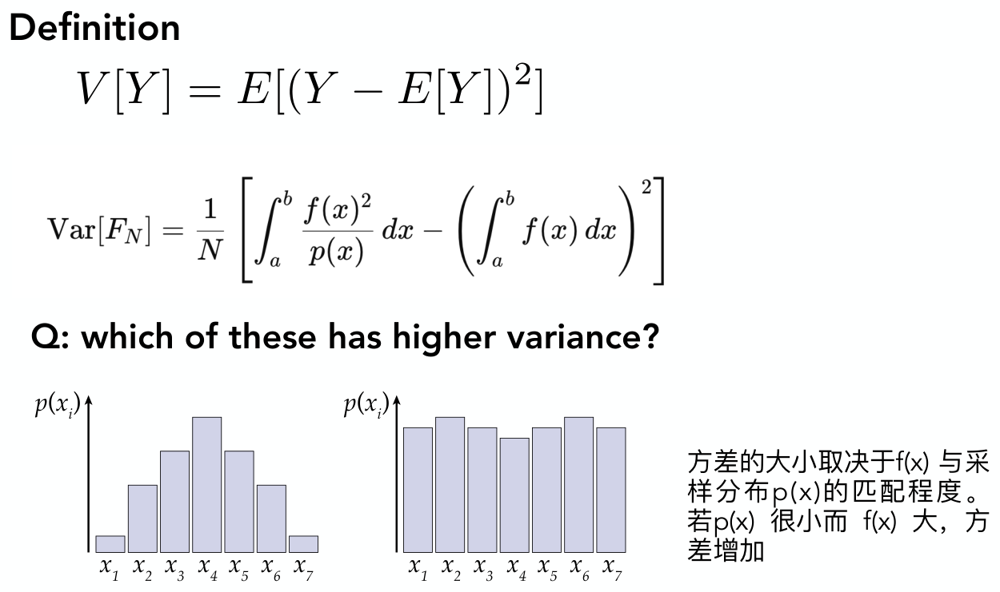

## 第 47 页 · Law of Large Numbers

大数定律

- Important fact: for any random variable, the average value of N trials approaches the expected value as we increase N
- Decrease in variance is always linear in N:
- = Important fact: for any random variable, the average value of N trials approaches the expected value as we increase N

Properties of variance:

Consider computation of  :

$$
\operatorname{Var}\!\left[\frac1N\sum_{i=1}^NY_i\right]=\frac1{N^2}\sum_{i=1}^N\operatorname{Var}[Y_i]=\frac1N\operatorname{Var}[Y].
$$

## 第 48 页

Q: Why is the law of large numbers important for Monte Carlo ray tracing?

A: No matter how hard the integrals are (complicated lighting, geometry, materials, etc.), can always get the right image by taking more samples.

## 第 49 页 · More Random Samples Reduces Variance

1 shadow ray

16 shadow rays

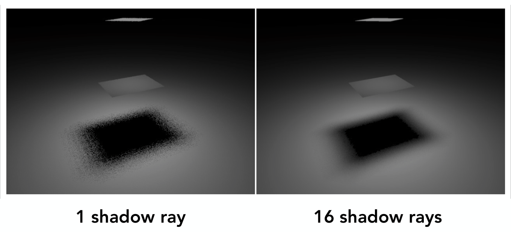

## 第 50 页 · Example: Monte Carlo Estimate

Of Direct Lighting Integral

## 第 51 页 · Direct Lighting (Irradiance) Estimate

Idea: sample directions over hemisphere uniformly in solid angle

Estimator:

$$
E(p)=\int_{H^2}L_i(p,\omega)\cos\theta\,d\omega,\qquad
p(\omega)=\frac1{2\pi},\quad F_N=\frac{2\pi}{N}\sum_{i=1}^N L_i(p,\omega_i)\cos\theta_i.
$$

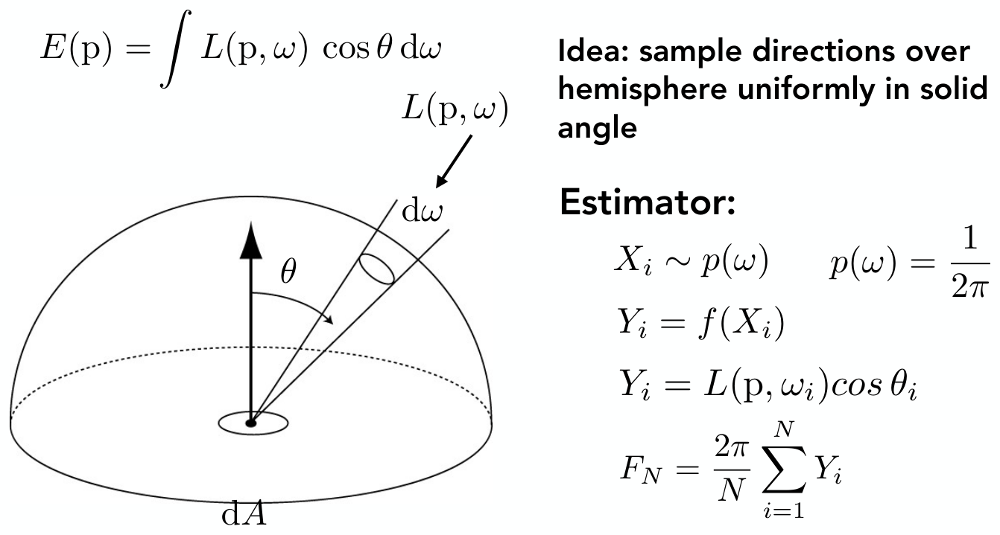

## 第 52 页 · Direct Lighting (Irradiance) Estimate

Sample directions over hemisphere uniformly in solid angle.

Given surface point $p$, initialize Monte Carlo estimator $F_N$ to 0.

For each of $N$ samples:

1. Generate random direction $\omega_i$.
2. Compute incoming radiance $L_i$ arriving at $p$ from direction $\omega_i$. A ray tracer evaluates radiance along a ray.
3. Increment the estimator by $\frac{2\pi}{N}L_i\cos\theta_i$.

$$
E(p)=\int_{H^2}L_i(p,\omega)\cos\theta\,d\omega,\qquad
p(\omega)=\frac1{2\pi},\quad F_N=\frac{2\pi}{N}\sum_{i=1}^N L_i(p,\omega_i)\cos\theta_i.
$$

## 第 53 页 · Random Direction: Picking Points on Unit Hemisphere

How do we uniformly sample directions from the hemisphere?

One way: use rejection sampling. (How?)

Another way: “warp” two values in [0,1] via the inversion method:

1.0

0.8

0.6

0.4

0.2

Exercise: derive from the inversion method

$$
(\xi_1,\xi_2)\mapsto\bigl(\sqrt{1-\xi_1^2}\cos(2\pi\xi_2),\,\sqrt{1-\xi_1^2}\sin(2\pi\xi_2),\,\xi_1\bigr).
$$

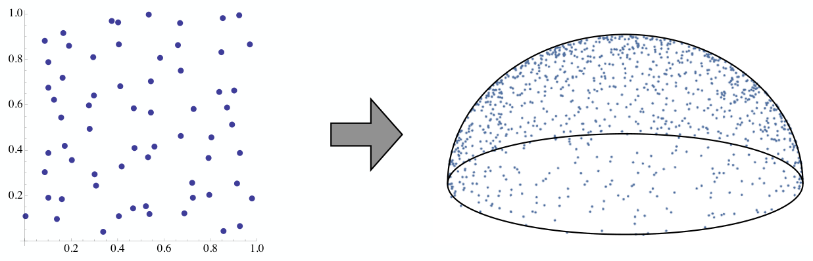

## 第 54 页

Hemispherical Solid Angle Sampling 100 rays

(random directions drawn uniformly from hemisphere)

## 第 55 页

The MC estimator uses different random directions at each pixel. Only some directions point towards the light.

(Estimator is a random variable)

Why does this image look “noisy”?

## 第 56 页 · Observation: incoming radiance is zero

for most directions in this scene

Idea: integrate only over the area of the light

(directions where incoming radiance could be non-zero)

## 第 57 页

Sampling Light Source Area 100 rays

If no occlusion is present, all directions chosen in computing estimate “hit” the light source.

(Choice of direction only matters if portion of light is occluded from surface point p.)

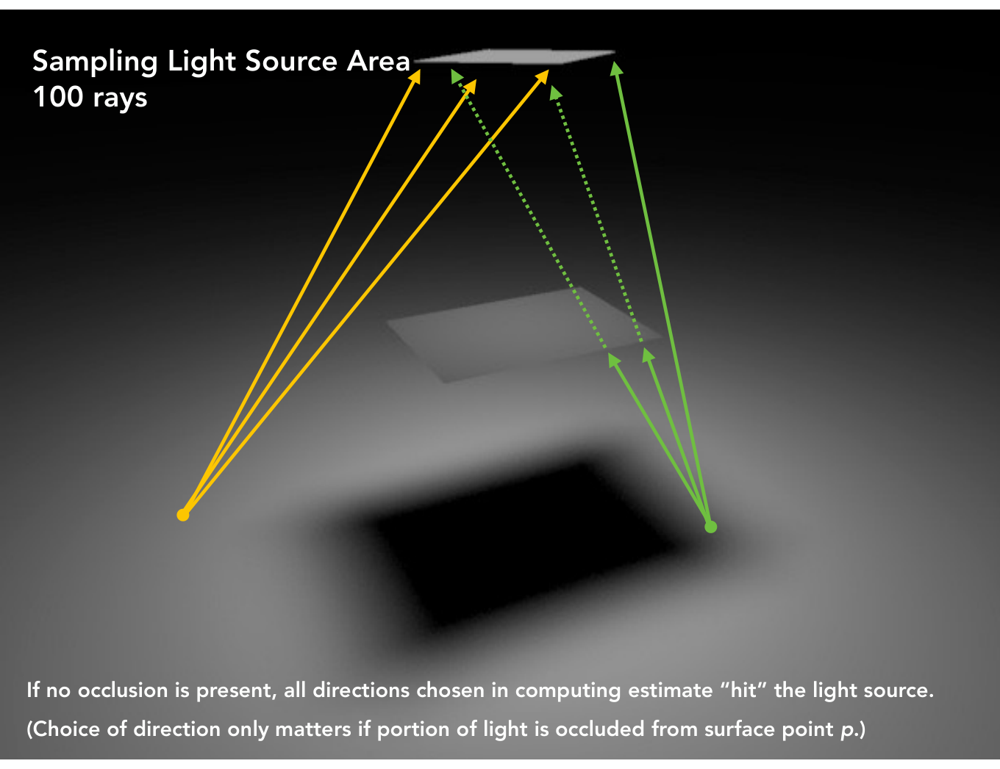

## 第 58 页 · Changing Basis of Integration: Sampling Hemisphere

$$
E(p)=\int_{H^2}L_i(p,\omega)\cos\theta\,d\omega.
$$

## 第 59 页

Changing Basis of Integration: Sampling Light Source Area

Change of variables to integral over area of light

Binary visibility function:

1 if p’ is visible from p, 0 otherwise (accounts for light occlusion)

Outgoing radiance from light point p, in direction w’ towards p

$$
E(p)=\int_{A'} L_o(p',\omega')V(p,p')\frac{\cos\theta\cos\theta'}{\|p-p'\|^2}\,dA',\qquad d\omega=\frac{dA'\cos\theta'}{\|p'-p\|^2}.
$$

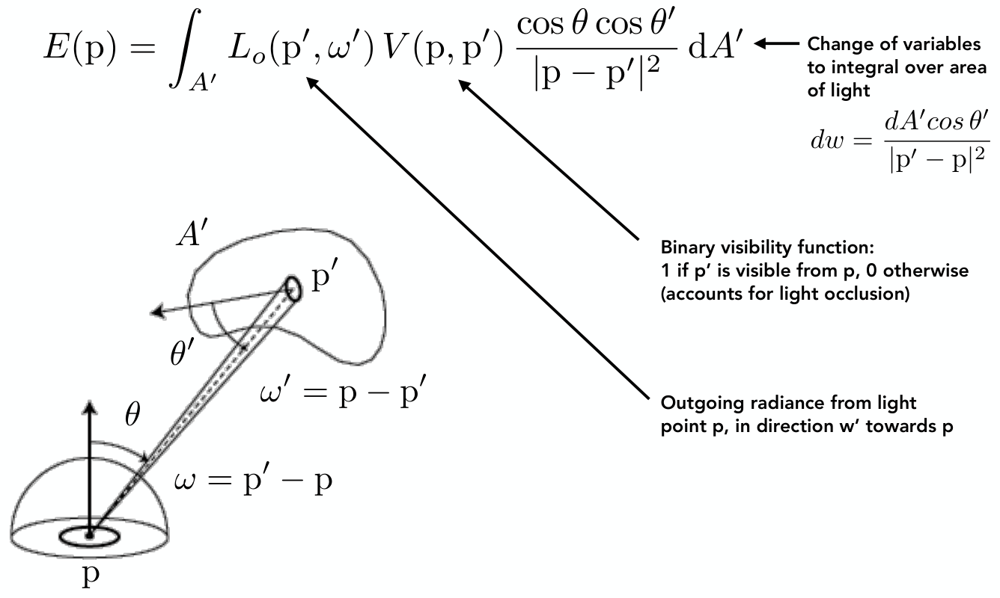

## 第 60 页 · Monte Carlo Estimate by Sampling Light Source Area

Randomly sample light source area A' (assume uniformly over area)

Monte Carlo Estimator

$$
E(p)=\int_{A'} L_o(p',\omega')V(p,p')\frac{\cos\theta\cos\theta'}{\|p-p'\|^2}\,dA'.
$$

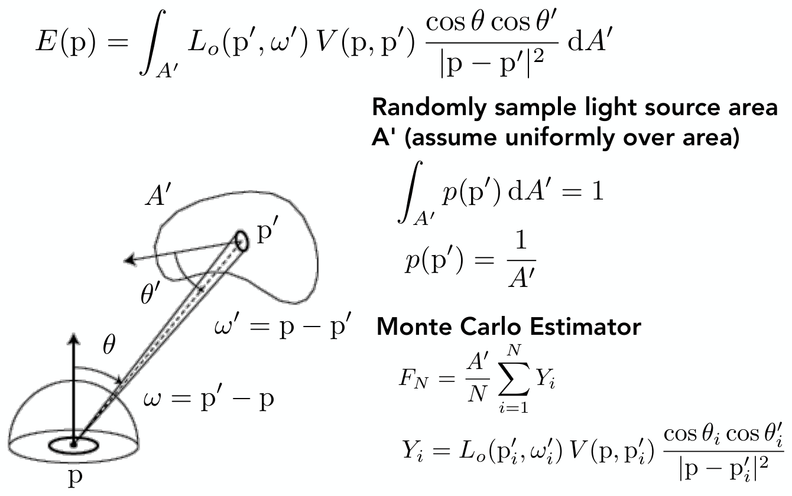

## 第 61 页 · Solid Angle Sampling vs Light Area Sampling

Sampling solid angle

Sampling light source area

100 random directions on hemisphere

100 random points on area of light source

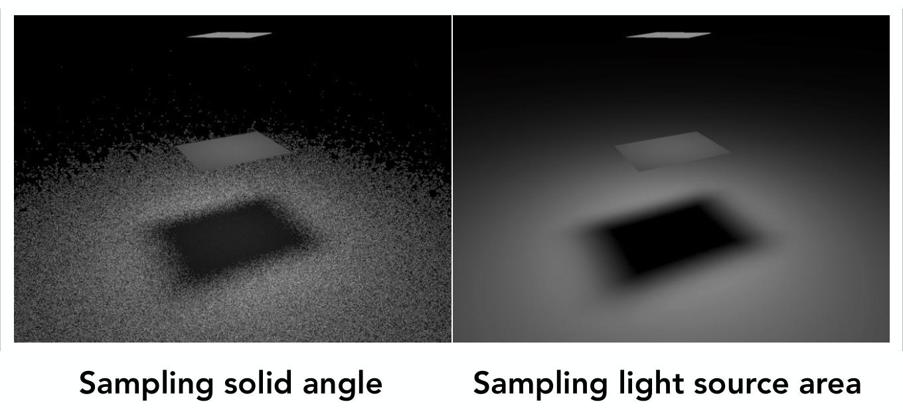

## 第 62 页 · Importance Sampling

Simple idea: sample the integrand according to how much we expect it to contribute to the integral.

Basic Monte Carlo:

()

Inefficient to sample heavily here!

(small contribution to integral)

(xi are sampled uniformly)

complicated integrand

Importance-Sampled Monte Carlo:

(xi are sampled proportional to p)

our best guess for where the integrand is “big”

“If I sample x less frequently, each sample should count for more.”

Note: p(x) must be non-zero where f(x) is non-zero

$$
X_i\sim p(x),\qquad F_N=\frac1N\sum_{i=1}^N\frac{f(X_i)}{p(X_i)}.
$$

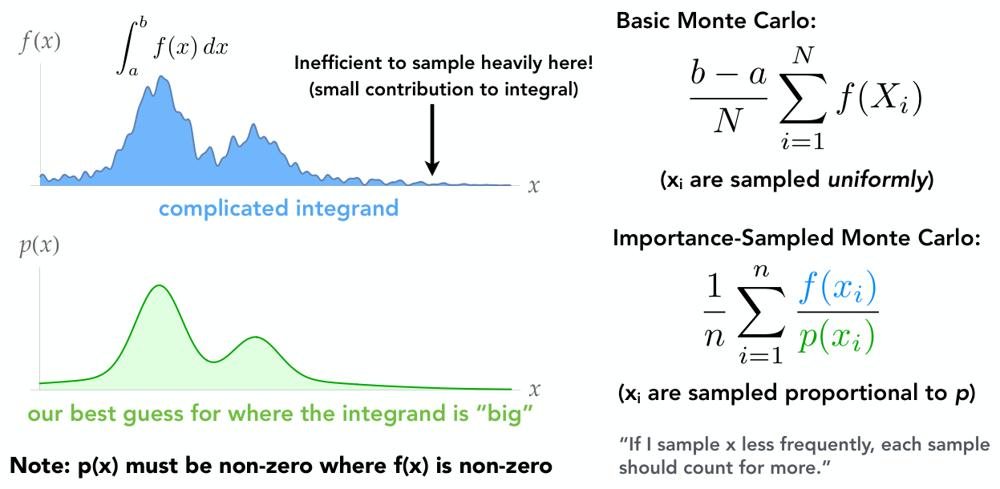

## 第 63 页 · Importance Sampling Can Reduce Variance

()

Q: which of these has higher variance?

p(xi)

Importance sampling reduces variance when your sampling distribution approximates the shape of the integrand.

x1

x2 x3 x4 x5 x6 x7

x1 x2 x3 x4 x5 x6 x7

$$
\operatorname{Var}[Y]=\mathbb E[(Y-\mathbb E[Y])^2].
$$

$$
\operatorname{Var}[F_N]=\frac1N\left(\int\frac{f(x)^2}{p(x)}\,dx-\left(\int f(x)\,dx\right)^2\right).
$$

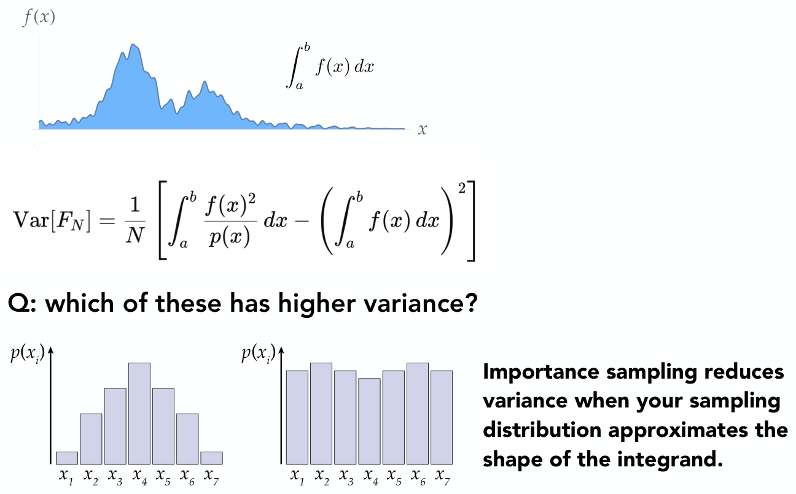

## 第 64 页 · More Importance Sampling — Cosine-Weighted Sampling

Consider uniform hemisphere sampling in irradiance estimate:

$$
E(p)=\int_{H^2}L_i(p,\omega)\cos\theta\,d\omega,\qquad
p(\omega)=\frac1{2\pi},\quad F_N=\frac{2\pi}{N}\sum_{i=1}^N L_i(p,\omega_i)\cos\theta_i.
$$

## 第 65 页 · More Importance Sampling — Cosine-Weighted Sampling

Cosine-weighted hemisphere sampling in irradiance estimate:

cosθ

Idea: bias samples toward directions where

is large (if L is

constant, then these are the directions that contribute most)

$$
p(\omega)=\frac{\cos\theta}{\pi},\qquad F_N=\frac{\pi}{N}\sum_{i=1}^N L_i(p,\omega_i).
$$

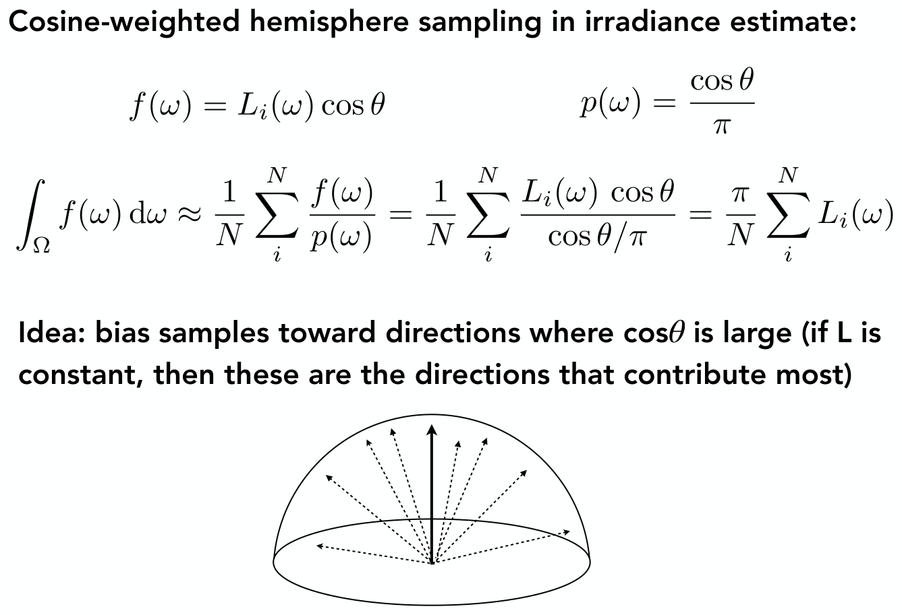

## 第 66 页

So far we’ve considered light coming

directly from light sources, scattered once.

How do we use Monte Carlo integration

to get the final color values for each pixel?

Sampling Light Source Area 100 rays

## 第 67 页 · Indirect Illumination (Irradiance) Estimate

Monte Carlo estimate:

- Generate directions      sampled from some distribution
- Choices for
    - Uniformly sample hemisphere
    - Importance sample BRDF (proportional to BRDF)
    - Importance sample lights (sample position on lights)
- Compute the estimator

$$
F_N=\frac1N\sum_{i=1}^N \frac{f_r(p,\omega_i\to\omega_o)L_i(p,\omega_i)\cos\theta_i}{p(\omega_i)}.
$$

## 第 68 页 · Light Paths

## 第 69 页 · 1-Bounce Path Connecting Ray to Light

Camera

Light

## 第 70 页 · 1-Bounce Paths Connecting Ray to Light

Camera

Light

## 第 71 页 · 2-Bounce Path Connecting Ray to Light

Camera

Light

## 第 72 页 · 2-Bounce Paths Connecting Ray to Light

Camera

Light

## 第 73 页 · 2-Bounce Paths Connecting Ray to Light

文字同第 72 页。

## 第 74 页 · 3-Bounce Paths Connecting Ray to Light

Camera

Light

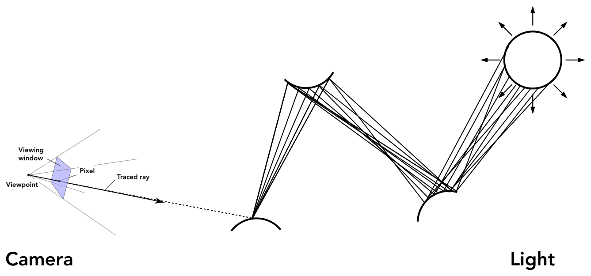

## 第 75 页 · Global Illumination Rendering

Sum over all paths of all lengths

## 第 76 页 · Direct illumination

p

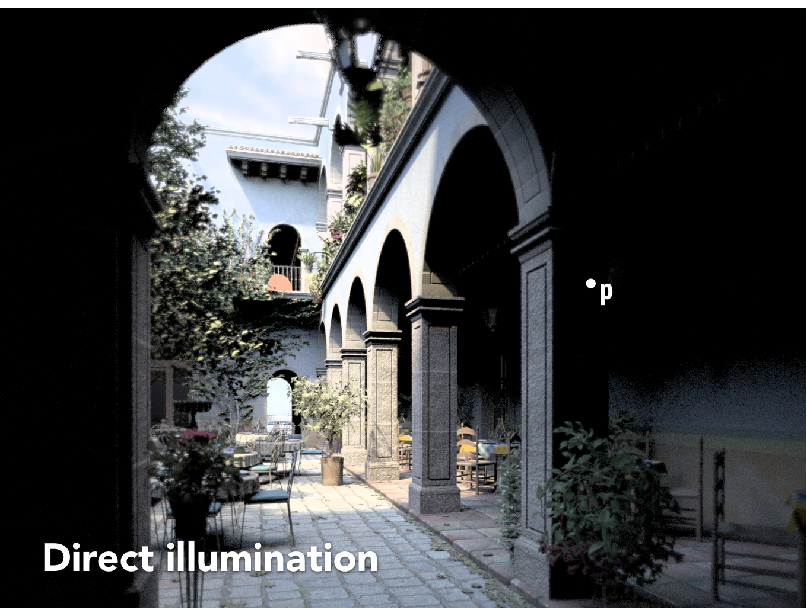

## 第 77 页 · One-bounce global illumination

p

## 第 78 页 · Two-bounce global illumination

p

## 第 79 页 · Four-bounce global illumination

p

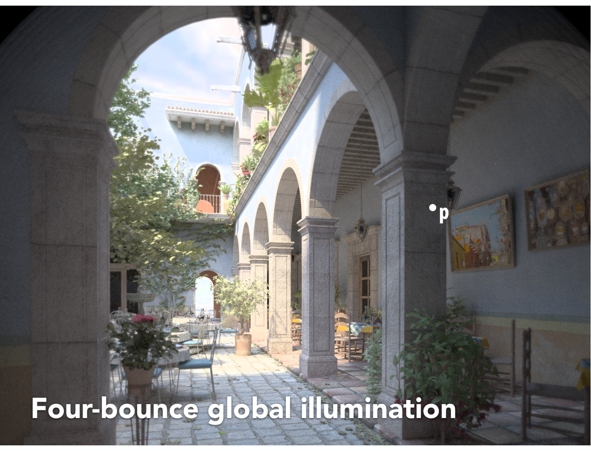

## 第 80 页 · Eight-bounce global illumination

p

## 第 81 页 · Sixteen-bounce global illumination

p

## 第 82 页 · Global Illumination Rendering

Sum over all paths of all lengths

Challenges:

- How to generate all possible paths?
- How to sample space of paths efficiently?

## 第 83 页 · Path Tracing Problem

Problem 1: Explosion of #rays as #bounces go up:

#rays = N#bounces

100 →

10000

1000000 →

inf

10000 →

1000000

1 →

100

Camera

Key observation: #rays will not explode iff N = ?

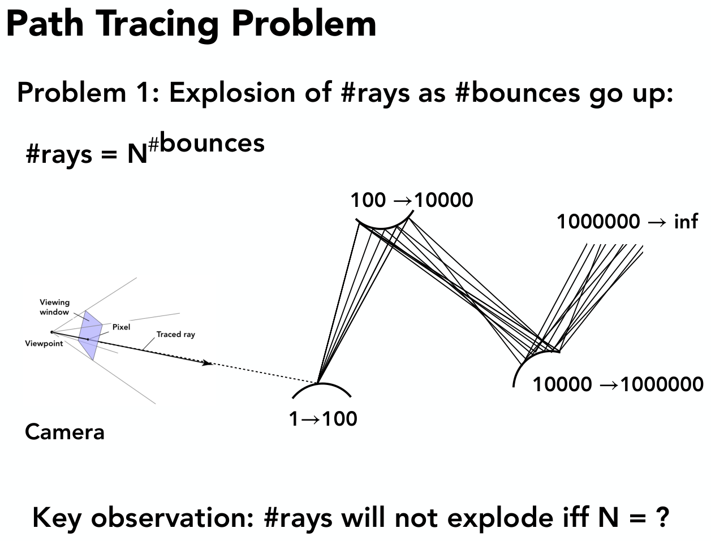

## 第 84 页 · Path Tracing Problem

Solution: only 1 ray is traced at each shading point

#bounces

#rays = N

=1

Camera

## 第 85 页 · One sample (path) per pixel

One sample (path) per pixel

CMU 15-462/662, Fall 2015

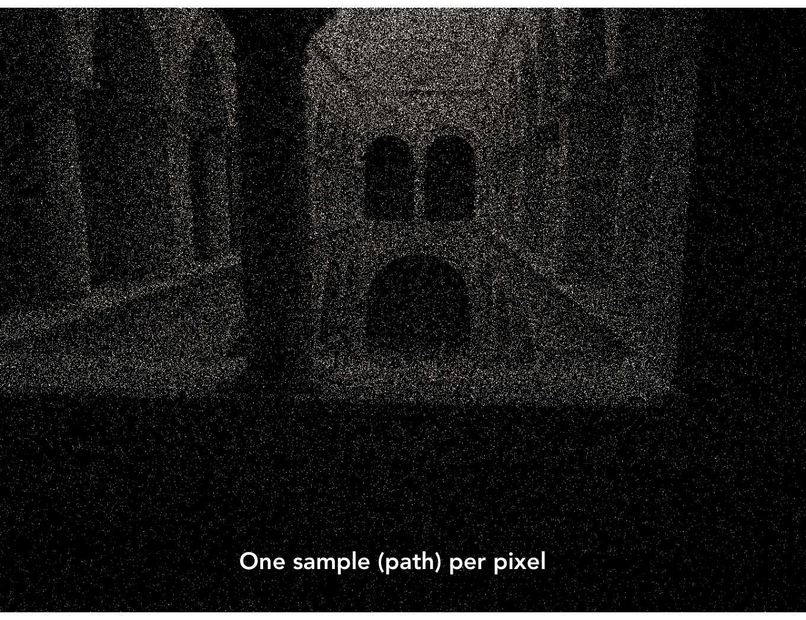

## 第 86 页 · Path Tracing Problem

But, noisy rendering if only one ray is traced

No problem, just trace more paths through each pixel and average their radiance!

pixel

## 第 87 页

32 samples (paths) per pixel

CMU 15-462/662, Fall 2015

## 第 88 页 · 1024 samples (paths) per pixel

1024 samples (paths) per pixel

CMU 15-462/662, Fall 2015

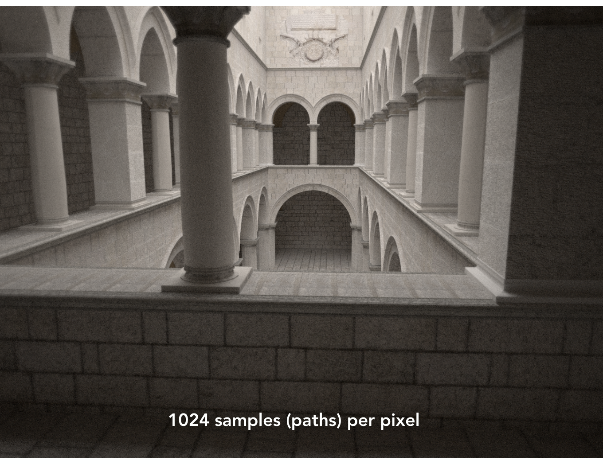

## 第 89 页 · Path Tracing Problem

Problem 2: Infinite Bounces of Light

#bounces →∞

How to integrate over infinite dimensions?

- Note: if energy dissipates, contributions from higher bounces decrease exponentially

Idea: just use N bounces

- Problem: biased!  No matter how many Monte Carlo samples, never see light taking N+1 to infinity bounces

## 第 90 页 · Russian Roulette

- Idea: want to avoid spending time evaluating function for samples that make a small contribution to the final result
- Consider a low-contribution sample of the form:

L = fᵣ(ωᵢ → ωₒ) Lᵢ(ωᵢ) V (p, p′) cos θᵢ

p(ωᵢ)

V (p, p′)

## 第 91 页 · Russian Roulette

L = fᵣ(ωᵢ → ωₒ) Lᵢ(ωᵢ) V (p, p′) cos θᵢ

p(ωᵢ)

L =

V (p, p′)

- If tentative contribution (in brackets) is small, total contribution to the image will be small regardless of

V(p, p′)

- Ignoring low-contribution samples introduces systematic error
    - No longer converges to correct value! (Exact integral)
- Instead, randomly discard low-contribution samples in a way that leaves estimator unbiased

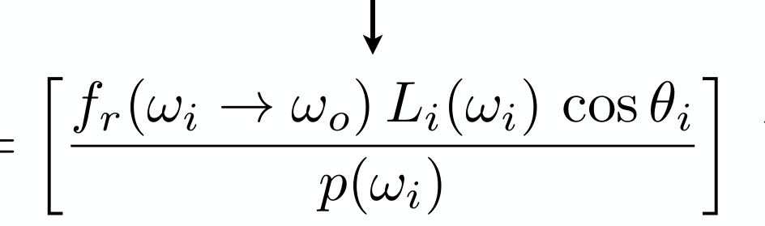

## 第 92 页 · Russian Roulette

- New estimator: evaluate original estimator with probability , reweight. Otherwise ignore.
- Sample expected value as original estimator:

Unbiased!

As

↓, the noise (variance) increases.

$$
X'=\begin{cases}X/p_{\mathrm{rr}},&\text{with probability }p_{\mathrm{rr}},\\0,&\text{with probability }1-p_{\mathrm{rr}},\end{cases}
\qquad \mathbb E[X']=p_{\mathrm{rr}}\frac{\mathbb E[X]}{p_{\mathrm{rr}}}=\mathbb E[X].
$$

## 第 93 页

No Russian roulette: 6.4 seconds

CMU 15-462/662

## 第 94 页

Russian roulette: terminate 50% of all contributions with

luminance less than 0.25: 5.1 seconds

CMU 15-462/662

## 第 95 页

Russian roulette: terminate 50% of all contributions with

luminance less than 0.5: 4.9 seconds

CMU 15-462/662

## 第 96 页

Russian roulette: terminate 90% of all contributions with

luminance less than 0.125: 4.8 seconds

CMU 15-462/662

## 第 97 页

Russian roulette: terminate 90% of all contributions with

luminance less than 1: 3.6 seconds

CMU 15-462/662

## 第 98 页 · Path Tracing Pseudo Code

```text
shade(p, wo)
    # Contribution from the light source.
    Uniformly sample the light at x’ (pdf_light = 1 / A)
    L_dir = L_i * f_r * cos θ * cos θ’ / |x’ - p|^2 / pdf_light

    # Contribution from other reflectors.
    L_indir = 0.0
    Test Russian Roulette with probability P_RR
    Uniformly sample the hemisphere toward wi (pdf_hemi = 1 / 2pi)
    Trace a ray r(p, wi)
    If ray r hit a non-emitting object at q
        L_indir = shade(q, -wi) * f_r * cos θ / pdf_hemi / P_RR

    Return L_dir + L_indir
```

计算一条光路，光路上的每个点包括直接照明和间接照明两部分，光路随机终止。

$$
F_N=\frac{A'}N\sum_{i=1}^N Y_i,\qquad Y_i=L_o(p_i',\omega_i')\,V(p,p_i')\frac{\cos\theta_i\cos\theta_i'}{\lVert p-p_i'\rVert^2}.
$$

$$
\frac1N\sum_{j=1}^N\frac{f_r(p,\omega_j\to\omega_r)L_i(p,\omega_j)\cos\theta_j}{p(\omega_j)}.
$$

## 第 99 页 · Path Tracing Overview

Terminate paths randomly with Russian Roulette

Partition the recursive radiance evaluation. At each point on light path

- Direct lighting – non-recursive, importance sample lights
- Indirect lighting – recursive, importance sample BRDF

Monte Carlo estimate for each partition separately

- Possible to take just one sample for each
- Assume: 100s - 1000s of paths sampled per pixel

## 第 100 页 · Partitioning the Rendering Equation

```text
EstRadianceIn(x, ω)
      = EstRadianceOut(p, –ω)
```

ω

x

−ω

p

## 第 101 页 · Partitioning the Rendering Equation

Need to sum paths going through p representing 0, 1, 2, 3, … bounces of light

x

−ω

p

## 第 102 页 · Partitioning the Rendering Equation

0-bounce: emitted at p toward −ω

x

−ω

p

At p, consider light contributions from paths of varying bounce-length

- 0-bounce: light emitted from p (p is on a light source)

## 第 103 页 · Partitioning the Rendering Equation

1-bounce: from light to p to −ω (“direct lighting”)

x

−ω

p

At p, consider light contributions from paths of varying bounce-length

- 0-bounce: light emitted from p (p is on a light source)
- 1-bounce: from light to p to x (“direct illumination”)

## 第 104 页 · Partitioning the Rendering Equation

&gt;1-bounce: from light to p’ to p to −ω (“indirect lighting”)

x

−ω

p’

p

At p, consider light contributions from paths of varying bounce-length

- 0-bounce: light emitted from p (p is on a light source)
- 1-bounce: from light to p to x (“direct illumination”)
- &gt;1-bounce: from light to at least one other point to p to x (“indirect illumination”)

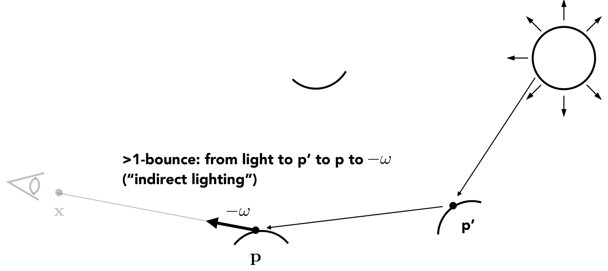

## 第 105 页 · Consider Evaluation of &gt;1 Bounce of Light

p’’

&gt;1-bounce at p to −ω equals ≥ 1-bounce toward p from all other points (e.g. p’ and p’’)

x

−ω

p’

p

At p, consider light contributions from paths of varying bounce-length

- 0-bounce: light emitted from p (p is on a light source)
- 1-bounce: from light to p to x (“direct illumination”)
- &gt;1-bounce: from light to at least one other point to p to x (“indirect illumination”)

## 第 106 页 · Path Tracing Pseudocode

```text
EstRadianceIn(x, ω)            // incoming at x from dir ω
  p = intersectScene(x, ω);
  return ZeroBounceRadiance(p, –ω)
       + AtLeastOneBounceRadiance(p, –ω);
ZeroBounceRadiance(p, ωo)      // outgoing at p in dir ωo
  return p.emittedLight(ωo);
```

## 第 107 页 · Path Tracing Pseudocode

```text
AtLeastOneBounceRadiance(p, ωo)              // out at p, dir ωo
  L = OneBounceRadiance(p, ωo);             // direct illum
  ωi, pdf = p.brdf.sampleDirection(ωo);       // Imp. sampling
  p’ =  intersectScene(p, ωi);
  cpdf = continuationProbability(p.brdf, ωi, ωo);
  if (random01() < cpdf)                  // Russ. Roulette
     L += AtLeastOneBounceRadiance(p’, –ωi)  // Recursive est. of
     * p.brdf(ωi, ωo) * costheta / pdf / cpdf;// indirect illum
   return L;
OneBounceRadiance(p, ωo)       // out at p, dir ωo
   return DirectLightingSampleLights(p, ωo); // direct illum
```

## 第 108 页 · Direct Lighting Pseudocode (Lights)

```text
DirectLightingSamplingLights(p, ωo)
  L, ωi, pdf = lights.sampleDirection(p);   // Imp. sampling
  if (scene.shadowIntersection(p, ωi))      // Shadow ray
     return 0;
  else
     return L * p.brdf(ωi, ωo) * costheta / pdf;
// Note: only one random sample over all lights.
// Assignment 3-1 asks you to, alternatively, loop over
// multiple lights and take multiple samples (later slide)
```

## 第 109 页 · Is Monte Carlo Ray Tracing Correct?

Yes, almost 100% correct, a.k.a. PHOTO-REALISTIC

Global Illumination

Photo

(Path Tracing)

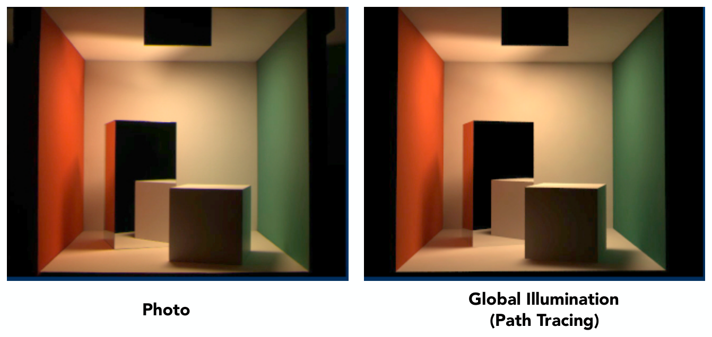

## 第 110 页 · Monte Carlo Ray Tracing — Summary

- Light hitting a point (e.g., pixel) described by rendering equation
    - Expressed as recursive integral
    - Can use Monte Carlo to estimate this integral
    - Need to be intelligent about how to sample!

$$
L_o(p,\omega_o)=L_e(p,\omega_o)+
\int_{H^2} f_r(p,\omega_i\to\omega_o)\,L_i(p,\omega_i)\cos\theta_i\,d\omega_i.
$$
